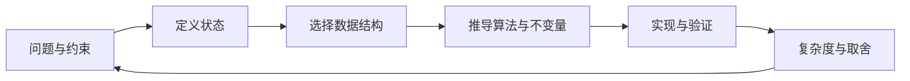
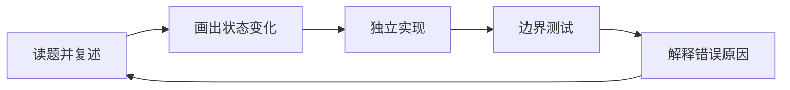

## 这门课要训练什么

> 对应课件第 1–5、8–13 页。本章是课程导读，原课件没有独立 LeetCode 题。讲师经历、求职成果和课堂安排属于背景信息，技术学习应通过自己的代码与测试验证。

这套课程以 Java 讲数据结构与算法，再扩展到面向对象、系统设计、JVM、网络与操作系统。学习目标不是认出题名，而是能把自然语言需求转成可验证的状态、约束和步骤。

- **数据结构回答“把什么存在哪里”**：数组适合索引访问；链表适合已知位置的局部连接；哈希表通过键找值；堆维护当前最值；树表达层级；图表达任意关系。
- **算法回答“按照什么顺序处理”**：DFS 沿一条路径深入，BFS 按距离推进，二分利用单调性，动态规划复用子问题，Dijkstra 按当前最短距离处理状态。
- **分析回答“规模变大后还能不能运行”**：同一个正确答案，可以有指数时间、平方时间或线性时间的实现。选择方法前必须看输入规模。
- **沟通回答“别人怎样知道你做对了”**：先定义输入和输出，再讲不变量与边界，最后写代码。只念代码不能说明为什么正确。

课件中的面试流程示意图表现的是常见流程，并不构成任何公司的固定招聘承诺。课程里涉及的作者排名、过往成果按原课件保留在原图，不用作算法正确性的依据。



## 一道题的完整工作流程

> 对应第 6–7 页。课件把暴力解和手工测试标为 Optional；作为学习习惯，至少在脑中做一次小规模暴力对照和边界验证。

### 1. 先澄清问题，不急着写循环

确认输入是否为空、是否有重复、数值范围、是否可以修改原数据、答案是否唯一，以及返回的是索引还是数值。这些条件会决定算法。例如“找一对数等于目标”若返回原索引，直接排序会丢失位置，必须额外保存索引。

### 2. 写出最直接的正确办法

例如对于每个位置，检查它后面的每个位置。这样不会重复使用同一个元素，也能完整覆盖所有二元组合。总比较数为 `n(n-1)/2`，所以时间 O(n²)，额外空间 O(1)。暴力解不是失败，它给后面的优化一个正确性基准。

### 3. 找到反复付出的成本

暴力法对每个 `x` 都重新寻找 `target-x`。如果把“过去出现过的值及其位置”存起来，就可以把一次线性查找降为平均 O(1)。关键不变量是：处理位置 `i` 前，表中只存 `0..i-1` 的元素；因此不会把 `i` 自己当成另一项。

例如输入 `[2,7,11,15]`、`target=9`，前两步已经找到答案：

| 阶段 | 当前数字 | 需要的数字 | 之前的记录 | 动作 |
|---|---:|---:|---|---|
| i=0 | 2 | 7 | 空 | 保存 2→0 |
| i=1 | 7 | 2 | 2→0 | 找到索引 0 和 1 |

这一步的价值在于解释“为什么先查再放”，而不只是记住 HashMap 模板。完整题解放在[哈希表章节](#/lesson/07)。

### 4. 边实现边说清楚每个容器代表什么

变量名 `seen` 比 `map1` 更能说明语义。明确 `seen` 存的是值到位置的映射，而不是出现次数。一个变量承载多种含义，往往是错误开始的地方。

### 5. 用能推翻思路的例子测试

正例只能说明“这一次碰巧对了”。更值得测试的是空输入、最短合法输入、重复值、负值、极大整数、单边树和无解输入。手动模拟时记录真正的程序状态，不能靠想象跳过步骤。

### 6. 分析复杂度并接受追问

一次扫描加哈希查询通常是平均 O(n) 时间、O(n) 空间。必须注明哈希查询是平均或期望意义；不能把所有哈希操作在所有实现与对抗输入下都说成严格 O(1)。如果输入已排序且只需是否存在，双指针又会成为 O(n) 时间、O(1) 额外空间的合理选项。

## 把“会做”变成“会解释”

课件强调理解 why、识别模式、主动提问与实践。一个可执行的复习循环是：合上答案，独立定义状态；用纸笔追踪一个例子；写完整实现；给出反例解释为什么错误方案不行；最后隔一天重新实现。



| 你能回答的问题 | 说明掌握了什么 |
|---|---|
| 为什么一定会停止？ | 终止条件与严格缩小的问题规模 |
| 为什么没有漏掉解？ | 搜索空间的完整覆盖 |
| 为什么没有重复？ | 去重规则与状态规范化 |
| 为什么返回的是最优解？ | 贪心证明、最短路性质或 DP 最优子结构 |
| 为什么不会越界或溢出？ | 数据范围、类型选择与边界约束 |
| 为什么复杂度是这个量级？ | 访问次数、分支数、状态数和容器操作成本 |

## Java 示例应该怎样运行

后续标记为 LeetCode 的 `class Solution` 是单题提交单元，不要把不同题的多个同名类复制进同一个文件。树题的 `TreeNode`、链表题的 `ListNode` 通常由题目平台提供；本地运行时需自行加上定义。设计题则按题目要求使用 `Trie`、`FileSystem` 等类名。

```java
import java.util.*;

public class Main {
    public static void main(String[] args) {
        Deque<Integer> queue = new ArrayDeque<>();
        queue.offer(10);
        queue.offer(20);
        System.out.println(queue.poll()); // 10
        System.out.println(queue.peek()); // 20，仍留在队列里
    }
}
```

`Deque<Integer>` 是接口类型，`ArrayDeque<>` 是具体实现；尖括号中的 `Integer` 是泛型参数，不能写基本类型 `int`。`<>` 是菱形语法，由左边推断类型。`offer` 从队尾加入，`poll` 删除并返回队首，`peek` 只查看。`poll/peek` 在空队列时返回 `null`；如果自动拆箱成 `int`，就会触发 `NullPointerException`。`ArrayDeque` 不接受 `null` 元素。

把文件命名为 `Main.java`，用 `javac Main.java` 编译，再用 `java Main` 运行。建议统一使用 JDK 21：多数算法实现兼容 Java 8，后面的设计与系统示例还会使用 `List.of`、`record` 等较新特性，并在对应章节说明；不要把所有示例都按 Java 8 编译。基础控制流不逐字重复，泛型、集合、比较器、位运算与并发语义会在题目和[语法手册](#/syntax)中展开。
