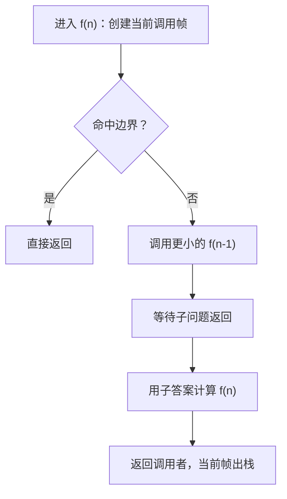
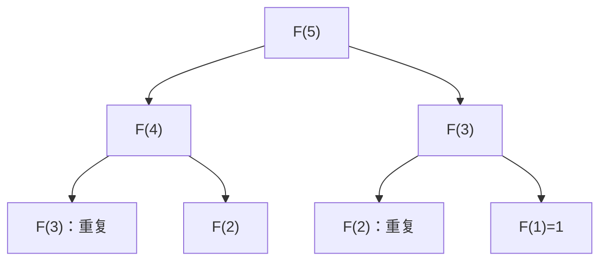
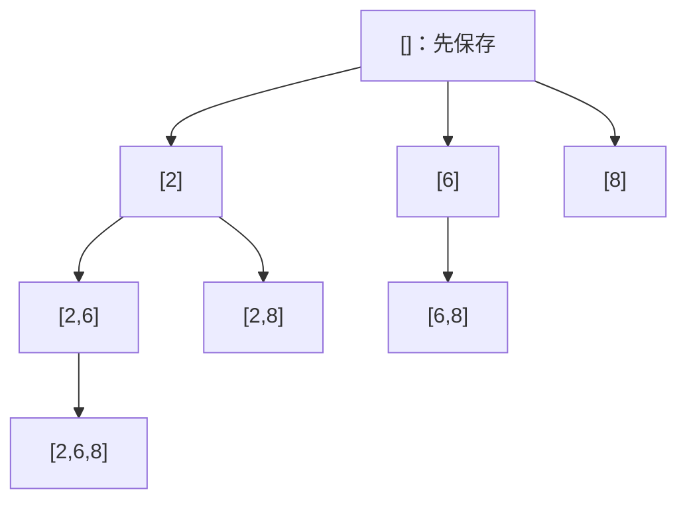

## 递归不是绕圈：先约定子问题的答案

来源：`01-recursion.pdf` 第 1–6、14–20、77–79 页。递归用更小的同类问题解决原问题。写函数之前，先用一句话解释参数和返回值，例如 `factorial(n)` 返回 n!，`search(r,c)` 返回“从这个格子能否到达终点”。然后寻找停止条件，并证明每次递归都向停止条件前进。

递归需要三件事：**状态**说清当前子问题；**base case**直接回答足够小的问题；**递推规则**利用更小问题的答案构造当前答案。参数可分为“定义子问题的输入”与“记录临时结果的路径”；两类参数不能混淆。只用下标就能描述后缀时，不必不断复制数组。



栈帧保存这一层的参数、局部变量和返回位置。子函数返回以后，程序会从调用语句后继续执行，而不是重新从函数头开始。回溯是建立在递归上的“尝试选择→探索→撤销选择”；不是所有递归都需要撤销。整数参数按值传递，各层独立；共享列表/数组被修改以后，兄弟分支会看见，才需要恢复或复制。

课件总结中的三种合并方式，应按实际语义理解：单一子问题如阶乘；存在任一分支成功就足够如迷宫，用 OR；所有分支都需要探索如排列与组合，是**收集答案**，不意味着简单写布尔 AND。需要同时满足左右条件的对称/平衡树，才是布尔 AND 的自然例子。

## Java 回溯代码中要真正理解的语法

后文均为 Java 8+。每个 `class Solution` 是独立提交，不要把多个同名类粘到一个文件里。`import java.util.*` 引入集合等工具类，不自动引入其他子包。`List<T>` 是接口，`ArrayList<T>` 是动态数组实现；`List<List<Integer>>` 是一个“元素本身又是整数列表”的列表。`<>` 是菱形运算符，让编译器根据左侧推断泛型实参。集合泛型不能写原始类型 int，需 Integer；向 List<Integer> 加入 int 时自动装箱，取出参与算术时自动拆箱。

|语法/API|含义|回溯中为什么重要|
|---|---|---|
|`new ArrayList<>(path)`|复制容器内元素引用|保存当下快照，后续 remove 不改变已保存答案|
|`path.add(x)`|末尾加入 x，均摊 O(1)|做出选择|
|`path.remove(path.size()-1)`|按 int 下标删除最后元素|精确撤销刚才的选择；不要误写成按值删除|
|`list.add(pos,x)`|在 pos 插入并移动后续元素|插入法全排列的单次插入 O(n)|
|`Arrays.sort(a)`|原地升序排序|让相等元素相邻，帮助同层去重，会改变输入|
|`a.clone()` / `Arrays.copyOf(a,n)`|复制数组|保护原输入或生成子数组；不等于仅复制引用|
|`StringBuilder`|可变字符缓冲区|append 后探索、删末尾后恢复|
|`builder.toString()`|生成字符串快照|避免答案随下一步修改|
|`&&`、`||`|短路逻辑|越界检查失败后不再访问数组；存在解后可停止|

上述 ArrayList 操作和复制语义可对照 [Java 8 ArrayList 文档](https://docs.oracle.com/javase/8/docs/api/java/util/ArrayList.html)。所有复制都需要计入复杂度；返回 n! 条长 n 的排列本身就要 Ω(n·n!) 的输出量。

<a id="factorial"></a>
## 课堂题 · Factorial：只有一个子问题

来源：第 7–9、20 页。求非负整数 n 的阶乘，定义 0!=1，n!=n×(n−1)!。课件只写 n=1 的边界，会让 n=0 继续递归到负数；以下补齐非负定义，并限制 long 能准确表示的范围 0…20。

|调用|等待的子问题|返回计算|
|---|---|---|
|factorial(4)|factorial(3)|4×6=24|
|factorial(3)|factorial(2)|3×2=6|
|factorial(2)|factorial(1)|2×1=2|
|factorial(1)|不再递归|1|

```java
class Solution {
    public long factorial(int n) {
        if (n < 0 || n > 20) throw new IllegalArgumentException("n must be 0..20");
        return calculate(n);
    }
    private long calculate(int n) {
        if (n <= 1) return 1L;
        return n * calculate(n - 1);
    }
    public long factorialIterative(int n) {
        if (n < 0 || n > 20) throw new IllegalArgumentException("n must be 0..20");
        long product = 1L;
        for (int i = 2; i <= n; i++) product *= i;
        return product;
    }
}
```

`1L` 是 long 字面量；递归返回 long，使乘法按 long 运算。`throw new IllegalArgumentException` 明确拒绝超出方法契约的参数；更大 n 可换 BigInteger。递归与迭代都 O(n) 时间，递归栈 O(n)，迭代额外空间 O(1)。Java 不保证尾调用优化，因此不能因为函数末尾调用自己就忽略栈。

<a id="lc-509"></a>
## LC 509 · Fibonacci：分支重复了什么

来源：第 10–13 页。[官方题目](https://leetcode.com/problems/fibonacci-number/)。F(0)=0，F(1)=1，F(n)=F(n−1)+F(n−2)。直接递归很好地表达数学定义，却反复计算相同参数。F(5) 的两边都需要 F(3)，更下层重复更多。



|n|0|1|2|3|4|5|
|---|---:|---:|---:|---:|---:|---:|
|F(n)|0|1|1|2|3|5|

```java
class Solution {
    public int fib(int n) {
        Integer[] memo = new Integer[n + 1];
        return solve(n, memo);
    }
    private int solve(int n, Integer[] memo) {
        if (n < 2) return n;
        if (memo[n] != null) return memo[n];
        memo[n] = solve(n - 1, memo) + solve(n - 2, memo);
        return memo[n];
    }
}
```

Integer[] 默认元素为 null，用它表示“尚未计算”；int[] 的默认 0 容易与合法 F(0) 混淆。`return memo[n]` 自动拆箱。每个 n 最多计算一次，时间 O(n)、缓存与栈 O(n)；课件无缓存版本时间 O(φ^n)、栈 O(n)，不是 O(2^n) 栈。n=0/1 直接返回。如何消除栈并压缩到 O(1) 额外空间见 [DP Fibonacci](#/lesson/04?section=lc-509)。

<a id="lc-70"></a>
## 预备练习 LC 70 · Climbing Stairs

来源：第 6 页列举。[官方题目](https://leetcode.com/problems/climbing-stairs/)。一次走1阶或2阶，求走到 n 阶的不同方法数。按最后一步分类：从 n−1 走1阶，或从 n−2 走2阶，两类互斥且覆盖全部方案，因此 ways(n)=ways(n−1)+ways(n−2)。边界 ways(0)=1 表示空动作序列，ways(1)=1。

|阶数|0|1|2|3|4|
|---|---:|---:|---:|---:|---:|
|方法数|1|1|2|3|5|
|3阶的方案| | | |111、12、21| |

```java
class Solution {
    public int climbStairs(int n) {
        int a = 1, b = 1;
        for (int i = 2; i <= n; i++) {
            int next = a + b;
            a = b;
            b = next;
        }
        return b;
    }
}
```

这与 Fibonacci 递推相同，但初值不同，不能照抄 F(0)=0。临时变量 next 保存旧 a+b 后再移动窗口；无特殊库 API。时间 O(n)，空间 O(1)。LeetCode 的 n≤45 确保 int 足够。

<a id="lc-89"></a>
## LC 89 · Gray Code：镜像扩展为什么正确

来源：第 21–31 页。[官方题目](https://leetcode.com/problems/gray-code/)。生成长度 2^n 的序列，包含 n 位范围内每个整数一次，从0开始，相邻两个数只有一位不同，首尾也满足这一条件。课件允许 n=0，当前官方题从1开始；算法自然支持 n=0 返回 `[0]`。

从 n−1 位答案构造 n 位：原列表前面补0；把原列表倒序后前面补1，再接到后面。原半段内部已经合法；新半段倒序不改变相邻关系；两半连接处低位完全相同，只变最高位；首尾低位都为0，也只差最高位。

|构造阶段|前半段|后半段（倒序加最高位）|结果|
|---|---|---|---|
|0位|0|无|[0]|
|1位|0|1|[0,1]|
|2位|00,01|11,10|[0,1,3,2]|
|3位|000,001,011,010|110,111,101,100|[0,1,3,2,6,7,5,4]|

```java
import java.util.ArrayList;
import java.util.List;
class Solution {
    public List<Integer> grayCode(int n) {
        List<Integer> answer = new ArrayList<>();
        answer.add(0);
        for (int bit = 0; bit < n; bit++) {
            int high = 1 << bit;
            int oldSize = answer.size();
            for (int j = oldSize - 1; j >= 0; j--) {
                answer.add(answer.get(j) | high);
            }
        }
        return answer;
    }
}
```

`1 << bit` 将1左移 bit 位，即2^bit；`| high` 设置新最高位，旧数这一位全为0，所以也可写 `+ high`。oldSize 必须在追加前保存，遍历的只是原半段；反向扫描保证连接处只变一位。课件递归版先调用 helper(n−1)，返回时做同样的镜像；这里只有一条递归链，迭代正好把“返回过程”显式写成循环。时间 O(2^n)，结果空间 O(2^n)，迭代工作空间 O(1)。别把“一个子问题”误认为 O(n)：每层合并要扩展指数数量的输出。

<a id="lc-50"></a>
## LC 50 · Pow(x,n)：快速幂与负指数溢出

来源：第 32–36 页。[官方题目](https://leetcode.com/problems/powx-n/)。计算 x^n，n 可负。逐次乘 x 需要 O(|n|)；把指数二分，只求一次较小问题 `half=x^(n/2)`，偶数返回 half²，奇数再乘 x。若分别求两次 half，重复调用会把对数优势丢掉。

|求 2^9 的调用|子结果|当前结果|
|---|---:|---:|
|power(2,0)|边界|1|
|power(2,1)|1|1×1×2=2|
|power(2,2)|2|2×2=4|
|power(2,4)|4|4×4=16|
|power(2,9)|16|16×16×2=512|

```java
class Solution {
    public double myPow(double x, int n) {
        long exponent = n;
        if (exponent < 0) {
            x = 1.0 / x;
            exponent = -exponent;
        }
        return power(x, exponent);
    }
    private double power(double x, long n) {
        if (n == 0) return 1.0;
        double half = power(x, n / 2);
        double square = half * half;
        return n % 2 == 0 ? square : square * x;
    }
}
```

**课件修正：**int 最小值 −2147483648 取负仍然溢出，不能写 `myPow(1/x,-n)`。必须先 `long exponent=n` 再取负；`long exponent=-n` 仍先在 int 范围里取负，来不及补救。1.0 明确使用 double 除法；`%2` 判奇偶；三元表达式只选择所需结果。时间和栈均 O(log|n|)。n=0 返回1，负指数通过倒数处理；浮点数有舍入误差，测试应使用容差。题目排除了无定义的0的非正次幂情形。

<a id="maze-reachability"></a>
## 课堂题 · 迷宫可达性与路径返回

来源：第 37–48 页。给字符矩阵，`X` 是墙，其余可通行，允许上下左右一步，判断起点是否能到终点，并扩展为返回一条路径。先做合法性检查，再判断是否抵达终点；否则“终点本身是墙”也可能被误报成功。

课件6×6例子，从 (0,0) 到 (5,5) 一条路线是 `(0,0)→(1,0)→(1,1)→(1,2)→(0,2)→(0,3)→(0,4)→(1,4)→(2,4)→(3,4)→(4,4)→(5,4)→(5,5)`。DFS 按下、右、上、左探索时，先进入 (2,2) 的死路，再退回 (1,2) 向上走。

|到达状态|尝试|结果|
|---|---|---|
|(1,2)|向下到(2,2)|其余邻居被墙或已访问挡住|
|(2,2)|四向都失败|回到(1,2)，撤销路径中的D|
|(1,2)|向右墙，向上(0,2)|继续探索新分支|
|(5,5)|目标合法且可达|逐层保留成功路径并返回|

```java
import java.util.ArrayList;
import java.util.List;
class Solution {
    private final int[] dr = {1, 0, -1, 0};
    private final int[] dc = {0, 1, 0, -1};
    private final char[] move = {'D', 'R', 'U', 'L'};
    public boolean canReach(char[][] maze, int sr, int sc, int tr, int tc) {
        if (maze.length == 0 || maze[0].length == 0) return false;
        return dfs(maze, sr, sc, tr, tc,
                   new boolean[maze.length][maze[0].length], new ArrayList<>());
    }
    public List<Character> findPath(char[][] maze, int sr, int sc, int tr, int tc) {
        List<Character> path = new ArrayList<>();
        if (maze.length == 0 || maze[0].length == 0) return null;
        boolean found = dfs(maze, sr, sc, tr, tc,
                new boolean[maze.length][maze[0].length], path);
        return found ? path : null;
    }
    private boolean dfs(char[][] maze, int r, int c, int tr, int tc,
                        boolean[][] seen, List<Character> path) {
        if (r < 0 || r >= maze.length || c < 0 || c >= maze[0].length
                || maze[r][c] == 'X' || seen[r][c]) return false;
        if (r == tr && c == tc) return true;
        seen[r][c] = true;
        for (int k = 0; k < 4; k++) {
            path.add(move[k]);
            if (dfs(maze, r + dr[k], c + dc[k], tr, tc, seen, path)) return true;
            path.remove(path.size() - 1);
        }
        return false;
    }
}
```

方向数组三者同下标配对；`final` 表示数组引用不重新指向另一数组，并不让数组内容不可变。findPath 返回 null 表示不可达，空列表表示起终点相同且合法，区分两种情况。path 需要撤销，而 seen 不恢复：这里仅求任意可达路径，已完整探索的格子无需重搜；Word Search 的历史占用会影响后续合法性，所以其 visited 语义不同。

第44–45页把访问标记直接写为墙可省 boolean 数组，但会修改输入，调用栈仍最坏 O(RC)，不能称总空间 O(1)。第46页 `newY >= maze.length` 把列数写成行数，在非方形矩阵会错；应为 `maze[0].length`。第47页用不可变 String 拼接路径，分支不会互相污染，但每次复制前缀可能增加总耗时。当前解时间 O(RC)，seen和最坏栈/路径 O(RC)，返回的路径不保证最短。

<a id="lc-46"></a>
## LC 46 · Permutations：位置选择与插入构造

来源：第 49–55 页。[官方题目](https://leetcode.com/problems/permutations/)。输入互不相同的整数，输出每个元素恰好出现一次的所有排列。排列关心顺序；`[1,2]` 和 `[2,1]` 是不同答案。

课件的插入法先求 n−1 个数的所有排列，再把最后一个数插入每个排列的 n 个位置。例如已有 `[1,2]`，插入3得到 `[3,1,2]、[1,3,2]、[1,2,3]`；对 `[2,1]` 同理得到另3个。下面按“下一个位置放哪个未用元素”回溯，同一搜索空间更容易推广到去重。

|path|used 的真下标|可选下一项|
|---|---|---|
|[]|无|1,2,3|
|[1]|0|2,3|
|[1,2]|0,1|3|
|[1,2,3]|0,1,2|保存快照，撤销3|
|回到[1]|0|继续选择3，再2|

```java
import java.util.ArrayList;
import java.util.List;
class Solution {
    public List<List<Integer>> permute(int[] nums) {
        List<List<Integer>> answer = new ArrayList<>();
        dfs(nums, new boolean[nums.length], new ArrayList<>(), answer);
        return answer;
    }
    private void dfs(int[] nums, boolean[] used, List<Integer> path,
                     List<List<Integer>> answer) {
        if (path.size() == nums.length) {
            answer.add(new ArrayList<>(path));
            return;
        }
        for (int i = 0; i < nums.length; i++) {
            if (used[i]) continue;
            used[i] = true;
            path.add(nums[i]);
            dfs(nums, used, path, answer);
            path.remove(path.size() - 1);
            used[i] = false;
        }
    }
}
```

used 标记**下标**而非值；path.size() 就是待填位置。new ArrayList 快照必要；做选择与撤销顺序要严格对应。课件 `Arrays.copyOf(nums,nums.length-1)` 真正复制前缀数组，`newPerm.add(pos,last)` 会移动原pos后面的内容。两个版本时间 O(n·n!)，输出 O(n·n!)，本回溯工作空间 O(n)。本版本空输入自然产生一个空排列；课件仅 length==1 的边界对空输入不适用。

<a id="lc-47"></a>
## LC 47 · Permutations II：重复值只固定一种相对顺序

来源：第 56–57 页。[官方题目](https://leetcode.com/problems/permutations-ii/)。数字**可能重复**，返回不重复排列。课件题干的 distinct 是笔误。排序后，把两个相同的1暂时叫1a、1b：强制当前路径中1a在1b前出现，就能消除只交换同值下标造成的重复。

|nums=[1a,1b,2] 的选择|判断|
|---|---|
|根先选1a|允许|
|根先选1b，1a未用|跳过，和先选1a等价|
|path=[1a] 再选1b|允许，前一个相同值已经占用|
|path=[2] 选1a后选1b|得到[2,1,1]|

```java
import java.util.ArrayList;
import java.util.Arrays;
import java.util.List;
class Solution {
    public List<List<Integer>> permuteUnique(int[] nums) {
        nums = nums.clone();
        Arrays.sort(nums);
        List<List<Integer>> answer = new ArrayList<>();
        dfs(nums, new boolean[nums.length], new ArrayList<>(), answer);
        return answer;
    }
    private void dfs(int[] a, boolean[] used, List<Integer> path,
                     List<List<Integer>> answer) {
        if (path.size() == a.length) {
            answer.add(new ArrayList<>(path));
            return;
        }
        for (int i = 0; i < a.length; i++) {
            if (used[i]) continue;
            if (i > 0 && a[i] == a[i - 1] && !used[i - 1]) continue;
            used[i] = true;
            path.add(a[i]);
            dfs(a, used, path, answer);
            path.remove(path.size() - 1);
            used[i] = false;
        }
    }
}
```

`!used[i-1]` 精确表示“相同的前一个下标还没有成为当前路径的一部分”，不是禁止所有相同值。clone 后排序避免改动调用者数组。第57页是特殊的“当前层保留交换结果、传给子调用的是列表副本”变体：有序后缀的结构让同值候选连续出现，不能把它和通常的原地交换回溯混用。`list.set(i,x)`替换一个位置，不会插入或移动其他元素。`Integer == Integer`比较对象引用，不是一般意义上的数值比较；通用写法应使用`.equals`或先拆箱为int。若改成通常的原地交换方法，则应每层用HashSet记录已经尝试的值，并在子调用后交换回来。最坏时间 O(n·n!)，工作空间 O(n)，实际输出条数是 `n!/(c1!c2!...)`。

<a id="lc-78"></a>
## LC 78 · Subsets：每个搜索节点都是答案

来源：第 58–63、80 页。[官方题目](https://leetcode.com/problems/subsets/)。课件称 Combination，实际要求全部子集（幂集），而不是固定大小 k 的组合。对每个元素选/不选共有 2^n 种决定，空集也必须出现。

两种等价搜索：二叉决策树在 index==n 时保存；或者每次选择“下一个被加入的下标”，在**每次进入函数时保存当前集合**。后者保持下标递增，排除 `[6,2]` 对 `[2,6]` 的重复。



```java
import java.util.ArrayList;
import java.util.List;
class Solution {
    public List<List<Integer>> subsets(int[] nums) {
        List<List<Integer>> answer = new ArrayList<>();
        dfs(nums, 0, new ArrayList<>(), answer);
        return answer;
    }
    private void dfs(int[] nums, int start, List<Integer> path,
                     List<List<Integer>> answer) {
        answer.add(new ArrayList<>(path));
        for (int i = start; i < nums.length; i++) {
            path.add(nums[i]);
            dfs(nums, i + 1, path, answer);
            path.remove(path.size() - 1);
        }
    }
}
```

递归参数 i+1 表示这个下标不能再次使用。第61–62页只在 index==n 保存循环式搜索，**不只是漏空集**，还漏掉所有不以最后一个元素结束的子集，例如 `[2]、[6]、[2,6]`；输出会只剩包含最后元素的部分。当前算法进入就保存，覆盖8个答案。时间 O(n2^n)，输出 O(n2^n)，工作空间 O(n)。

<a id="lc-39"></a>
## LC 39 · Combination Sum：同一元素可重复取

来源：第 64–70 页，课件题名 Knapsack。[官方题目](https://leetcode.com/problems/combination-sum/)。候选为互不相同的正整数，每个可用无限次，返回总和等于 target 的所有不重复组合。状态 `(start,remain,path)` 表示只能使用 start及之后的数，当前还差 remain。

|candidates=[2,3,6,7], target=7|remain|处理|
|---|---:|---|
|[]|7|先选2|
|[2]|5|允许再次选2|
|[2,2]|3|再选2剩1无解；改选3|
|[2,2,3]|0|保存|
|回到根选7|0|保存[7]|

```java
import java.util.ArrayList;
import java.util.Arrays;
import java.util.List;
class Solution {
    public List<List<Integer>> combinationSum(int[] candidates, int target) {
        int[] a = candidates.clone();
        Arrays.sort(a);
        List<List<Integer>> answer = new ArrayList<>();
        dfs(a, 0, target, new ArrayList<>(), answer);
        return answer;
    }
    private void dfs(int[] a, int start, int remain, List<Integer> path,
                     List<List<Integer>> answer) {
        if (remain == 0) {
            answer.add(new ArrayList<>(path));
            return;
        }
        for (int i = start; i < a.length; i++) {
            if (a[i] > remain) break;
            path.add(a[i]);
            dfs(a, i, remain - a[i], path, answer);
            path.remove(path.size() - 1);
        }
    }
}
```

递归传 i 而不是 i+1，允许重用当前候选；仍然不回到更小下标，所以 `[2,2,3]` 不会以 `[3,2,2]` 重复出现。排序后 `a[i]>remain` 时后面都更大，可用 break；未排序时只能 continue。课件的选/不选法对应 `(i,remain-a[i])` 与 `(i+1,remain)`，也正确。正数条件保证 remain 严格减少；若允许0，选0会无限递归。令 D=target/min(a)，树深≤D，宽松时间界 O(n^D·D)，工作空间 O(D+n)，输出另计；不能称为普通 O(n·target) 背包，因为这里枚举全部组合。

<a id="lc-40"></a>
## LC 40 · Combination Sum II：每个下标只能选一次

来源：第 71–73 页。[官方题目](https://leetcode.com/problems/combination-sum-ii/)。候选可能重复，但每个位置最多一次，输出仍不能有重复组合。两处改动：递归传 i+1；排序后同层遇到重复值，跳过除第一个以外的分支。

|nums=[2a,2b,3,7], target=9|动作|
|---|---|
|根选2a|可以再选2b，但2+2+3=7不足，最终[2,7]成功|
|根选2b|与根选2a的值分支重复，跳过|
|path=[2a] 选2b|不同层，允许，体现存在两个2|
|根选3或7|都无法合法凑9|

```java
import java.util.ArrayList;
import java.util.Arrays;
import java.util.List;
class Solution {
    public List<List<Integer>> combinationSum2(int[] candidates, int target) {
        int[] a = candidates.clone();
        Arrays.sort(a);
        List<List<Integer>> answer = new ArrayList<>();
        dfs(a, 0, target, new ArrayList<>(), answer);
        return answer;
    }
    private void dfs(int[] a, int start, int remain, List<Integer> path,
                     List<List<Integer>> answer) {
        if (remain == 0) {
            answer.add(new ArrayList<>(path));
            return;
        }
        for (int i = start; i < a.length; i++) {
            if (i > start && a[i] == a[i - 1]) continue;
            if (a[i] > remain) break;
            path.add(a[i]);
            dfs(a, i + 1, remain - a[i], path, answer);
            path.remove(path.size() - 1);
        }
    }
}
```

`i>start` 只做同层去重；若写 i>0 会连合法 `[2,2,...]` 都删掉。课件在循环末尾用 while 跳过重复值，是同一思想，只是写法不同。每个下标最多取一次，深度 n；宽松时间 O(n2^n)，工作空间 O(n)，输出另计。目标为0的扩展返回一个空组合。

<a id="knapsack-exact"></a>
## 课堂题 · 0–1 背包恰好装满：存在性递归

来源：第 74–76 页。给正整数重量数组，每件最多取一次，能否恰好凑成 s？它不要求列出全部方案，只需一个 true。状态 `(index,remain)`：前 index 件已经决定，只能从后面选择。

|s=20，weights=[14,8,7,5,3]|剩余|
|---|---:|
|跳过14|20|
|选8|12|
|选7|5|
|选5|0，成功|

```java
class Solution {
    public boolean knapsack(int s, int[] weights) {
        if (s < 0) return false;
        Boolean[][] memo = new Boolean[weights.length + 1][s + 1];
        return solve(weights, 0, s, memo);
    }
    private boolean solve(int[] w, int i, int remain, Boolean[][] memo) {
        if (remain == 0) return true;
        if (remain < 0 || i == w.length) return false;
        if (memo[i][remain] != null) return memo[i][remain];
        boolean found = solve(w, i + 1, remain - w[i], memo)
                || solve(w, i + 1, remain, memo);
        memo[i][remain] = found;
        return found;
    }
}
```

Boolean[][] 的 null 区分“未知”和 false；负 remain 在访问缓存前被挡住。先选后不选只影响找到答案的速度，不影响正确性；OR 短路找到一种方案便停止。课件无缓存有 O(2^n) 时间，当前至多 (n+1)(s+1) 个状态，时间/缓存 O(ns)，栈 O(n)。s=0 即使没有物品也为 true；如果重量可能为负，remain<0 剪枝和以 s 为范围的缓存都不再适用。

<a id="lc-17"></a>
## 选做 LC 17 · Letter Combinations of a Phone Number

来源：第 80 页。[官方题目](https://leetcode.com/problems/letter-combinations-of-a-phone-number/)。输入2–9的数字串，按电话键盘映射为字母，返回每位任选一个字母的所有字符串。第 index 位的分支只由该数字对应的字母决定，各位独立。

|digits="23"|生成过程|
|---|---|
|第0位选a|ad,ae,af|
|第0位选b|bd,be,bf|
|第0位选c|cd,ce,cf|

```java
import java.util.ArrayList;
import java.util.List;
class Solution {
    private final String[] letters = {"", "", "abc", "def", "ghi", "jkl",
                                      "mno", "pqrs", "tuv", "wxyz"};
    public List<String> letterCombinations(String digits) {
        List<String> answer = new ArrayList<>();
        if (digits.isEmpty()) return answer;
        dfs(digits, 0, new StringBuilder(), answer);
        return answer;
    }
    private void dfs(String digits, int index, StringBuilder path,
                     List<String> answer) {
        if (index == digits.length()) {
            answer.add(path.toString());
            return;
        }
        String choices = letters[digits.charAt(index) - '0'];
        for (int i = 0; i < choices.length(); i++) {
            path.append(choices.charAt(i));
            dfs(digits, index + 1, path, answer);
            path.deleteCharAt(path.length() - 1);
        }
    }
}
```

`digits.charAt(index)-'0'` 利用数字字符连续编码转为0…9下标，不是解析整个字符串。StringBuilder append/删除配对，toString 保存不可变快照。空输入按常用扩展返回空列表，非空前提下每个答案长 n。若有 a 位对应3字母、b位对应4字母，结果3^a4^b，时间 O(n3^a4^b)，工作空间 O(n)。

<a id="lc-51"></a>
## 选做 LC 51 · N-Queens：用约束直接剪枝

来源：第 6、77、80 页的八皇后/N皇后。[官方题目](https://leetcode.com/problems/n-queens/)。在 n×n 棋盘放 n 个皇后，任意两枚不同行、不在同列、不在同一对角线，返回所有棋盘。每层处理一行，天然消除同行冲突；用列和两类对角线集合判冲突。

格子(r,c) 的主对角线键是 r−c，偏移 n−1 后为非负；副对角线键 r+c。相同键表示同一斜线。

|n=4 的一条成功分支|选列|已放位置|
|---|---:|---|
|row0|1|(0,1)|
|row1|3|(0,1),(1,3)|
|row2|0|再加(2,0)|
|row3|2|再加(3,2)，得到 .Q../...Q/Q.../..Q.|

```java
import java.util.ArrayList;
import java.util.Arrays;
import java.util.List;
class Solution {
    public List<List<String>> solveNQueens(int n) {
        char[][] board = new char[n][n];
        for (char[] row : board) Arrays.fill(row, '.');
        List<List<String>> answer = new ArrayList<>();
        dfs(0, board, new boolean[n], new boolean[2 * n - 1],
            new boolean[2 * n - 1], answer);
        return answer;
    }
    private void dfs(int r, char[][] b, boolean[] col, boolean[] down,
                     boolean[] up, List<List<String>> answer) {
        int n = b.length;
        if (r == n) {
            List<String> snapshot = new ArrayList<>();
            for (char[] row : b) snapshot.add(new String(row));
            answer.add(snapshot);
            return;
        }
        for (int c = 0; c < n; c++) {
            int d = r - c + n - 1, u = r + c;
            if (col[c] || down[d] || up[u]) continue;
            col[c] = down[d] = up[u] = true;
            b[r][c] = 'Q';
            dfs(r + 1, b, col, down, up, answer);
            b[r][c] = '.';
            col[c] = down[d] = up[u] = false;
        }
    }
}
```

`Arrays.fill(char[],'.')` 把一整行设为空；`new String(row)` 把可变字符数组复制成字符串，不能把 board 本身反复放进结果。链式赋值将三个布尔位置设成同一值，撤销也全部恢复。2n−1 是对角线键的种类数。宽松搜索时间 O(n·n!+S·n²)，S为答案数，输出棋盘需 O(Sn²)，工作空间 O(n²+n)。n=1 一个答案；n=2/3 无解。代码按官方 n≥1。

<a id="lc-90"></a>
## 选做 LC 90 · Subsets II

来源：第 81 页。[官方题目](https://leetcode.com/problems/subsets-ii/)。输入可重复，输出所有不重复子集。仍在进入 DFS 时保存当前集合；排序后同一层重复值只开一条分支，不同层允许再次使用另一个相同下标。

|nums=[1,2a,2b]|收集/剪枝|
|---|---|
|根|[]|
|选1|[1]，再[1,2]，再[1,2,2]|
|根选2a|[2]，再[2,2]|
|根选2b|同层重复，跳过|

```java
import java.util.ArrayList;
import java.util.Arrays;
import java.util.List;
class Solution {
    public List<List<Integer>> subsetsWithDup(int[] nums) {
        int[] a = nums.clone();
        Arrays.sort(a);
        List<List<Integer>> answer = new ArrayList<>();
        dfs(a, 0, new ArrayList<>(), answer);
        return answer;
    }
    private void dfs(int[] a, int start, List<Integer> path,
                     List<List<Integer>> answer) {
        answer.add(new ArrayList<>(path));
        for (int i = start; i < a.length; i++) {
            if (i > start && a[i] == a[i - 1]) continue;
            path.add(a[i]);
            dfs(a, i + 1, path, answer);
            path.remove(path.size() - 1);
        }
    }
}
```

i>start 而不是 i>0，与 LC40 的同层去重完全相同，但这里每个中间 path 都是答案。clone保护输入；sort让重复邻接；快照避免引用污染。最坏 O(n2^n) 时间，工作空间 O(n)。全相同n个数只有n+1个子集，分别取0…n个。

<a id="lc-37"></a>
## 选做 LC 37 · Sudoku Solver

来源：第 6、77、81 页。[官方题目](https://leetcode.com/problems/sudoku-solver/)。原地填满9×9数独，'.'为空，每行、每列、每个3×3宫都包含1…9且不重复。先把已有数字登记到 row/col/box，再按格子编号搜索空位。每次候选必须同时满足三类约束。

|标准示例开头 "53..7...." 的首个空格 (0,2)|判断|
|---|---|
|行里已有5,3,7|排除5,3,7|
|列/所在宫已有其他数字|合并排除集合|
|当前允许1,2,4|逐个试，不承诺第一个候选最终正确|
|试1后后续出现某格无候选|恢复'.'及三种标记，回退试2，再试4|

只检查当前不冲突还不能保证整体有解，所以必须继续递归。找到一种完整解后返回 true，保留棋盘；失败分支恢复。

```java
class Solution {
    private boolean[][] row = new boolean[9][9];
    private boolean[][] col = new boolean[9][9];
    private boolean[][] box = new boolean[9][9];
    public void solveSudoku(char[][] board) {
        row = new boolean[9][9];
        col = new boolean[9][9];
        box = new boolean[9][9];
        for (int r = 0; r < 9; r++) {
            for (int c = 0; c < 9; c++) {
                if (board[r][c] == '.') continue;
                int d = board[r][c] - '1';
                row[r][d] = col[c][d] = box[(r / 3) * 3 + c / 3][d] = true;
            }
        }
        fill(board, 0);
    }
    private boolean fill(char[][] b, int pos) {
        if (pos == 81) return true;
        int r = pos / 9, c = pos % 9;
        if (b[r][c] != '.') return fill(b, pos + 1);
        int group = (r / 3) * 3 + c / 3;
        for (int d = 0; d < 9; d++) {
            if (row[r][d] || col[c][d] || box[group][d]) continue;
            row[r][d] = col[c][d] = box[group][d] = true;
            b[r][c] = (char) ('1' + d);
            if (fill(b, pos + 1)) return true;
            b[r][c] = '.';
            row[r][d] = col[c][d] = box[group][d] = false;
        }
        return false;
    }
}
```

`pos/9,pos%9` 把线性下标还原行列；`(r/3)*3+c/3` 给九宫格编号0…8，整数除法向零截断，在非负坐标即取整。`'1'+d` 产生int，强制转换 `(char)` 才能放入char数组。每次入口重建字段数组避免复用Solution污染状态。E个空格时粗略上界 O(9^E)，约束剪枝通常显著减少；固定9×9的工作数组为常量，递归最多81层。题目保证输入有效且有唯一解；若扩展为校验任意数独，还需检测初始重复。

<a id="lc-93"></a>
## 选做 LC 93 · Restore IP Addresses

来源：第 81 页。[官方题目](https://leetcode.com/problems/restore-ip-addresses/)。在数字串中插入3个点，得到4段，每段0…255，除单独0外不能前导零，必须使用全部字符。状态为当前位置 index、已选段数和路径。

|s="25525511135" 的分支|结果|
|---|---|
|255 / 255 / 11 / 135|合法|
|255 / 255 / 111 / 35|合法|
|255 / 255 / 1 / 1135|末段超过3位，剪枝|
|2 / 55 / ...|剩余字符多于剩余段数×3，剪枝|

```java
import java.util.ArrayList;
import java.util.List;
class Solution {
    public List<String> restoreIpAddresses(String s) {
        List<String> answer = new ArrayList<>();
        dfs(s, 0, new ArrayList<>(), answer);
        return answer;
    }
    private void dfs(String s, int index, List<String> parts, List<String> answer) {
        int slots = 4 - parts.size(), left = s.length() - index;
        if (left < slots || left > 3 * slots) return;
        if (slots == 0) {
            answer.add(String.join(".", parts));
            return;
        }
        int value = 0;
        for (int end = index; end < s.length() && end < index + 3; end++) {
            if (end > index && s.charAt(index) == '0') break;
            value = value * 10 + s.charAt(end) - '0';
            if (value > 255) break;
            parts.add(s.substring(index, end + 1));
            dfs(s, end + 1, parts, answer);
            parts.remove(parts.size() - 1);
        }
    }
}
```

String.join 是Java8 API，把parts用点连接，中间有点、首尾无点；substring左闭右开；value逐位累加，不必异常驱动地parseInt。`slots==0` 前已经通过长度剪枝，所以此时必然正好用完输入。前导0必须break，后面的更长段都非法。最多4层，每层≤3分支，时间 O(3^4·L) 的常量规模上界，路径工作空间 O(L)，这里L≤12才可能有解。"0000" 只返回0.0.0.0；长度<4或>12会立刻剪枝。

<a id="lc-784"></a>
## 选做 LC 784 · Letter Case Permutation

来源：第 81 页。[官方题目](https://leetcode.com/problems/letter-case-permutation/)。字符串包含英文字母和数字，每个字母可变大写或小写，数字保持不变，返回所有结果。每层固定一个字符，数字只有一个分支，字母有两个。

|s="a1b2"|下一阶段|
|---|---|
|a/A|a1 / A1|
|处理b/B|a1b / a1B / A1b / A1B|
|固定2|a1b2、a1B2、A1b2、A1B2|

```java
import java.util.ArrayList;
import java.util.List;
class Solution {
    public List<String> letterCasePermutation(String s) {
        List<String> answer = new ArrayList<>();
        dfs(s.toCharArray(), 0, answer);
        return answer;
    }
    private void dfs(char[] chars, int i, List<String> answer) {
        if (i == chars.length) {
            answer.add(new String(chars));
            return;
        }
        char original = chars[i];
        if (Character.isLetter(original)) {
            chars[i] = Character.toLowerCase(original);
            dfs(chars, i + 1, answer);
            chars[i] = Character.toUpperCase(original);
            dfs(chars, i + 1, answer);
        } else {
            dfs(chars, i + 1, answer);
        }
        chars[i] = original;
    }
}
```

`toCharArray` 创建可变字符数组，原String不可变；Character.isLetter检测字母，toLowerCase/toUpperCase做大小写转换；题目只含英文字母，因而不会涉及Unicode多字符大小写展开。new String(chars)生成快照，最后恢复原字符，让helper退出时保持输入状态。若n长度、k个字母，时间 O(n2^k)，工作空间 O(n)，输出 O(n2^k)。全数字只有原串一个答案。

<a id="lc-131"></a>
## 选做 LC 131 · Palindrome Partitioning 的完整路线

来源：第 80 页。把连续前缀切成回文段，对剩余后缀继续递归。`aab` 的两条完整路径是 `[a,a,b]` 和 `[aa,b]`；不是排列字符，也不允许跳过中间字符。切点从start+1尝试到n，先检查当前段是否回文，再递归未覆盖部分，回来后删除刚加入的段。空后缀表示完整划分，应复制path保存。

这道题在下一份课件第93–100页展开，本网站把其**完整Java实现、aab递归树、pal二维状态表、substring细节、逐步推导、输出复杂度与课件修正**集中在 [LC 131 详细讲解](#/lesson/02?section=lc-131)，可以直接继续阅读。

<a id="lc-79"></a>
## 选做 LC 79 · Word Search 的完整路线

来源：第 81 页。每个格子都可作为起点，状态必须同时包括格子、正在匹配的字符下标和当前路径占用。对标准网格，ABCCED 成功而 ABCB 失败，是因为B需要再次使用原格。每次标记格子、探索邻居、恢复标记，不能像普通可达迷宫一样永久标记。

这道题在下一份课件第89–92页展开，其**完整Java实现、ABCCED六步坐标表、短路越界检查、成功时也恢复标记、时间空间复杂度**见 [LC 79 详细讲解](#/lesson/02?section=lc-79)。

## 总结页中提到的其他递归模式

来源：第6、77–79页。Merge Sort 的递归对象是半个数组，两个子数组排好序后线性归并，递推式 `T(n)=2T(n/2)+O(n)`，得到O(n log n)。它并非回溯，不需要恢复选择。链表求和可以写成“当前值+后缀和”；删除链表元素则先递归处理后缀，再决定保留当前节点还是返回处理后的next。这些例子强调**信任子问题返回值**。kSum 则可在排序后固定一个数字，把目标减去该值，转为(k−1)Sum，直到2Sum用双指针；去重仍需按层处理。

递归选择方法的最后检查是：状态是否足以描述问题；每次调用是否严格缩小某个量；边界是否先于非法访问；共享状态是否在所有失败路径中恢复；保存答案是否需要副本；复杂度是否包含枚举输出；题目求任意解、所有解还是最短解。第79页只是Homework分隔页，第80–81页列出的所有选做题均已在本章或明确链接的DFS章节完整展开。

<a id="linked-list-sum"></a>
## 总结页补充 · Sum of Linked List

来源：第77页。给定无环单链表，求所有节点值之和。链表本身是递归结构：一个头节点，加上其next指向的剩余链表。`sum(head)` 的契约是整条后缀的和，空链表返回加法单位元0；非空时返回head.val加上后缀和。

本地测试的节点定义如下；LeetCode链表题会提供同等含义的类型，提交时不必重复定义。

```java
class ListNode {
    int val;
    ListNode next;
    ListNode(int val) { this.val = val; }
}
```

|head 指向|子问题返回|本层返回|
|---|---:|---:|
|null|不递归|0|
|3→null|0|3|
|2→3|3|5|
|1→2→3|5|6|

```java
class Solution {
    public long sum(ListNode head) {
        if (head == null) return 0L;
        return head.val + sum(head.next);
    }
}
```

next是对象引用，`sum(head.next)`不复制节点，也不会修改链表；返回long使加法在long范围计算。若链表含环，递归不会到null，须先检测/处理环。时间O(n)，栈O(n)；很长的链表应改循环累加，时间不变、工作空间降为O(1)。

<a id="lc-203"></a>
## 总结页补充 LC 203 · Remove Linked List Elements

来源：第77页。[官方题目](https://leetcode.com/problems/remove-linked-list-elements/)。删除所有值等于val的节点，返回新头。递归契约是“返回这条后缀删除完成后的头”，所以先令 `head.next=recursive(head.next,val)`，再决定当前head是否保留。

|head=[6,1,6,2]，删除6，返回阶段|新的后缀头|
|---|---|
|处理2|2|
|处理末尾6|跳过它，返回2|
|处理1|把next接2，返回1→2|
|处理开头6|跳过它，返回1→2|

官方输入可有一万节点，Java递归可能受线程栈限制。下面保留完整递归方法用于理解，提交入口用等价迭代实现，更适合长链。

```java
class Solution {
    public ListNode removeElements(ListNode head, int val) {
        ListNode dummy = new ListNode(0);
        dummy.next = head;
        ListNode previous = dummy;
        while (previous.next != null) {
            if (previous.next.val == val) {
                previous.next = previous.next.next;
            } else {
                previous = previous.next;
            }
        }
        return dummy.next;
    }
    public ListNode recursive(ListNode head, int val) {
        if (head == null) return null;
        head.next = recursive(head.next, val);
        return head.val == val ? head.next : head;
    }
}
```

dummy是假头，统一删除真头与中间节点的操作；值0只是占位，不参与判断。迭代不变量：previous之前的部分已无目标值，previous.next是下一个待审查节点；删除后previous不能前进，否则会漏掉连续目标值。`previous.next=previous.next.next` 改变连接，并不创建节点副本；Java会自动回收不再可达的节点。三元表达式在递归版中返回新头引用。空链表返回null，全为目标值也返回null。两种方法均O(n)时间，迭代O(1)额外空间、递归O(n)栈。

<a id="general-ksum"></a>
## 总结页补充 · 通用 kSum

来源：第77页。固定k≥2，找出数组中k个不同下标的元素，使总和等于target，输出不重复的值组合。先排序；固定第一个数字x后，剩余问题就是在更后面下标中找(k−1)个数，目标改成target−x；k=2时用双指针收尾。

|nums=[−1,0,1,2,−1,−4]，k=3，target=0|过程|
|---|---|
|排序|[−4,−1,−1,0,1,2]|
|固定−4|后缀找和4，无解|
|固定第一个−1|后缀找和1，找到[−1,2]和[0,1]|
|固定第二个−1|同层重复，跳过|
|最终|[−1,−1,2]、[−1,0,1]|

```java
import java.util.ArrayList;
import java.util.Arrays;
import java.util.List;
class Solution {
    public List<List<Integer>> kSum(int[] nums, int k, long target) {
        if (k < 2) throw new IllegalArgumentException("k must be at least 2");
        int[] a = nums.clone();
        Arrays.sort(a);
        return solve(a, 0, k, target);
    }
    private List<List<Integer>> solve(int[] a, int start, int k, long target) {
        List<List<Integer>> answer = new ArrayList<>();
        if (a.length - start < k) return answer;
        if (k == 2) {
            int left = start, right = a.length - 1;
            while (left < right) {
                long sum = (long) a[left] + a[right];
                if (sum < target) left++;
                else if (sum > target) right--;
                else {
                    answer.add(Arrays.asList(a[left], a[right]));
                    int low = a[left], high = a[right];
                    while (left < right && a[left] == low) left++;
                    while (left < right && a[right] == high) right--;
                }
            }
            return answer;
        }
        for (int i = start; i <= a.length - k; i++) {
            if (i > start && a[i] == a[i - 1]) continue;
            for (List<Integer> tail : solve(a, i + 1, k - 1, target - a[i])) {
                List<Integer> combination = new ArrayList<>();
                combination.add(a[i]);
                combination.addAll(tail);
                answer.add(combination);
            }
        }
        return answer;
    }
}
```

`(long)a[left]`在加法之前提升类型，避免两个int先溢出；target也用long，让多项累加更安全。`Arrays.asList`生成定长列表，能读取但不能add/remove；这里只把二元结果保存，向上合并时用新的ArrayList和addAll，因此不会触发UnsupportedOperationException。i+1保证下标不重复；相等值同层跳过，双指针命中后跳过左右重复值，两处一起保证结果去重。固定k时主搜索O(n^(k−1))，再加排序O(nlogn)与输出复制；递归深O(k)，返回列表的存储随输出大小增长。

Merge Sort在本章第6页是后续预告，其完整拆分、稳定归并、代码与复杂度在 [排序章节](#/lesson/10) 展开。
