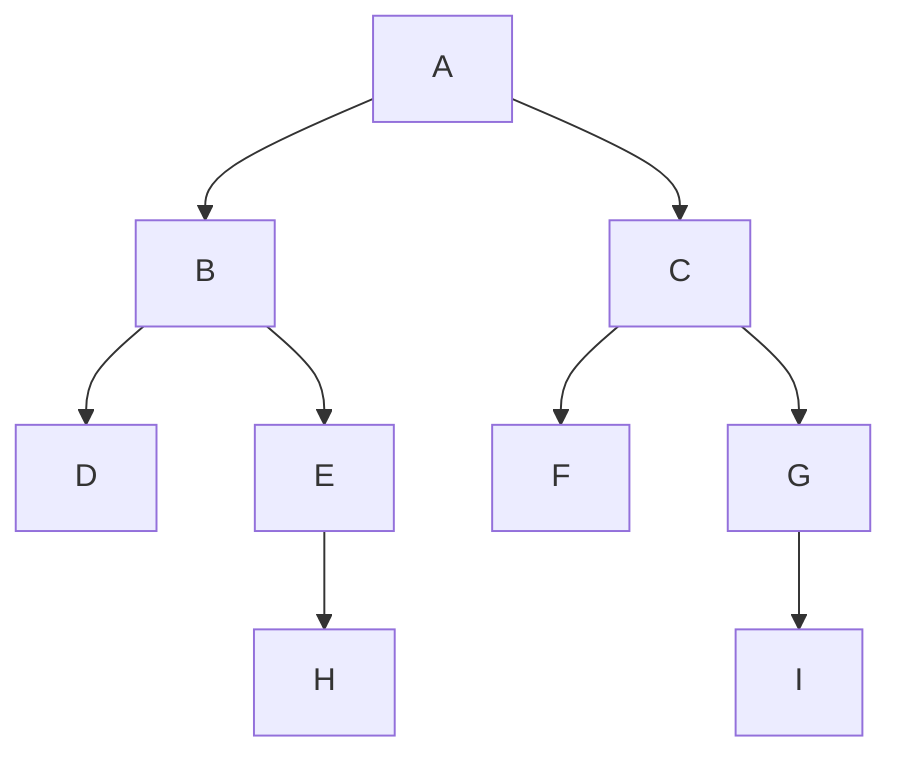
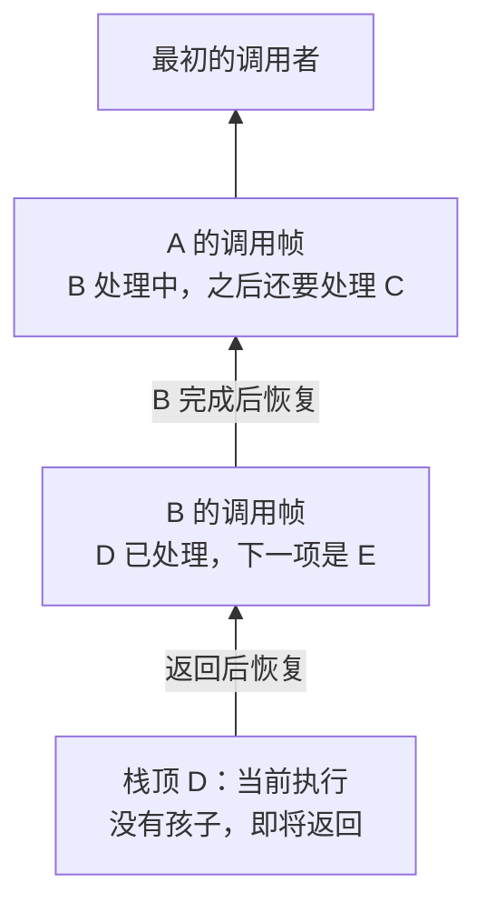
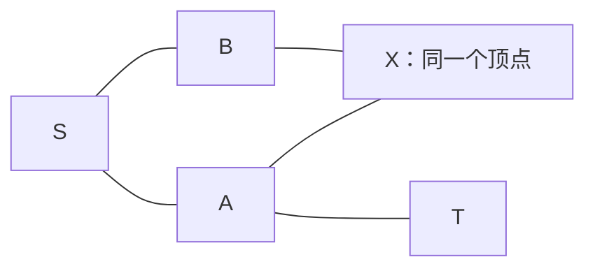
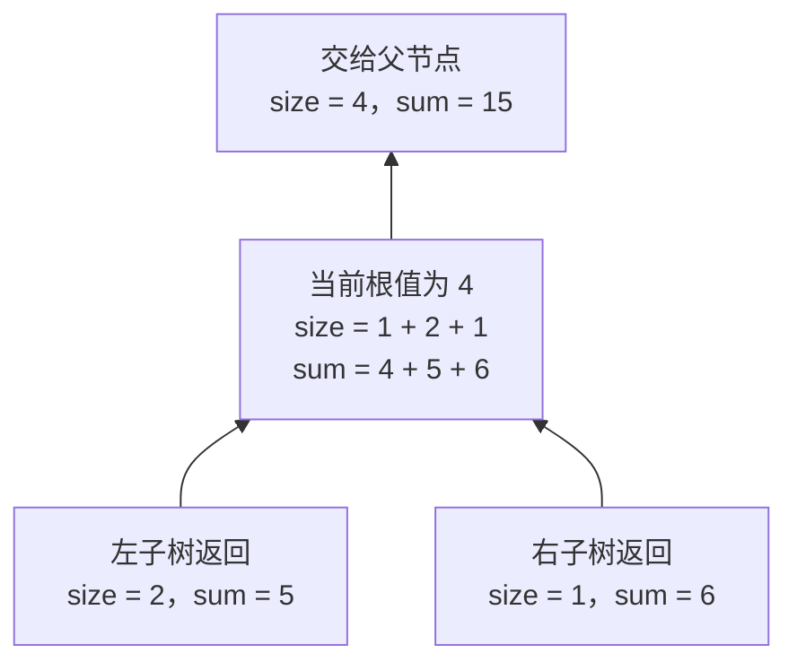
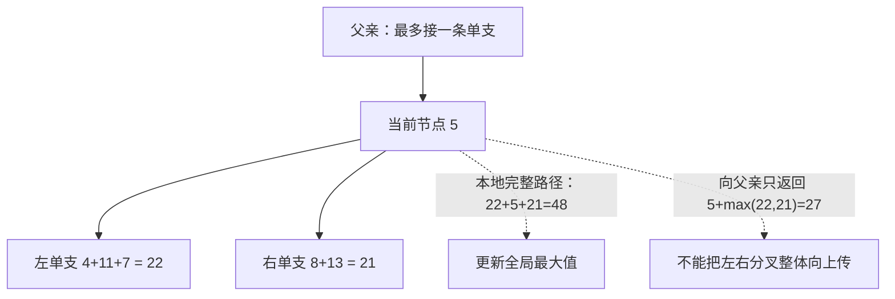
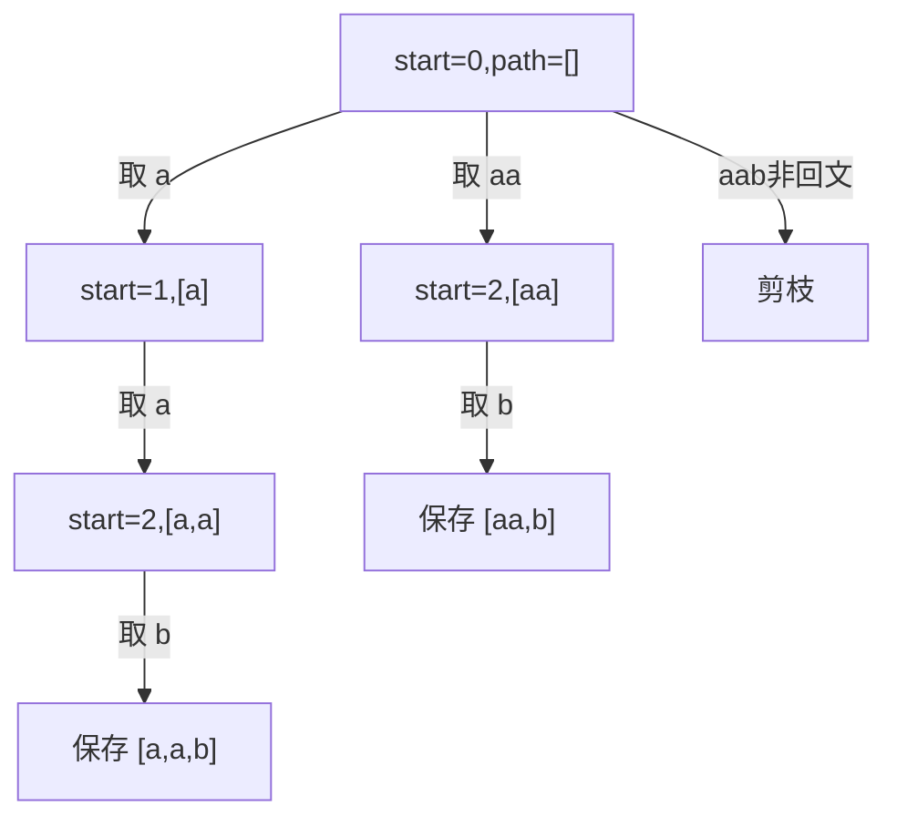

## DFS 的工作方式：沿分支深入，再返回

来源：`02-dfs.pdf` 第 1–42 页。深度优先搜索（DFS）把一个状态的某条分支走到底，再回到最近还有未尝试分支的位置。广度优先搜索（BFS）则先处理与起点距离相同的一整层。递归很适合表达 DFS，但 DFS 也可以用显式栈；“DFS 就是递归”只是课件的简化表述。



对这棵树，规定左子树先访问：DFS 前序是 `A B D E H C F G I`，BFS 是 `A B C D E F G H I`。若改成先右后左，具体顺序改变，可达节点集合不变；但 DFS 找到的第一条路径可能变长或变短，不能认为第一条就是最短。课件第 5–17 页、第 19–40 页分别以迷宫和网格动画说明这点。

在网格里，把可通行格子视为顶点、上下左右相邻视为边。DFS 的 `visited` 可避免 A→B→A 无限循环。BFS 要在**入队时**标记，避免同一格被多个邻居反复入队。搜索一个连通块时，visited 代表永久“已经探索过”；搜索一条不能重用格子的单词路径时，visited 只代表“当前路径占用”，回溯必须恢复。

|步骤|DFS 的选择|BFS 的选择|
|---|---|---|
|从 A 出发|先进入 B 分支|队列加入 B,C|
|下一次|继续进入 D|先弹出 B，再弹出 C|
|遇到死路 D|返回 B，改试 E|继续当前层剩余节点|
|存储含义|当前调用路径/待处理分支|已经发现但未扩展的前沿|

树上每个节点只访问一次时，时间 O(N)，递归栈 O(H)；图采用邻接表和 visited 时为 O(V+E)。网格 O(RC)。搜索所有排列或路径时，V 是庞大的状态空间，而不是原始输入元素数，因此经常是指数复杂度。

第19–40页的3×3填格动画把同一差别画在平面上。自己重做一遍时，明确从(0,0)出发，四邻居按上、右、下、左尝试，并在发现时标记。下面是按这些规则重新计算的首次访问编号；读格子里的编号而不是把BFS连线误当成一条实际可走的路径。

|行|DFS 首次访问编号|BFS 首次访问编号|
|---|---|---|
|0|1,2,3|1,2,4|
|1|8,7,4|3,5,7|
|2|9,6,5|6,8,9|

DFS从右下走到(2,1)时，优先向上进入尚未访问的中心(1,1)；BFS则把中心与同距离的(0,2)、(2,0)放在一层。方向优先级决定同层内部/兄弟分支的先后，层的最短距离性质不受它影响。

### 为什么走完一条分支后还能继续：调用帧保存“尚未做完的事”

只记录“我现在在 D”不足以继续搜索：D 结束以后该回哪里，B 的哪个孩子还没试，必须有人记住。递归调用帧正是在保存这些信息。进入子调用时，父调用暂停，但它的参数、循环游标、局部结果和下一条待执行语句仍留在栈中。

下图截取前面那棵树的一个时刻：A 已进入 B，B 已进入 D。箭头不是新增的树边，而是 **D 返回以后恢复哪个未完成的调用**。



|事件|仍然活跃的调用帧（栈底到栈顶）|接下来执行什么|
|---|---|---|
|进入 A|A|调用 B|
|A 调用 B|A、B|调用 D|
|B 调用 D|A、B、D|处理 D 的边界|
|D 返回|A、B|B 从刚才的调用语句之后继续，转向 E|
|B 的所有孩子完成|A|A 接收 B 的结果，转向 C|

这也解释了三个经常混淆的量：**总调用次数**决定了多少工作；**同时活跃的调用数**决定栈空间；**当前答案路径**是程序自己维护的数据。一次遍历可能调用 N 次，但同一时刻只保留 H 层调用帧，所以树 DFS 的栈是 O(H)，不是因为访问了 N 个节点就必然占用 N 个帧。树退化成链时才有 H=N。若要用显式栈准确模拟递归，除了节点，还可能需要保存“这个节点的孩子处理到哪一步”；仅保存节点够不够，取决于是否需要在子调用返回后继续工作。

<a id="tpl-dfs-explicit-frames"></a>
**双语模板：用显式调用帧遍历图，并保留递归的访问顺序**

适用于固定邻居顺序的有向或无向图，顶点编号为 `0…n−1`，邻接表中每个编号合法。每个帧保存“当前顶点、下一条待检查的边”，seen 在首次发现时标记。共同输入邻接表 `[[1,2],[3],[3,4],[4],[1]]`，从0出发；其中 `1→3→4→1` 有环，预期顺序为 `[0,1,3,4,2]`。这个顺序与按邻接表顺序递归访问一致。

```python
def dfs_order(graph, start):
    if not 0 <= start < len(graph):
        raise ValueError("start is outside the graph")
    seen = {start}
    order = [start]
    stack = [(start, iter(graph[start]))]

    while stack:
        node, neighbors = stack[-1]
        neighbor = next(neighbors, None)
        if neighbor is None:
            stack.pop()
            continue
        if neighbor in seen:
            continue
        seen.add(neighbor)
        order.append(neighbor)
        stack.append((neighbor, iter(graph[neighbor])))
    return order


if __name__ == "__main__":
    graph = [[1, 2], [3], [3, 4], [4], [1]]
    assert dfs_order(graph, 0) == [0, 1, 3, 4, 2]
    assert dfs_order([[]], 0) == [0]
    print(dfs_order(graph, 0))
```
```java
import java.util.ArrayDeque;
import java.util.ArrayList;
import java.util.Arrays;
import java.util.Deque;
import java.util.List;

class GraphDfsTemplate {
    private static class Frame {
        final int node;
        int nextNeighbor = 0;
        Frame(int node) { this.node = node; }
    }

    static List<Integer> dfsOrder(int[][] graph, int start) {
        if (start < 0 || start >= graph.length) {
            throw new IllegalArgumentException("start is outside the graph");
        }
        boolean[] seen = new boolean[graph.length];
        List<Integer> order = new ArrayList<>();
        Deque<Frame> stack = new ArrayDeque<>();
        seen[start] = true;
        order.add(start);
        stack.push(new Frame(start));
        while (!stack.isEmpty()) {
            Frame frame = stack.peek();
            if (frame.nextNeighbor == graph[frame.node].length) {
                stack.pop();
                continue;
            }
            int neighbor = graph[frame.node][frame.nextNeighbor++];
            if (seen[neighbor]) continue;
            seen[neighbor] = true;
            order.add(neighbor);
            stack.push(new Frame(neighbor));
        }
        return order;
    }

    public static void main(String[] args) {
        int[][] graph = {{1, 2}, {3}, {3, 4}, {4}, {1}};
        assert dfsOrder(graph, 0).equals(Arrays.asList(0, 1, 3, 4, 2));
        assert dfsOrder(new int[][]{{}}, 0).equals(Arrays.asList(0));
        System.out.println(dfsOrder(graph, 0));
    }
}
```

Python `iter` 创建会记住进度的迭代器，`next(iterator, None)` 在耗尽时返回默认值；顶点是整数，因此 None 不与合法顶点冲突。`stack[-1]` 读取栈顶，`pop()` 删除栈顶。Java `Deque.push/peek/pop` 分别压栈、只看栈顶和弹栈；帧中的 `nextNeighbor++` 在检查该边时前进一次，子帧返回后继续检查下一条边。Java 的 `boolean[]` 与 Python 的 set 都表示永久发现集合。本模板只遍历从 start 可达的部分，时间 O(V+E)、额外空间 O(V)；需要整个非连通图时，应在外层为每个尚未发现的顶点启动搜索，并共享 seen。

### 什么时候允许合并两次访问：先比较完整状态

`visited[x]` 的含义不是“这个坐标出现过，所以永远不能再出现”。它实际作出一个更强的判断：**此前那次访问已经足以代表此后所有到达 x 的访问**。普通静态图可达性只取决于从 x 出发有哪些边，因此可以合并；枚举不重复节点的路径时，可继续走哪些边还取决于路径已经用过哪些节点，单独的 x 就不够。

考虑下面的无向图，要枚举从 S 到 T 的简单路径，即一条路径内不重复节点：



|当前前缀，都结束在 X|已经使用的节点|接下来走 X→A→T|
|---|---|---|
|S→A→X|S、A、X|不合法：A 已在当前路径上|
|S→B→X|S、B、X|合法：A 尚未使用|

两次访问的坐标相同，合法后续不同，所以完整状态至少是 `(当前顶点, 当前路径使用集合)`。如果因第一行失败就缓存“X 无解”，会错误剪掉第二行。这里不能用全局 visited 合并路径状态；应进入分支时标记占用，退出时恢复。普通可达性搜索则允许全局标记：第一次探索 A 时，A→T 这条边也会被处理，不需要把“从 X 返回某个已访问点”当作新的搜索机会。

据此区分两类不变量：连通性搜索中，seen 集合只增不减，每个顶点至多展开一次；路径回溯中，used 集合恰好对应**当前路径**，一个兄弟分支结束后必须恢复成另一个兄弟分支开始前的状态。这个判断比记忆“某道题要不要回溯 visited”更可靠。

<a id="tpl-dfs-path-occupancy"></a>
**双语模板：枚举简单路径时，把 visited 改成当前路径占用**

适用于枚举有限图中从 start 到 target 的全部简单路径；一条路径内不重复顶点，不要求图本身无环。邻接表不含重复边。沿用上图编号 `S=0,A=1,B=2,X=3,T=4`，共同输入 `[[1,2],[0,3,4],[0,3],[1,2],[1]]`，预期为 `[[0,1,4],[0,2,3,1,4]]`。目标是完整路径列表，因此返回前必须复制 path，兄弟分支之间必须恢复占用。

```python
def all_simple_paths(graph, start, target):
    answer = []
    path = []
    on_path = [False] * len(graph)

    def visit(node):
        on_path[node] = True
        path.append(node)
        if node == target:
            answer.append(path.copy())
        else:
            for neighbor in graph[node]:
                if not on_path[neighbor]:
                    visit(neighbor)
        path.pop()
        on_path[node] = False

    visit(start)
    return answer


if __name__ == "__main__":
    graph = [[1, 2], [0, 3, 4], [0, 3], [1, 2], [1]]
    expected = [[0, 1, 4], [0, 2, 3, 1, 4]]
    assert all_simple_paths(graph, 0, 4) == expected
    assert all_simple_paths(graph, 0, 0) == [[0]]
    print(all_simple_paths(graph, 0, 4))
```
```java
import java.util.ArrayList;
import java.util.Arrays;
import java.util.List;

class SimplePathsTemplate {
    static List<List<Integer>> allSimplePaths(int[][] graph, int start, int target) {
        List<List<Integer>> answer = new ArrayList<>();
        visit(graph, start, target, new boolean[graph.length],
              new ArrayList<>(), answer);
        return answer;
    }

    private static void visit(int[][] graph, int node, int target,
                              boolean[] onPath, List<Integer> path,
                              List<List<Integer>> answer) {
        onPath[node] = true;
        path.add(node);
        if (node == target) {
            answer.add(new ArrayList<>(path));
        } else {
            for (int neighbor : graph[node]) {
                if (!onPath[neighbor]) {
                    visit(graph, neighbor, target, onPath, path, answer);
                }
            }
        }
        path.remove(path.size() - 1);
        onPath[node] = false;
    }

    public static void main(String[] args) {
        int[][] graph = {{1, 2}, {0, 3, 4}, {0, 3}, {1, 2}, {1}};
        List<List<Integer>> expected = Arrays.asList(
                Arrays.asList(0, 1, 4), Arrays.asList(0, 2, 3, 1, 4));
        assert allSimplePaths(graph, 0, 4).equals(expected);
        assert allSimplePaths(graph, 0, 0).equals(Arrays.asList(Arrays.asList(0)));
        System.out.println(allSimplePaths(graph, 0, 4));
    }
}
```

入口假定 start、target 均为合法顶点。达到 target 后不再向外扩展，但仍执行末尾的撤销；因此起终点相同时返回长度1的路径。Python 的闭包和 Java 的参数传递都让递归层共享同一个工作列表，退出函数不会自动撤销它。工作路径和栈最多 O(V)，输出规模可能非常大；此处会反复访问同一顶点的不同路径状态，不能套用普通 DFS 的 O(V+E) 总时间。

## 树的术语、遍历和递归契约

来源：第 43–44、87–88、101 页。根没有父节点；叶子没有子节点；同一父节点的孩子是兄弟；向根方向是祖先，向下是后代。N 个节点的非空树有 N−1 条边。通常深度按根到节点的边数定义，根深度 0；本课件算法题计算的“树深度”是最长路径**节点数**，空树 0、叶子 1，两种约定相差 1，必须看题意。

前序是“根、左、右”；中序是“左、根、右”；后序是“左、右、根”。三个位置是同一次递归过程中不同的工作时机。要聚合子树答案（高度、最大贡献等），通常在两个递归返回后处理根，也就是后序。


下面二叉树题的 LeetCode 环境会提供 `TreeNode`，无需重新提交。若在本地独立运行，可加上这个定义。它的 left/right 是可空引用，不能访问 null.val。

```java
class TreeNode {
    int val;
    TreeNode left, right;
    TreeNode(int val) { this.val = val; }
}
```

不变量应写成“helper(node) 返回什么”，而不是“helper 会递归”。然后假设左右孩子的返回值已经正确，证明这一层可以据此计算正确结果；最后证明空节点/叶子的边界与契约一致。剪枝必须有证明：一个分支已经不可能合法，或绝不优于已有最优值时才能丢弃。

### 如何设计返回值：把子树压缩成父节点需要的信息

父节点不一定需要知道子树里每一步发生了什么。假设现在要同时统计子树的节点数和节点值总和，那么子调用只需返回 `(size, sum)`。这两个数保留了当前问题需要的全部信息，父节点可以把子树当成已经处理完的小模块。



|当前对象|孩子返回值|当前返回值|
|---|---|---|
|空子树|无|`(0,0)`|
|值为 6 的叶子|左右都是 `(0,0)`|`(1,6)`|
|图中的根 4|左 `(2,5)`、右 `(1,6)`|`(4,15)`|

正确性可以按树的大小证明。空树的统计显然正确；假设两个更小子树都已返回正确统计，因为左右子树互不重叠、与根也不是同一节点，把三部分相加便恰好统计每个节点一次。**如果输入实际上是共享孩子的有向图，这个证明就不成立**：同一节点可能被两个子树同时统计。递推正确与否依赖对象的结构，不能只看代码长得像二叉树递归。

返回值还必须与父节点的需求匹配：只有总和不能推出高度；只有高度不能知道子树是否处处平衡；只有“某条完整路径的最大和”也不一定能作为向父节点延伸的贡献。遇到“子问题都算了，当前层还是没法组合”的情况，先检查返回的信息是否足够，而不是立即添加全局变量。

复杂度也来自同一分解。若每个节点只产生一次调用，合并两个固定大小摘要耗时 O(1)，则总工作是 N 份常数，时间 O(N)。若每个节点还要重新扫描整棵子树，或复制长度与子树大小有关的列表，就不能继续声称“用了 DFS，所以 O(N)”。空间则计算同时存在的调用帧、临时对象与答案，不能只数递归深度。

<a id="tpl-tree-traversal-summary"></a>
**双语模板：二叉树类型、三种遍历位置与子树摘要**

适用于无环、没有共享孩子的二叉树。共同输入为根4、左孩子2、2的左孩子3、根的右孩子6。预期前序 `[4,2,3,6]`，中序 `[3,2,4,6]`，后序 `[3,2,6,4]`；摘要为节点数4、总和15。两段代码都包括节点类型，无需在线评测提供任何辅助定义。

```python
class TreeNode:
    def __init__(self, value, left=None, right=None):
        self.value = value
        self.left = left
        self.right = right


def traversals(root):
    preorder, inorder, postorder = [], [], []

    def visit(node):
        if node is None:
            return
        preorder.append(node.value)
        visit(node.left)
        inorder.append(node.value)
        visit(node.right)
        postorder.append(node.value)

    visit(root)
    return [preorder, inorder, postorder]


def tree_summary(node):
    if node is None:
        return 0, 0
    left_size, left_sum = tree_summary(node.left)
    right_size, right_sum = tree_summary(node.right)
    return 1 + left_size + right_size, node.value + left_sum + right_sum


if __name__ == "__main__":
    root = TreeNode(4, TreeNode(2, TreeNode(3)), TreeNode(6))
    expected = [[4, 2, 3, 6], [3, 2, 4, 6], [3, 2, 6, 4]]
    assert traversals(root) == expected
    assert tree_summary(root) == (4, 15)
    assert tree_summary(None) == (0, 0)
    print(traversals(root))
    size, total = tree_summary(root)
    print(f"size={size}, sum={total}")
```
```java
import java.util.ArrayList;
import java.util.Arrays;
import java.util.List;

class TreeTraversalTemplate {
    static class Node {
        final int value;
        final Node left, right;
        Node(int value, Node left, Node right) {
            this.value = value;
            this.left = left;
            this.right = right;
        }
    }

    static class Summary {
        final int size;
        final long sum;
        Summary(int size, long sum) { this.size = size; this.sum = sum; }
    }

    static List<List<Integer>> traversals(Node root) {
        List<List<Integer>> result = Arrays.asList(
                new ArrayList<Integer>(), new ArrayList<Integer>(),
                new ArrayList<Integer>());
        visit(root, result);
        return result;
    }

    private static void visit(Node node, List<List<Integer>> result) {
        if (node == null) return;
        result.get(0).add(node.value);
        visit(node.left, result);
        result.get(1).add(node.value);
        visit(node.right, result);
        result.get(2).add(node.value);
    }

    static Summary treeSummary(Node node) {
        if (node == null) return new Summary(0, 0L);
        Summary left = treeSummary(node.left), right = treeSummary(node.right);
        return new Summary(1 + left.size + right.size, node.value + left.sum + right.sum);
    }

    public static void main(String[] args) {
        Node root = new Node(4, new Node(2, new Node(3, null, null), null),
                             new Node(6, null, null));
        List<List<Integer>> expected = Arrays.asList(
                Arrays.asList(4, 2, 3, 6), Arrays.asList(3, 2, 4, 6),
                Arrays.asList(3, 2, 6, 4));
        assert traversals(root).equals(expected);
        Summary s = treeSummary(root);
        assert s.size == 4 && s.sum == 15;
        assert treeSummary(null).size == 0;
        System.out.println(traversals(root));
        System.out.println("size=" + s.size + ", sum=" + s.sum);
    }
}
```

Python 用元组返回两个结果，并通过解包分别命名；Java 用 Summary 类型为两个字段命名，sum 使用 long。Python 的 `left=None` 是省略孩子时的默认值，不会共享一个可变孩子对象。Java 的静态嵌套类型不依赖外层实例，final 字段在构造后不能重新赋值。`Arrays.asList` 这里只固定外层三个位置，内部的 ArrayList 仍可追加元素。遍历和摘要各自均为 O(N) 时间、O(H) 调用栈；三份遍历结果额外占用 O(N) 输出空间。

<a id="lc-104"></a>
## LC 104 · Maximum Depth of Binary Tree

来源：第 45–51 页。[官方题目](https://leetcode.com/problems/maximum-depth-of-binary-tree/)。求根到最深叶子的路径节点数。helper 返回当前子树的高度，所以根的答案是 `max(左高度,右高度)+1`。空树高度 0，保证叶子得到 1。

以 `[3,9,20,null,null,15,7]` 为例：

|后序返回节点|左高度|右高度|返回|
|---|---:|---:|---:|
|9|0|0|1|
|15|0|0|1|
|7|0|0|1|
|20|1|1|2|
|3|1|2|3|

```java
class Solution {
    public int maxDepth(TreeNode root) {
        if (root == null) return 0;
        return 1 + Math.max(maxDepth(root.left), maxDepth(root.right));
    }
}
```

`Math.max` 比较两个已经完成的递归结果；Java 求值时先计算参数中的递归调用，再调用 max。不能省略 `+1`，它对应当前根。null 返回 0，单节点返回 1，链状树返回节点总数。时间 O(N)，栈 O(H)；最坏 H=N，深链在实际 JVM 上可能造成栈溢出，此时可改为显式栈或 BFS。

<a id="lc-110"></a>
## LC 110 · Balanced Binary Tree

来源：第 52–58 页。[官方题目](https://leetcode.com/problems/balanced-binary-tree/)。要求每一个节点的左右子树高度差不超过 1。只检查根不够：根的左右高度相同，深处仍可能存在很长的单链。

直接解法对每个节点分别算两次高度，再检查左右是否平衡，会重复扫描子树。把返回值扩展：非负数为“平衡且高度为这个值”，−1 为“不平衡”。这样一次后序遍历同时算高度和检查条件。

|子树形状|左返回|右返回|当前返回|
|---|---:|---:|---:|
|叶子|0|0|1|
|一个叶子孩子|1|0|2|
|左高2、右空|2|0|−1|
|某孩子已经不平衡|−1|任意|−1|

```java
class Solution {
    public boolean isBalanced(TreeNode root) {
        return height(root) != -1;
    }
    private int height(TreeNode node) {
        if (node == null) return 0;
        int left = height(node.left);
        if (left == -1) return -1;
        int right = height(node.right);
        if (right == -1 || Math.abs(left - right) > 1) return -1;
        return 1 + Math.max(left, right);
    }
}
```

`Math.abs` 取绝对值，左右方向不影响判断；先检测 −1 再算差，避免把错误标记当高度。`left==-1` 立即返回是一种可靠剪枝：一处不平衡就不满足“每个节点”。时间 O(N)，栈 O(H)。课件朴素方法常以 O(N²) 作为宽松上界，重复求高度确实可避免；本版本严格做到每个访问节点一次。空树按定义平衡。

<a id="lc-101"></a>
## LC 101 · Symmetric Tree

来源：第 59–62 页。[官方题目](https://leetcode.com/problems/symmetric-tree/)。左右镜像要求节点值相同、结构对称。判断的对象必须是一对节点，单独说“左子树自己对称”不能回答它是否与右子树互为镜像。

`mirror(a,b)` 不变量：a 和 b 整棵子树是否互为镜像。两者都空为 true；仅一个空为 false；值不同为 false；再交叉比较 `a.left↔b.right` 和 `a.right↔b.left`。

|比较对，树为 [1,2,2,3,4,4,3]|结果/下一步|
|---|---|
|左2、右2|值相同，比较外侧与内侧|
|左外3、右外3|相等，两个空孩子对都成功|
|左内4、右内4|相等，两个空孩子对都成功|
|合并|true && true，返回 true|

```java
class Solution {
    public boolean isSymmetric(TreeNode root) {
        return root == null || mirror(root.left, root.right);
    }
    private boolean mirror(TreeNode a, TreeNode b) {
        if (a == null || b == null) return a == b;
        return a.val == b.val
                && mirror(a.left, b.right)
                && mirror(a.right, b.left);
    }
}
```

这里 `a==b` 不是比较节点内容：已经知道至少一个为空，它只在两个都 null 时成立。后面的 `a.val==b.val` 才比较整数值。`&&` 短路，一项失败就不再递归其他项。中序序列是回文仍不足以保证树结构对称。时间 O(N)，栈 O(H)，空树和单节点树都对称。

<a id="lc-111"></a>
## LC 111 · Minimum Depth of Binary Tree

来源：第 63–66 页。[官方题目](https://leetcode.com/problems/minimum-depth-of-binary-tree/)。找根到最近**叶子**的节点数。叶子要求左右都为空，空孩子不是一个能结束路径的叶子。因此不能直接 `min(左高,右高)+1`。

|情况|正确选择|
|---|---|
|空树|0|
|叶子|1|
|只有左子树|1+左最小深度|
|只有右子树|1+右最小深度|
|两边都有|1+min(左右最小深度)|

链 `1→2→3` 的返回顺序是 3 返回 1、2 返回 2、1 返回 3；不能因根右边空就返回 1。

```java
class Solution {
    public int minDepth(TreeNode root) {
        if (root == null) return 0;
        if (root.left == null) return 1 + minDepth(root.right);
        if (root.right == null) return 1 + minDepth(root.left);
        return 1 + Math.min(minDepth(root.left), minDepth(root.right));
    }
}
```

Math.min 只在两棵非空子树之间比较，边界分支表达“必须走存在的那一边”。时间 O(N)，栈 O(H)。BFS 可以在遇到第一片叶子时停止，详见 [BFS 的同题解法](#/lesson/03?section=lc-111)。课件第 64 页写 LC 101 是编号错误，应为 111。

<a id="lc-112"></a>
## LC 112 · Path Sum

来源：第 67–76 页。[官方题目](https://leetcode.com/problems/path-sum/)。判断是否存在根到叶的路径，其节点和恰好等于 targetSum。helper(node,remain) 的 remain 是“包括当前节点在内，尚需凑出的和”，进入孩子前减掉 node.val。

|节点路径|进入时 remain|处理动作|
|---|---:|---|
|5|22|孩子还需17|
|5→4|17|孩子还需13|
|5→4→11|13|孩子还需2|
|5→4→11→7|2|叶子7不等于2，失败|
|5→4→11→2|2|叶子2等于2，成功并逐层返回|

```java
class Solution {
    public boolean hasPathSum(TreeNode root, int targetSum) {
        if (root == null) return false;
        if (root.left == null && root.right == null) {
            return targetSum == root.val;
        }
        return hasPathSum(root.left, targetSum - root.val)
                || hasPathSum(root.right, targetSum - root.val);
    }
}
```

`||` 表示存在任一分支即可，并在左分支成功后不再探索右分支。Java 的 int 参数按值传递，因此左调用的 targetSum 不会修改右调用所用的值；无需“把剩余和加回来”。不能在中途 remain=0 就成功，必须到叶子；不能因 remain<0 就剪枝，节点可能为负。空树即使 target=0 仍为 false，因为题目要非空根到叶路径。时间 O(N)，栈 O(H)。

<a id="lc-124"></a>
## LC 124 · Binary Tree Maximum Path Sum

来源：第 77–86 页。[官方题目](https://leetcode.com/problems/binary-tree-maximum-path-sum/)。路径可从任意节点开始、到任意节点结束，沿父子边且不重复节点，不一定经过树根。它与 LC112 的固定根到叶限制不同。

必须区分两个量：**返回父亲的单支贡献**只能沿左或右其中一边，避免路径出现分叉；**以当前节点为最高点的完整路径**可以同时用左右两边。令 left/right 为孩子可提供的最大单支贡献，负贡献可以丢弃：

- 当前完整候选：`node.val+max(0,left)+max(0,right)`，更新全局答案。
- 返回父亲：`node.val+max(0,left,right)`，最多带走一条分支。



|节点|左右有效贡献|完整候选|向上贡献|
|---|---|---:|---:|
|7|0,0|7|7|
|2|0,0|2|2|
|11|7,2|20|18|
|4（5的左孩）|18,0|22|22|
|8|13,5|26|21|
|5|22,21|48|27|

```java
class Solution {
    private int best;
    public int maxPathSum(TreeNode root) {
        best = Integer.MIN_VALUE;
        gain(root);
        return best;
    }
    private int gain(TreeNode node) {
        if (node == null) return 0;
        int left = Math.max(0, gain(node.left));
        int right = Math.max(0, gain(node.right));
        best = Math.max(best, node.val + left + right);
        return node.val + Math.max(left, right);
    }
}
```

`Integer.MIN_VALUE` 是 int 最小值，初始化成 0 会让全负树错误选中空路径；`[-3]` 必须返回 −3。best 是实例字段，每次入口重置，递归间共享。也可用 `int[] best={Integer.MIN_VALUE}` 传给 helper：Java 仍然按值传递，但复制的是同一数组的引用，所以修改 best[0] 对所有调用可见；给局部变量重新赋数组引用则不会改变调用者的引用。课件第 85 页代码缺少关闭括号，直接粘贴不能编译；第 84 页 Python 片段缺少外层调用和返回。本节是完整实现。时间 O(N)，栈 O(H)。

<a id="lc-79"></a>
## LC 79 · Word Search：路径占用必须恢复

来源：第 89–92 页，亦是递归章选做。[官方题目](https://leetcode.com/problems/word-search/)。从网格任意格子开始，上下左右拼出 word；同一格在一条路径中最多使用一次。相同字母可能出现在不同格子，不能按字符值去重。

```text
A B C E
S F C S
A D E E
```

|word=ABCCED 的字符下标|坐标|当前路径|
|---|---|---|
|0|(0,0)|A|
|1|(0,1)|AB|
|2|(0,2)|ABC|
|3|(1,2)|ABCC|
|4|(2,2)|ABCCE|
|5|(2,1)|ABCCED，成功|

`ABCB` 失败：最后的 B 只能回到已经使用的 (0,1)。完整状态是 (r,c,k,used)，不能仅因某格之前试过就永久禁用，因为换一条前缀路径后，可用格子集合变了。

```java
class Solution {
    public boolean exist(char[][] board, String word) {
        if (word.isEmpty()) return true;
        if (board.length == 0 || board[0].length == 0) return false;
        boolean[][] used = new boolean[board.length][board[0].length];
        for (int r = 0; r < board.length; r++) {
            for (int c = 0; c < board[0].length; c++) {
                if (dfs(board, word, r, c, 0, used)) return true;
            }
        }
        return false;
    }
    private boolean dfs(char[][] b, String w, int r, int c,
                        int k, boolean[][] used) {
        if (r < 0 || r >= b.length || c < 0 || c >= b[0].length
                || used[r][c] || b[r][c] != w.charAt(k)) return false;
        if (k == w.length() - 1) return true;
        used[r][c] = true;
        boolean found = dfs(b, w, r + 1, c, k + 1, used)
                || dfs(b, w, r - 1, c, k + 1, used)
                || dfs(b, w, r, c + 1, k + 1, used)
                || dfs(b, w, r, c - 1, k + 1, used);
        used[r][c] = false;
        return found;
    }
}
```

语句逐项看：`word.isEmpty()` 检查长度0；`charAt(k)` 取正在匹配的字符；一串 `||` 从左到右短路，所以只有坐标合法才会读 used[r][c]；先保存 found，再恢复 used，保证成功和失败两种退出都恢复路径。boolean[][] 默认 false，无需 Arrays.fill。此实现不改变 board。设单词长度 L，宽松时间 O(RC·4^L)，利用不能立即走回上格可写 O(RC·3^L) 的同阶指数界（首步有4个方向）；额外空间 O(RC+L)。可加 L>RC 提前返回和字符频次不足剪枝。

<a id="lc-131"></a>
## LC 131 · Palindrome Partitioning：枚举切点与预处理

来源：第 93–100 页，亦是递归章选做。[官方题目](https://leetcode.com/problems/palindrome-partitioning/)。把 s 切成若干连续非空子串，要求每段是回文，返回所有划分。切割不能乱序，也不能漏字符。dfs(start) 的契约：path 已完整覆盖 s[0,start)，枚举其余后缀的合法切法。

对 `aab`，先尝试第一个子串：`a` 合法，再从第二个 a 出发，得到 `[a,a,b]`；`aa` 合法，剩 b，得到 `[aa,b]`；`aab` 非回文，剪掉。



第95页手绘例子是`aabcbaaa`：前缀`aa`是回文，前缀`aabcbaa`也为回文，说明不能看到第一个合法前缀就贪心结束；两条分支都要继续分割剩余后缀。

朴素每次双指针检查子串，重复工作很多。预处理 `pal[i][j]` 表示 s[i..j] 是否回文：两端相同，且长度≤2 或中间 `pal[i+1][j-1]` 为 true。i 从右往左，确保下一行已经算好。

|pal 对 aab|j=0 a|j=1 a|j=2 b|
|---|---|---|---|
|i=0 a|true|true|false|
|i=1 a|不用|true|false|
|i=2 b|不用|不用|true|

```java
import java.util.ArrayList;
import java.util.List;
class Solution {
    public List<List<String>> partition(String s) {
        int n = s.length();
        boolean[][] pal = new boolean[n][n];
        for (int i = n - 1; i >= 0; i--) {
            for (int j = i; j < n; j++) {
                pal[i][j] = s.charAt(i) == s.charAt(j)
                        && (j - i < 2 || pal[i + 1][j - 1]);
            }
        }
        List<List<String>> answer = new ArrayList<>();
        dfs(s, 0, pal, new ArrayList<>(), answer);
        return answer;
    }
    private void dfs(String s, int start, boolean[][] pal,
                     List<String> path, List<List<String>> answer) {
        if (start == s.length()) {
            answer.add(new ArrayList<>(path));
            return;
        }
        for (int end = start; end < s.length(); end++) {
            if (!pal[start][end]) continue;
            path.add(s.substring(start, end + 1));
            dfs(s, end + 1, pal, path, answer);
            path.remove(path.size() - 1);
        }
    }
}
```

`substring(start,end+1)` 左闭右开，pal 却使用两端闭区间，所以要 +1。`new ArrayList<>(path)` 复制容器，否则所有答案会随着同一个 path 回退而被清空；String 不可变，所以不必复制字符串内容。`remove(path.size()-1)` 参数是 int，下标删除尾部，不是按对象值删除。`j-i<2 || ...` 的短路避免长度1/2时访问不存在的内部区间。课件第99页变量 len 表示 j−i，并非实际长度，实际长度为 len+1。最坏全相同字符有 2^(n−1) 种划分；预处理 O(n²)，生成结果约 O(n2^n)，额外工作空间 O(n²+n)，输出另计。

<a id="lc-22"></a>
## 拓展例题 LC 22 · Generate Parentheses

来源：第 42、88 页列举的一维 DFS 例子。[官方题目](https://leetcode.com/problems/generate-parentheses/)。生成 n 对合法括号的全部字符串。状态是已用左括号 open、右括号 close、当前前缀；任何合法前缀都满足 `0≤close≤open≤n`。有左括号额度就能加 '('；只有 close<open 才能加 ')'。

|n=2 的状态|合法后继|
|---|---|
|空，0/0|只能 (|
|(，1/0|可 (( 或 ()|
|((，2/0|只能 (()，再 (())|
|()，1/1|只能 ()(，再 ()()|

```java
import java.util.ArrayList;
import java.util.List;
class Solution {
    public List<String> generateParenthesis(int n) {
        List<String> answer = new ArrayList<>();
        dfs(n, 0, 0, new StringBuilder(), answer);
        return answer;
    }
    private void dfs(int n, int open, int close,
                     StringBuilder path, List<String> answer) {
        if (path.length() == 2 * n) {
            answer.add(path.toString());
            return;
        }
        if (open < n) {
            path.append('(');
            dfs(n, open + 1, close, path, answer);
            path.deleteCharAt(path.length() - 1);
        }
        if (close < open) {
            path.append(')');
            dfs(n, open, close + 1, path, answer);
            path.deleteCharAt(path.length() - 1);
        }
    }
}
```

StringBuilder 是可变字符缓冲；append 原地扩展，deleteCharAt 删除指定下标字符；toString 生成独立不可变字符串快照。不变量保证到2n长度时恰好n个左n个右且全程合法，无需事后再检查。结果数是 Catalan 数 Cn，时间 O(n·Cn)，工作空间 O(n)，输出 O(n·Cn)。n=0 的自然扩展得到 `[""]`。

## 课件中其他 DFS 例子的对应位置

第42页和第88页用题目名称展示 DFS 的适用面：排列、子集/组合、组合总和、电话键盘、N皇后、迷宫详见 [递归与回溯](#/lesson/01)；包围区域与岛屿详见 [BFS/DFS 网格连通性](#/lesson/03?section=lc-130)。这些不是新的算法类别，而是改变了状态、合法后继和答案收集时机。树的深度题求一个汇总值，排列枚举全部叶子，子集可能每个节点都收集，迷宫求存在性可提前成功。始终由题目语义决定何时停止、何时复制、何时恢复。
