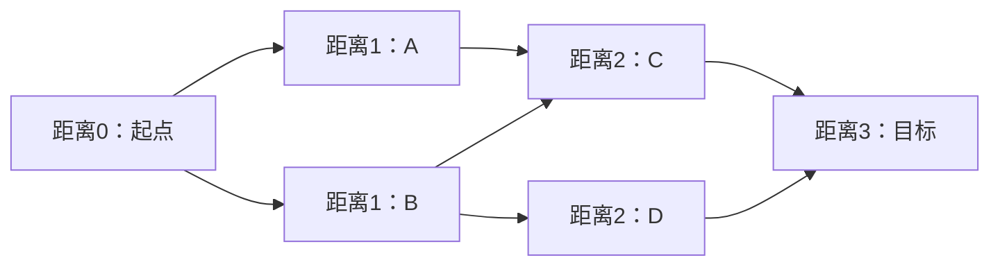
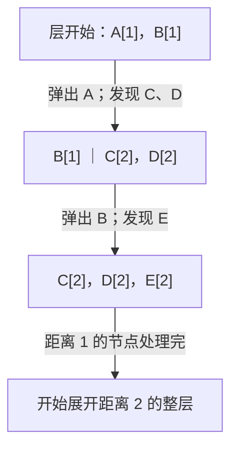
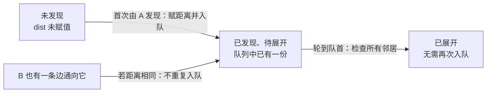
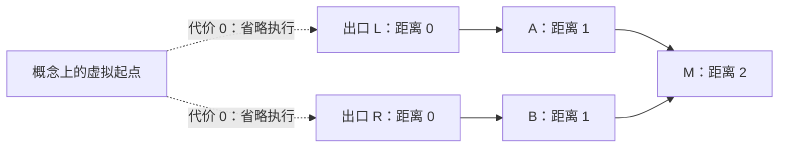
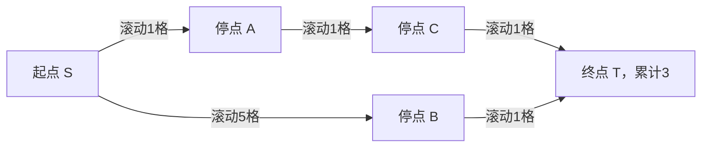
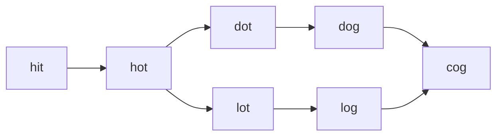

## BFS 的承诺：按步数从小到大扩展

来源：`03-bfs.pdf` 第 1–15、37、47–49、105–106 页。广度优先搜索用先进先出队列：先扩展距离0的起点，再扩展距离1、2……的状态。在**每条边代价相同**的图中，一个状态第一次被发现的距离就是最短距离。证明要点是：更短路径的前驱一定属于更早一层，若存在更短路径，它应该更早被发现，产生矛盾。

课件的最短树深、一步移动迷宫、Word Ladder 都满足单位边权。滚动小球一条边可跨多个格子，边权不同，不能套用“第一次发现即最短”。后文用 Dijkstra 处理；课件普通队列反复更新距离的版本是松弛算法，不是普通分层 BFS 的同一保证。



C 可能被 A、B 同时发现。应在第一次**入队**时标记 seen，而不是出队时才标记；否则重复项会在队列中不断累积。树没有环，每个非根节点只有一个父亲，一般不需要 visited；普通图通常需要。

|数据结构|取出规则|适合|
|---|---|---|
|栈|最后进入的先取出，LIFO|DFS、回溯、表达式求值|
|FIFO队列|最早进入的先取出|单位边权BFS、任务排队|
|优先队列|优先级最小者先取出|Dijkstra、事件按时间调度|

课件提到系统/多任务队列作为设计启发。真实任务调度是否FIFO由需求决定：优先级、公平性、阻塞与并发都属于额外规则，不能仅凭“Queue接口”推断调度顺序。

### 为什么 FIFO 恰好产生最短路：队列里最多混合相邻两层

把距离起点恰好 d 步的节点集合记为 `F_d`。当算法正在展开这一层时，队列前部保存 `F_d` 中尚未展开的节点，后部保存刚发现的 `F_(d+1)` 节点。展开一个 d 层节点只能发现距离至多 d+1 的邻居；已发现的邻居跳过，新发现的全部放到队尾，不能插到尚未处理完的 d 层前面。

下面直接画队列的变化。方括号内的数字是距离，不是节点值；左边是出队口。



|队列变化|仍未展开的第 1 层|已发现的第 2 层|
|---|---|---|
|`[A,B]`|A、B|无|
|处理 A 后 `[B,C,D]`|B|C、D|
|处理 B 后 `[C,D,E]`|无|C、D、E|

这给出两个可检查的不变量：队列中的距离始终不下降；若队首距离是 d，队列中的距离只可能是 d 或 d+1。初始只含距离0的起点，不变量成立；弹出队首并把新邻居以 d+1 的距离加到尾部，会继续保持它。

由此证明首次发现最短。假设从距离 d 的节点发现 v，给它赋值 d+1，却存在一条长度至多 d 的更短路径。那么那条路径中 v 的前驱距离至多 d−1，应该已经先于当前节点展开，并且当时就发现 v。这与 v 现在才首次出现矛盾。因此距离可以在入队时确定，不必等到它自己出队。

<a id="tpl-bfs-distance-parent"></a>
**双语模板：单源 BFS 的距离数组与一条最短路径**

适用于单位边权、顶点编号 `0…n−1` 的邻接表，start 和所有邻居编号均合法。共同输入 `[[1,2],[3],[3],[4],[],[]]`、start=0。预期距离 `[0,1,1,2,3,-1]`，其中 −1 表示不可达；到4的一条最短路径是 `[0,1,3,4]`。parent 只在首次发现时写入，因此本模板返回一条路径，不枚举所有最短路径。

```python
from collections import deque


def bfs_distances(graph, start):
    distance = [-1] * len(graph)
    parent = [-1] * len(graph)
    distance[start] = 0
    queue = deque([start])
    while queue:
        node = queue.popleft()
        for neighbor in graph[node]:
            if distance[neighbor] != -1:
                continue
            distance[neighbor] = distance[node] + 1
            parent[neighbor] = node
            queue.append(neighbor)
    return distance, parent


def restore_path(distance, parent, target):
    if distance[target] == -1:
        return []
    path = []
    while target != -1:
        path.append(target)
        target = parent[target]
    return path[::-1]


if __name__ == "__main__":
    graph = [[1, 2], [3], [3], [4], [], []]
    distance, parent = bfs_distances(graph, 0)
    assert distance == [0, 1, 1, 2, 3, -1]
    assert restore_path(distance, parent, 4) == [0, 1, 3, 4]
    assert restore_path(distance, parent, 5) == []
    print(distance)
    print(restore_path(distance, parent, 4))
```
```java
import java.util.ArrayDeque;
import java.util.ArrayList;
import java.util.Arrays;
import java.util.Collections;
import java.util.List;
import java.util.Queue;

class BfsDistanceTemplate {
    static class Result {
        final int[] distance, parent;
        Result(int n) {
            distance = new int[n];
            parent = new int[n];
            Arrays.fill(distance, -1);
            Arrays.fill(parent, -1);
        }
    }

    static Result bfs(int[][] graph, int start) {
        Result result = new Result(graph.length);
        Queue<Integer> queue = new ArrayDeque<>();
        result.distance[start] = 0;
        queue.offer(start);
        while (!queue.isEmpty()) {
            int node = queue.poll();
            for (int neighbor : graph[node]) {
                if (result.distance[neighbor] != -1) continue;
                result.distance[neighbor] = result.distance[node] + 1;
                result.parent[neighbor] = node;
                queue.offer(neighbor);
            }
        }
        return result;
    }

    static List<Integer> restorePath(Result result, int target) {
        List<Integer> path = new ArrayList<>();
        if (result.distance[target] == -1) return path;
        for (int node = target; node != -1; node = result.parent[node]) {
            path.add(node);
        }
        Collections.reverse(path);
        return path;
    }

    public static void main(String[] args) {
        int[][] graph = {{1, 2}, {3}, {3}, {4}, {}, {}};
        Result result = bfs(graph, 0);
        assert Arrays.equals(result.distance, new int[]{0, 1, 1, 2, 3, -1});
        assert restorePath(result, 4).equals(Arrays.asList(0, 1, 3, 4));
        assert restorePath(result, 5).isEmpty();
        System.out.println(Arrays.toString(result.distance));
        System.out.println(restorePath(result, 4));
    }
}
```

Python `deque.popleft()` 与 Java `poll()` 删除队首，`append/offer` 加在队尾。这里 distance 的 −1 同时表示“未发现”，所以无需另一份 visited。Python 的 `path[::-1]` 创建倒序副本；Java 的 `Collections.reverse` 原地反转刚建好的结果列表。起点 parent 保持−1，成为恢复路径的终止标记。BFS 时间 O(V+E)、额外空间 O(V)，单次恢复路径耗时与路径长度成正比。

必要条件是**每走一条边，代价统一增加 1，或增加相同正数**。若 S→T 代价9，而 S→A、A→T 各代价1，FIFO可能先发现只经过一条边的 S→T，却不是最小代价路线。这时需要按累计代价选择下一状态，不能让“最早入队”代替“当前距离最小”。后面的滚动迷宫会具体处理这个差别。

<a id="tpl-dijkstra-nonnegative"></a>
**双语模板：非负边权用最小堆，并跳过过期距离**

适用于边权非负的有向或无向图；每个邻接项保存 `(终点, 权重)`。共同输入0→1权重1、0→2权重9、1→2权重1，另有孤立点3，从0出发，预期距离 `[0,1,2,-1]`。Java 使用 long 保存距离，约定结果不超过 long 范围。负边权不满足该模板的正确性前提。

```python
from heapq import heappop, heappush


def dijkstra(graph, start):
    infinity = float("inf")
    distance = [infinity] * len(graph)
    distance[start] = 0
    heap = [(0, start)]
    while heap:
        current_distance, node = heappop(heap)
        if current_distance != distance[node]:
            continue
        for neighbor, weight in graph[node]:
            candidate = current_distance + weight
            if candidate < distance[neighbor]:
                distance[neighbor] = candidate
                heappush(heap, (candidate, neighbor))
    return [-1 if value == infinity else value for value in distance]


if __name__ == "__main__":
    graph = [[(1, 1), (2, 9)], [(2, 1)], [], []]
    assert dijkstra(graph, 0) == [0, 1, 2, -1]
    assert dijkstra([[(1, 0)], []], 0) == [0, 0]
    print(dijkstra(graph, 0))
```
```java
import java.util.Arrays;
import java.util.PriorityQueue;

class DijkstraTemplate {
    static long[] distances(int[][][] graph, int start) {
        long[] distance = new long[graph.length];
        Arrays.fill(distance, Long.MAX_VALUE);
        PriorityQueue<long[]> heap = new PriorityQueue<>(
                (a, b) -> Long.compare(a[0], b[0]));
        distance[start] = 0;
        heap.offer(new long[]{0, start});
        while (!heap.isEmpty()) {
            long[] current = heap.poll();
            long currentDistance = current[0];
            int node = (int) current[1];
            if (currentDistance != distance[node]) continue;
            for (int[] edge : graph[node]) {
                int neighbor = edge[0], weight = edge[1];
                long candidate = currentDistance + weight;
                if (candidate < distance[neighbor]) {
                    distance[neighbor] = candidate;
                    heap.offer(new long[]{candidate, neighbor});
                }
            }
        }
        for (int i = 0; i < distance.length; i++) {
            if (distance[i] == Long.MAX_VALUE) distance[i] = -1;
        }
        return distance;
    }

    public static void main(String[] args) {
        int[][][] graph = {{{1, 1}, {2, 9}}, {{2, 1}}, {}, {}};
        assert Arrays.equals(distances(graph, 0), new long[]{0, 1, 2, -1});
        assert Arrays.equals(distances(new int[][][]{{{1, 0}}, {}}, 0),
                             new long[]{0, 0});
        System.out.println(Arrays.toString(distances(graph, 0)));
    }
}
```

Python heapq 默认是最小堆，元组先按距离比较，距离相同再按顶点编号比较；Java 数组没有自动的数值排序规则，所以提供按第0项排序的比较器，`Long.compare` 避免用减法比较时溢出。两份代码都不直接修改堆里的旧条目：发现更短距离就加入新条目，旧条目将来弹出时通过不等式跳过。严格改善才入堆，因此零权环也不会无限产生等价状态。采用这种允许过期条目的实现，时间可写为 O(V+E log(E+1))，最坏额外空间 O(V+E)，不能把堆规模一律算成只有 V。

### 为什么入队时就标记：发现与展开是两件不同的事

“已经发现”表示已经确定这个节点应该被处理，以及它的最短距离；“已经展开”表示已经检查完它的所有出边。节点可以还没有展开，却已经无需再次入队。把这两件事分开，visited 的时机就不再模糊。



设同层 A、B 都指向 C。先处理 A 时给 C 赋距离2并入队；接着处理 B 时，即使 C 还没有出队，也已经有负责它的队列项。若等 C 出队才标记，B 就会再塞入一个 C。更多节点汇合时，重复项会继续增加；若重复项也扩展出边，工作量可能进一步放大。

|题目要什么|第二次同距离发现 C 时应该做什么|
|---|---|
|只问能否到达/最短长度|跳过，第一条发现已经足够|
|要返回一条最短路径|保留首次发现的父节点即可|
|要返回所有最短路径|不再次入队，但追加另一个等距前驱|

因此“只入队一次”和“只保留一个前驱”是两件事。前者保证工作不重复，后者却可能丢失题目要求的方案。Word Ladder II 正是要保留全部等距前驱，而不是为每条路径重新展开同一个单词。

在邻接表表示下，每个顶点至多入队一次，所以顶点处理 O(V)；每条有向边随其起点展开被检查一次，无向边从两端各检查一次，所以总时间 O(V+E)。这个推导也给出了适用范围：若邻居是通过“生成所有变形字符串”得到的，还要计入候选生成、复制和查表的成本；若重复松弛允许一个状态多次入队，则也不能直接套用这份计数。

### 多个起点如何同时搜索：把它们放在同一条距离零前沿

如果问题问“离任意一个出口最近有多远”，可以从每个出口分别 BFS 再取最小值，但大量区域会被反复扫描。更直接的做法是：所有出口都以距离0入队，然后执行同一遍 BFS。此时每格的答案是到**起点集合**的最短距离，而非某个固定起点的距离。



虚拟起点只是解释工具，不需要真的加入队列。到各真实源的零代价边通过“一起初始化为0”实现，之后图中的实际移动仍都是单位代价。

|处理事件|队列|已确定的信息|
|---|---|---|
|初始化|L、R|两个出口距离都是0|
|展开 L|R、A|A 距离1|
|展开 R|A、B|B 距离1|
|展开 A|B、M|M 距离2|
|展开 B|M|又发现到 M 的等长路线，不需重复入队|

同一套层不变量继续成立，因为初始化本身就是完整的 `F_0`。所得 `dist[v]` 等于各源到 v 的最短距离的最小值，所有源合起来仍只展开每个节点一次。若图有方向，并且问题问“从 v 能到哪个出口”，反向从出口搜索时必须把边也反向，不能直接沿原图出边走。包围区域则利用无向网格，把所有边界 O 作为起点集合，一次标记全部与外界连通的安全格子。

<a id="tpl-bfs-multiple-sources"></a>
**双语模板：把所有源作为距离零的一层**

适用于单位边权图，求每个顶点到起点集合的最短距离。共同输入无向链 `0—1—2—3—4` 和孤立点5，sources=`[0,4,0]`，预期 `[0,1,2,1,0,-1]`。重复出现的起点0只入队一次；起点集合为空时，所有距离都是−1。若求“到出口”的有向距离，需要先反转边。

```python
from collections import deque


def multi_source_distances(graph, sources):
    distance = [-1] * len(graph)
    queue = deque()
    for source in sources:
        if distance[source] == -1:
            distance[source] = 0
            queue.append(source)
    while queue:
        node = queue.popleft()
        for neighbor in graph[node]:
            if distance[neighbor] != -1:
                continue
            distance[neighbor] = distance[node] + 1
            queue.append(neighbor)
    return distance


if __name__ == "__main__":
    graph = [[1], [0, 2], [1, 3], [2, 4], [3], []]
    assert multi_source_distances(graph, [0, 4, 0]) == [0, 1, 2, 1, 0, -1]
    assert multi_source_distances(graph, []) == [-1] * 6
    print(multi_source_distances(graph, [0, 4, 0]))
```
```java
import java.util.ArrayDeque;
import java.util.Arrays;
import java.util.Queue;

class MultiSourceBfsTemplate {
    static int[] distances(int[][] graph, int[] sources) {
        int[] distance = new int[graph.length];
        Arrays.fill(distance, -1);
        Queue<Integer> queue = new ArrayDeque<>();
        for (int source : sources) {
            if (distance[source] == -1) {
                distance[source] = 0;
                queue.offer(source);
            }
        }
        while (!queue.isEmpty()) {
            int node = queue.poll();
            for (int neighbor : graph[node]) {
                if (distance[neighbor] != -1) continue;
                distance[neighbor] = distance[node] + 1;
                queue.offer(neighbor);
            }
        }
        return distance;
    }

    public static void main(String[] args) {
        int[][] graph = {{1}, {0, 2}, {1, 3}, {2, 4}, {3}, {}};
        assert Arrays.equals(distances(graph, new int[]{0, 4, 0}),
                             new int[]{0, 1, 2, 1, 0, -1});
        assert Arrays.equals(distances(graph, new int[0]),
                             new int[]{-1, -1, -1, -1, -1, -1});
        System.out.println(Arrays.toString(distances(graph, new int[]{0, 4, 0})));
    }
}
```

与单源模板相比，只更换初始化过程，主体循环不变。不能在每放入一个源后立即开始搜索：必须先把所有源设成距离0，才有正确的统一前沿。额外遍历 sources 的时间为 O(S)，整次搜索 O(S+V+E)，距离数组和队列 O(V)。

## Java Queue、Deque 和层的边界

来源：第 3–12、20–25、37、47 页。[Java Queue 官方文档](https://docs.oracle.com/javase/8/docs/api/java/util/Queue.html)列出三对操作：

|目的|失败时抛异常|用特殊返回值报告失败|
|---|---|---|
|加入元素|add(e)|offer(e)，容量不足时可返回false|
|取出队首|remove()|poll()，空时返回null|
|只看队首|element()|peek()，空时返回null|

本章用 `Queue<T> q=new ArrayDeque<>();`。左边是接口，右边是支持该接口的循环数组实现；`<>`推断元素类型。ArrayDeque 不允许 null，所以不采用空节点分层标记。LinkedList 可放 null，但用它当层分隔符需要处理空树和最后一层，很容易写成不断入队null的循环。

分层有三种写法：两个队列分别保存当前层和下一层；放一个特殊哨兵标记层尾；进入外层循环先保存 `int size=q.size()`，恰好弹出size次。本章用第三种：内层不断加入下一层节点，也不会把它们错算到当前层，因为size是进入这一层时的快照。不能写 `i<q.size()`，队列长度正在变。

Python对应 `collections.deque.append/popleft`；课件部分页面用list.pop(0)，这会移动剩余元素，单次O(n)，可能把线性遍历拖成平方时间。ArrayDeque的常见队首/队尾操作是均摊O(1)。优先队列另有排序规则，不等于FIFO。

二叉树代码默认在线评测提供 `TreeNode{int val; TreeNode left,right;}`；本地运行时需加入DFS章节的同名定义。每个Solution类独立提交。

<a id="tpl-bfs-level-boundary"></a>
**双语模板：保存当前层长度，再逐层收集**

适用于需要按距离分组的单位边权图。共同输入 `[[1,2],[3],[3],[4],[],[]]`，从0出发，预期 `[[0],[1,2],[3],[4]]`；孤立点5不会出现在结果中。树上使用同样的层边界即可，只需把邻接表换成非空孩子。

```python
from collections import deque


def bfs_levels(graph, start):
    queue = deque([start])
    seen = {start}
    levels = []
    while queue:
        level_size = len(queue)
        level = []
        for _ in range(level_size):
            node = queue.popleft()
            level.append(node)
            for neighbor in graph[node]:
                if neighbor not in seen:
                    seen.add(neighbor)
                    queue.append(neighbor)
        levels.append(level)
    return levels


if __name__ == "__main__":
    graph = [[1, 2], [3], [3], [4], [], []]
    assert bfs_levels(graph, 0) == [[0], [1, 2], [3], [4]]
    assert bfs_levels([[0]], 0) == [[0]]
    print(bfs_levels(graph, 0))
```
```java
import java.util.ArrayDeque;
import java.util.ArrayList;
import java.util.Arrays;
import java.util.List;
import java.util.Queue;

class BfsLevelsTemplate {
    static List<List<Integer>> levels(int[][] graph, int start) {
        List<List<Integer>> answer = new ArrayList<>();
        boolean[] seen = new boolean[graph.length];
        Queue<Integer> queue = new ArrayDeque<>();
        seen[start] = true;
        queue.offer(start);
        while (!queue.isEmpty()) {
            int levelSize = queue.size();
            List<Integer> level = new ArrayList<>();
            for (int i = 0; i < levelSize; i++) {
                int node = queue.poll();
                level.add(node);
                for (int neighbor : graph[node]) {
                    if (!seen[neighbor]) {
                        seen[neighbor] = true;
                        queue.offer(neighbor);
                    }
                }
            }
            answer.add(level);
        }
        return answer;
    }

    public static void main(String[] args) {
        int[][] graph = {{1, 2}, {3}, {3}, {4}, {}, {}};
        List<List<Integer>> expected = Arrays.asList(
                Arrays.asList(0), Arrays.asList(1, 2),
                Arrays.asList(3), Arrays.asList(4));
        assert levels(graph, 0).equals(expected);
        assert levels(new int[][]{{0}}, 0).equals(Arrays.asList(Arrays.asList(0)));
        System.out.println(levels(graph, 0));
    }
}
```

Python 的 `range(level_size)` 在建立本层循环时就固定次数；Java 的局部变量 levelSize 同样不会跟随队列长度变化。`_` 是“不使用这个循环变量”的命名惯例，并没有特殊运行语义。每层重新创建 level，保存后不再修改，所以这里不需要额外复制；若复用同一列表再清空，则会破坏已经保存的层。总时间 O(V+E)，seen、队列与结果的总规模均为 O(V)。

<a id="lc-102"></a>
## LC 102 · Binary Tree Level Order Traversal

来源：第 13–25 页。[官方题目](https://leetcode.com/problems/binary-tree-level-order-traversal/)。按从上到下、每层从左到右输出二维列表。先左后右入队，FIFO保证同层次序正确。

|层开始队列|固定size|依次弹出|加入下一层|保存|
|---|---:|---|---|---|
|[3]|1|3|9,20|[3]|
|[9,20]|2|9,20|15,7|[9,20]|
|[15,7]|2|15,7|无|[15,7]|

```java
import java.util.ArrayDeque;
import java.util.ArrayList;
import java.util.List;
import java.util.Queue;
class Solution {
    public List<List<Integer>> levelOrder(TreeNode root) {
        List<List<Integer>> answer = new ArrayList<>();
        if (root == null) return answer;
        Queue<TreeNode> queue = new ArrayDeque<>();
        queue.offer(root);
        while (!queue.isEmpty()) {
            int size = queue.size();
            List<Integer> level = new ArrayList<>(size);
            for (int i = 0; i < size; i++) {
                TreeNode node = queue.poll();
                level.add(node.val);
                if (node.left != null) queue.offer(node.left);
                if (node.right != null) queue.offer(node.right);
            }
            answer.add(level);
        }
        return answer;
    }
}
```

`new ArrayList<>(size)` 指初始**容量**，列表仍为空，不能随即get(0)；本代码用add逐个写入。poll删除队首并返回节点；非空条件和固定循环次数保证此处非null。每层new一个level，因此不用额外复制就能保存；复用同一列表再clear会破坏已保存结果。时间O(N)，队列O(W)，输出O(N)，W为最大层宽。空树返回[]，不能向ArrayDeque加入null。课件第22页哨兵Java版未先判断空根，可能不断处理null；本实现补齐。

<a id="lc-103"></a>
## LC 103 · Binary Tree Zigzag Level Order Traversal

来源：第 26–32 页。[官方题目](https://leetcode.com/problems/binary-tree-zigzag-level-order-traversal/)。层顺序不变，奇偶层交替左到右/右到左。最容易保证正确的方法是仍然普通BFS，只改变结果这一层的排列方向。

|层|正常访问|结果方向|保存|
|---|---|---|---|
|0|3|左到右|[3]|
|1|9,20|右到左|[20,9]|
|2|15,7|左到右|[15,7]|

```java
import java.util.ArrayDeque;
import java.util.ArrayList;
import java.util.Collections;
import java.util.List;
import java.util.Queue;
class Solution {
    public List<List<Integer>> zigzagLevelOrder(TreeNode root) {
        List<List<Integer>> answer = new ArrayList<>();
        if (root == null) return answer;
        Queue<TreeNode> queue = new ArrayDeque<>();
        queue.offer(root);
        boolean leftToRight = true;
        while (!queue.isEmpty()) {
            int size = queue.size();
            List<Integer> level = new ArrayList<>(size);
            for (int i = 0; i < size; i++) {
                TreeNode node = queue.poll();
                level.add(node.val);
                if (node.left != null) queue.offer(node.left);
                if (node.right != null) queue.offer(node.right);
            }
            if (!leftToRight) Collections.reverse(level);
            answer.add(level);
            leftToRight = !leftToRight;
        }
        return answer;
    }
}
```

Collections.reverse原地反转列表，单层O(k)，所有层的k相加等于N，所以课件提出的“每层反转很费时吗”答案是：增加线性常数工作，**总时间仍O(N)**。`!leftToRight` 每层切换一次。双栈也可实现：弹栈的次序与压入次序相反，因此按层交替压左/右，但更容易弄反。工作空间O(W)，结果O(N)，不是因为反转就变O(N²)。

<a id="lc-513"></a>
## LC 513 · Find Bottom Left Tree Value

来源：第 33–36 页。[官方题目](https://leetcode.com/problems/find-bottom-left-tree-value/)。找最深一层最左节点的值，而非“所有左孩子中最深的那个”。一个右孩子也可能是最后一层唯一节点。

|课件树的层|队列|这一层最左|
|---|---|---:|
|0|[1]|1|
|1|[2,0]|2|
|2|[4,7,9]|4|

```java
import java.util.ArrayDeque;
import java.util.Queue;
class Solution {
    public int findBottomLeftValue(TreeNode root) {
        Queue<TreeNode> queue = new ArrayDeque<>();
        queue.offer(root);
        int answer = root.val;
        while (!queue.isEmpty()) {
            int size = queue.size();
            answer = queue.peek().val;
            for (int i = 0; i < size; i++) {
                TreeNode node = queue.poll();
                if (node.left != null) queue.offer(node.left);
                if (node.right != null) queue.offer(node.right);
            }
        }
        return answer;
    }
}
```

peek读取但不删除，取到新一层第一个节点；之后必须仍由poll处理它。输入按题目保证非空，若设计通用接口应另定义空树返回值/抛异常，而不能随意拿0代表不存在。每层覆盖answer，循环结束保留最后层结果。时间O(N)、队列O(W)。值可负，不影响位置判断。

<a id="lc-111"></a>
## LC 111 · Minimum Depth：第一次遇到叶子即可结束

来源：第 38–46 页。[官方题目](https://leetcode.com/problems/minimum-depth-of-binary-tree/)。求根到最近叶子的节点数。BFS按深度递增，第一片叶子一定在最浅层；无需等同层其他节点，更无需搜索更深层。

|root=[3,9,20,null,null,15,7]|动作|
|---|---|
|depth=1，弹3|有孩子，加入9,20|
|depth=2，弹9|左右都空，立即返回2|
|20的更深子树|无需再访问|

```java
import java.util.ArrayDeque;
import java.util.Queue;
class Solution {
    public int minDepth(TreeNode root) {
        if (root == null) return 0;
        Queue<TreeNode> queue = new ArrayDeque<>();
        queue.offer(root);
        int depth = 1;
        while (!queue.isEmpty()) {
            int size = queue.size();
            for (int i = 0; i < size; i++) {
                TreeNode node = queue.poll();
                if (node.left == null && node.right == null) return depth;
                if (node.left != null) queue.offer(node.left);
                if (node.right != null) queue.offer(node.right);
            }
            depth++;
        }
        return 0;
    }
}
```

叶子条件必须是`&&`，只有一个空孩子不能返回。depth在整层处理完后递增，不是每弹一个节点递增。最后return0对合法非空有限树不可达，只为补齐Java控制流。最坏O(N)时间、O(W)空间；DFS最坏也O(N)，但若浅层有叶子BFS可更早停止，若树很宽则BFS队列可能大于DFS调用栈。第39页文字递推漏写的+1应补上，完整DFS见 [DFS版](#/lesson/02?section=lc-111)。

<a id="maze-bfs"></a>
## 课堂题 · Simple Maze：从可达性到最少步数

来源：第 49–51 页。网格里每次走上下左右一步，X是墙，其他格可通行。BFS除了判断可达，还能直接返回最少步数。队列里的状态可用`r*列数+c`编码成整数，再用整除/余数还原，列数不能误写为行数。

例如 `..X / ... / X..`，从(0,0)到(2,2)：

|距离|第一次发现的格子|
|---|---|
|0|(0,0)|
|1|(1,0),(0,1)|
|2|(1,1)|
|3|(2,1),(1,2)|
|4|(2,2)，返回4|

```java
import java.util.ArrayDeque;
import java.util.Arrays;
import java.util.Queue;
class Solution {
    public boolean canReach(char[][] maze, int sr, int sc, int tr, int tc) {
        return shortestSteps(maze, sr, sc, tr, tc) != -1;
    }
    public int shortestSteps(char[][] maze, int sr, int sc, int tr, int tc) {
        if (maze.length == 0 || maze[0].length == 0) return -1;
        int m = maze.length, n = maze[0].length;
        if (sr < 0 || sr >= m || sc < 0 || sc >= n
                || tr < 0 || tr >= m || tc < 0 || tc >= n
                || maze[sr][sc] == 'X' || maze[tr][tc] == 'X') return -1;
        int[][] dist = new int[m][n];
        for (int[] row : dist) Arrays.fill(row, -1);
        int[] dr = {1, 0, -1, 0}, dc = {0, 1, 0, -1};
        Queue<Integer> queue = new ArrayDeque<>();
        queue.offer(sr * n + sc);
        dist[sr][sc] = 0;
        while (!queue.isEmpty()) {
            int code = queue.poll(), r = code / n, c = code % n;
            if (r == tr && c == tc) return dist[r][c];
            for (int k = 0; k < 4; k++) {
                int nr = r + dr[k], nc = c + dc[k];
                if (nr < 0 || nr >= m || nc < 0 || nc >= n
                        || maze[nr][nc] == 'X' || dist[nr][nc] != -1) continue;
                dist[nr][nc] = dist[r][c] + 1;
                queue.offer(nr * n + nc);
            }
        }
        return -1;
    }
}
```

距离数组同时充当visited，−1是未发现；必须在offer前写距离。Queue<Integer>装箱整数，poll后自动拆箱；Arrays.fill逐行填−1，因为二维数组是数组的数组。课件原代码先比较邻居是不是目标，再判断边界/墙，可能把墙内终点当成功；起点也没有先标记，且起终点重合没有正确处理。本解先验证起终点，弹出合法节点后判断目标，距离0自然处理起终点相同。时间和空间O(mn)。若要路径，首次发现时保存父坐标，终点沿父指针倒走再反转即可。

<a id="lc-505"></a>
## LC 505 · The Maze II：滚动距离是边权

来源：第 52–58 页。[官方页面](https://leetcode.com/problems/the-maze-ii/)（题目正文可能需要订阅）。球选定方向后必须一直滚，直到下一步是墙或边界才停；只有停止位置才能重新选择方向。求停在终点的最小经过格数，经过终点但不停不算成功。

把“停下来的格子”当顶点，一次完整滚动当边，边权是滚过的格数。边权1、3、5都可能出现，所以普通BFS层数代表“转向次数”，不是距离。Dijkstra用最小堆，每次弹出当前总距离最小的状态；非负边权保证弹出时距离已确定。



上图三次滚动共3格，优于两次滚动共6格，是“最少边数”和“最小边权和”不同的例子。课件矩阵`00100/00000/00010/11011/00000`，起(0,4)终(4,4)的12步路线：

|动作|停止格|新增距离|累计|
|---|---|---:|---:|
|左|(0,3)|1|1|
|下|(1,3)|1|2|
|左|(1,0)|3|5|
|下|(2,0)|1|6|
|右|(2,2)|2|8|
|下|(4,2)|2|10|
|右|(4,4)|2|12|

```java
import java.util.Arrays;
import java.util.PriorityQueue;
class Solution {
    public int shortestDistance(int[][] maze, int[] start, int[] destination) {
        int m = maze.length, n = maze[0].length;
        int[][] dist = new int[m][n];
        for (int[] row : dist) Arrays.fill(row, Integer.MAX_VALUE);
        PriorityQueue<int[]> heap = new PriorityQueue<>(
                (a, b) -> Integer.compare(a[0], b[0]));
        dist[start[0]][start[1]] = 0;
        heap.offer(new int[]{0, start[0], start[1]});
        int[] dr = {1, 0, -1, 0}, dc = {0, 1, 0, -1};
        while (!heap.isEmpty()) {
            int[] cur = heap.poll();
            int d = cur[0], r = cur[1], c = cur[2];
            if (d != dist[r][c]) continue;
            if (r == destination[0] && c == destination[1]) return d;
            for (int k = 0; k < 4; k++) {
                int nr = r, nc = c, steps = 0;
                while (nr + dr[k] >= 0 && nr + dr[k] < m
                        && nc + dc[k] >= 0 && nc + dc[k] < n
                        && maze[nr + dr[k]][nc + dc[k]] == 0) {
                    nr += dr[k];
                    nc += dc[k];
                    steps++;
                }
                if (d + steps < dist[nr][nc]) {
                    dist[nr][nc] = d + steps;
                    heap.offer(new int[]{d + steps, nr, nc});
                }
            }
        }
        return -1;
    }
}
```

`PriorityQueue<int[]>`不能自动按数组内容排序，lambda `(a,b)->...`提供比较器；`Integer.compare`避免`a[0]-b[0]`潜在溢出。数组的三个槽明确是距离/行/列。堆不支持直接高效减少已有键，所以加入新状态，旧状态弹出时由`d!=dist`跳过。while先检查**下一格**，无需像课件先撞墙再回退一步；如果一步都动不了，d+0不会改进自身，自动跳过。

设V≤mn个停点，D=max(m,n)，每个确定停点滚4个方向，时间O(mn·D+mn log(mn))，空间O(mn)。预计算各格各方向终点与步数后可去掉重复滚动扫描。课件FIFO松弛版只在距离更小时重新入队，也能不断改进到正确结果，但不能第一次到目标就返回，也不应宣称与普通BFS同为O(V+E)。

<a id="lc-499"></a>
## LC 499 · The Maze III：距离相同时比较路径字符串

来源：第 59–64 页。[官方页面](https://leetcode.com/problems/the-maze-iii/)（题目正文可能需要订阅）。球遇到洞立即掉入，即使还没撞墙也停止；优先最短实际距离，距离相同再取方向串字典序最小，方向为d/l/r/u；无解返回`impossible`。

课件例子：`00000/11001/00000/01001/01000`，ball=(4,3)，hole=(0,1)。

|路径|停靠/入洞|距离|比较|
|---|---|---:|---|
|l→u→l|(4,2)→(0,2)→(0,1)|1+4+1=6|字符串lul|
|u→l|(0,3)→(0,1)|4+2=6|字符串ul|
|选答案|同为6|6|l<u，所以lul|

```java
import java.util.Arrays;
import java.util.PriorityQueue;
class Solution {
    private static class State {
        int row, col, distance;
        String path;
        State(int row, int col, int distance, String path) {
            this.row = row; this.col = col;
            this.distance = distance; this.path = path;
        }
    }
    public String findShortestWay(int[][] maze, int[] ball, int[] hole) {
        int m = maze.length, n = maze[0].length;
        int[][] dist = new int[m][n];
        String[][] bestPath = new String[m][n];
        for (int[] row : dist) Arrays.fill(row, Integer.MAX_VALUE);
        PriorityQueue<State> heap = new PriorityQueue<>((a, b) -> {
            int cmp = Integer.compare(a.distance, b.distance);
            return cmp != 0 ? cmp : a.path.compareTo(b.path);
        });
        dist[ball[0]][ball[1]] = 0;
        bestPath[ball[0]][ball[1]] = "";
        heap.offer(new State(ball[0], ball[1], 0, ""));
        int[] dr = {1, 0, 0, -1}, dc = {0, -1, 1, 0};
        char[] direction = {'d', 'l', 'r', 'u'};
        while (!heap.isEmpty()) {
            State s = heap.poll();
            if (s.distance != dist[s.row][s.col]
                    || !s.path.equals(bestPath[s.row][s.col])) continue;
            if (s.row == hole[0] && s.col == hole[1]) return s.path;
            for (int k = 0; k < 4; k++) {
                int r = s.row, c = s.col, steps = 0;
                while (r + dr[k] >= 0 && r + dr[k] < m
                        && c + dc[k] >= 0 && c + dc[k] < n
                        && maze[r + dr[k]][c + dc[k]] == 0) {
                    r += dr[k]; c += dc[k]; steps++;
                    if (r == hole[0] && c == hole[1]) break;
                }
                if (steps == 0) continue;
                int nd = s.distance + steps;
                String np = s.path + direction[k];
                if (nd < dist[r][c] || (nd == dist[r][c]
                        && np.compareTo(bestPath[r][c]) < 0)) {
                    dist[r][c] = nd;
                    bestPath[r][c] = np;
                    heap.offer(new State(r, c, nd, np));
                }
            }
        }
        return "impossible";
    }
}
```

State是private static嵌套类，用来把相关字段放一起，static表示不隐含持有外层Solution实例。`this.row=row`区分字段与同名参数。比较器先比distance再比path，不能只按方向枚举顺序假定最小答案先到。`String.compareTo`返回负/零/正表示字典序小/等/大；`.equals`比较文本，`==`只比较引用。`s.path+direction[k]`创建新字符串，不会修改s.path。首次到某格时nd<MAX成立，OR短路避免对null bestPath调用compareTo；相等距离的有限状态已经有路径。steps==0禁止无意义的原地动作。

设V≤mn、D=max(m,n)、K为候选方向串最大长度，计入字符串复制与比较后，时间可界为O(VD+VK log V)，空间O(VK)；最优正权路径不会绕正权环，K可界为O(V)。空方向串对应球一开始就在洞中。洞不可达返回impossible。课件普通队列版本必须同时在距离下降或等距字典序变小时松弛，不能仅用visited一次性封死状态。

<a id="lc-127"></a>
## LC 127 · Word Ladder：把字典看成隐式图

来源：第 65–87 页。[官方题目](https://leetcode.com/problems/word-ladder/)。一次仅改变一个字符，新单词必须在wordList里，求beginWord到endWord的最短序列**单词数**，无解为0。每个单词是顶点，相差一个字符就连边；不必提前建出所有边，每次尝试每个位置的26个字母即可。

**课件勘误：**示例wordList少了cog却给答案5。按当前官方题，endWord必须在字典里；缺cog时答案0，加入cog才有下面的路线。

|单词数/层|当前队列|新发现|
|---|---|---|
|1|hit|hot|
|2|hot|dot,lot|
|3|dot,lot|dog,log|
|4|dog,log|cog|
|5|cog|返回5|

```java
import java.util.ArrayDeque;
import java.util.HashSet;
import java.util.List;
import java.util.Queue;
import java.util.Set;
class Solution {
    public int ladderLength(String beginWord, String endWord, List<String> wordList) {
        Set<String> unused = new HashSet<>(wordList);
        if (!unused.contains(endWord)) return 0;
        Queue<String> queue = new ArrayDeque<>();
        queue.offer(beginWord);
        unused.remove(beginWord);
        int length = 1;
        while (!queue.isEmpty()) {
            int size = queue.size();
            for (int k = 0; k < size; k++) {
                String word = queue.poll();
                if (word.equals(endWord)) return length;
                char[] chars = word.toCharArray();
                for (int i = 0; i < chars.length; i++) {
                    char old = chars[i];
                    for (char c = 'a'; c <= 'z'; c++) {
                        if (c == old) continue;
                        chars[i] = c;
                        String next = new String(chars);
                        if (unused.remove(next)) queue.offer(next);
                    }
                    chars[i] = old;
                }
            }
            length++;
        }
        return 0;
    }
}
```

HashSet将字典去重并支持平均O(1)哈希桶访问；字符串计算哈希/比较仍与长度有关。`remove(next)`返回是否真的移除了元素，一句同时表达“字典存在且之前未发现”，并标记已发现。toCharArray提供可变副本，每个位置尝试完必须恢复old，防止下一轮同时改动两个位置。字符串比较用equals。词数为N、词长L，候选生成O(26NL)，每次创建与哈希O(L)，故计入字符串处理的时间O(26NL²)，空间O(NL)。题目保证begin!=end；扩展为相同输入时通常定义答案1，应在字典检查前额外处理。

<a id="lc-126"></a>
## LC 126 · Word Ladder II：保存全部最短前驱

来源：第 88–104 页。[官方题目](https://leetcode.com/problems/word-ladder-ii/)。返回所有最短转换序列。仅记录一个父节点会漏答案；第一次到终点立即退出内层也会漏掉同层其他前驱。解决办法是BFS记录最短距离和所有满足距离增加1的前驱，再从end反向DFS重建。



|BFS发现|最短距离（边数）|前驱列表|
|---|---:|---|
|hit|0|无|
|hot|1|hit|
|dot / lot|2|hot / hot|
|dog / log|3|dot / lot|
|cog|4|dog、log，两个都要保留|

课件选择“处理完整一层后统一更新visited”；下面采用distance表：第一次发现入队，后续如果得到**相同最短距离**仍可追加前驱，若更长则丢弃。两者等价，不能把LC127立即从字典删词的写法原样搬来。

```java
import java.util.ArrayDeque;
import java.util.ArrayList;
import java.util.Collections;
import java.util.HashMap;
import java.util.HashSet;
import java.util.List;
import java.util.Map;
import java.util.Queue;
import java.util.Set;
class Solution {
    public List<List<String>> findLadders(String beginWord, String endWord,
                                          List<String> wordList) {
        List<List<String>> answer = new ArrayList<>();
        Set<String> words = new HashSet<>(wordList);
        if (!words.contains(endWord)) return answer;
        Map<String, Integer> dist = new HashMap<>();
        Map<String, List<String>> parents = new HashMap<>();
        Queue<String> queue = new ArrayDeque<>();
        queue.offer(beginWord);
        dist.put(beginWord, 0);
        int targetDistance = Integer.MAX_VALUE;
        while (!queue.isEmpty()) {
            String word = queue.poll();
            int nextDistance = dist.get(word) + 1;
            if (nextDistance > targetDistance) continue;
            char[] chars = word.toCharArray();
            for (int i = 0; i < chars.length; i++) {
                char old = chars[i];
                for (char c = 'a'; c <= 'z'; c++) {
                    if (c == old) continue;
                    chars[i] = c;
                    String next = new String(chars);
                    if (!words.contains(next)) continue;
                    if (!dist.containsKey(next)) {
                        dist.put(next, nextDistance);
                        queue.offer(next);
                    }
                    if (dist.get(next) == nextDistance) {
                        parents.computeIfAbsent(next, key -> new ArrayList<>()).add(word);
                        if (next.equals(endWord)) targetDistance = nextDistance;
                    }
                }
                chars[i] = old;
            }
        }
        if (dist.containsKey(endWord)) {
            build(endWord, beginWord, parents, new ArrayList<>(), answer);
        }
        return answer;
    }
    private void build(String word, String begin, Map<String, List<String>> parents,
                       List<String> reversePath, List<List<String>> answer) {
        reversePath.add(word);
        if (word.equals(begin)) {
            List<String> path = new ArrayList<>(reversePath);
            Collections.reverse(path);
            answer.add(path);
        } else {
            for (String parent : parents.get(word)) {
                build(parent, begin, parents, reversePath, answer);
            }
        }
        reversePath.remove(reversePath.size() - 1);
    }
}
```

Map<String,Integer>把词映射到距离，get自动拆箱后与int比较；`computeIfAbsent(next,key -> new ArrayList<>())`是Java8 API，缺键时创建列表，有键则返回已有列表，接着add记录另一个父节点。lambda参数key在这里不参与列表构造，只满足函数接口签名。反向DFS每一步距离严格减少，不会有环；到begin时复制reversePath、再反转副本，不能原地反转共享path。得到一条后撤销当前词，再试另一个父亲。

设最短路径数P，每条含D个词，前驱边数E。BFS约O(26NL²)，重建与复制O(PD)，额外索引空间O(NL+E)，输出O(PD)个词引用；不能忽略输出可能指数增长。end缺席返回[]；不可达也返回[]。课件第98页wordList/wordSet名称混用与方法参数类型不一致，直接拼接片段可能编译失败；此处统一words集合。若BFS把整条路径都入队，同一前缀会复制很多次，前驱DAG通常更省空间。

<a id="lc-130"></a>
## LC 130 · Surrounded Regions：从边界救出安全区域

来源：第 107–113 页。[官方题目](https://leetcode.com/problems/surrounded-regions/)。把不与边界相连的O区域变为X。与其对每片O判断是否被包围，不如从边界所有O反向出发，标记所有能逃到边界的O为安全；最后未标记O全部翻转，安全标记恢复O。

|课件棋盘|处理|
|---|---|
|XXXX / XOOX / XXOX / XOXX|边界只有(3,1)为O|
|从(3,1)多源BFS|只标记它为#，无法连到内部区域|
|扫描全部格子|内部(1,1),(1,2),(2,2)翻X|
|恢复#|底部(3,1)保持O|

```java
import java.util.ArrayDeque;
import java.util.Queue;
class Solution {
    public void solve(char[][] board) {
        if (board.length == 0 || board[0].length == 0) return;
        int m = board.length, n = board[0].length;
        Queue<Integer> queue = new ArrayDeque<>();
        for (int r = 0; r < m; r++) {
            mark(board, r, 0, queue);
            mark(board, r, n - 1, queue);
        }
        for (int c = 0; c < n; c++) {
            mark(board, 0, c, queue);
            mark(board, m - 1, c, queue);
        }
        int[] dr = {1, 0, -1, 0}, dc = {0, 1, 0, -1};
        while (!queue.isEmpty()) {
            int code = queue.poll(), r = code / n, c = code % n;
            for (int k = 0; k < 4; k++) {
                int nr = r + dr[k], nc = c + dc[k];
                if (nr >= 0 && nr < m && nc >= 0 && nc < n) {
                    mark(board, nr, nc, queue);
                }
            }
        }
        for (int r = 0; r < m; r++) {
            for (int c = 0; c < n; c++) {
                if (board[r][c] == 'O') board[r][c] = 'X';
                else if (board[r][c] == '#') board[r][c] = 'O';
            }
        }
    }
    private void mark(char[][] b, int r, int c, Queue<Integer> q) {
        if (b[r][c] != 'O') return;
        b[r][c] = '#';
        q.offer(r * b[0].length + c);
    }
}
```

mark检查必须为O才能处理，角落被两次边界循环触及时第二次会跳过；入队前立刻改成#，避免重复发现。`else if`防止刚把O改为X后又错误处理。输入保证只有X/O，所以#可安全用作内部标记。原地修改满足题目要求。时间O(mn)，最坏队列空间O(mn)。课件DFS版本省略通向边界部分的条件依赖“所有边界都会另行调用”的前提，不宜当通用洪水填充模板；用统一四方向合法性判断更不易误用。单行/单列全是边界，所有O都保留。

<a id="lc-200"></a>
## 延伸 LC 200 · Number of Islands

来源：第 106 页列举的DFS/BFS共同应用。[官方题目](https://leetcode.com/problems/number-of-islands/)。字符'1'为陆地，'0'为水，四邻接的陆地组成岛，求连通块数量。扫描每个格子，发现尚未处理的1就把答案加1，再BFS清除整个岛；这样同一岛只计一次。

|网格 11000 / 11000 / 00100 / 00011|扫描结果|
|---|---|
|(0,0)尚未访问|第1岛，淹没左上4格|
|(2,2)尚未访问|第2岛，淹没单格|
|(3,3)尚未访问|第3岛，连同(3,4)淹没|

```java
import java.util.ArrayDeque;
import java.util.Queue;
class Solution {
    public int numIslands(char[][] grid) {
        if (grid.length == 0 || grid[0].length == 0) return 0;
        int m = grid.length, n = grid[0].length, count = 0;
        int[] dr = {1, 0, -1, 0}, dc = {0, 1, 0, -1};
        Queue<Integer> queue = new ArrayDeque<>();
        for (int r = 0; r < m; r++) {
            for (int c = 0; c < n; c++) {
                if (grid[r][c] != '1') continue;
                count++;
                grid[r][c] = '0';
                queue.offer(r * n + c);
                while (!queue.isEmpty()) {
                    int code = queue.poll(), x = code / n, y = code % n;
                    for (int k = 0; k < 4; k++) {
                        int nx = x + dr[k], ny = y + dc[k];
                        if (nx < 0 || nx >= m || ny < 0 || ny >= n
                                || grid[nx][ny] != '1') continue;
                        grid[nx][ny] = '0';
                        queue.offer(nx * n + ny);
                    }
                }
            }
        }
        return count;
    }
}
```

这是破坏性输入标记；需要保留grid时换boolean[][] seen。队列在每个岛搜索完成后为空，可以复用；count在发现一个新的连通块时加1，而不是每个陆地加1。字符'1'不同于整数1，坐标编码仍用列数n。时间O(mn)，空间最坏O(mn)。斜对角不相连，例如`10/01`有2岛。

## BFS、DFS 与带权最短路的选择

“需要最短”并不直接等于“任何队列都能解决”。单位边权用BFS，非负不同边权用Dijkstra；只判断连通性时DFS/BFS都可；枚举全部解常用回溯；找到所有最短方案可先BFS压成前驱DAG，再DFS输出。课件写Word Edit Distance是在提示“以编辑作为一步的状态图”；本章实际展开的是只替换一个字母的Word Ladder，不等同于允许插入/删除的完整编辑距离题。

用三个问题检查实现：状态何时能被永久标记；队列的一层代表什么；答案是在发现目标时、弹出目标时还是处理完整层之后才能确定。LC127首次发现最短长度就够，LC126必须保留同层全部前驱，Maze II/III需要按最小累计代价出堆。差异都来自题目要求，不是模板的例外补丁。
