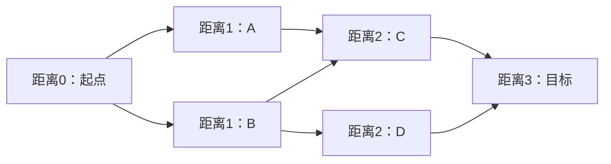
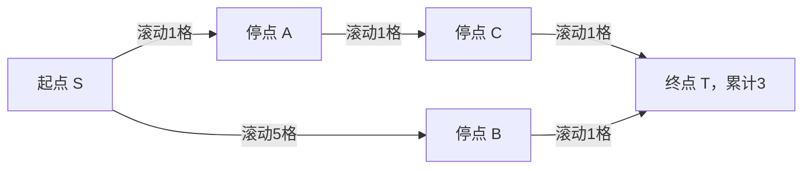
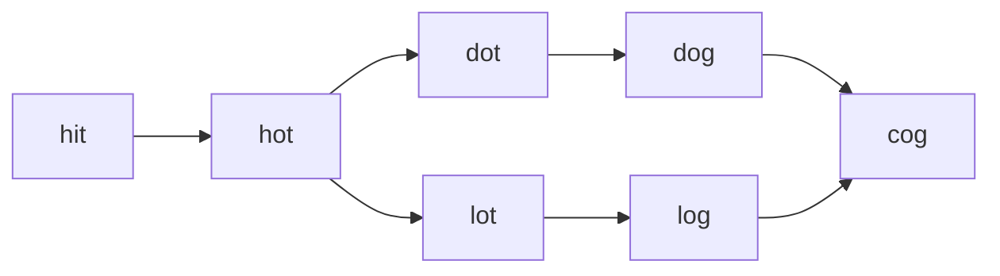

## BFS 的承诺：按步数从小到大扩展

来源：`03-bfs.pdf` 第 1–15、37、47–49、105–106 页。广度优先搜索用先进先出队列：先扩展距离0的起点，再扩展距离1、2……的状态。在**每条边代价相同**的图中，一个状态第一次被发现的距离就是最短距离。证明要点是：更短路径的前驱一定属于更早一层，若存在更短路径，它应该更早被发现，产生矛盾。

课件的最短树深、一步移动迷宫、Word Ladder 都满足单位边权。滚动小球一条边可跨多个格子，边权不同，不能套用“第一次发现即最短”。后文用 Dijkstra 处理；课件普通队列反复更新距离的版本是松弛算法，不是普通分层 BFS 的同一保证。



C 可能被 A、B 同时发现。应在第一次**入队**时标记 seen，而不是出队时才标记；否则重复项会在队列中不断累积。树没有环，每个非根节点只有一个父亲，一般不需要 visited；普通图通常需要。

|数据结构|取出规则|适合|
|---|---|---|
|栈|最后进入的先取出，LIFO|DFS、回溯、表达式求值|
|FIFO队列|最早进入的先取出|单位边权BFS、任务排队|
|优先队列|优先级最小者先取出|Dijkstra、事件按时间调度|

课件提到系统/多任务队列作为设计启发。真实任务调度是否FIFO由需求决定：优先级、公平性、阻塞与并发都属于额外规则，不能仅凭“Queue接口”推断调度顺序。

## Java Queue、Deque 和层的边界

来源：第 3–12、20–25、37、47 页。[Java Queue 官方文档](https://docs.oracle.com/javase/8/docs/api/java/util/Queue.html)列出三对操作：

|目的|失败时抛异常|用特殊返回值报告失败|
|---|---|---|
|加入元素|add(e)|offer(e)，容量不足时可返回false|
|取出队首|remove()|poll()，空时返回null|
|只看队首|element()|peek()，空时返回null|

本章用 `Queue<T> q=new ArrayDeque<>();`。左边是接口，右边是支持该接口的循环数组实现；`<>`推断元素类型。ArrayDeque 不允许 null，所以不采用空节点分层标记。LinkedList 可放 null，但用它当层分隔符需要处理空树和最后一层，很容易写成不断入队null的循环。

分层有三种写法：两个队列分别保存当前层和下一层；放一个特殊哨兵标记层尾；进入外层循环先保存 `int size=q.size()`，恰好弹出size次。本章用第三种：内层不断加入下一层节点，也不会把它们错算到当前层，因为size是进入这一层时的快照。不能写 `i<q.size()`，队列长度正在变。

Python对应 `collections.deque.append/popleft`；课件部分页面用list.pop(0)，这会移动剩余元素，单次O(n)，可能把线性遍历拖成平方时间。ArrayDeque的常见队首/队尾操作是均摊O(1)。优先队列另有排序规则，不等于FIFO。

二叉树代码默认在线评测提供 `TreeNode{int val; TreeNode left,right;}`；本地运行时需加入DFS章节的同名定义。每个Solution类独立提交。

<a id="lc-102"></a>
## LC 102 · Binary Tree Level Order Traversal

来源：第 13–25 页。[官方题目](https://leetcode.com/problems/binary-tree-level-order-traversal/)。按从上到下、每层从左到右输出二维列表。先左后右入队，FIFO保证同层次序正确。

|层开始队列|固定size|依次弹出|加入下一层|保存|
|---|---:|---|---|---|
|[3]|1|3|9,20|[3]|
|[9,20]|2|9,20|15,7|[9,20]|
|[15,7]|2|15,7|无|[15,7]|

```java
import java.util.ArrayDeque;
import java.util.ArrayList;
import java.util.List;
import java.util.Queue;
class Solution {
    public List<List<Integer>> levelOrder(TreeNode root) {
        List<List<Integer>> answer = new ArrayList<>();
        if (root == null) return answer;
        Queue<TreeNode> queue = new ArrayDeque<>();
        queue.offer(root);
        while (!queue.isEmpty()) {
            int size = queue.size();
            List<Integer> level = new ArrayList<>(size);
            for (int i = 0; i < size; i++) {
                TreeNode node = queue.poll();
                level.add(node.val);
                if (node.left != null) queue.offer(node.left);
                if (node.right != null) queue.offer(node.right);
            }
            answer.add(level);
        }
        return answer;
    }
}
```

`new ArrayList<>(size)` 指初始**容量**，列表仍为空，不能随即get(0)；本代码用add逐个写入。poll删除队首并返回节点；非空条件和固定循环次数保证此处非null。每层new一个level，因此不用额外复制就能保存；复用同一列表再clear会破坏已保存结果。时间O(N)，队列O(W)，输出O(N)，W为最大层宽。空树返回[]，不能向ArrayDeque加入null。课件第22页哨兵Java版未先判断空根，可能不断处理null；本实现补齐。

<a id="lc-103"></a>
## LC 103 · Binary Tree Zigzag Level Order Traversal

来源：第 26–32 页。[官方题目](https://leetcode.com/problems/binary-tree-zigzag-level-order-traversal/)。层顺序不变，奇偶层交替左到右/右到左。最容易保证正确的方法是仍然普通BFS，只改变结果这一层的排列方向。

|层|正常访问|结果方向|保存|
|---|---|---|---|
|0|3|左到右|[3]|
|1|9,20|右到左|[20,9]|
|2|15,7|左到右|[15,7]|

```java
import java.util.ArrayDeque;
import java.util.ArrayList;
import java.util.Collections;
import java.util.List;
import java.util.Queue;
class Solution {
    public List<List<Integer>> zigzagLevelOrder(TreeNode root) {
        List<List<Integer>> answer = new ArrayList<>();
        if (root == null) return answer;
        Queue<TreeNode> queue = new ArrayDeque<>();
        queue.offer(root);
        boolean leftToRight = true;
        while (!queue.isEmpty()) {
            int size = queue.size();
            List<Integer> level = new ArrayList<>(size);
            for (int i = 0; i < size; i++) {
                TreeNode node = queue.poll();
                level.add(node.val);
                if (node.left != null) queue.offer(node.left);
                if (node.right != null) queue.offer(node.right);
            }
            if (!leftToRight) Collections.reverse(level);
            answer.add(level);
            leftToRight = !leftToRight;
        }
        return answer;
    }
}
```

Collections.reverse原地反转列表，单层O(k)，所有层的k相加等于N，所以课件提出的“每层反转很费时吗”答案是：增加线性常数工作，**总时间仍O(N)**。`!leftToRight` 每层切换一次。双栈也可实现：弹栈的次序与压入次序相反，因此按层交替压左/右，但更容易弄反。工作空间O(W)，结果O(N)，不是因为反转就变O(N²)。

<a id="lc-513"></a>
## LC 513 · Find Bottom Left Tree Value

来源：第 33–36 页。[官方题目](https://leetcode.com/problems/find-bottom-left-tree-value/)。找最深一层最左节点的值，而非“所有左孩子中最深的那个”。一个右孩子也可能是最后一层唯一节点。

|课件树的层|队列|这一层最左|
|---|---|---:|
|0|[1]|1|
|1|[2,0]|2|
|2|[4,7,9]|4|

```java
import java.util.ArrayDeque;
import java.util.Queue;
class Solution {
    public int findBottomLeftValue(TreeNode root) {
        Queue<TreeNode> queue = new ArrayDeque<>();
        queue.offer(root);
        int answer = root.val;
        while (!queue.isEmpty()) {
            int size = queue.size();
            answer = queue.peek().val;
            for (int i = 0; i < size; i++) {
                TreeNode node = queue.poll();
                if (node.left != null) queue.offer(node.left);
                if (node.right != null) queue.offer(node.right);
            }
        }
        return answer;
    }
}
```

peek读取但不删除，取到新一层第一个节点；之后必须仍由poll处理它。输入按题目保证非空，若设计通用接口应另定义空树返回值/抛异常，而不能随意拿0代表不存在。每层覆盖answer，循环结束保留最后层结果。时间O(N)、队列O(W)。值可负，不影响位置判断。

<a id="lc-111"></a>
## LC 111 · Minimum Depth：第一次遇到叶子即可结束

来源：第 38–46 页。[官方题目](https://leetcode.com/problems/minimum-depth-of-binary-tree/)。求根到最近叶子的节点数。BFS按深度递增，第一片叶子一定在最浅层；无需等同层其他节点，更无需搜索更深层。

|root=[3,9,20,null,null,15,7]|动作|
|---|---|
|depth=1，弹3|有孩子，加入9,20|
|depth=2，弹9|左右都空，立即返回2|
|20的更深子树|无需再访问|

```java
import java.util.ArrayDeque;
import java.util.Queue;
class Solution {
    public int minDepth(TreeNode root) {
        if (root == null) return 0;
        Queue<TreeNode> queue = new ArrayDeque<>();
        queue.offer(root);
        int depth = 1;
        while (!queue.isEmpty()) {
            int size = queue.size();
            for (int i = 0; i < size; i++) {
                TreeNode node = queue.poll();
                if (node.left == null && node.right == null) return depth;
                if (node.left != null) queue.offer(node.left);
                if (node.right != null) queue.offer(node.right);
            }
            depth++;
        }
        return 0;
    }
}
```

叶子条件必须是`&&`，只有一个空孩子不能返回。depth在整层处理完后递增，不是每弹一个节点递增。最后return0对合法非空有限树不可达，只为补齐Java控制流。最坏O(N)时间、O(W)空间；DFS最坏也O(N)，但若浅层有叶子BFS可更早停止，若树很宽则BFS队列可能大于DFS调用栈。第39页文字递推漏写的+1应补上，完整DFS见 [DFS版](#/lesson/02?section=lc-111)。

<a id="maze-bfs"></a>
## 课堂题 · Simple Maze：从可达性到最少步数

来源：第 49–51 页。网格里每次走上下左右一步，X是墙，其他格可通行。BFS除了判断可达，还能直接返回最少步数。队列里的状态可用`r*列数+c`编码成整数，再用整除/余数还原，列数不能误写为行数。

例如 `..X / ... / X..`，从(0,0)到(2,2)：

|距离|第一次发现的格子|
|---|---|
|0|(0,0)|
|1|(1,0),(0,1)|
|2|(1,1)|
|3|(2,1),(1,2)|
|4|(2,2)，返回4|

```java
import java.util.ArrayDeque;
import java.util.Arrays;
import java.util.Queue;
class Solution {
    public boolean canReach(char[][] maze, int sr, int sc, int tr, int tc) {
        return shortestSteps(maze, sr, sc, tr, tc) != -1;
    }
    public int shortestSteps(char[][] maze, int sr, int sc, int tr, int tc) {
        if (maze.length == 0 || maze[0].length == 0) return -1;
        int m = maze.length, n = maze[0].length;
        if (sr < 0 || sr >= m || sc < 0 || sc >= n
                || tr < 0 || tr >= m || tc < 0 || tc >= n
                || maze[sr][sc] == 'X' || maze[tr][tc] == 'X') return -1;
        int[][] dist = new int[m][n];
        for (int[] row : dist) Arrays.fill(row, -1);
        int[] dr = {1, 0, -1, 0}, dc = {0, 1, 0, -1};
        Queue<Integer> queue = new ArrayDeque<>();
        queue.offer(sr * n + sc);
        dist[sr][sc] = 0;
        while (!queue.isEmpty()) {
            int code = queue.poll(), r = code / n, c = code % n;
            if (r == tr && c == tc) return dist[r][c];
            for (int k = 0; k < 4; k++) {
                int nr = r + dr[k], nc = c + dc[k];
                if (nr < 0 || nr >= m || nc < 0 || nc >= n
                        || maze[nr][nc] == 'X' || dist[nr][nc] != -1) continue;
                dist[nr][nc] = dist[r][c] + 1;
                queue.offer(nr * n + nc);
            }
        }
        return -1;
    }
}
```

距离数组同时充当visited，−1是未发现；必须在offer前写距离。Queue<Integer>装箱整数，poll后自动拆箱；Arrays.fill逐行填−1，因为二维数组是数组的数组。课件原代码先比较邻居是不是目标，再判断边界/墙，可能把墙内终点当成功；起点也没有先标记，且起终点重合没有正确处理。本解先验证起终点，弹出合法节点后判断目标，距离0自然处理起终点相同。时间和空间O(mn)。若要路径，首次发现时保存父坐标，终点沿父指针倒走再反转即可。

<a id="lc-505"></a>
## LC 505 · The Maze II：滚动距离是边权

来源：第 52–58 页。[官方页面](https://leetcode.com/problems/the-maze-ii/)（题目正文可能需要订阅）。球选定方向后必须一直滚，直到下一步是墙或边界才停；只有停止位置才能重新选择方向。求停在终点的最小经过格数，经过终点但不停不算成功。

把“停下来的格子”当顶点，一次完整滚动当边，边权是滚过的格数。边权1、3、5都可能出现，所以普通BFS层数代表“转向次数”，不是距离。Dijkstra用最小堆，每次弹出当前总距离最小的状态；非负边权保证弹出时距离已确定。



上图三次滚动共3格，优于两次滚动共6格，是“最少边数”和“最小边权和”不同的例子。课件矩阵`00100/00000/00010/11011/00000`，起(0,4)终(4,4)的12步路线：

|动作|停止格|新增距离|累计|
|---|---|---:|---:|
|左|(0,3)|1|1|
|下|(1,3)|1|2|
|左|(1,0)|3|5|
|下|(2,0)|1|6|
|右|(2,2)|2|8|
|下|(4,2)|2|10|
|右|(4,4)|2|12|

```java
import java.util.Arrays;
import java.util.PriorityQueue;
class Solution {
    public int shortestDistance(int[][] maze, int[] start, int[] destination) {
        int m = maze.length, n = maze[0].length;
        int[][] dist = new int[m][n];
        for (int[] row : dist) Arrays.fill(row, Integer.MAX_VALUE);
        PriorityQueue<int[]> heap = new PriorityQueue<>(
                (a, b) -> Integer.compare(a[0], b[0]));
        dist[start[0]][start[1]] = 0;
        heap.offer(new int[]{0, start[0], start[1]});
        int[] dr = {1, 0, -1, 0}, dc = {0, 1, 0, -1};
        while (!heap.isEmpty()) {
            int[] cur = heap.poll();
            int d = cur[0], r = cur[1], c = cur[2];
            if (d != dist[r][c]) continue;
            if (r == destination[0] && c == destination[1]) return d;
            for (int k = 0; k < 4; k++) {
                int nr = r, nc = c, steps = 0;
                while (nr + dr[k] >= 0 && nr + dr[k] < m
                        && nc + dc[k] >= 0 && nc + dc[k] < n
                        && maze[nr + dr[k]][nc + dc[k]] == 0) {
                    nr += dr[k];
                    nc += dc[k];
                    steps++;
                }
                if (d + steps < dist[nr][nc]) {
                    dist[nr][nc] = d + steps;
                    heap.offer(new int[]{d + steps, nr, nc});
                }
            }
        }
        return -1;
    }
}
```

`PriorityQueue<int[]>`不能自动按数组内容排序，lambda `(a,b)->...`提供比较器；`Integer.compare`避免`a[0]-b[0]`潜在溢出。数组的三个槽明确是距离/行/列。堆不支持直接高效减少已有键，所以加入新状态，旧状态弹出时由`d!=dist`跳过。while先检查**下一格**，无需像课件先撞墙再回退一步；如果一步都动不了，d+0不会改进自身，自动跳过。

设V≤mn个停点，D=max(m,n)，每个确定停点滚4个方向，时间O(mn·D+mn log(mn))，空间O(mn)。预计算各格各方向终点与步数后可去掉重复滚动扫描。课件FIFO松弛版只在距离更小时重新入队，也能不断改进到正确结果，但不能第一次到目标就返回，也不应宣称与普通BFS同为O(V+E)。

<a id="lc-499"></a>
## LC 499 · The Maze III：距离相同时比较路径字符串

来源：第 59–64 页。[官方页面](https://leetcode.com/problems/the-maze-iii/)（题目正文可能需要订阅）。球遇到洞立即掉入，即使还没撞墙也停止；优先最短实际距离，距离相同再取方向串字典序最小，方向为d/l/r/u；无解返回`impossible`。

课件例子：`00000/11001/00000/01001/01000`，ball=(4,3)，hole=(0,1)。

|路径|停靠/入洞|距离|比较|
|---|---|---:|---|
|l→u→l|(4,2)→(0,2)→(0,1)|1+4+1=6|字符串lul|
|u→l|(0,3)→(0,1)|4+2=6|字符串ul|
|选答案|同为6|6|l<u，所以lul|

```java
import java.util.Arrays;
import java.util.PriorityQueue;
class Solution {
    private static class State {
        int row, col, distance;
        String path;
        State(int row, int col, int distance, String path) {
            this.row = row; this.col = col;
            this.distance = distance; this.path = path;
        }
    }
    public String findShortestWay(int[][] maze, int[] ball, int[] hole) {
        int m = maze.length, n = maze[0].length;
        int[][] dist = new int[m][n];
        String[][] bestPath = new String[m][n];
        for (int[] row : dist) Arrays.fill(row, Integer.MAX_VALUE);
        PriorityQueue<State> heap = new PriorityQueue<>((a, b) -> {
            int cmp = Integer.compare(a.distance, b.distance);
            return cmp != 0 ? cmp : a.path.compareTo(b.path);
        });
        dist[ball[0]][ball[1]] = 0;
        bestPath[ball[0]][ball[1]] = "";
        heap.offer(new State(ball[0], ball[1], 0, ""));
        int[] dr = {1, 0, 0, -1}, dc = {0, -1, 1, 0};
        char[] direction = {'d', 'l', 'r', 'u'};
        while (!heap.isEmpty()) {
            State s = heap.poll();
            if (s.distance != dist[s.row][s.col]
                    || !s.path.equals(bestPath[s.row][s.col])) continue;
            if (s.row == hole[0] && s.col == hole[1]) return s.path;
            for (int k = 0; k < 4; k++) {
                int r = s.row, c = s.col, steps = 0;
                while (r + dr[k] >= 0 && r + dr[k] < m
                        && c + dc[k] >= 0 && c + dc[k] < n
                        && maze[r + dr[k]][c + dc[k]] == 0) {
                    r += dr[k]; c += dc[k]; steps++;
                    if (r == hole[0] && c == hole[1]) break;
                }
                if (steps == 0) continue;
                int nd = s.distance + steps;
                String np = s.path + direction[k];
                if (nd < dist[r][c] || (nd == dist[r][c]
                        && np.compareTo(bestPath[r][c]) < 0)) {
                    dist[r][c] = nd;
                    bestPath[r][c] = np;
                    heap.offer(new State(r, c, nd, np));
                }
            }
        }
        return "impossible";
    }
}
```

State是private static嵌套类，用来把相关字段放一起，static表示不隐含持有外层Solution实例。`this.row=row`区分字段与同名参数。比较器先比distance再比path，不能只按方向枚举顺序假定最小答案先到。`String.compareTo`返回负/零/正表示字典序小/等/大；`.equals`比较文本，`==`只比较引用。`s.path+direction[k]`创建新字符串，不会修改s.path。首次到某格时nd<MAX成立，OR短路避免对null bestPath调用compareTo；相等距离的有限状态已经有路径。steps==0禁止无意义的原地动作。

设V≤mn、D=max(m,n)、K为候选方向串最大长度，计入字符串复制与比较后，时间可界为O(VD+VK log V)，空间O(VK)；最优正权路径不会绕正权环，K可界为O(V)。空方向串对应球一开始就在洞中。洞不可达返回impossible。课件普通队列版本必须同时在距离下降或等距字典序变小时松弛，不能仅用visited一次性封死状态。

<a id="lc-127"></a>
## LC 127 · Word Ladder：把字典看成隐式图

来源：第 65–87 页。[官方题目](https://leetcode.com/problems/word-ladder/)。一次仅改变一个字符，新单词必须在wordList里，求beginWord到endWord的最短序列**单词数**，无解为0。每个单词是顶点，相差一个字符就连边；不必提前建出所有边，每次尝试每个位置的26个字母即可。

**课件勘误：**示例wordList少了cog却给答案5。按当前官方题，endWord必须在字典里；缺cog时答案0，加入cog才有下面的路线。

|单词数/层|当前队列|新发现|
|---|---|---|
|1|hit|hot|
|2|hot|dot,lot|
|3|dot,lot|dog,log|
|4|dog,log|cog|
|5|cog|返回5|

```java
import java.util.ArrayDeque;
import java.util.HashSet;
import java.util.List;
import java.util.Queue;
import java.util.Set;
class Solution {
    public int ladderLength(String beginWord, String endWord, List<String> wordList) {
        Set<String> unused = new HashSet<>(wordList);
        if (!unused.contains(endWord)) return 0;
        Queue<String> queue = new ArrayDeque<>();
        queue.offer(beginWord);
        unused.remove(beginWord);
        int length = 1;
        while (!queue.isEmpty()) {
            int size = queue.size();
            for (int k = 0; k < size; k++) {
                String word = queue.poll();
                if (word.equals(endWord)) return length;
                char[] chars = word.toCharArray();
                for (int i = 0; i < chars.length; i++) {
                    char old = chars[i];
                    for (char c = 'a'; c <= 'z'; c++) {
                        if (c == old) continue;
                        chars[i] = c;
                        String next = new String(chars);
                        if (unused.remove(next)) queue.offer(next);
                    }
                    chars[i] = old;
                }
            }
            length++;
        }
        return 0;
    }
}
```

HashSet将字典去重并支持平均O(1)哈希桶访问；字符串计算哈希/比较仍与长度有关。`remove(next)`返回是否真的移除了元素，一句同时表达“字典存在且之前未发现”，并标记已发现。toCharArray提供可变副本，每个位置尝试完必须恢复old，防止下一轮同时改动两个位置。字符串比较用equals。词数为N、词长L，候选生成O(26NL)，每次创建与哈希O(L)，故计入字符串处理的时间O(26NL²)，空间O(NL)。题目保证begin!=end；扩展为相同输入时通常定义答案1，应在字典检查前额外处理。

<a id="lc-126"></a>
## LC 126 · Word Ladder II：保存全部最短前驱

来源：第 88–104 页。[官方题目](https://leetcode.com/problems/word-ladder-ii/)。返回所有最短转换序列。仅记录一个父节点会漏答案；第一次到终点立即退出内层也会漏掉同层其他前驱。解决办法是BFS记录最短距离和所有满足距离增加1的前驱，再从end反向DFS重建。



|BFS发现|最短距离（边数）|前驱列表|
|---|---:|---|
|hit|0|无|
|hot|1|hit|
|dot / lot|2|hot / hot|
|dog / log|3|dot / lot|
|cog|4|dog、log，两个都要保留|

课件选择“处理完整一层后统一更新visited”；下面采用distance表：第一次发现入队，后续如果得到**相同最短距离**仍可追加前驱，若更长则丢弃。两者等价，不能把LC127立即从字典删词的写法原样搬来。

```java
import java.util.ArrayDeque;
import java.util.ArrayList;
import java.util.Collections;
import java.util.HashMap;
import java.util.HashSet;
import java.util.List;
import java.util.Map;
import java.util.Queue;
import java.util.Set;
class Solution {
    public List<List<String>> findLadders(String beginWord, String endWord,
                                          List<String> wordList) {
        List<List<String>> answer = new ArrayList<>();
        Set<String> words = new HashSet<>(wordList);
        if (!words.contains(endWord)) return answer;
        Map<String, Integer> dist = new HashMap<>();
        Map<String, List<String>> parents = new HashMap<>();
        Queue<String> queue = new ArrayDeque<>();
        queue.offer(beginWord);
        dist.put(beginWord, 0);
        int targetDistance = Integer.MAX_VALUE;
        while (!queue.isEmpty()) {
            String word = queue.poll();
            int nextDistance = dist.get(word) + 1;
            if (nextDistance > targetDistance) continue;
            char[] chars = word.toCharArray();
            for (int i = 0; i < chars.length; i++) {
                char old = chars[i];
                for (char c = 'a'; c <= 'z'; c++) {
                    if (c == old) continue;
                    chars[i] = c;
                    String next = new String(chars);
                    if (!words.contains(next)) continue;
                    if (!dist.containsKey(next)) {
                        dist.put(next, nextDistance);
                        queue.offer(next);
                    }
                    if (dist.get(next) == nextDistance) {
                        parents.computeIfAbsent(next, key -> new ArrayList<>()).add(word);
                        if (next.equals(endWord)) targetDistance = nextDistance;
                    }
                }
                chars[i] = old;
            }
        }
        if (dist.containsKey(endWord)) {
            build(endWord, beginWord, parents, new ArrayList<>(), answer);
        }
        return answer;
    }
    private void build(String word, String begin, Map<String, List<String>> parents,
                       List<String> reversePath, List<List<String>> answer) {
        reversePath.add(word);
        if (word.equals(begin)) {
            List<String> path = new ArrayList<>(reversePath);
            Collections.reverse(path);
            answer.add(path);
        } else {
            for (String parent : parents.get(word)) {
                build(parent, begin, parents, reversePath, answer);
            }
        }
        reversePath.remove(reversePath.size() - 1);
    }
}
```

Map<String,Integer>把词映射到距离，get自动拆箱后与int比较；`computeIfAbsent(next,key -> new ArrayList<>())`是Java8 API，缺键时创建列表，有键则返回已有列表，接着add记录另一个父节点。lambda参数key在这里不参与列表构造，只满足函数接口签名。反向DFS每一步距离严格减少，不会有环；到begin时复制reversePath、再反转副本，不能原地反转共享path。得到一条后撤销当前词，再试另一个父亲。

设最短路径数P，每条含D个词，前驱边数E。BFS约O(26NL²)，重建与复制O(PD)，额外索引空间O(NL+E)，输出O(PD)个词引用；不能忽略输出可能指数增长。end缺席返回[]；不可达也返回[]。课件第98页wordList/wordSet名称混用与方法参数类型不一致，直接拼接片段可能编译失败；此处统一words集合。若BFS把整条路径都入队，同一前缀会复制很多次，前驱DAG通常更省空间。

<a id="lc-130"></a>
## LC 130 · Surrounded Regions：从边界救出安全区域

来源：第 107–113 页。[官方题目](https://leetcode.com/problems/surrounded-regions/)。把不与边界相连的O区域变为X。与其对每片O判断是否被包围，不如从边界所有O反向出发，标记所有能逃到边界的O为安全；最后未标记O全部翻转，安全标记恢复O。

|课件棋盘|处理|
|---|---|
|XXXX / XOOX / XXOX / XOXX|边界只有(3,1)为O|
|从(3,1)多源BFS|只标记它为#，无法连到内部区域|
|扫描全部格子|内部(1,1),(1,2),(2,2)翻X|
|恢复#|底部(3,1)保持O|

```java
import java.util.ArrayDeque;
import java.util.Queue;
class Solution {
    public void solve(char[][] board) {
        if (board.length == 0 || board[0].length == 0) return;
        int m = board.length, n = board[0].length;
        Queue<Integer> queue = new ArrayDeque<>();
        for (int r = 0; r < m; r++) {
            mark(board, r, 0, queue);
            mark(board, r, n - 1, queue);
        }
        for (int c = 0; c < n; c++) {
            mark(board, 0, c, queue);
            mark(board, m - 1, c, queue);
        }
        int[] dr = {1, 0, -1, 0}, dc = {0, 1, 0, -1};
        while (!queue.isEmpty()) {
            int code = queue.poll(), r = code / n, c = code % n;
            for (int k = 0; k < 4; k++) {
                int nr = r + dr[k], nc = c + dc[k];
                if (nr >= 0 && nr < m && nc >= 0 && nc < n) {
                    mark(board, nr, nc, queue);
                }
            }
        }
        for (int r = 0; r < m; r++) {
            for (int c = 0; c < n; c++) {
                if (board[r][c] == 'O') board[r][c] = 'X';
                else if (board[r][c] == '#') board[r][c] = 'O';
            }
        }
    }
    private void mark(char[][] b, int r, int c, Queue<Integer> q) {
        if (b[r][c] != 'O') return;
        b[r][c] = '#';
        q.offer(r * b[0].length + c);
    }
}
```

mark检查必须为O才能处理，角落被两次边界循环触及时第二次会跳过；入队前立刻改成#，避免重复发现。`else if`防止刚把O改为X后又错误处理。输入保证只有X/O，所以#可安全用作内部标记。原地修改满足题目要求。时间O(mn)，最坏队列空间O(mn)。课件DFS版本省略通向边界部分的条件依赖“所有边界都会另行调用”的前提，不宜当通用洪水填充模板；用统一四方向合法性判断更不易误用。单行/单列全是边界，所有O都保留。

<a id="lc-200"></a>
## 延伸 LC 200 · Number of Islands

来源：第 106 页列举的DFS/BFS共同应用。[官方题目](https://leetcode.com/problems/number-of-islands/)。字符'1'为陆地，'0'为水，四邻接的陆地组成岛，求连通块数量。扫描每个格子，发现尚未处理的1就把答案加1，再BFS清除整个岛；这样同一岛只计一次。

|网格 11000 / 11000 / 00100 / 00011|扫描结果|
|---|---|
|(0,0)尚未访问|第1岛，淹没左上4格|
|(2,2)尚未访问|第2岛，淹没单格|
|(3,3)尚未访问|第3岛，连同(3,4)淹没|

```java
import java.util.ArrayDeque;
import java.util.Queue;
class Solution {
    public int numIslands(char[][] grid) {
        if (grid.length == 0 || grid[0].length == 0) return 0;
        int m = grid.length, n = grid[0].length, count = 0;
        int[] dr = {1, 0, -1, 0}, dc = {0, 1, 0, -1};
        Queue<Integer> queue = new ArrayDeque<>();
        for (int r = 0; r < m; r++) {
            for (int c = 0; c < n; c++) {
                if (grid[r][c] != '1') continue;
                count++;
                grid[r][c] = '0';
                queue.offer(r * n + c);
                while (!queue.isEmpty()) {
                    int code = queue.poll(), x = code / n, y = code % n;
                    for (int k = 0; k < 4; k++) {
                        int nx = x + dr[k], ny = y + dc[k];
                        if (nx < 0 || nx >= m || ny < 0 || ny >= n
                                || grid[nx][ny] != '1') continue;
                        grid[nx][ny] = '0';
                        queue.offer(nx * n + ny);
                    }
                }
            }
        }
        return count;
    }
}
```

这是破坏性输入标记；需要保留grid时换boolean[][] seen。队列在每个岛搜索完成后为空，可以复用；count在发现一个新的连通块时加1，而不是每个陆地加1。字符'1'不同于整数1，坐标编码仍用列数n。时间O(mn)，空间最坏O(mn)。斜对角不相连，例如`10/01`有2岛。

## BFS、DFS 与带权最短路的选择

“需要最短”并不直接等于“任何队列都能解决”。单位边权用BFS，非负不同边权用Dijkstra；只判断连通性时DFS/BFS都可；枚举全部解常用回溯；找到所有最短方案可先BFS压成前驱DAG，再DFS输出。课件写Word Edit Distance是在提示“以编辑作为一步的状态图”；本章实际展开的是只替换一个字母的Word Ladder，不等同于允许插入/删除的完整编辑距离题。

用三个问题检查实现：状态何时能被永久标记；队列的一层代表什么；答案是在发现目标时、弹出目标时还是处理完整层之后才能确定。LC127首次发现最短长度就够，LC126必须保留同层全部前驱，Maze II/III需要按最小累计代价出堆。差异都来自题目要求，不是模板的例外补丁。
