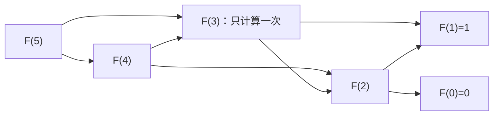
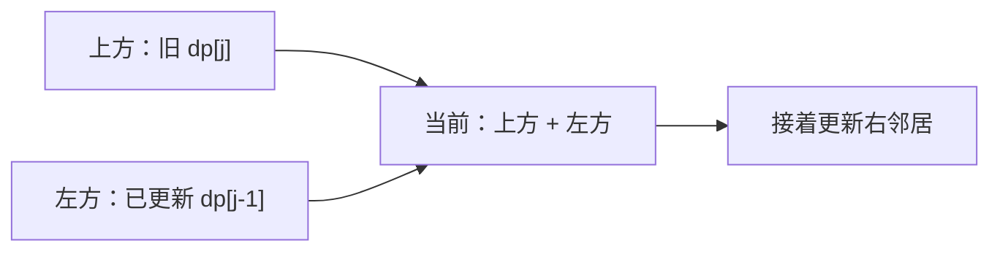
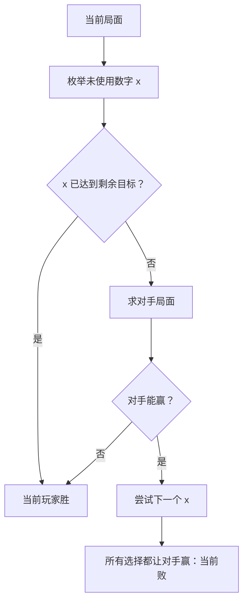

## 从重复递归到动态规划

来源：`04-dynamic-programming.pdf` 第 1–8、34–37 页。动态规划（DP）先给子问题一个精确的名字，再保证每个相同状态只计算一次。它不是一种固定的二维数组写法，也不要求必须求最大值：计数、可行性、最小代价和博弈都能使用 DP。

以 Fibonacci 为例，递归调用 `F(5)` 和 `F(4)` 都会继续求 `F(3)`。递归树中的两个节点只要参数完全相同，它们的答案就相同，可以合并为一个状态。这叫**重叠子问题**。优化问题还要证明**最优子结构**：如果整体方案用了一个不是最优的子方案，将它替换为更优子方案不会破坏合法性，整体便会更优，产生矛盾。计数问题更关心分支互斥且覆盖所有情况；不要强行把它叫“最大值子结构”。



记忆化是自顶向下：先问需要哪个状态，递归前查缓存；制表是自底向上：按依赖顺序把需要的状态填好。二者都来自同一个递推关系。记忆化只访问可达状态，但有调用栈；制表不递归，遍历顺序必须与依赖一致。DP 也不一定是多项式：以子集作为状态仍可有 `2^n` 个状态；背包的 `O(nW)` 是对数值 W 的伪多项式复杂度。

写 DP 前逐一回答五件事：状态里保存的究竟是什么；最后一步/最后一个物品有什么选择；每种选择依赖哪些更小状态；空输入、第一行第一列如何初始化；最终答案是某个格子还是整张表的最大值。空间压缩最后做，先证明被覆盖的旧值以后不会再用。

贪心只保留当前最有希望的一条选择，需要额外的交换论证或结构性质。硬币 `[1,3,4]` 凑 6 时，贪心 `4+1+1` 用 3 枚，DP 找到 `3+3` 用 2 枚。课件第 35 页“DP 会把指数降到多项式”和第 36 页三种算法关系是学习提示，不是无条件的定理。

<a id="lc-509"></a>
## LC 509 · Fibonacci：先统一边界

来源：第 6–8 页。[官方题目](https://leetcode.com/problems/fibonacci-number/)。标准定义是 `F(0)=0,F(1)=1`；本课件这一章使用 `1,1` 开头，与递归章不同，得到的是标准 `F(n+1)`。下面按 LeetCode 定义写。

状态为第 i 个 Fibonacci 数，转移 `F(i)=F(i-1)+F(i-2)`。算完 i 后，只需保留 i−1 和 i 的值。不变量：循环开始时 a 是 `F(i-2)`，b 是 `F(i-1)`。

| i | a（旧） | b（旧） | 新值 a+b |
|---|---:|---:|---:|
|2|0|1|1|
|3|1|1|2|
|4|1|2|3|
|5|2|3|5|

```java
class Solution {
    public int fib(int n) {
        if (n < 2) return n;
        int a = 0, b = 1;
        for (int i = 2; i <= n; i++) {
            int next = a + b;
            a = b;
            b = next;
        }
        return b;
    }
}
```

`next` 必须在覆盖 a/b 之前求出，直接写 `a=b; b=a+b` 会重复使用旧 b。这里没有额外库 API。时间 O(n)，额外空间 O(1)；朴素递归时间 O(φ^n)、栈 O(n)。n=0 和 n=1 要直接返回；题目 n≤30 的范围内 int 足够，不能把这点推广到任意 n。

<a id="lc-62"></a>
## LC 62 · Unique Paths：由最后一步划分计数

来源：第 9–13 页。[官方题目](https://leetcode.com/problems/unique-paths/)。机器人从 m×n 网格左上角到右下角，只能向右或向下。求不同路径数。最后一步来自上方或左方，这两类路径互不重叠，所以相加。

定义 `dp[i][j]` 为到达坐标 (i,j) 的路径数，`dp[i][j]=dp[i-1][j]+dp[i][j-1]`。第一行只能一直向右，第一列只能一直向下，均为 1。3×4 的计算表为：

| 行\列 |0|1|2|3|
|---|---:|---:|---:|---:|
|0|1|1|1|1|
|1|1|2|3|4|
|2|1|3|6|10|



```java
import java.util.Arrays;
class Solution {
    public int uniquePaths(int m, int n) {
        int[] dp = new int[n];
        Arrays.fill(dp, 1);
        for (int i = 1; i < m; i++) {
            for (int j = 1; j < n; j++) dp[j] += dp[j - 1];
        }
        return dp[n - 1];
    }
}
```

`Arrays.fill(dp,1)` 把每个位置设为 1；`dp[j] += dp[j-1]` 等价于读取更新前的 dp[j] 加上已更新的左邻居，再写回。因此必须从左向右扫。课件用新旧两行数组也正确，空间仍为 O(n)；一行更直接。时间 O(mn)，空间 O(n)。m=1 或 n=1 自动返回 1。通用超大网格计数可能需要 BigInteger，题目保证目标答案在其要求范围内。

<a id="lc-64"></a>
## LC 64 · Minimum Path Sum：把相加的计数换成最小代价

来源：第 14–20 页。[官方题目](https://leetcode.com/problems/minimum-path-sum/)。每个格子有非负代价，只向右/下，经过起点和终点都计费。状态是“到这个格子的最小累计代价”，不是“这个格子的数”。最后一步必从上或左，取较小者，再加当前格子。

课件矩阵对应的完整 DP：

|行|原始格子|累计最优值|
|---|---|---|
|0|1,3,4,2|1,4,8,10|
|1|3,5,2,3|4,9,10,13|
|2|2,1,2,3|6,7,9,12|
|3|2,2,4,2|8,9,13,14|

例如 (2,2) 选 `min(10,7)+2=9`；终点选 `min(12,13)+2=14`。若要恢复路径，可记录每格来自上还是左，再从终点倒走；只保留一行时无法直接还原全部决策。

```java
class Solution {
    public int minPathSum(int[][] grid) {
        int m = grid.length, n = grid[0].length;
        int[] dp = new int[n];
        dp[0] = grid[0][0];
        for (int j = 1; j < n; j++) dp[j] = dp[j - 1] + grid[0][j];
        for (int i = 1; i < m; i++) {
            dp[0] += grid[i][0];
            for (int j = 1; j < n; j++) {
                dp[j] = Math.min(dp[j], dp[j - 1]) + grid[i][j];
            }
        }
        return dp[n - 1];
    }
}
```

`Math.min` 返回两个 int 的较小值；数组默认的 0 不是所有边界的正确答案，所以显式填第一行。第 19–20 页标题 Minimum Path Sum II 仍是同一题的滚动数组优化，不是另一道编号题。`currentRow.clone()` 复制数组；直接赋值会让两个变量指向同一个数组，语义不同。时间 O(mn)，额外空间 O(n)，不修改输入；一个格子时答案就是它自己。

<a id="knapsack-value"></a>
## 课堂题 · 0–1 背包最大价值

来源：第 21–28 页。物品 i 有重量 w[i] 和价值 v[i]，最多取一次，总重量不超过 W，最大化价值。本题和递归章“能否恰好装满”不是同一个返回值。

定义 `dp[i][c]` 为只使用前 i 件物品、容量上限 c 的最大价值。若第 i 件不取，值为 `dp[i-1][c]`；若取且放得下，为 `dp[i-1][c-w]+v`。两分支取最大。0 件物品时任意容量都可什么也不放，答案为 0。

|已考虑物品 (重,值)|容量0|1|2|3|4|5|6|7|
|---|---:|---:|---:|---:|---:|---:|---:|---:|
|无|0|0|0|0|0|0|0|0|
|(1,3)|0|3|3|3|3|3|3|3|
|再加(3,8)|0|3|3|8|11|11|11|11|
|再加(4,4)|0|3|3|8|11|11|11|12|
|再加(5,7)|0|3|3|8|11|11|11|12|

```java
class Solution {
    public int knapsack(int capacity, int[] weights, int[] values) {
        int[] dp = new int[capacity + 1];
        for (int i = 0; i < weights.length; i++) {
            for (int c = capacity; c >= weights[i]; c--) {
                dp[c] = Math.max(dp[c], dp[c - weights[i]] + values[i]);
            }
        }
        return dp[capacity];
    }
}
```

**倒序容量是语义的一部分。**处理重量 1、价值 3 的物品时，若正序更新，dp[1]=3 后立刻拿它更新 dp[2]=6，相当于同一件拿了两次。倒序保证 `dp[c-w]` 仍是上一件物品处理完时的值。`Math.max` 比较取与不取；`capacity+1` 让下标本身就是容量。时间 O(nW)，空间 O(W)。假设重量为正，weights/values 长度相同；W=0 返回 0。若要求恰好装满，除 dp[0]=0 外其余应为不可达哨兵，不能全部设 0。

<a id="lc-322"></a>
## LC 322 · Coin Change：无限次取用与不可达状态

来源：第 29–33 页。[官方题目](https://leetcode.com/problems/coin-change/)。给定正面额硬币，各可无限取，恰好凑 amount，返回最少枚数，无解返回 −1。最优方案最后一枚是 c，那么去掉它以后必须是金额 a−c 的最优解，否则可以替换为更短方案。

`dp[a]` 表示凑 a 的最少枚数。`dp[0]=0`，其余初始化为 `amount+1`（任何可行解最多 amount 枚，因为每枚至少值 1）。转移 `dp[a]=min(dp[a-c]+1)`。

|a，coins=[1,3,4]|0|1|2|3|4|5|6|
|---|---:|---:|---:|---:|---:|---:|---:|
|dp[a]|0|1|2|1|1|2|2|
|最后一枚可选的最优方案|空|1|1+1|3|4|4+1|3+3|

```java
import java.util.Arrays;
class Solution {
    public int coinChange(int[] coins, int amount) {
        int[] dp = new int[amount + 1];
        Arrays.fill(dp, amount + 1);
        dp[0] = 0;
        for (int a = 1; a <= amount; a++) {
            for (int c : coins) {
                if (c <= a) dp[a] = Math.min(dp[a], dp[a - c] + 1);
            }
        }
        return dp[amount] > amount ? -1 : dp[amount];
    }
}
```

增强 for `for(int c:coins)` 依次读取每个面额；三元表达式 `条件 ? A : B` 只计算被选中的分支。这里不需要排序。课件二维法枚举第 i 种硬币使用 k 次，逻辑正确但多一层循环，最坏可达 O(kA²)；用“最后一枚”转移只需 O(kA)，空间 O(A)。不要对 `Integer.MAX_VALUE` 直接加 1，否则会溢出；本解选有限哨兵。amount=0 返回 0，coins=[2]、amount=3 返回 −1。

<a id="lc-300"></a>
## LC 300 · 最长严格递增子序列

来源：第 38–47 页。[官方题目](https://leetcode.com/problems/longest-increasing-subsequence/)。可以跳过元素但不能改变相对顺序，求严格递增子序列的最大长度。关键是把状态定义成“**必须以 i 结尾**”，而不是模糊的“前 i 个的最优值”；只有知道末尾元素，才知道能否接 nums[i]。

`dp[i]=1+max(dp[j])`，其中 j<i 且 nums[j]<nums[i]；没有可接元素则为 1。全局答案取全部 dp 的最大值。

|nums|3|1|4|5|7|6|8|2|
|---|---:|---:|---:|---:|---:|---:|---:|---:|
|dp|1|1|2|3|4|4|5|2|
|一条对应末尾路径|3|1|1,4|1,4,5|1,4,5,7|1,4,5,6|1,4,5,6,8|1,2|

```java
import java.util.Arrays;
class Solution {
    public int lengthOfLIS(int[] nums) {
        int[] dp = new int[nums.length];
        Arrays.fill(dp, 1);
        int best = 0;
        for (int i = 0; i < nums.length; i++) {
            for (int j = 0; j < i; j++) {
                if (nums[j] < nums[i]) dp[i] = Math.max(dp[i], dp[j] + 1);
            }
            best = Math.max(best, dp[i]);
        }
        return best;
    }
}
```

两个 max 的用途不同：内层选接在 i 前的最佳路径，外层选整个数组中的最佳终点。`<` 不能写 `<=`，例如 `[2,2]` 答案为 1。时间 O(n²)，空间 O(n)。进阶的 O(n log n) 方法维护“每个长度能达到的最小末尾”，二分第一个不小于 x 的位置；该 tails 数组不是原数组中的一条真实子序列，不能直接拿来当路径输出。

<a id="lc-1143"></a>
## LC 1143 · 最长公共子序列

来源：第 48–57 页。[官方题目](https://leetcode.com/problems/longest-common-subsequence/)。两串里保留字符相对顺序，可以删除字符，求最长公共子序列长度。课件写 Common Sequence / Common String，这里是 subsequence，**不要求连续**。

`dp[i][j]` 用 A 的前 i 个字符、B 的前 j 个字符，空前缀长度为 0。若两个末尾字符相等，它们可以配对，`dp[i][j]=dp[i-1][j-1]+1`；不同就不能同时匹配，舍弃 A 末尾或 B 末尾，取 `max(dp[i-1][j],dp[i][j-1])`。

|A前缀 \ B前缀|空|a|ac|ace|
|---|---:|---:|---:|---:|
|空|0|0|0|0|
|a|0|1|1|1|
|ab|0|1|1|1|
|abc|0|1|2|2|
|abcd|0|1|2|2|
|abcde|0|1|2|3|

```java
class Solution {
    public int longestCommonSubsequence(String a, String b) {
        int m = a.length(), n = b.length();
        int[][] dp = new int[m + 1][n + 1];
        for (int i = 1; i <= m; i++) {
            for (int j = 1; j <= n; j++) {
                if (a.charAt(i - 1) == b.charAt(j - 1)) {
                    dp[i][j] = dp[i - 1][j - 1] + 1;
                } else {
                    dp[i][j] = Math.max(dp[i - 1][j], dp[i][j - 1]);
                }
            }
        }
        return dp[m][n];
    }
}
```

`String.length()` 是方法，数组 `length` 是字段；`charAt(i-1)` 将“前 i 个”转换为 0 起始的最后字符下标。二维 int 数组默认全部为 0，省去课件的边界赋零循环。时间 O(mn)，空间 O(mn)。课件例子 `abcfbc` 与 `abfcab` 可取 `abcb`，长度 4。回溯路径时，相等走左上并记录字符，否则向值较大的上/左格走，最终反转字符序列。

<a id="lc-198"></a>
## 作业 LC 198 · House Robber

来源：第 58 页。[官方题目](https://leetcode.com/problems/house-robber/)。一排房屋有非负金额，不能选相邻两家，求最大金额。处理最后一家只有“不选它，沿用前 i−1 家答案”和“选它，接前 i−2 家答案”两类，故 `best[i]=max(best[i-1],best[i-2]+nums[i])`。

|金额|2|7|9|3|1|
|---|---:|---:|---:|---:|---:|
|选当前所得|2|7|11|10|12|
|到此为止最优|2|7|11|11|12|

```java
class Solution {
    public int rob(int[] nums) {
        int twoBack = 0, oneBack = 0;
        for (int money : nums) {
            int current = Math.max(oneBack, twoBack + money);
            twoBack = oneBack;
            oneBack = current;
        }
        return oneBack;
    }
}
```

更新前 twoBack/oneBack 分别对应前前个和前一个前缀；用 current 暂存防止覆盖。增强 for 每次读取一间房的金额，Math.max 比较两种互斥选择。空数组按扩展定义返回 0；单间返回它的金额，全 0 返回 0。时间 O(n)，空间 O(1)，不能按金额由大到小贪心，因为选一家会排除两个邻居。

<a id="lc-53"></a>
## 作业 LC 53 · Maximum Subarray

来源：第 58 页。[官方题目](https://leetcode.com/problems/maximum-subarray/)。求非空连续子数组最大和。定义 `ending` 为必须在当前元素结尾的最大和；要么把 x 接到前一个 ending 后，要么从 x 重新开始。转移 `ending=max(x,ending+x)`，再用 best 记录所有终点。

|输入|−2|1|−3|4|−1|2|1|−5|4|
|---|---:|---:|---:|---:|---:|---:|---:|---:|---:|
|ending|−2|1|−2|4|3|5|6|1|5|
|best|−2|1|1|4|4|5|6|6|6|

```java
class Solution {
    public int maxSubArray(int[] nums) {
        int ending = nums[0], best = nums[0];
        for (int i = 1; i < nums.length; i++) {
            ending = Math.max(nums[i], ending + nums[i]);
            best = Math.max(best, ending);
        }
        return best;
    }
}
```

必须用第一个元素初始化，若用 0，全负数组会错误地返回不存在的空子数组。Math.max 在第一次调用选“续接或重启”，第二次更新最终答案；不需要集合或额外 API。时间 O(n)，空间 O(1)。这就是 Kadane 算法；其有效性来自“相同终点的较小和永远不比较大和更适合向后延伸”。

<a id="lc-120"></a>
## 作业 LC 120 · Triangle

来源：第 58 页。[官方题目](https://leetcode.com/problems/triangle/)。从三角形顶端走到底部，每次到下一行相同列 j 或 j+1，求最小路径和。自底向上令 dp[j] 表示从当前格子到底的最小代价，转移 `当前值+min(下方j,下方j+1)`。

|正在处理的行|更新完成的有效 dp|
|---|---|
|4,1,8,3|4,1,8,3|
|6,5,7|7,6,10|
|3,4|9,10|
|2|11|

```java
import java.util.List;
class Solution {
    public int minimumTotal(List<List<Integer>> triangle) {
        int n = triangle.size();
        int[] dp = new int[n + 1];
        for (int i = n - 1; i >= 0; i--) {
            for (int j = 0; j <= i; j++) {
                dp[j] = triangle.get(i).get(j) + Math.min(dp[j], dp[j + 1]);
            }
        }
        return dp[0];
    }
}
```

`List<List<Integer>>` 是嵌套泛型；第一层 get 取得一行，第二层取得 Integer，并在加法时自动拆箱。n+1 个零视为底部下面的虚拟零代价行。j 从左到右，让 dp[j+1] 仍然是下一行旧值。时间 O(n²)（n 是行数），空间 O(n)。负数也适用，因为状态依赖无环，不依赖代价非负。

<a id="lc-97"></a>
## 作业 LC 97 · Interleaving String

来源：第 58 页。[官方题目](https://leetcode.com/problems/interleaving-string/)。判断 s3 能否由 s1、s2 的字符交错组成，同时保持各自内部相对顺序。先检查长度之和。`dp[i][j]` 代表前 i 个 s1 字符与前 j 个 s2 字符能否形成 s3 的前 i+j 个字符。

最后字符来自 s1：要求 `dp[i-1][j]` 且 s1[i−1]=s3[i+j−1]；来自 s2 同理。两个条件用 OR。

|s1="ab", s2="cd", s3="acbd"|j=0|j=1|j=2|
|---|---|---|---|
|i=0|true|false|false|
|i=1|true|true|false|
|i=2|false|true|true|

```java
class Solution {
    public boolean isInterleave(String a, String b, String c) {
        int m = a.length(), n = b.length();
        if (m + n != c.length()) return false;
        boolean[][] dp = new boolean[m + 1][n + 1];
        dp[0][0] = true;
        for (int i = 0; i <= m; i++) {
            for (int j = 0; j <= n; j++) {
                if (i > 0) dp[i][j] |= dp[i - 1][j]
                        && a.charAt(i - 1) == c.charAt(i + j - 1);
                if (j > 0) dp[i][j] |= dp[i][j - 1]
                        && b.charAt(j - 1) == c.charAt(i + j - 1);
            }
        }
        return dp[m][n];
    }
}
```

布尔 `|=` 是“把已有结果与右边 OR 后写回”，不要误以为数值加法。它本身不短路，但右边的 `&&` 会；边界 if 保证 charAt 不访问 −1。Java boolean 数组默认为 false，空串组合只有 dp[0][0] 为 true。时间 O(mn)，空间 O(mn)。相同字符处不能贪心固定取 s1，否则可能错过必须取 s2 的后续组合。

<a id="lc-213"></a>
## 作业 LC 213 · House Robber II

来源：第 58 页。[官方题目](https://leetcode.com/problems/house-robber-ii/)。房屋成环，首尾也相邻。任何合法方案不可能同时选首尾，因此一定属于“禁止最后一家”或“禁止第一家”的至少一类；各做一次线性 House Robber，再取最大。

|输入 [2,3,2]|允许区间|最优|
|---|---|---:|
|排除末尾|[2,3]|3|
|排除开头|[3,2]|3|
|两类合并|最大值|3|

```java
class Solution {
    public int rob(int[] nums) {
        if (nums.length == 1) return nums[0];
        return Math.max(linear(nums, 0, nums.length - 2),
                        linear(nums, 1, nums.length - 1));
    }
    private int linear(int[] a, int lo, int hi) {
        int prev2 = 0, prev1 = 0;
        for (int i = lo; i <= hi; i++) {
            int current = Math.max(prev1, prev2 + a[i]);
            prev2 = prev1;
            prev1 = current;
        }
        return prev1;
    }
}
```

lo、hi 都是包含端点的下标；不复制子数组，减少分配。private helper 只服务本类；两次调用的局部变量互不影响。n=1 必须单独处理，不能因为同时是首尾就排除它；n=2 取较大的一家。时间 O(n)，空间 O(1)。不需要强迫选首或选尾，两区间算法都允许两者都不选。

<a id="lc-115"></a>
## 选做 LC 115 · Distinct Subsequences

来源：第 59 页。[官方题目](https://leetcode.com/problems/distinct-subsequences/)。在 s 中删除若干字符形成 t，按所选下标组合计数。即使字符文本相同，选择不同位置也是不同方案。`dp[i][j]` 表示 s 前 i 个字符形成 t 前 j 个字符的方案数。

不选 s[i−1] 得 `dp[i-1][j]`；两字符相等时可以选，再加 `dp[i-1][j-1]`。空目标有且仅有一种方法：全删，故 dp[i][0]=1。

|逐字扫描 s="babgbag"，t="bag"|空|b|ba|bag|
|---|---:|---:|---:|---:|
|初始|1|0|0|0|
|b|1|1|0|0|
|a|1|1|1|0|
|b|1|2|1|0|
|g|1|2|1|1|
|b|1|3|1|1|
|a|1|3|4|1|
|g|1|3|4|5|

```java
import java.math.BigInteger;
import java.util.Arrays;
class Solution {
    public int numDistinct(String s, String t) {
        BigInteger[] dp = new BigInteger[t.length() + 1];
        Arrays.fill(dp, BigInteger.ZERO);
        dp[0] = BigInteger.ONE;
        for (int i = 0; i < s.length(); i++) {
            for (int j = t.length(); j >= 1; j--) {
                if (s.charAt(i) == t.charAt(j - 1)) {
                    dp[j] = dp[j].add(dp[j - 1]);
                }
            }
        }
        return dp[t.length()].intValueExact();
    }
}
```

这里刻意用 BigInteger：最终答案受 int 范围约束，并不自动保证所有前缀计数不溢出。BigInteger 是不可变对象，`.add` 返回新的数；Arrays.fill 共享 ZERO 是安全的，因为它不会被原地修改。`.intValueExact()` 在结果超 int 时抛出异常，题目约束内不会触发。j 倒序防止同一个 s 字符被多次使用。进行 O(mn) 次大整数加法，若最大中间数有 B 位，位复杂度 O(mnB)，额外存储 O(nB)。

<a id="lc-174"></a>
## 选做 LC 174 · Dungeon Game

来源：第 59 页。[官方题目](https://leetcode.com/problems/dungeon-game/)。从左上到右下，只向右/下，格子数可增减生命，途中生命始终至少 1，求最少初始生命。前向只记“最大累计和”会丢失路径的最低谷信息。反过来定义 `need[i][j]`：进入该格前，至少需要多少生命才能活到终点。

离开后需要下/右较小的 need；当前格提供 grid[i][j]，所以 `need=max(1,min(下,右)-grid[i][j])`。

|格子值|反向所需生命|
|---|---|
|−2,−3,3|7,5,2|
|−5,−10,1|6,11,5|
|10,30,−5|1,1,6|

```java
import java.util.Arrays;
class Solution {
    public int calculateMinimumHP(int[][] dungeon) {
        int m = dungeon.length, n = dungeon[0].length;
        int[] dp = new int[n + 1];
        Arrays.fill(dp, Integer.MAX_VALUE);
        dp[n - 1] = 1;
        for (int i = m - 1; i >= 0; i--) {
            for (int j = n - 1; j >= 0; j--) {
                int after = Math.min(dp[j], dp[j + 1]);
                dp[j] = Math.max(1, after - dungeon[i][j]);
            }
        }
        return dp[0];
    }
}
```

dp[n] 是右边界不可达哨兵；先令 dp[n−1]=1，给终点下方放置虚拟的“至少 1”出口。每格至少有一个有限后继，因此不会对 MAX_VALUE 做减法运算得到伪状态。逆序让 dp[j] 保留下一行、dp[j+1] 是当前行右侧。时间 O(mn)，空间 O(n)。单格 −5 需 6，单格 +5 需 1；答案不能低于 1。

<a id="lc-474"></a>
## 选做 LC 474 · Ones and Zeroes

来源：第 59 页。[官方题目](https://leetcode.com/problems/ones-and-zeroes/)。从二进制字符串集合选尽可能多的字符串，0 总数不超过 m、1 总数不超过 n，每条字符串只能用一次。它是有两种容量的 0–1 背包：物品重量为 `(零数,一数)`，价值统一为 1。

以 `["10","0","1"]`、m=n=1 为例：先处理 "10"，dp[1][1]=1；处理 "0"，dp[1][0]=1；最后处理 "1"，dp[1][1] 可从 dp[1][0]+1 得到 2，对应选 "0" 与 "1"。

```java
class Solution {
    public int findMaxForm(String[] strs, int m, int n) {
        int[][] dp = new int[m + 1][n + 1];
        for (String s : strs) {
            int zeros = 0;
            for (int k = 0; k < s.length(); k++) {
                if (s.charAt(k) == '0') zeros++;
            }
            int ones = s.length() - zeros;
            for (int i = m; i >= zeros; i--) {
                for (int j = n; j >= ones; j--) {
                    dp[i][j] = Math.max(dp[i][j],
                                       dp[i - zeros][j - ones] + 1);
                }
            }
        }
        return dp[m][n];
    }
}
```

两个容量都倒序，保持来源属于上一批物品。即使 zeros=0 或 ones=0，另一个维度的倒序仍避免复用当前非空字符串。String[] 是字符串数组，charAt 返回 char，与字符字面量 `'0'` 比较。若总字符数为 L、字符串数为 k，时间 O(L+kmn)，空间 O(mn)。容量为 0 的边界也自然包含在数组中。

<a id="lc-221"></a>
## 选做 LC 221 · Maximal Square

来源：第 59 页。[官方题目](https://leetcode.com/problems/maximal-square/)。在字符矩阵里找全为 '1' 的最大正方形，返回面积。定义 dp[i][j] 为以该格作为右下角的最大边长；若当前为 1，边长为 `1+min(上,左,左上)`。三者任何一个短，新增的一行一列都无法补齐更大的正方形。

|输入行|对应边长 DP|
|---|---|
|1 0 1 0 0|1 0 1 0 0|
|1 0 1 1 1|1 0 1 1 1|
|1 1 1 1 1|1 1 1 2 2|
|1 0 0 1 0|1 0 0 1 0|

```java
class Solution {
    public int maximalSquare(char[][] matrix) {
        int m = matrix.length, n = matrix[0].length, best = 0;
        int[][] dp = new int[m + 1][n + 1];
        for (int i = 1; i <= m; i++) {
            for (int j = 1; j <= n; j++) {
                if (matrix[i - 1][j - 1] == '1') {
                    dp[i][j] = 1 + Math.min(dp[i - 1][j - 1],
                                     Math.min(dp[i - 1][j], dp[i][j - 1]));
                    best = Math.max(best, dp[i][j]);
                }
            }
        }
        return best * best;
    }
}
```

多开一行一列零是为了统一边界，不代表输入多了格子。必须比较字符 `'1'` 而不是整数 1；返回 best²，因为状态存边长而题目问面积。时间 O(mn)，空间 O(mn)，可用一行加 leftUp 暂存压缩。全 0 返回 0，单格 '1' 返回 1。

<a id="lc-464"></a>
## 选做 LC 464 · Can I Win：状态压缩博弈

来源：第 59 页。[官方题目](https://leetcode.com/problems/can-i-win/)。两人交替从 1…M 中挑一个未使用的整数，累计和先达到 target 的人获胜，双方最优时先手能否必胜。先检查 target≤0（已经满足）以及总和 `M(M+1)/2<target`（无人能达到）。

一个局面能赢，当且仅当存在一个合法选择，能够立即达标，或把对方送入必败局面。`used` 位掩码记录哪些数字已拿；相同 used 的累计和相同，所以剩余目标可以由 used 推导，缓存只需要 used。



M=3,target=4：先选 1，对方选 3 达标；先选 2，对方选 3 达标；先选 3，对方选 1 达标。所以根状态必败。注意“我拿当前最大”并不能普遍保证胜利。

```java
class Solution {
    private byte[] memo;
    private int max;
    public boolean canIWin(int maxChoosableInteger, int desiredTotal) {
        if (desiredTotal <= 0) return true;
        if (maxChoosableInteger * (maxChoosableInteger + 1) / 2
                < desiredTotal) return false;
        max = maxChoosableInteger;
        memo = new byte[1 << max];
        return win(0, desiredTotal);
    }
    private boolean win(int used, int remain) {
        if (memo[used] != 0) return memo[used] == 1;
        for (int x = 1; x <= max; x++) {
            int bit = 1 << (x - 1);
            if ((used & bit) != 0) continue;
            if (x >= remain || !win(used | bit, remain - x)) {
                memo[used] = 1;
                return true;
            }
        }
        memo[used] = -1;
        return false;
    }
}
```

`1 << (x-1)` 把第 x 个数编码成单独一位；`used & bit` 检查占用，`used | bit` 标记使用；括号避免位运算优先级误读。byte 的 0/1/−1 分别是未知/必胜/必败，boolean[] 无法同时表达未知。`||` 短路保证立即获胜时无需递归。M≤20 时位掩码和数组规模可行。最多 2^M 个状态，各枚举 M 个数，时间 O(M2^M)，缓存 O(2^M)，栈 O(M)。每次 public 方法调用重置 memo，避免不同目标污染缓存。

## 复习：用状态语义检查程序

本章所有题都可以用同一套检查，而答案完全不同：计数用加法，最小代价用 min，最大收益用 max，可达性用 OR，博弈用“存在让对手失败的选择”。先明确返回值语义，再选择操作符。滚动数组的方向来自依赖：路径问题通常向前；0–1 背包容量向后；地下城从终点反向；子序列计数压缩时目标下标向后。方向不是背诵的口诀，而是“读取哪个版本的状态”的结果。
