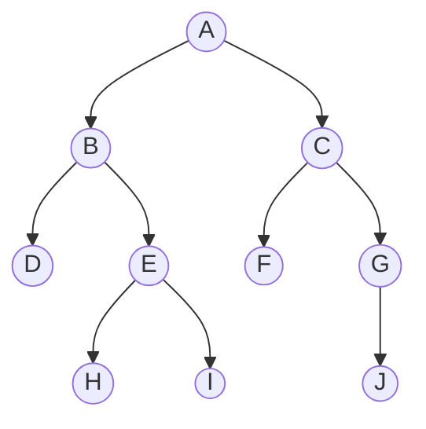
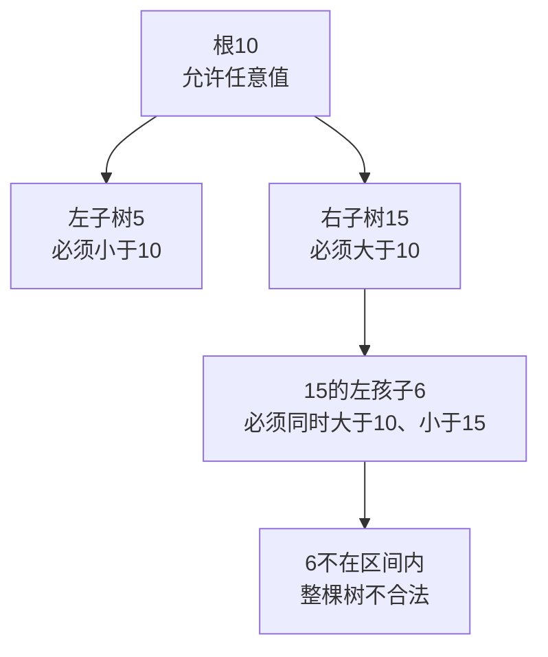
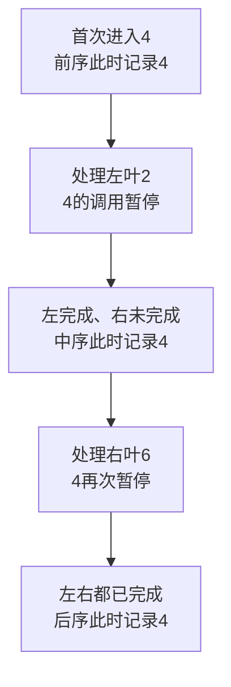
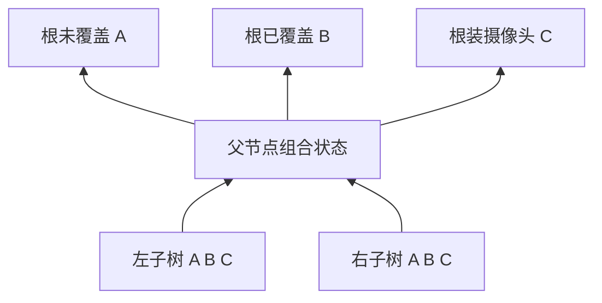
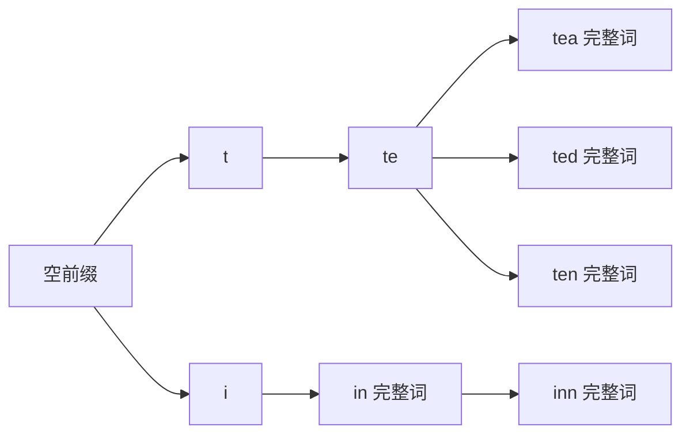
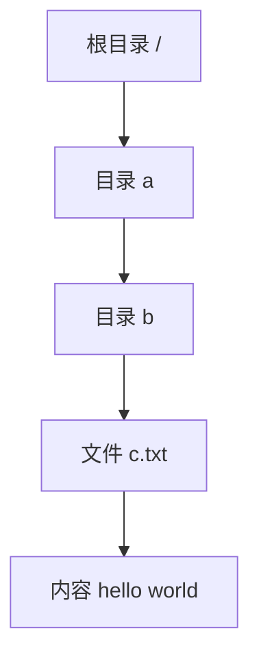

## 树：先统一术语与高度约定

> 对应课件页序 1–9。PPT 内印刷页号中途有 19.1 等插页；本站统一按文件中第几页定位。本章的 57 页全部是图片，已通过图像阅读与 OCR 整理。

树是**连通、无环的无向图**；n 个节点的非空树有 n−1 条边，任意两点间恰有一条简单路径。算法里的有根树额外指定一个根，从而能谈父子、祖先和子树。只有“无环”还不够：不连通的无环图是森林。

| 名称 | 含义 | 例子 |
|---|---|---|
| root 根 | 没有父节点的起点 | 下图 A |
| parent / child | 一条边上，靠根 / 远根的两个节点 | B 是 E 的父节点 |
| siblings 兄弟 | 父节点相同 | B 与 C |
| leaf 叶子 | 没有孩子 | D、H、I、F、J |
| ancestor / descendant | 沿父链向上 / 沿子链向下的节点 | A 是 I 的祖先 |
| depth 深度 | 从根到该节点的边数 | A 深度 0，H 深度 3 |
| height 高度 | 从该节点到最远叶子的边数 | 叶子高度 0，A 高度 3 |
| level 层 | 通常与深度一致，但有的课件从 1 开始 | 本文第 0 层是根 |
| path 路径 | 相邻节点串成的序列 | D→B→E→I |



二叉树的每个节点有**有区别的左位置和右位置**，每个位置至多一棵子树。只有左孩子与只有右孩子，是两种不同的结构。普通树没有至多两个孩子的限制。

- **满二叉树（perfect）**：每层都填满。高度 h 按边数算时，总节点数是 `2^(h+1)-1`。英文 full 有时仅指每个节点孩子数为 0 或 2，不能与 perfect 混用。
- **完全二叉树（complete）**：除了最后一层，其余层填满；最后一层从左到右连续填充。堆利用这个性质放入数组。
- **平衡二叉树（balanced）**：高度被限制在 O(log n)，具体定义依实现而异，不能把所有二叉树都当作平衡树。链状二叉树高度为 n−1。
- **二叉搜索树（BST）**：对于每个节点，左子树的所有值小于它，右子树的所有值大于它；是否允许重复必须另外约定。
- **AVL 与红黑树**：都是通过额外约束和旋转控制高度的 BST。AVL 对高度差约束更严格；红黑树用颜色规则保持渐近平衡。
- **B 树**：一个节点容纳多个键、拥有多个分支，适合减少磁盘或页访问次数，不属于二叉树。
- **Trie**：按字符或路径片段走边，整条路径表示键；不按数值大小做 BST 比较。

第 i 层最多 `2^i` 个节点。对于 n≥1 的完全二叉树，边数高度为 `floor(log2(n))`；层数为 `floor(log2(n))+1`，也等于 `ceil(log2(n+1))`。课件把高度按不同约定混写，所以使用公式前先问清根的高度是 0 还是 1。

下文 h 始终指按边数计的高度；从根到叶子的节点数是 h+1，所以栈空间写成 O(h+1)，也涵盖单节点树需要一个栈帧的情况。空树只需 O(1) 调用开销。

完全二叉树用 0 起始数组存储时，索引 i 的孩子是 `2*i+1`、`2*i+2`，非根父节点是 `(i-1)/2`。孩子索引必须 `< n` 才存在。非完全树如果也强行按此公式放数组，会出现大量空槽。

### 为什么 BST 必须继承所有祖先的限制

“左孩子小、右孩子大”只检查了一条边；搜索能丢弃整棵子树，依赖的是**子树中每个值**都满足祖先留下的范围。沿右边走，会提高下界；沿左边走，会降低上界。

下面的6小于它的父节点15，局部比较通过，却位于10的右子树，因此不是合法BST。图中的开区间对应本章“不允许重复值”的约定。



例如搜索7，根10会让算法直接放弃整个右子树。只有右子树所有值都大于10，这一步才不会漏解。所以验证BST要向下传上下界，而不是只比较父子。每下降一层缩小一次允许范围，验证仍只访问每个节点一次，时间O(n)；**树是否平衡只影响路径长度，不改变合法性的定义**。

### 泛型节点与题目节点

**调用约定：** 下文每个`class Solution`是一份独立模板。Python用`Solution().方法名(参数)`调用，Java用`new Solution().方法名(参数)`；共同示例省略了这个对象前缀。节点定义先复制一份，LeetCode平台已经提供时不要重复声明；原地修改的方法检查修改后的输入。

<a id="tpl-generic-tree-node"></a>

**双语模板 · 泛型节点：同一结构保存不同类型**

Python的类型标注不会自动执行运行时类型检查；Java泛型则由编译器检查。内嵌Node使用独立TypeVar U，外层BinaryTree再用T指定其节点值类型，root返回Node[T]。

```java
class BinaryTree<T> {
    static class Node<T> {
        T data;
        Node<T> left;
        Node<T> right;
        Node(T data) { this.data = data; }
    }
    private final Node<T> root;
    BinaryTree(T rootData) { root = new Node<>(rootData); }
    Node<T> root() { return root; }
}
```

```python
from typing import Generic, Optional, TypeVar

T = TypeVar("T")
U = TypeVar("U")

class BinaryTree(Generic[T]):
    class Node(Generic[U]):
        def __init__(self, data: U):
            self.data = data
            self.left: Optional["BinaryTree.Node[U]"] = None
            self.right: Optional["BinaryTree.Node[U]"] = None

    def __init__(self, rootData: T):
        self._root: BinaryTree.Node[T] = self.Node(rootData)

    def root(self) -> "BinaryTree.Node[T]":
        return self._root
```

**共同调用与预期：** 构造根值为7的 BinaryTree，调用 `root().data`，预期7。

`T` 是类型参数，让同一种树结构存储 String、Integer 等不同引用类型。静态嵌套类 `Node<T>` 不隐式捕获外部 `BinaryTree` 对象；它声明自己的 T，不直接使用外层 T。`final root` 意味着根引用不能重新指向另一对象，不意味着节点及左右孩子不可修改。课件里构造器 `Tree(...)` 与类名 `BinaryTree` 不一致，应改为同名。

以下 LeetCode 树题采用平台提供的节点。本地测试时单独加入这段定义，提交时不要重复添加：

<a id="tpl-tree-node"></a>

**双语模板 · 整数二叉树节点：后续树模板的共同定义**

```java
class TreeNode {
    int val;
    TreeNode left, right;
    TreeNode(int val) { this.val = val; }
}
```

```python
class TreeNode:
    def __init__(self, val):
        self.val = val
        self.left = None
        self.right = None
```

**共同调用与预期：** 创建根2，再设置左孩子1、右孩子3；根的 `left.val` 为1、`right.val` 为3。

## 三种遍历，其实只差“何时处理根”

> 对应第 10–14 页。节点顺序取决于处理当前节点的语句出现在两个递归调用之前、之间还是之后。

对上图：前序是 `A B D E H I C F G J`；中序是 `D B H E I A F C G J`；后序是 `D H I E B F J G C A`。这三种方法走过同一组边，只在不同时间收集值。

| 顺序 | 处理次序 | 常见用途 |
|---|---|---|
| 前序 | 根→左→右 | 复制树、带空标记序列化 |
| 中序 | 左→根→右 | 按顺序读取 BST；普通树不保证有序 |
| 后序 | 左→右→根 | 删除树、计算高度、树形 DP |

### 同一个递归帧，会经历三个不同的时刻

以根4、左叶2、右叶6为例，调用“遍历4”不会一口气完成：它先暂停去处理2，回来后又暂停去处理6。下图省略叶子的空孩子调用，保留真正决定输出位置的状态。



前序在“首次进入”时记录，中序在“左边回来”时记录，后序在“两边都回来”时记录。需要孩子计算结果的任务，例如`高度=1+max(左高,右高)`，只能在最后一个时刻完成。若在首次见到根时就算高度，所需数据尚未产生。

这也解释显式栈为什么有时要保存阶段标记：节点4这个引用没有变，但“下一步该去左边、右边，还是返回”的含义已经变了。每个节点只经过常数个阶段，所以三种遍历都是O(n)，不是因为暂停多次就变成O(n²)。

**模板复用路线：** 六种遍历分别提供递归与迭代双语实现；[Trie](#/lesson/05?section=tpl-trie)用于字符前缀，文件系统只是把字符边换成路径片段；[树形DP](#/lesson/05?section=tpl-tree-postorder-dp)展示多状态后序合并，[BST边界](#/lesson/05?section=tpl-bst-bounds)展示祖先条件下传，[序列化](#/lesson/05?section=tpl-tree-codec)展示带空标记的结构恢复。各树模板的TreeNode定义见本章对应代码对。

<a id="lc-144"></a>
### LC 144 · 二叉树前序遍历

题目要求返回前序的节点值列表。递归约定：`visit(node, out)` 把这棵子树的前序结果追加到 out。空树没有值，直接结束；非空树先写自己，再按照定义处理两个子树。

<a id="tpl-tree-pre-recursive"></a>

**双语模板 · 递归前序**

节点使用本章[TreeNode 双语定义](#/lesson/05?section=tpl-tree-node)。两种语言均按同一棵树调用；Python 的 None 对应 Java 的 null。

```java
import java.util.*;
class Solution {
    public List<Integer> preorderTraversal(TreeNode root) {
        List<Integer> out = new ArrayList<>();
        visit(root, out);
        return out;
    }
    private void visit(TreeNode node, List<Integer> out) {
        if (node == null) return;
        out.add(node.val);
        visit(node.left, out);
        visit(node.right, out);
    }
}
```

```python
class Solution:
    def preorderTraversal(self, root):
        result = []
        def visit(node):
            if node is None:
                return
            result.append(node.val)
            visit(node.left)
            visit(node.right)

        visit(root)
        return result
```

**共同调用与预期：** 共同树为根2、左1、右3；调用 `preorderTraversal(root)`，预期 `[2, 1, 3]`。

例子 `1` 的左孩子为 `2`、右孩子为 `3`：

| 调用 | 操作 | out |
|---|---|---|
| visit(1) | 立即收集 1 | [1] |
| visit(2) | 收集 2，两个空孩子返回 | [1,2] |
| 回到 visit(1) | 开始右子树 | [1,2] |
| visit(3) | 收集 3 | [1,2,3] |

Java 传递的是引用的值，所有递归层拿到的是指向同一个 `ArrayList` 的引用副本；`add` 因而改变同一结果容器。无需把列表从每一层再返回。`List<Integer>` 发生 int 到 Integer 的自动装箱。每个节点一次，O(n) 时间；递归栈 O(h+1)，结果 O(n)。空树返回空列表，单节点返回仅一个值。

<a id="lc-94"></a>
### LC 94 · 二叉树中序遍历

题意改为左→根→右。必须等待左子树全部完成后才写根。

<a id="tpl-tree-in-recursive"></a>

**双语模板 · 递归中序**

节点使用本章[TreeNode 双语定义](#/lesson/05?section=tpl-tree-node)。两种语言均按同一棵树调用；Python 的 None 对应 Java 的 null。

```java
import java.util.*;
class Solution {
    public List<Integer> inorderTraversal(TreeNode root) {
        List<Integer> out = new ArrayList<>();
        visit(root, out);
        return out;
    }
    private void visit(TreeNode node, List<Integer> out) {
        if (node == null) return;
        visit(node.left, out);
        out.add(node.val);
        visit(node.right, out);
    }
}
```

```python
class Solution:
    def inorderTraversal(self, root):
        result = []
        def visit(node):
            if node is None:
                return
            visit(node.left)
            result.append(node.val)
            visit(node.right)

        visit(root)
        return result
```

**共同调用与预期：** 共同树为根2、左1、右3；调用 `inorderTraversal(root)`，预期 `[1, 2, 3]`。

对于根 2、左右孩子 1 和 3，先进入 `visit(1)`，它的左空子树返回后写 1；回到根写 2；最后右子树写 3。结果 `[1,2,3]`。如果根是 1、左孩子是 9，结果 `[9,1]`，说明中序自动有序只对合法 BST 成立。API 与前序相同；时间 O(n)，栈 O(h+1)，结果 O(n)。

<a id="lc-145"></a>
### LC 145 · 二叉树后序遍历

后序在两个孩子都完成后收集根，适合“先获得子问题答案，再合成父答案”。

<a id="tpl-tree-post-recursive"></a>

**双语模板 · 递归后序**

节点使用本章[TreeNode 双语定义](#/lesson/05?section=tpl-tree-node)。两种语言均按同一棵树调用；Python 的 None 对应 Java 的 null。

```java
import java.util.*;
class Solution {
    public List<Integer> postorderTraversal(TreeNode root) {
        List<Integer> out = new ArrayList<>();
        visit(root, out);
        return out;
    }
    private void visit(TreeNode node, List<Integer> out) {
        if (node == null) return;
        visit(node.left, out);
        visit(node.right, out);
        out.add(node.val);
    }
}
```

```python
class Solution:
    def postorderTraversal(self, root):
        result = []
        def visit(node):
            if node is None:
                return
            visit(node.left)
            visit(node.right)
            result.append(node.val)

        visit(root)
        return result
```

**共同调用与预期：** 共同树为根2、左1、右3；调用 `postorderTraversal(root)`，预期 `[1, 3, 2]`。

根 1、左 2、右 3：`visit(1)` 等待，`visit(2)` 等两个 null 返回后写 2，`visit(3)` 同样写 3，最后根写 1，结果 `[2,3,1]`。时间 O(n)，栈 O(h+1)，结果 O(n)。测试单边链时，结果应从最深叶子向根排列。

## 用显式栈模拟递归的暂停与恢复

> 对应第 15–29 页。递归调用帧记录“我是谁，以及接下来执行到哪里”；换成显式栈时，这些信息也不能丢。

### 前序：先入右，再入左

<a id="tpl-tree-pre-iterative"></a>

**双语模板 · 显式栈前序：先压右再压左**

节点使用本章[TreeNode 双语定义](#/lesson/05?section=tpl-tree-node)。两种语言均按同一棵树调用；Python 的 None 对应 Java 的 null。 Python list的append/pop都使用尾部，不能用pop(0)模拟栈。

```java
import java.util.*;
class Solution {
    public List<Integer> preorderTraversal(TreeNode root) {
        List<Integer> out = new ArrayList<>();
        if (root == null) return out;
        Deque<TreeNode> stack = new ArrayDeque<>();
        stack.push(root);
        while (!stack.isEmpty()) {
            TreeNode node = stack.pop();
            out.add(node.val);
            if (node.right != null) stack.push(node.right);
            if (node.left != null) stack.push(node.left);
        }
        return out;
    }
}
```

```python
class Solution:
    def preorderTraversal(self, root):
        if root is None:
            return []
        stack, result = [root], []
        while stack:
            node = stack.pop()
            result.append(node.val)
            if node.right is not None:
                stack.append(node.right)
            if node.left is not None:
                stack.append(node.left)
        return result
```

**共同调用与预期：** 对根2、左1、右3调用 `preorderTraversal(root)`，预期 `[2,1,3]`。

栈后进先出，所以右孩子必须先放，左孩子才先取出。根 1、左 2、右 3：`[1]→弹1→压3压2→[2,3]→弹2→[3]→弹3`，栈顶写在左侧。课件的另一个版本是沿左链边收集边入栈，左边走完后弹回父节点再去右边，二者都遵守根→左→右。

`Deque` 是双端队列接口，`push/pop/peek` 使用同一端成为栈；不要混用 `offer` 的队列方向。`ArrayDeque` 禁止 null，所以只把非空孩子放入。时间 O(n)，额外栈 O(h+1)（最坏 O(n)），输出 O(n)。

### 中序：走到底，再返回

<a id="tpl-tree-in-iterative"></a>

**双语模板 · 显式栈中序：保存尚未输出的祖先**

节点使用本章[TreeNode 双语定义](#/lesson/05?section=tpl-tree-node)。两种语言均按同一棵树调用；Python 的 None 对应 Java 的 null。

```java
import java.util.*;
class Solution {
    public List<Integer> inorderTraversal(TreeNode root) {
        List<Integer> out = new ArrayList<>();
        Deque<TreeNode> stack = new ArrayDeque<>();
        TreeNode cur = root;
        while (cur != null || !stack.isEmpty()) {
            while (cur != null) {
                stack.push(cur);
                cur = cur.left;
            }
            cur = stack.pop();
            out.add(cur.val);
            cur = cur.right;
        }
        return out;
    }
}
```

```python
class Solution:
    def inorderTraversal(self, root):
        stack, result = [], []
        current = root
        while current is not None or stack:
            while current is not None:
                stack.append(current)
                current = current.left
            current = stack.pop()
            result.append(current.val)
            current = current.right
        return result
```

**共同调用与预期：** 对根2、左1、右3调用 `inorderTraversal(root)`，预期 `[1,2,3]`。

栈里保存“左边正在处理、自己还没输出”的祖先。内层循环结束时 cur=null，说明左边已经到底；弹出的节点可以输出，再把右子树交给同一套流程。根 2、左1右3的状态：压2→压1→弹1输出→弹2输出→压3→弹3输出。

外层必须用 `||`：当前节点为空不代表所有祖先都完成；栈为空时当前右子树仍可能待处理。课件 Java 示例误写 `res.add(root.val)`，应使用本步弹出的 `cur.val`，否则反复输出原根。O(n) 时间、O(h+1) 栈。

### 后序：增加“孩子是否已处理”的状态

<a id="tpl-tree-post-iterative"></a>

**双语模板 · 显式栈后序：节点加处理阶段**

节点使用本章[TreeNode 双语定义](#/lesson/05?section=tpl-tree-node)。两种语言均按同一棵树调用；Python 的 None 对应 Java 的 null。 Python二元组对应Java的Frame，解包同时取得节点和阶段。

```java
import java.util.*;
class Solution {
    static class Frame {
        TreeNode node;
        boolean expanded;
        Frame(TreeNode node, boolean expanded) {
            this.node = node;
            this.expanded = expanded;
        }
    }
    public List<Integer> postorderTraversal(TreeNode root) {
        List<Integer> out = new ArrayList<>();
        if (root == null) return out;
        Deque<Frame> stack = new ArrayDeque<>();
        stack.push(new Frame(root, false));
        while (!stack.isEmpty()) {
            Frame f = stack.pop();
            if (f.expanded) {
                out.add(f.node.val);
            } else {
                stack.push(new Frame(f.node, true));
                if (f.node.right != null)
                    stack.push(new Frame(f.node.right, false));
                if (f.node.left != null)
                    stack.push(new Frame(f.node.left, false));
            }
        }
        return out;
    }
}
```

```python
class Solution:
    def postorderTraversal(self, root):
        if root is None:
            return []
        stack, result = [(root, False)], []
        while stack:
            node, expanded = stack.pop()
            if expanded:
                result.append(node.val)
                continue
            stack.append((node, True))
            if node.right is not None:
                stack.append((node.right, False))
            if node.left is not None:
                stack.append((node.left, False))
        return result
```

**共同调用与预期：** 对根2、左1、右3调用 `postorderTraversal(root)`，预期 `[1,3,2]`。

`expanded=false` 表示第一次到达，安排后续工作；`true` 表示所有孩子的任务已经排在自己前面并执行完毕，可以输出。

| 栈顶在左 | 执行动作 |
|---|---|
| (1,false) | 弹1，把 (1,true)、(3,false)、(2,false) 压入 |
| (2,false),(3,false),(1,true) | 展开2 |
| (2,true),(3,false),(1,true) | 输出2 |
| (3,false),(1,true) | 展开3，再输出3 |
| (1,true) | 输出1 |

`Frame` 是一个保存节点引用和状态的对象，不能只在栈里放数值，因为同值的节点可能不同。课件还提出 `HashSet<TreeNode>` 记录第一次到达；默认 TreeNode 不重写 equals 时按对象身份去重，不能用 `HashSet<Integer>` 替代，否则值相同会混淆节点。显式 Frame 的 O(h+1) 栈更直接，HashSet 记录所有节点会多用 O(n) 空间。两种方式均 O(n) 时间。

<a id="lc-968"></a>
## LC 968 · 监控二叉树：三种状态的树形 DP

> 对应第 30–33 页。[原题](https://leetcode.com/problems/binary-tree-cameras/)：一个摄像头覆盖自身、直接父节点和直接孩子，求覆盖所有节点的最少数量。不能覆盖祖父或兄弟。

### 为什么后序与三个状态缺一不可

只知道“子树最少几个摄像头”不够。父节点需要知道：孩子自己是否被覆盖？孩子上是否有摄像头，能顺带覆盖父节点？因此对每棵子树返回三个数，且保证子树内除了当前根以外的节点已经覆盖：

| 状态 | 当前根 | 是否依赖父节点 |
|---|---|---|
| A | 未覆盖，根无摄像头 | 等待父节点覆盖 |
| B | 已覆盖，根无摄像头 | 不依赖父节点 |
| C | 根安装摄像头 | 不依赖父节点，还可覆盖父节点 |

1. `A=L.B+R.B`：根不被覆盖，两个孩子不能装摄像头；同时孩子必须已覆盖。
2. `B=min(L.C+min(R.B,R.C), R.C+min(L.B,L.C))`：至少一个直接孩子安装摄像头，才有办法覆盖根。另一孩子必须自给自足，不能用未覆盖的 A，因为根没摄像头。
3. `C=1+min(L.A,L.B,L.C)+min(R.A,R.B,R.C)`：根有摄像头，可以救两个未覆盖的孩子，所以每个孩子三种状态都能选。
4. 整棵树的根没有父节点，因此最终只允许 `min(B,C)`。



<a id="tpl-tree-postorder-dp"></a>

**双语模板 · 后序树形 DP：一次返回多个状态**

节点使用本章[TreeNode 双语定义](#/lesson/05?section=tpl-tree-node)。两种语言均按同一棵树调用；Python 的 None 对应 Java 的 null。 状态顺序与上文一致：未覆盖、已覆盖但无相机、自己有相机。

```java
class Solution {
    private static final int INF = 1_000_000;
    public int minCameraCover(TreeNode root) {
        int[] state = dfs(root);
        return Math.min(state[1], state[2]);
    }
    private int[] dfs(TreeNode node) {
        if (node == null) return new int[]{0, 0, INF};
        int[] left = dfs(node.left);
        int[] right = dfs(node.right);
        int uncovered = left[1] + right[1];
        int covered = Math.min(
            left[2] + Math.min(right[1], right[2]),
            right[2] + Math.min(left[1], left[2]));
        int camera = 1 + Math.min(left[0], Math.min(left[1], left[2]))
                       + Math.min(right[0], Math.min(right[1], right[2]));
        return new int[]{uncovered, covered, camera};
    }
}
```

```python
class Solution:
    def minCameraCover(self, root):
        infinity = float("inf")

        def dfs(node):
            if node is None:
                return 0, 0, infinity
            left, right = dfs(node.left), dfs(node.right)
            uncovered = left[1] + right[1]
            covered = min(left[2] + min(right[1], right[2]),
                          right[2] + min(left[1], left[2]))
            camera = 1 + min(left) + min(right)
            return uncovered, covered, camera

        state = dfs(root)
        return min(state[1], state[2])
```

**共同调用与预期：** 对根2、左1、右3调用 `minCameraCover(root)`，预期1；单节点也为1。

### 手算一条三节点链：r→m→leaf

空节点返回 `[0,0,INF]`：空处没有覆盖成本，但不能真的装摄像头。这里 A/B 都是空子树占位状态，无需严格按“空根被覆盖”理解。

| 节点 | A 未覆盖 | B 已覆盖无相机 | C 有相机 |
|---|---:|---:|---:|
| leaf | 0 | INF | 1 |
| m | INF | 1 | 1 |
| r | 1 | 1 | 2 |

答案 `min(r.B,r.C)=1`，在 m 安装就覆盖整条链。单节点答案1；空树返回0；有两个叶子时根放1个最优。

`private static final` 把 INF 定为类级不可重绑定常量；数字下划线只改善可读性。不能使用 `Integer.MAX_VALUE` 再相加，否则可能溢出成负数。`new int[]{...}` 按约定的位置返回多个值，每次创建新的数组。`Math.min` 只收两个参数，因此三者取最小要嵌套。O(n) 时间、O(h+1) 同时存活的递归与状态空间。

贪心也能做：孩子未覆盖就给当前节点装摄像头，否则孩子有摄像头则当前被覆盖，否则等待父节点。这需要说明交换论证：覆盖叶子时把摄像头从叶子移到父节点不会减少覆盖能力。三状态 DP 更直接展示所有合法组合，避免只凭直觉判断。

## Trie：把公共前缀共享为路径

> 对应第 34–38 页。Trie 中一条边代表一个字符；节点代表从根到它的前缀。根代表空前缀。

存入 tea、ted、ten、in、inn：前三个单词共享 t→e，后两个共享 i→n。`in` 既是完整单词，又是 `inn` 的前缀，因此必须有独立的“完整单词结束”标记，不能用是否有孩子判断。



长度 L 的单词插入、搜索和前缀查询都是 O(L)，前提是单条边的查询是 O(1)，例如固定26孩子数组或期望 O(1) 的哈希表。总字符数 S 时节点数至多 S+1。固定数组每个节点存26个引用，空间 O(26S)=O(S)，但常数很大；稀疏词典里可能比直接哈希存整词更耗内存。课件“几乎不额外消耗空间”的说法不能普遍成立。Trie 的优势是前缀共享和边走边剪枝，不是无条件节省空间。

<a id="lc-208"></a>
## LC 208 · 实现前缀树

> 对应第 39–44 页。[原题](https://leetcode.com/problems/implement-trie-prefix-tree/)要求 insert、search、startsWith。输入限定小写英文字母。

### 推导与完整实现

1. 每个节点准备26个孩子槽，字符 c 映射为 `c-'a'`。
2. 插入时缺少边就创建节点，走完所有字符后标记结尾。
3. 查询整词时，路径存在还不够，结尾标记必须为 true。
4. 查询前缀只需路径存在。把“沿路径走”提取到 walk，避免两份查询逻辑不一致。

<a id="tpl-trie"></a>

**双语模板 · Trie：插入、完整查询与前缀查询**

两份实现都限定小写a–z。Python的[None]*26只复制空引用，后续逐槽创建节点；不要写[Node()]*26，那会让26个位置共享同一节点。

```java
class Trie {
    private static class Node {
        Node[] next = new Node[26];
        boolean end;
    }
    private final Node root = new Node();
    public Trie() { }
    public void insert(String word) {
        Node cur = root;
        for (int i = 0; i < word.length(); i++) {
            int c = word.charAt(i) - 'a';
            if (cur.next[c] == null) cur.next[c] = new Node();
            cur = cur.next[c];
        }
        cur.end = true;
    }
    public boolean search(String word) {
        Node node = walk(word);
        return node != null && node.end;
    }
    public boolean startsWith(String prefix) {
        return walk(prefix) != null;
    }
    private Node walk(String text) {
        Node cur = root;
        for (int i = 0; i < text.length(); i++) {
            cur = cur.next[text.charAt(i) - 'a'];
            if (cur == null) return null;
        }
        return cur;
    }
}
```

```python
class Trie:
    class Node:
        def __init__(self):
            self.next = [None] * 26
            self.end = False

    def __init__(self):
        self.root = self.Node()

    def insert(self, word):
        current = self.root
        for char in word:
            index = ord(char) - ord("a")
            if current.next[index] is None:
                current.next[index] = self.Node()
            current = current.next[index]
        current.end = True

    def _walk(self, text):
        current = self.root
        for char in text:
            current = current.next[ord(char) - ord("a")]
            if current is None:
                return None
        return current

    def search(self, word):
        node = self._walk(word)
        return node is not None and node.end

    def startsWith(self, prefix):
        return self._walk(prefix) is not None
```

**共同调用与预期：** 依次 `insert("apple")`、`search("apple")`、`search("app")`、`startsWith("app")`，后三项预期为真、假、真。

| 操作 | 路径状态 | 返回 |
|---|---|---|
| insert("apple") | a→p→p→l→e，只有 e.end=true | 无 |
| search("app") | app 路径存在，end=false | false |
| startsWith("app") | app 路径存在 | true |
| insert("app") | 复用前三条边，标记 app.end=true | 无 |
| search("app") | 路径与结尾都满足 | true |

`charAt(i)` 返回一个 UTF-16 代码单元，字符减法会提升为 int；对于 a..z 恰好映射0..25。若支持其他字符，不能直接套此映射。`new Node[26]` 创建26个 null 引用，并不会创建26个 Node。`&&` 短路避免对 null 访问 end。

课件把 `search("")` 无条件返回 true，与“确实插入过整词”的语义不一致。本实现若插入空串才标记 root.end；原题非空输入约束下不影响答案。null 不属于题目输入，工程接口可另外用 `Objects.requireNonNull` 明确拒绝。重复插入不会重复创建路径。单次 O(L) 时间；总空间 O(S)。

<a id="lc-588"></a>
## LC 588 · 内存文件系统：边不一定是字符

> 对应第 45–50 页。需要实现 ls、mkdir、追加文件内容、读取内容。目录里的文件名和子目录名应按字典序返回。这里按课件题意和有效路径约束实现。

### 把路径分段转为多叉 Trie

`/a/b/c.txt` 的边依次是 a、b、c.txt，整段名字是键，而不是一个字母。目录和文件共用 Node，`file` 区分类型；文件有内容，目录有孩子。用 TreeMap 让孩子始终按名字排序，ls 时不再单独排序。



<a id="tpl-path-trie"></a>

**路径 Trie：边保存目录名，节点保存文件内容**

两份实现遵循本题的合法绝对路径约定，文件不会作为中间目录。Java 的 TreeMap 自动按键排序；Python 的字典不提供字典序，因此 ls 显式 sorted。Python 把每次追加的内容放进列表，读取时 join，避免每次追加都复制旧字符串；rsplit("/", 1) 只从右侧切一次。

```java
import java.util.*;
class FileSystem {
    private static class Node {
        boolean file;
        StringBuilder content = new StringBuilder();
        TreeMap<String, Node> children = new TreeMap<>();
    }
    private final Node root = new Node();
    public FileSystem() { }
    private Node walk(String path, boolean create) {
        Node cur = root;
        for (String part : path.split("/")) {
            if (part.isEmpty()) continue;
            if (create) cur.children.putIfAbsent(part, new Node());
            cur = cur.children.get(part);
            if (cur == null) throw new IllegalArgumentException("Missing path");
        }
        return cur;
    }
    public List<String> ls(String path) {
        Node node = walk(path, false);
        if (node.file) {
            return Collections.singletonList(path.substring(path.lastIndexOf('/') + 1));
        }
        return new ArrayList<>(node.children.keySet());
    }
    public void mkdir(String path) {
        walk(path, true);
    }
    public void addContentToFile(String filePath, String content) {
        Node node = walk(filePath, true);
        node.file = true;
        node.content.append(content);
    }
    public String readContentFromFile(String filePath) {
        return walk(filePath, false).content.toString();
    }
}
```

```python
class FileSystem:
    class Node:
        def __init__(self):
            self.file = False
            self.content = []
            self.children = {}

    def __init__(self):
        self.root = self.Node()

    def _walk(self, path, create):
        cur = self.root
        for part in path.split("/"):
            if not part:
                continue
            if part not in cur.children:
                if not create:
                    raise ValueError("Missing path")
                cur.children[part] = self.Node()
            cur = cur.children[part]
        return cur

    def ls(self, path):
        node = self._walk(path, False)
        if node.file:
            return [path.rsplit("/", 1)[-1]]
        return sorted(node.children)

    def mkdir(self, path):
        self._walk(path, True)

    def addContentToFile(self, filePath, content):
        node = self._walk(filePath, True)
        node.file = True
        node.content.append(content)

    def readContentFromFile(self, filePath):
        return "".join(self._walk(filePath, False).content)
```

**共同调用与预期：** 分别创建 FileSystem，依次调用 `mkdir("/a/b")`、`addContentToFile("/a/b/c", "hi")`、`addContentToFile("/a/b/c", "!")`。`ls("/")` 为 `["a"]`，`ls("/a/b")` 为 `["c"]`，读取 `/a/b/c` 为 `"hi!"`。

### 完整操作轨迹

| 操作 | 发生的变化 | 结果 |
|---|---|---|
| ls("/") | 根没有孩子 | [] |
| mkdir("/a/b") | 缺 a 创建，缺 b 创建 | 根→a→b |
| addContentToFile("/a/b/c.txt","hello") | 创建c.txt并标记file | 内容hello |
| addContentToFile("/a/b/c.txt"," world") | 命中同一节点，追加 | 内容hello world |
| ls("/a/b") | 读取已排序的键 | [c.txt] |
| ls("/a/b/c.txt") | 文件只返回自身名字 | [c.txt] |
| readContentFromFile(...) | 读取，不创建节点 | hello world |

`String.split` 接受正则表达式；这里 `/` 在 Java 正则中无需转义。开头的斜杠产生空段，`isEmpty` 跳过，所以根路径也能正确处理。`TreeMap` 的键按字符串自然顺序排序；`keySet()` 是视图，`new ArrayList<>(...)` 复制成独立列表。`singletonList` 是不可增删、也不可用 `set` 替换元素的单元素列表，本题只返回结果无需修改。`lastIndexOf('/')+1` 定位文件名起点。`StringBuilder.append` 避免反复拼接不可变 String 导致累计拷贝。

`putIfAbsent(part, new Node())` 只在键没有映射时插入；但 Java 会先计算实参，因此路径已存在时仍创建一个随后丢弃的临时 Node。需要避免这次分配时可以使用 `computeIfAbsent(part, ignored -> new Node())`，其 Lambda 仅在缺失时执行。这里保留直观写法，不影响结果与渐近复杂度。

设路径字符数 P、段数 d、每层最多 k 个孩子。如果把名字比较视为 O(1)，路径遍历 O(P+d·log(k+1))；实际 `String.compareTo` 最坏要检查整段公共前缀。设第 i 段名字长度为 ℓᵢ、所在目录孩子数为 kᵢ，字符级成本为 O(P+Σ ℓᵢ·log(kᵢ+1))，可用 O(P·(1+log(k+1))) 作统一上界。`ls` 目录另需 O(k) 复制名字引用，并不深拷贝每个字符串；读取长度 C 的内容另需 O(C) 创建字符串，追加 C 个字符为摊还 O(C)。[TreeMap 的对数保证](https://docs.oracle.com/en/java/javase/21/docs/api/java.base/java/util/TreeMap.html)描述树操作的比较次数，不能忽略比较器自身的成本。

所有内容与节点共占 O(路径键总长度+内容总长度) 空间。原课件读取调用了会创建路径的 helper；有效路径测试里可能看不出来，但工程设计中读不应悄悄创建。本实现区分 create。文件目录冲突、非法名字、权限和并发都超出该题有效输入约束，真实系统需要另行定义。

<a id="lc-212"></a>
## LC 212 · 单词搜索 II：Trie 与回溯一起剪枝

> 对应第 51–56 页及第57页作业重复项。[原题](https://leetcode.com/problems/word-search-ii/)要求从网格中找词典里的单词。只能上下左右相邻，同一条路径不能重复使用一个格子。

### 从单词逐个搜，到多个单词共享搜索

逐词 DFS 会反复搜索相同前缀。先把所有词建成 Trie，在网格里走一个字符，Trie 也同时走一条边；不存在对应孩子，说明词典里没有任何词能从这个前缀继续，立即剪枝。一个 Trie 结点的 `word` 保存完整单词，命中时直接收集，不再拼接字符串。

1. 在所有格子枚举起点，因为词可以从任意位置开始。
2. 越界或本路径已访问则返回。
3. 查询 Trie 对应字符分支，不存在则返回。
4. 若 word 非空，加入答案，并清空 word 去重。
5. 临时把网格字符改成 `#`，递归四邻居。
6. 回溯时恢复原字符，供其他路径使用。

<a id="tpl-trie-backtracking"></a>

**Trie 加回溯：同时维护棋盘路径与词典前缀**

棋盘必须是可修改的二维字符容器：Python 可用 list("ab") 构造一行，不能把不可变字符串当成一行。ord 把字符转成整数码点，相减对应 Java 的 ch - 'a'。word 置空只去重已找到的单词；格子复原则恢复搜索现场，这两种状态的寿命不同。

```java
import java.util.*;
class Solution {
    private static class Node {
        Node[] next = new Node[26];
        String word;
    }
    public List<String> findWords(char[][] board, String[] words) {
        Node root = new Node();
        for (String word : words) {
            Node cur = root;
            for (char ch : word.toCharArray()) {
                int i = ch - 'a';
                if (cur.next[i] == null) cur.next[i] = new Node();
                cur = cur.next[i];
            }
            cur.word = word;
        }
        List<String> result = new ArrayList<>();
        for (int r = 0; r < board.length; r++) {
            for (int c = 0; c < board[0].length; c++) {
                dfs(board, r, c, root, result);
            }
        }
        return result;
    }
    private void dfs(char[][] board, int r, int c, Node parent, List<String> out) {
        if (r < 0 || r >= board.length || c < 0 || c >= board[0].length) return;
        char ch = board[r][c];
        if (ch == '#') return;
        Node node = parent.next[ch - 'a'];
        if (node == null) return;
        if (node.word != null) {
            out.add(node.word);
            node.word = null;
        }
        board[r][c] = '#';
        dfs(board, r + 1, c, node, out);
        dfs(board, r - 1, c, node, out);
        dfs(board, r, c + 1, node, out);
        dfs(board, r, c - 1, node, out);
        board[r][c] = ch;
    }
}
```

```python
class Solution:
    class Node:
        def __init__(self):
            self.next = [None] * 26
            self.word = None

    def findWords(self, board, words):
        root = self.Node()
        for word in words:
            cur = root
            for ch in word:
                i = ord(ch) - ord("a")
                if cur.next[i] is None:
                    cur.next[i] = self.Node()
                cur = cur.next[i]
            cur.word = word
        rows = len(board)
        cols = len(board[0]) if rows else 0
        result = []

        def dfs(r, c, parent):
            if r < 0 or r >= rows or c < 0 or c >= cols:
                return
            ch = board[r][c]
            if ch == "#":
                return
            node = parent.next[ord(ch) - ord("a")]
            if node is None:
                return
            if node.word is not None:
                result.append(node.word)
                node.word = None
            board[r][c] = "#"
            dfs(r + 1, c, node)
            dfs(r - 1, c, node)
            dfs(r, c + 1, node)
            dfs(r, c - 1, node)
            board[r][c] = ch

        for r in range(rows):
            for c in range(cols):
                dfs(r, c, root)
        return result
```

**共同调用与预期：** 棋盘两行为 `["a","b"]`、`["c","d"]`，words 为 `["ab","ac","aba","bd"]`。`findWords(board, words)` 找到 `ab、ac、bd`（结果顺序不要求固定），调用后棋盘仍与原来相同；aba 因为不能重复使用同一格而失败。

课件网格首行 `o a a n`，第二行 `e t a e`，第三行 `i h k r`，第四行 `i f l v`；词典 `oath, pea, eat, rain`。

| 步骤 | 网格位置 | Trie前缀 | 行为 |
|---|---|---|---|
| 1 | (0,0) o | o | 有分支，标记访问 |
| 2 | (0,1) a | oa | 有分支，不能退回已用o |
| 3 | (1,1) t | oat | 有分支 |
| 4 | (2,1) h | oath | 命中，记录oath并清空结尾word |
| 5 | 沿调用栈返回 | oat→oa→o | 恢复h、t、a、o |
| 6 | (1,3) e→(1,2) a→(1,1) t | eat | 命中第二个词 |

清空 `word` 只去掉“答案标记”，不能剪掉整个节点，因为词也可能是更长词的前缀。`board[r][c]='#'` 是路径内的临时修改；忘记最后恢复会影响其他起点。`toCharArray` 分配字符数组，循环值是char；`String word` 直接保存原字符串引用，免去重新生成单词。代码假定原题的非空小写字母网格。

设网格 M×N、词典总字符 S、最长词 L。建 Trie O(S)。保守上界 O(MN·4^L+S)，利用不能立即回头可写更紧的 O(MN·4·3^(L−1)+S)，实际会被前缀剪枝大幅削减。空间 O(S+min(L,MN))，不含答案；固定26分支为常数。测试词是另一词前缀、多条路径拼出同词、只靠重复同一格才能成词、没有任何首字母匹配的情况。

<a id="lc-98"></a>
## 作业 LC 98 · 验证二叉搜索树

> 第57页。[原题](https://leetcode.com/problems/validate-binary-search-tree/)中的大小关系是严格的，重复值不合法。

只比较父子会漏掉深层问题：根5的右孩子8合法，但8的左孩子4虽然小于8，却落在根5的右子树，不合法。把每个节点允许的**开区间**沿递归传下去，左边收紧上界，右边收紧下界。

<a id="tpl-bst-bounds"></a>

**双语模板 · BST 验证：向下传递祖先边界**

节点使用本章[TreeNode 双语定义](#/lesson/05?section=tpl-tree-node)。两种语言均按同一棵树调用；Python 的 None 对应 Java 的 null。

```java
class Solution {
    public boolean isValidBST(TreeNode root) {
        return valid(root, Long.MIN_VALUE, Long.MAX_VALUE);
    }
    private boolean valid(TreeNode node, long low, long high) {
        if (node == null) return true;
        if (node.val <= low || node.val >= high) return false;
        return valid(node.left, low, node.val)
            && valid(node.right, node.val, high);
    }
}
```

```python
class Solution:
    def isValidBST(self, root):
        def valid(node, low, high):
            if node is None:
                return True
            if not low < node.val < high:
                return False
            return (valid(node.left, low, node.val)
                    and valid(node.right, node.val, high))
        return valid(root, float("-inf"), float("inf"))
```

**共同调用与预期：** 根2、左1、右3返回真；再把右孩子改成1，返回假。

| 节点 | 合法区间 | 结果 |
|---|---|---|
| 5 | (-∞,+∞) | 通过 |
| 8（5的右） | (5,+∞) | 通过 |
| 4（8的左） | (5,8) | 4≤5，失败 |

`long` 边界比 int 范围大，允许节点本身等于 `Integer.MIN_VALUE/MAX_VALUE`。别用 `node.val-1` 表示严格上界，它会溢出；用 `<=/>=` 判断更直接。`&&` 一边失败就短路。每节点最多一次，O(n) 时间、O(h+1) 栈。空树为true，重复值为false，单个极值节点为true。

<a id="lc-96"></a>
## 作业 LC 96 · 不同的二叉搜索树：只计数

> 第57页。给定1..n各用一次，问不同BST结构的数量。

选第 i 个数作根，左边必须使用 i−1 个较小数，右边用 n−i 个较大数；选择互相独立，数量相乘。枚举根后相加：`dp[n]=Σ dp[i−1]*dp[n−i]`。`dp[0]=1` 代表一种空树，不能设0，否则所有组合都被乘没。

<a id="tpl-catalan-tree-count"></a>

**结构计数：左右子树数量相乘，根的选择相加**

这是计数模板，不保存具体树。Python 整数可扩展；现有 Java 返回 int，按本题 n ≤ 19 使用，不能把强制类型转换理解为任意大结果都能安全保存。时间 O(n²)，空间 O(n)。

```java
class Solution {
    public int numTrees(int n) {
        long[] dp = new long[n + 1];
        dp[0] = 1;
        for (int size = 1; size <= n; size++) {
            for (int root = 1; root <= size; root++) {
                dp[size] += dp[root - 1] * dp[size - root];
            }
        }
        return (int) dp[n];
    }
}
```

```python
class Solution:
    def numTrees(self, n):
        dp = [0] * (n + 1)
        dp[0] = 1
        for size in range(1, n + 1):
            for root in range(1, size + 1):
                dp[size] += dp[root - 1] * dp[size - root]
        return dp[n]
```

**共同调用与预期：** `numTrees(0)` 为1（组合时空树是一种选择），`numTrees(3)` 为5，`numTrees(4)` 为14。

| size | 根的贡献 | dp |
|---|---|---:|
| 0 | 空树 | 1 |
| 1 | 1×1 | 1 |
| 2 | 1×1 + 1×1 | 2 |
| 3 | 1×2 + 1×1 + 2×1 | 5 |

数组元素是 long，所以乘法按long执行，不会先在int中溢出。最后强制转int依赖原题 n≤19 的结果范围，通用更大n应使用 BigInteger，不能沿用该强转。O(n²) 时间、O(n) 空间。n=1返回1，n=3返回5；空子树1是计数基础状态，不代表“没有答案”。

<a id="lc-95"></a>
## 作业 LC 95 · 不同的二叉搜索树 II：构造全部结果

> 第57页。[原题](https://leetcode.com/problems/unique-binary-search-trees-ii/)把计数改为返回所有树，n≤8。相乘现在变成左右结果的笛卡尔积。

`build(lo,hi)` 返回使用区间内所有整数的合法BST集合。枚举root后先生成左右集合，再两层循环配对。空区间返回含一个 null 的列表，表示“这个位置可以为空”；不能返回空列表，否则两层循环一次也不会执行。

<a id="tpl-tree-cartesian-build"></a>

**结构构造：枚举根，再组合左右结果**

节点使用 [TreeNode 双语定义](#/lesson/05?section=tpl-tree-node)，查看结构可调用 [Codec](#/lesson/05?section=tpl-tree-codec)。两层 for 做的是笛卡尔积；空区间返回 [None]/含 null 的列表，为乘法提供一个空子树选择。copy 创建独立节点，避免不同答案共享可变子树；代价也要把复制出来的全部输出节点算进去。

```java
import java.util.*;
class Solution {
    public List<TreeNode> generateTrees(int n) {
        if (n == 0) return new ArrayList<>();
        return build(1, n);
    }
    private List<TreeNode> build(int lo, int hi) {
        List<TreeNode> out = new ArrayList<>();
        if (lo > hi) {
            out.add(null);
            return out;
        }
        for (int value = lo; value <= hi; value++) {
            List<TreeNode> lefts = build(lo, value - 1);
            List<TreeNode> rights = build(value + 1, hi);
            for (TreeNode left : lefts) {
                for (TreeNode right : rights) {
                    TreeNode root = new TreeNode(value);
                    root.left = copy(left);
                    root.right = copy(right);
                    out.add(root);
                }
            }
        }
        return out;
    }
    private TreeNode copy(TreeNode node) {
        if (node == null) return null;
        TreeNode out = new TreeNode(node.val);
        out.left = copy(node.left);
        out.right = copy(node.right);
        return out;
    }
}
```

```python
# 先使用本章 TreeNode 定义。
class Solution:
    def generateTrees(self, n):
        if n == 0:
            return []
        return self._build(1, n)

    def _build(self, lo, hi):
        if lo > hi:
            return [None]
        result = []
        for value in range(lo, hi + 1):
            lefts = self._build(lo, value - 1)
            rights = self._build(value + 1, hi)
            for left in lefts:
                for right in rights:
                    root = TreeNode(value)
                    root.left = self._copy(left)
                    root.right = self._copy(right)
                    result.append(root)
        return result

    def _copy(self, node):
        if node is None:
            return None
        result = TreeNode(node.val)
        result.left = self._copy(node.left)
        result.right = self._copy(node.right)
        return result
```

**共同调用与预期：** `generateTrees(3)` 返回5棵不同 BST，每棵的中序都是 `[1,2,3]`；`generateTrees(0)` 返回空列表。可用本章 Codec 序列化每棵树观察结构。修改某棵输出树，不会改动另一棵树。

n=3：根1时左集合 `[null]`，右集合有两棵（2→右3；3→左2），组合出2棵；根2时左只有1、右只有3，组合1棵；根3时左有2棵、右空，组合2棵，总5棵。

`List<TreeNode>` 可以含null，而 `ArrayDeque` 不可以；不要把容器规则混用。这里 `copy` 让最终树之间不共享可变节点；很多题解直接挂接left/right也能通过只读验证，但若调用者修改一棵树，共享子树会连带改变另一棵。复制版更适合返回独立结果的契约。

设 Cn 为第n个卡特兰数，输出本身有 Θ(n·Cn) 个节点，本实现枚举与复制的时间/总输出空间都是 O(n·Cn)，Cn 约按 `4^n/n^(3/2)` 增长，递归深度 O(n)。这不是能处理很大n的多项式算法。边界测试n=1只有一个根；检查所有结果的中序均为1..n，且树形互不相同。

<a id="lc-99"></a>
## 作业 LC 99 · 恢复二叉搜索树

> 第57页。[原题](https://leetcode.com/problems/recover-binary-search-tree/)保证恰好两个节点的值被交换，树结构没有改变。

正常BST中序严格递增。交换相邻值只产生一个逆序断点；交换不相邻值产生两个。第一次断点 `prev.val>cur.val` 中，prev是过大的值；每次断点里的cur是候选过小值，最后一次的cur才是第二个需要交换的节点。

<a id="tpl-bst-inorder-repair"></a>

**中序状态机：找到交换值造成的逆序**

节点使用 [TreeNode 双语定义](#/lesson/05?section=tpl-tree-node)。适用条件是原本合法的 BST 恰好交换了两个值；任意破坏的树不能靠交换一次修好。first 只在第一次逆序赋值，second 则更新到最后一次逆序的小值。Python 并行赋值先计算右边两个值，再写回左边，等价于 Java 的临时变量交换。

```java
import java.util.*;
class Solution {
    public void recoverTree(TreeNode root) {
        Deque<TreeNode> stack = new ArrayDeque<>();
        TreeNode cur = root, prev = null, first = null, second = null;
        while (cur != null || !stack.isEmpty()) {
            while (cur != null) {
                stack.push(cur);
                cur = cur.left;
            }
            cur = stack.pop();
            if (prev != null && prev.val > cur.val) {
                if (first == null) first = prev;
                second = cur;
            }
            prev = cur;
            cur = cur.right;
        }
        if (first != null) {
            int temp = first.val;
            first.val = second.val;
            second.val = temp;
        }
    }
}
```

```python
# 先使用本章 TreeNode 定义。
class Solution:
    def recoverTree(self, root):
        stack = []
        cur = root
        prev = first = second = None
        while cur is not None or stack:
            while cur is not None:
                stack.append(cur)
                cur = cur.left
            cur = stack.pop()
            if prev is not None and prev.val > cur.val:
                if first is None:
                    first = prev
                second = cur
            prev = cur
            cur = cur.right
        if first is not None:
            first.val, second.val = second.val, first.val
```

**共同调用与预期：** 先建根2、左3、右1的树，中序为 `[3,2,1]`；`recoverTree(root)` 后，中序为 `[1,2,3]`，树的连接关系不变。该方法原地修改，Python 返回 None，Java 为 void。

| 中序原本 | 交换后 | 断点 | 恢复 |
|---|---|---|---|
| 1,2,3,4 | 1,3,2,4 | 3>2：first=3,second=2 | 交换3与2 |
| 1,2,3,4 | 1,4,3,2 | 4>3：first=4,second=3；3>2：second=2 | 交换4与2 |

保存的是节点引用而非数值，最终才能改回原树。`first` 只赋一次，`second` 可更新。不能发现第一个断点立即交换，否则非相邻情况会错。显式中序栈 O(h+1)，时间 O(n)。原题有O(1)额外空间追问，可用Morris遍历建立临时线索并在离开时恢复；本解清楚采用O(h+1)，不把它宣称为O(1)。两节点交换、相邻交换、不相邻交换、极值节点都应验证。

<a id="lc-297"></a>
## 作业 LC 297 · 二叉树的序列化与反序列化

> 第57页。把树变成字符串，再从字符串还原相同结构和节点值。重点是协议保留结构，而不是输出一定要长得像平台的数组示例。

仅有前序值 `1,2` 无法判断2是左孩子还是右孩子，所以必须写空指针标记。定义协议：前序；整数十进制表示；逗号分隔；null写 `#`。反序列化按相同顺序消费：读到整数就创建节点，再递归读左和右；读到#就返回空。

<a id="tpl-tree-codec"></a>

**双语模板 · 前序序列化：用空标记保留结构**

节点使用本章[TreeNode 双语定义](#/lesson/05?section=tpl-tree-node)。两种语言均按同一棵树调用；Python 的 None 对应 Java 的 null。 接受本serialize生成的合法数据；这不是面向任意恶意输入的格式校验器。

```java
import java.util.*;
class Codec {
    public String serialize(TreeNode root) {
        StringBuilder out = new StringBuilder();
        encode(root, out);
        return out.toString();
    }
    private void encode(TreeNode node, StringBuilder out) {
        if (node == null) {
            out.append("#,");
            return;
        }
        out.append(node.val).append(',');
        encode(node.left, out);
        encode(node.right, out);
    }
    public TreeNode deserialize(String data) {
        Deque<String> tokens = new ArrayDeque<>(Arrays.asList(data.split(",")));
        return decode(tokens);
    }
    private TreeNode decode(Deque<String> tokens) {
        String token = tokens.removeFirst();
        if (token.equals("#")) return null;
        TreeNode node = new TreeNode(Integer.parseInt(token));
        node.left = decode(tokens);
        node.right = decode(tokens);
        return node;
    }
}
```

```python
from collections import deque

class Codec:
    def serialize(self, root):
        tokens = []
        def encode(node):
            if node is None:
                tokens.append("#")
                return
            tokens.append(str(node.val))
            encode(node.left)
            encode(node.right)
        encode(root)
        return ",".join(tokens) + ","

    def deserialize(self, data):
        tokens = deque(data.rstrip(",").split(","))
        def decode():
            token = tokens.popleft()
            if token == "#":
                return None
            node = TreeNode(int(token))
            node.left = decode()
            node.right = decode()
            return node
        return decode()
```

**共同调用与预期：** 根2、左1、右3序列化为 `2,1,#,#,3,#,#,`；反序列化后再次序列化，应得到相同字符串。

根1、左2、右3序列化为 `1,2,#,#,3,#,#,`。

| 消费的token | 动作 | 下一步 |
|---|---|---|
| 1 | 建根1 | 读取1的左 |
| 2 | 建节点2 | 读取2的左 |
| # | 2.left=null | 读2的右 |
| # | 2.right=null | 2完成，返回1 |
| 3 | 建1的右节点3 | 读3的左和右 |
| #、# | 两孩子为空 | 整树完成 |

`StringBuilder.append` 返回自己，因此可以链式调用。`split(",")` 默认去掉末尾空段，末尾逗号不会多出一个非法token。`Arrays.asList` 产生固定大小列表，`new ArrayDeque<>(...)` 把它复制为可消费队列。`removeFirst` 在空时抛异常，帮助暴露协议不完整；代码假定输入来自合法serialize结果。`Integer.parseInt` 可读取负数。字符串比较用 `equals`，不用 `==` 的引用身份比较。

n个节点有n+1个空指针，合计2n+1个token；时间 O(n)（值的文本长度视为固定int界），序列化输出 O(n)，反序列化tokens O(n)，递归栈 O(h+1)。空树编码 `#,`。测试空树、负数、重复值、只有右孩子、长链。长链可能触发递归栈限制，生产服务可改显式栈并对输入长度和token范围做验证。

## Python 对照语法与本章纠错

课件提供Java/Python双版本。Java是本站主要可复制实现，但阅读原图时应理解以下非基础Python写法：

- `Optional[TreeNode]` 相当于可能是TreeNode或None的类型注解，不自动检查运行期类型；`List[int]` 说明元素类型。
- `Generic[T]` 与类型变量T描述泛型节点，注解不会改变对象的动态类型机制。
- `[None] * 26` 重复引用None是安全的；`[Node()] * 26` 则会让26项指向同一个可变节点，不能用来初始化独立孩子。
- `ord(c)-ord('a')` 对应Java的字符相减；`float('inf')` 是浮点正无穷，可用于不可达状态，但Java整数DP要使用不会相加溢出的哨兵。
- `nonlocal` 用来重新绑定外层函数作用域的变量；只读取外层m、n不需要nonlocal，往同一个list追加也不属于重新绑定变量。
- `return min(dfs(root)[1:])` 先取返回元组中从索引1到末尾的切片，再求最小，表示根不能用未覆盖状态。
- `results` 为set时能去重，最后 `list(results)` 不保证原遍历顺序；LC212允许任意答案顺序。

本章修正了树定义缺少连通条件、高度公式约定混杂、构造器名称不一致、中序输出root而非当前节点、Trie空词查询语义、文件读取创建节点等问题。所有原始页面保留原样，便于对照差异。
