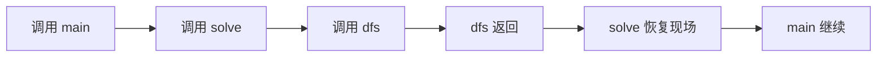
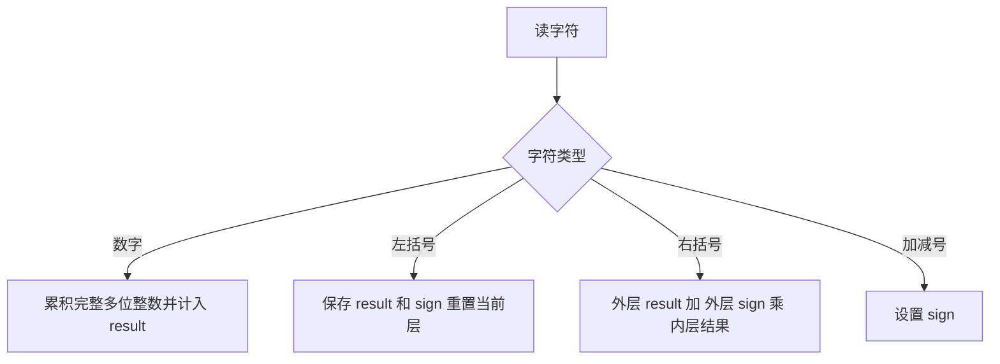

## 栈：保存尚未完成的工作

栈只允许从同一端加入和取走元素，后进先出（LIFO）；队列从一端加入、另一端取走，先进先出（FIFO）。函数调用把返回地址、局部状态放在调用栈中，递归是这一机制的直接应用。DFS 必须先完成最近展开的分支，所以适合栈；BFS 按发现次序处理节点，所以适合队列。任务队列通常采用 FIFO，但优先队列按优先级取元素，并不保证 FIFO。



### Java 容器与不变量

课件使用 `Stack<E>`。以下解法用 `Deque<E> stack = new ArrayDeque<>()` 表达栈。`Deque` 是接口，`ArrayDeque` 是实现；尖括号是泛型，`<>` 让编译器推断类型。`Deque<Integer>` 存的是包装类，放入 `int` 时自动装箱，取出参与运算时自动拆箱。`push/pop/peek` 都操作队首；`peek` 不删除，空栈返回 `null`，而 `pop` 空栈抛异常。`ArrayDeque` 不接受 `null`。

| 意图 | 栈 API | 队列 API | 成本 |
|---|---|---|---|
| 加入 | push(x) | offerLast(x) | 均摊 O(1) |
| 取出 | pop() | pollFirst() | O(1) |
| 查看 | peek() | peekFirst() | O(1) |
| 长度/判空 | size()/isEmpty() | 同左 | O(1) |

最重要的是写清“栈中每个元素代表什么”。括号解析保存外层状态；路径处理保存有效目录；单调栈保存尚未找到边界的下标。栈只是工具，正确性来自状态含义。

<a id="lc-394"></a>
## LC 394 · 字符串解码

**题意。** `k[片段]` 把片段重复 k 次，片段可以嵌套，数字可能有多位。输入合法，数字只表示次数。例如 `3[a2[c]]` 是 `accaccacc`。

读到 `[` 时，外层文本还不能完成，必须保存“已有前缀”和“重复次数”；读到 `]`，最近一次打开的片段最先结束，所以用栈。每层维护 `current`，其含义是当前这一层已解码的前缀。保存可变 `StringBuilder` 对象后为内层新建对象，避免内外层共用同一个缓冲区。

| 读入 | 次数栈（底→顶） | 前缀栈 | 当前文本 |
|---|---|---|---|
| 3[ | 3 | 空串 | 空串 |
| a2[ | 3,2 | 空串,a | 空串 |
| c | 3,2 | 空串,a | c |
| ] | 3 | 空串 | acc |
| ] | 空 | 空 | accaccacc |

```java
import java.util.*;
class Solution {
    public String decodeString(String s) {
        Deque<Integer> counts = new ArrayDeque<>();
        Deque<StringBuilder> prefixes = new ArrayDeque<>();
        StringBuilder current = new StringBuilder();
        int number = 0;
        for (char c : s.toCharArray()) {
            if (c >= '0' && c <= '9') {
                number = number * 10 + c - '0';
            } else if (c == '[') {
                counts.push(number);
                prefixes.push(current);
                current = new StringBuilder();
                number = 0;
            } else if (c == ']') {
                int count = counts.pop();
                StringBuilder outer = prefixes.pop();
                for (int j = 0; j < count; j++) outer.append(current);
                current = outer;
            } else {
                current.append(c);
            }
        }
        return current.toString();
    }
}
```

**语法与 API。** `toCharArray()` 产生字符数组；`c-'0'` 用字符编码之差得到数字。`StringBuilder.append` 追加内容而不是反复产生不可变字符串；`toString()` 生成最终字符串。两栈必须同时压入、同时弹出，才能保持同一层状态对应。

**边界与复杂度。** `10[a]` 检查多位次数，`a2[b]c` 检查外层前后缀，`1[1[a]]` 检查嵌套。不应把每次追加看作常数：设实际追加字符总数为 W，时间 O(n+W)，输出长 L、嵌套深度 d 时 W 最坏可达 O(dL)，额外空间 O(n+L)。

<a id="lc-71"></a>
## LC 71 · 简化 Unix 绝对路径

**题意。** 把多余 `/`、`.` 和 `..` 消去，得到从根目录出发的标准绝对路径。根目录的上一级仍是根；`...` 是普通目录名，不是两个 `..`。

扫描每个路径段：空串与 `.` 忽略；`..` 撤销最近进入的目录；其他段压入。栈始终表示当前已经走到的位置，因此撤销正好符合后进先出。这里用双端队列的尾端作为栈顶，方便最终正向遍历。

| `/a/./b/../../c/` 的段 | 有效目录（根→叶） |
|---|---|
| a | a |
| . | a |
| b | a,b |
| .. | a |
| .. | 空 |
| c | c |

```java
import java.util.*;
class Solution {
    public String simplifyPath(String path) {
        Deque<String> dirs = new ArrayDeque<>();
        for (String part : path.split("/")) {
            if (part.isEmpty() || part.equals(".")) continue;
            if (part.equals("..")) {
                if (!dirs.isEmpty()) dirs.removeLast();
            } else {
                dirs.addLast(part);
            }
        }
        StringBuilder result = new StringBuilder();
        for (String dir : dirs) result.append('/').append(dir);
        return result.length() == 0 ? "/" : result.toString();
    }
}
```

**细节。** `split` 接受正则表达式，`/` 在这里无须转义；它默认丢弃末尾空段，这与题意相容。字符串比较用 `equals`，`==` 比较引用。链式 `append` 因为返回当前 builder。课件不断 `insert(0,...)` 会搬移已有字符，最坏 O(n²)；尾部构造保持 O(n) 时间和空间。测试 `/../→/`、`/home//foo/→/home/foo`、`/.../→/...`。

<a id="lc-224"></a>
## LC 224 · 基本计算器

**题意。** 计算含整数、空格、`+ - ( )` 的合法表达式，支持一元负号，不涉及乘除。括号让外层计算暂时挂起。维护当前层的累计值 `result` 和下一个数的系数 `sign`；遇 `(` 保存两者，遇 `)` 把完整内层值当作外层的一个数。



| 表达式 `1-(2-3)` | 当前 result | sign | 保存的外层 |
|---|---:|---:|---|
| 1 | 1 | 1 | 空 |
| -( | 0 | 1 | result=1,sign=-1 |
| 2-3 | -1 | -1 | 同上 |
| ) | 2 | -1 | 空 |

```java
import java.util.*;
class Solution {
    public int calculate(String s) {
        Deque<Integer> saved = new ArrayDeque<>();
        int result = 0, sign = 1;
        for (int i = 0; i < s.length(); i++) {
            char c = s.charAt(i);
            if (c >= '0' && c <= '9') {
                int value = 0;
                while (i < s.length() && s.charAt(i) >= '0'
                        && s.charAt(i) <= '9') {
                    value = value * 10 + s.charAt(i) - '0';
                    i++;
                }
                i--;
                result += sign * value;
            } else if (c == '+') {
                sign = 1;
            } else if (c == '-') {
                sign = -1;
            } else if (c == '(') {
                saved.push(result);
                saved.push(sign);
                result = 0;
                sign = 1;
            } else if (c == ')') {
                int outerSign = saved.pop();
                int outerResult = saved.pop();
                result = outerResult + outerSign * result;
            }
        }
        return result;
    }
}
```

**细节。** `charAt(i)` 取 UTF-16 字符；数字循环结束后 `i--` 抵消外层循环的自增，避免跳过运算符。空格自然忽略，无须复制整个字符串。栈先压 result 再压 sign，弹出顺序相反。本解基于该题合法语法；[官方约束](https://leetcode.com/problems/basic-calculator/)允许一元负号、不允许一元加号，且保证不会出现连续运算符。因此课件 `+48 + -48` 是超出该版本约束的扩展示例，不能据此宣称支持任意连续符号，例如 `--2` 需要额外的语法规则。测试 `-(2+3)→-5`、`2147483647→2147483647`、`(1+(4+5+2)-3)+(6+8)→23`。每字符处理常数次，时间 O(n)，栈空间 O(d)。

<a id="lc-316"></a>
## LC 316 · 去除重复字母

**题意。** 从字符串删除字符，保持剩余字符相对次序，使每种字母恰好一次，并让结果字典序最小。不能先排序，因为结果必须是原串的子序列。

对当前字母 c，若栈顶更大且以后还会出现，就可以把它推迟，从而改善第一个不同的位置。若以后不再出现，则绝不能弹出，否则丢失一种必需字母。`remaining` 表示未扫描后缀的频次，`used` 表示当前答案中是否已有该字母。

| 扫描 `cbacdcbc` | 操作 | 答案栈 |
|---|---|---|
| c | 入栈 | c |
| b | c 以后还有，弹 c | b |
| a | b 以后还有，弹 b | a |
| c | 入栈 | ac |
| d | 入栈 | acd |
| c | 已有，跳过 | acd |
| b | d 后面没有，不能弹 | acdb |
| c | 已有，跳过 | acdb |

```java
class Solution {
    public String removeDuplicateLetters(String s) {
        int[] remaining = new int[26];
        boolean[] used = new boolean[26];
        for (int i = 0; i < s.length(); i++) remaining[s.charAt(i) - 'a']++;
        StringBuilder stack = new StringBuilder();
        for (int i = 0; i < s.length(); i++) {
            char c = s.charAt(i);
            remaining[c - 'a']--;
            if (used[c - 'a']) continue;
            while (stack.length() > 0) {
                char top = stack.charAt(stack.length() - 1);
                if (top <= c || remaining[top - 'a'] == 0) break;
                stack.deleteCharAt(stack.length() - 1);
                used[top - 'a'] = false;
            }
            stack.append(c);
            used[c - 'a'] = true;
        }
        return stack.toString();
    }
}
```

**细节。** 字符可直接用 `< >` 比较小写字母顺序。`deleteCharAt` 删除尾字符在此是 O(1)，并非任意位置删除都如此。先减 remaining 再检查 used，保证后缀统计不包含当前位置。每字符最多入栈、出栈一次，O(n) 时间，字母表固定时 O(1) 空间。测试 `bcabc→abc`、`aaaa→a`、`cba→cba`；最后一个例子说明答案不一定升序。

<a id="lc-84"></a>
## LC 84 · 柱状图最大矩形

**题意。** 每个柱子宽 1，找完全位于柱状图内部的最大轴对齐矩形。固定一个柱子作为最低高度，它可以扩展到左右第一个更低柱子的内侧；问题变成寻找边界。

栈存下标，栈中高度非递减。当新高度更低时，栈顶的右边界首次确定。弹出后新的栈顶是左侧限制，宽度是 `right-left-1`。遇相等高度可以暂不弹出，较早的同高柱最终会负责完整宽度。

| `[2,1,5,6,2,3]` | 弹出高度 | 左限制 | 右限制 | 面积 |
|---|---:|---:|---:|---:|
| i=1 | 2 | -1 | 1 | 2 |
| i=4 | 6 | 2 | 4 | 6 |
| i=4 | 5 | 1 | 4 | 10 |
| 末尾哨兵 i=6 | 3 | 4 | 6 | 3 |
| 同上 | 2 | 1 | 6 | 8 |
| 同上 | 1 | -1 | 6 | 6 |

```java
import java.util.*;
class Solution {
    public int largestRectangleArea(int[] heights) {
        Deque<Integer> stack = new ArrayDeque<>();
        int best = 0;
        for (int i = 0; i <= heights.length; i++) {
            int current = i == heights.length ? 0 : heights[i];
            while (!stack.isEmpty() && heights[stack.peek()] > current) {
                int h = heights[stack.pop()];
                int left = stack.isEmpty() ? -1 : stack.peek();
                best = Math.max(best, h * (i - left - 1));
            }
            if (i < heights.length) stack.push(i);
        }
        return best;
    }
}
```

**细节。** 三元表达式只求值被选中的分支，因此 i=n 时不访问 `heights[n]`。哨兵只提供高度 0，不压入不存在的下标。循环嵌套并不意味着 O(n²)：每下标入栈一次、出栈一次，总计 O(n)，空间 O(n)。测试 `[]→0`、`[2,2]→4`、`[0]→0`、单调增序列。面积受题目范围约束可用 int；通用大输入应转 long 后乘法。

<a id="lc-225"></a>
## 作业 · LC 225 用队列实现栈

**题意与推导。** 只允许队列的队尾入队、队首出队等操作，实现 `push/pop/top/empty`。令队首始终是最新元素。加入新元素后，把旧元素依次转到队尾，队列顺序就是栈从顶到底的顺序。

| 操作 | 队列（首→尾） | 返回 |
|---|---|---|
| push(1) | 1 | — |
| push(2)，旋转旧 1 | 2,1 | — |
| top() | 2,1 | 2 |
| pop() | 1 | 2 |

```java
import java.util.*;
class MyStack {
    private final Queue<Integer> queue = new ArrayDeque<>();
    public void push(int x) {
        int oldSize = queue.size();
        queue.offer(x);
        for (int i = 0; i < oldSize; i++) queue.offer(queue.remove());
    }
    public int pop() { return queue.remove(); }
    public int top() { return queue.element(); }
    public boolean empty() { return queue.isEmpty(); }
}
```

`final` 禁止字段改指向另一个队列，不禁止修改队列内容；`Queue` 静态类型约束只使用队列接口。`remove/element` 在空队列抛异常，题目保证 pop/top 合法。push O(n)，其他 O(1)，总存储 O(n)。测试单元素弹出后 empty=true、重复数字、交错 push/pop。课件的 Simplify Path 作业已在前文完整解决。

<a id="lc-42"></a>
## 作业 · LC 42 接雨水

**题意。** 宽 1 的非负高度数组，在降雨后最多积多少水。某位置水位受左右最高墙较低者限制。单调栈提供另一种按横向水层结算的方法：新右墙高于栈顶时，栈顶是凹槽底；弹出后若仍有左墙，就能结算一层水。

| `[3,0,2,0,4]` 到达位置 | 槽底 | 左墙 | 宽 | 水层高度 | 新增 |
|---|---:|---:|---:|---:|---:|
| i=2，高2 | 0 | i=0，高3 | 1 | 2 | 2 |
| i=4，高4 | 0 | i=2，高2 | 1 | 2 | 2 |
| i=4 | 2 | i=0，高3 | 3 | 1 | 3 |
| 合计 | — | — | — | — | 7 |

```java
import java.util.*;
class Solution {
    public int trap(int[] height) {
        Deque<Integer> stack = new ArrayDeque<>();
        int water = 0;
        for (int right = 0; right < height.length; right++) {
            while (!stack.isEmpty() && height[right] > height[stack.peek()]) {
                int bottom = stack.pop();
                if (stack.isEmpty()) break;
                int left = stack.peek();
                int level = Math.min(height[left], height[right]) - height[bottom];
                water += (right - left - 1) * level;
            }
            stack.push(right);
        }
        return water;
    }
}
```

`Math.min` 决定较矮边界；没有左墙时不可积水。每次结算的是新出现的水平层，不会与已结算的底层重复。O(n) 时间、O(n) 空间。测试单调数组→0、`[2,0,2]→2`、空数组→0。若只需要答案，双指针也可把空间降为 O(1)，但栈的“等待右边界”思路可直接迁移到 LC84。

<a id="lc-496"></a>
## 作业 · 下一个更大元素（按 LC 496 版本讲解）

课件只有标题，未指定 I/II。本节采用两个无重复数组的版本：nums1 是 nums2 的子集，对 nums1 每个数找它在 nums2 右侧第一个更大的数，没有则 -1。若题目是循环数组 LC503，应循环扫描 2n 次，并用下标存答案；不能套用本题按值映射的去重假设。

单调递减栈保存还没遇到答案的数，新数 x 大于栈顶时，x 就是该元素的第一个更大数，因为此前所有扫描元素都没能使它出栈。

| nums2=[1,3,4,2] | 弹出并填写 | 栈底→顶 |
|---|---|---|
| 1 | 无 | 1 |
| 3 | 1→3 | 3 |
| 4 | 3→4 | 4 |
| 2 | 无 | 4,2 |
| 扫描结束 | 4、2 均为 -1 | — |

```java
import java.util.*;
class Solution {
    public int[] nextGreaterElement(int[] nums1, int[] nums2) {
        Map<Integer, Integer> next = new HashMap<>();
        Deque<Integer> waiting = new ArrayDeque<>();
        for (int x : nums2) {
            while (!waiting.isEmpty() && waiting.peek() < x) next.put(waiting.pop(), x);
            waiting.push(x);
        }
        int[] answer = new int[nums1.length];
        for (int i = 0; i < nums1.length; i++) answer[i] = next.getOrDefault(nums1[i], -1);
        return answer;
    }
}
```

`getOrDefault` 在键不存在时返回 -1；它不把这个默认值存回 map。`[4,1,2]` 得 `[-1,3,-1]`。测试最大元素、最后元素、递减数组。总时间 O(n+m)（哈希操作按平均情况），空间 O(n)。
