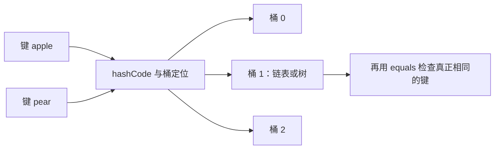
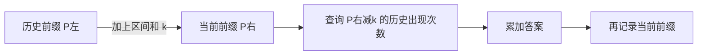

## 哈希表：把反复搜索变成查表

Map 把键映射到值；Set 只记录一个值是否出现。哈希函数把键转换为整数，再映射到桶下标；不同键可能落入同一桶，这叫冲突。桶数有限而键空间可能无限，因此不能承诺通用哈希函数完全无冲突。好的哈希函数确定、计算快、分布均匀。



### 冲突、扩容与 Java 集合

链地址法让一个桶容纳多个条目；开放寻址法在数组中继续寻找其他空槽。课件称前者 open hashing、后者 closed hashing，不同资料可能交换术语，描述机制比记名字可靠。开放寻址删除时常需墓碑标记，否则会截断探测链。负载因子=条目数/桶数；扩容重建桶位置，单次可能 O(n)，但合理扩容策略下插入可以均摊分析。Java HashMap 默认负载因子 0.75，不代表所有哈希表必须采用该数值。

| 类型 | 顺序 | 查找/插入 | 适合场景 |
|---|---|---|---|
| HashMap / HashSet | 不保证遍历顺序 | 平均 O(1) | 计数、去重、缓存 |
| TreeMap / TreeSet | 按自然顺序或比较器排序 | O(log n) | 前驱后继、范围检索 |
| LinkedHashMap / LinkedHashSet | 默认插入次序 | 平均 O(1) | 保序去重；访问序 Map 可用于 LRU |

`put` 返回旧值，`get/remove` 在没有映射时通常返回 null；若允许 null 值，不能单凭 `get()==null` 判断键不存在。`containsValue` 需要扫描值，通常 O(n)，不是 O(1)。`entrySet/keySet/values` 是集合视图，不是独立快照。遍历中结构性修改原 Map 可能触发并发修改异常；需要删除时使用迭代器的 `remove`。通常用 `for (Map.Entry<K,V> e : map.entrySet())` 同时取键值，避免额外查询。

相同对象的 `equals` 若返回 true，则 `hashCode` 必须相同；反过来不成立。放入 map 后不要修改参与相等比较的键字段。泛型不能直接用 int，要用 Integer；`getOrDefault(k,0)+1` 涉及自动拆箱，默认值避免 null 拆箱异常。[Java 8 HashMap 官方说明](https://docs.oracle.com/javase/8/docs/api/java/util/HashMap.html) 说明了顺序、负载因子及基本操作的性能前提。

### 读懂课件中的 JCF 全景图

`Map` 与 `Collection` 是并列接口，Map并不继承Collection。Collection下面分为List、Set、Queue；Deque又扩展Queue。List允许重复、按位置访问，ArrayList基于可扩展数组，随机访问O(1)，中间插删O(n)；LinkedList是双向链表，已持有节点/迭代器位置时改链接O(1)，但按下标寻找仍O(n)。ArrayDeque适合两端操作；PriorityQueue只提供优先级出队。SortedMap/SortedSet增加排序契约，NavigableMap/NavigableSet进一步提供更近的前驱、后继等查询。

全景图中的其他类各有专门语义：EnumMap面向同一种枚举键；IdentityHashMap用引用身份比较，适合对象图追踪；WeakHashMap的弱键可随垃圾回收消失，不适合需要永久保留的普通索引。Hashtable、Vector、Stack属于历史集合，单次同步方法也不自动让“先检查再修改”的复合操作原子化。选型先问存键值对还是值、是否允许重复、是否需要顺序，再问主要操作和并发要求。[java.util 官方类型索引](https://docs.oracle.com/javase/8/docs/api/java/util/package-summary.html)。

| 课件并发集合分支 | 解决的问题 | 关键取舍 |
|---|---|---|
| ConcurrentMap / ConcurrentHashMap | 多线程共享映射、原子更新 | 用putIfAbsent/compute等表达复合操作，普通get后put不是同一个原子步骤 |
| ConcurrentNavigableMap / ConcurrentSkipListMap / ConcurrentSkipListSet | 并发下保序与范围查询 | 跳表结构，典型操作O(log n) |
| CopyOnWriteArrayList / CopyOnWriteArraySet | 读多写少的集合 | 修改复制底层数组O(n)，迭代看到创建时快照 |
| BlockingQueue；ArrayBlockingQueue / LinkedBlockingQueue | 生产消费速率不同 | put/take可等待；容量设置决定缓存与背压 |
| PriorityBlockingQueue | 线程安全优先级调度 | 按优先级取出，不等价FIFO；默认不提供有界容量背压 |
| DelayQueue | 延时任务 | 只有到期元素才可被取出，元素需提供延迟语义 |
| SynchronousQueue | 直接交接 | 不存储元素，发送与接收要配对 |
| TransferQueue / LinkedTransferQueue | 生产者需要确认已有消费者接收 | transfer可等待实际接收，不只是成功放入缓冲 |
| BlockingDeque / LinkedBlockingDeque | 两端都需要阻塞操作 | 双端结构增加调度灵活性 |

这一页是接口与实现的地图，不意味着都要用在算法题里；单线程解题通常从简单容器开始。线程安全也不等于业务操作整体安全，具体保证要看所调用方法。[java.util.concurrent 官方说明](https://docs.oracle.com/javase/8/docs/api/java/util/concurrent/package-summary.html)。

<a id="lc-1"></a>
## LC 1 · 两数之和

**题意。** 返回两个不同下标，使对应数字相加为 target，题目保证恰有一解。暴力枚举两下标 O(n²)。扫描 x 时，之前的数中只需找 `target-x`，因此把“数→下标”存入 map。必须先查再存，避免把当前位置使用两次。

| nums=[3,2,4], target=6 | 所需数 | 扫描前 map | 行为 |
|---|---:|---|---|
| i=0,x=3 | 3 | 空 | 存 3→0 |
| i=1,x=2 | 4 | 3→0 | 存 2→1 |
| i=2,x=4 | 2 | 3→0,2→1 | 返回 [1,2] |

```java
import java.util.*;
class Solution {
    public int[] twoSum(int[] nums, int target) {
        Map<Integer, Integer> seen = new HashMap<>();
        for (int i = 0; i < nums.length; i++) {
            int need = target - nums[i];
            if (seen.containsKey(need)) return new int[]{seen.get(need), i};
            seen.put(nums[i], i);
        }
        throw new IllegalArgumentException("No solution");
    }
}
```

`new int[]{...}` 是直接构造返回数组，不是泛型；异常分支说明违反“保证有解”的调用约定。按本题数值范围 int 差值安全，通用版本可用 long 键。平均时间 O(n)，空间 O(n)。测试 `[3,3],6→[0,1]`、负数、解在最后两位；重复键覆盖旧下标不影响找到任意合法解。

<a id="lc-560"></a>
## LC 560 · 和为 K 的子数组

**题意。** 统计连续、非空子数组和等于 k 的数量。前缀和 P[i] 表示前 i 项之和，区间 `[l,r)` 的和是 `P[r]-P[l]`。固定右端后，要找的是历史前缀 `P[r]-k` 出现过多少次，不能只记录有没有。



| nums=[1,1,1], k=2 | 当前和 | 查询 | 新增 | 记录后频次 |
|---|---:|---:|---:|---|
| 初始 | 0 | — | — | 0:1 |
| 第一个1 | 1 | -1 | 0 | 0:1,1:1 |
| 第二个1 | 2 | 0 | 1 | 加2:1 |
| 第三个1 | 3 | 1 | 1 | 加3:1 |

```java
import java.util.*;
class Solution {
    public int subarraySum(int[] nums, int k) {
        Map<Integer, Integer> frequency = new HashMap<>();
        frequency.put(0, 1);
        int prefix = 0, answer = 0;
        for (int x : nums) {
            prefix += x;
            answer += frequency.getOrDefault(prefix - k, 0);
            frequency.put(prefix, frequency.getOrDefault(prefix, 0) + 1);
        }
        return answer;
    }
}
```

初始 0:1 代表数组开始前的空前缀，而非把空子数组计入答案。先查询再插入避免 k=0 时把当前前缀和自己相减。数组含负数，窗口和不单调，不能采用仅靠大于 k 就收缩的窗口。课件前缀和双循环版时间 O(n²)、空间 O(n)；此版平均 O(n) 时间、O(n) 空间。测试 `[0,0],0→3`、`[1,-1,0],0→3`、无解→0。频次和答案都可能多于数组长度。

<a id="lc-128"></a>
## LC 128 · 最长连续序列

**题意。** 无序数组中找数值连续序列的最大长度，不要求原数组下标连续。去重后，只从没有前驱 `x-1` 的数开始向上找，这样一个序列只遍历一次。

| 集合 {100,4,200,1,3,2} 中的数 | 有前驱? | 工作 |
|---|---|---|
| 100 | 无 | 长度1 |
| 4 | 有3 | 跳过 |
| 200 | 无 | 长度1 |
| 1 | 无 | 依次找到2、3、4，长度4 |
| 2、3 | 有 | 跳过 |

```java
import java.util.*;
class Solution {
    public int longestConsecutive(int[] nums) {
        Set<Integer> set = new HashSet<>();
        for (int x : nums) set.add(x);
        int best = 0;
        for (int x : set) {
            if (x != Integer.MIN_VALUE && set.contains(x - 1)) continue;
            int end = x, length = 1;
            while (end != Integer.MAX_VALUE && set.contains(end + 1)) {
                end++;
                length++;
            }
            best = Math.max(best, length);
        }
        return best;
    }
}
```

`Set.add` 自动去重；整数端点判断防止溢出把最大数与最小数错误连接。外层和内层总访问 O(n) 次而非 O(n²)，平均时间 O(n)、空间 O(n)。课件排序方案要跳过相等元素，复杂度 O(n log n)，且会改动输入。测试空数组→0、`[1,2,2,3]→3`、负数连续段。

<a id="lc-3"></a>
## LC 3 · 无重复字符的最长子串

**题意。** 找连续子串中没有重复字符的最大长度；子序列不满足要求。维护窗口 `[left,right]` 内字符互异。遇重复字符 c，其上次位置 p 迫使 left 至少到 p+1；如果 p 已在窗口外，left 不能倒退。

| `abba` | 上次位置 | left | 当前窗口 | 最长 |
|---|---:|---:|---|---:|
| i=0,a | 无 | 0 | a | 1 |
| i=1,b | 无 | 0 | ab | 2 |
| i=2,b | 1 | 2 | b | 2 |
| i=3,a | 0 | max(2,1)=2 | ba | 2 |

```java
import java.util.*;
class Solution {
    public int lengthOfLongestSubstring(String s) {
        Map<Character, Integer> last = new HashMap<>();
        int left = 0, best = 0;
        for (int right = 0; right < s.length(); right++) {
            char c = s.charAt(right);
            Integer previous = last.put(c, right);
            if (previous != null) left = Math.max(left, previous + 1);
            best = Math.max(best, right - left + 1);
        }
        return best;
    }
}
```

利用 `put` 返回旧值省一次查询，使用 Integer 是为了表达“没有旧值”的 null。课件 256 数组版只适用于相应有限字符集；Java char 可超过255，本版按 UTF-16 代码单元计算，若要求 Unicode 码点长度需改用 `s.codePoints()`。时间 O(n)，空间 O(min(n,字符集大小))。测试 `""→0`、`bbbbb→1`、`pwwkew→3`；必须保留 `Math.max`。

<a id="lc-76"></a>
## LC 76 · 最小覆盖子串

**题意。** 在 s 中找包含 t 全部字符及其重复次数的最短子串；无解返回空串。`need[c]` 表示还缺多少个 c，负数表示多余。右端扩张到全部满足，再不断收缩左端，直到刚刚失效。

| s=ADOBECODEBANC, t=ABC | 有效窗口 | 收缩结果 | 最佳 |
|---|---|---|---|
| right=5,C | ADOBEC | 去掉A后失效 | ADOBEC |
| right=10,A | DOBECODEBA | 收到CODEBA，去C失效 | 长度仍6 |
| right=12,C | ODEBANC | 收到BANC，去B失效 | BANC |

```java
import java.util.*;
class Solution {
    public String minWindow(String s, String t) {
        if (t.isEmpty()) return "";
        Map<Character, Integer> need = new HashMap<>();
        for (int i = 0; i < t.length(); i++) {
            char c = t.charAt(i);
            need.put(c, need.getOrDefault(c, 0) + 1);
        }
        int missing = t.length(), left = 0, start = 0, length = Integer.MAX_VALUE;
        for (int right = 0; right < s.length(); right++) {
            char c = s.charAt(right);
            if (need.containsKey(c)) {
                if (need.get(c) > 0) missing--;
                need.put(c, need.get(c) - 1);
            }
            while (missing == 0) {
                if (right - left + 1 < length) {
                    start = left;
                    length = right - left + 1;
                }
                char out = s.charAt(left++);
                if (need.containsKey(out)) {
                    need.put(out, need.get(out) + 1);
                    if (need.get(out) > 0) missing++;
                }
            }
        }
        return length == Integer.MAX_VALUE ? "" : s.substring(start, start + length);
    }
}
```

`substring(start,end)` 右端不包含 end。missing 统计缺少的字符总数，不是种类数，故 `t="AAB"` 正确要求两个 A。右端每步一次、左端只向前，总时间 O(|s|+|t|)，空间 O(t 中不同字符数)。测试 `a,aa→""`、`aa,aa→aa`、空 t→空串。课件未处理空 t 会不断收缩越界，这里补上保护。

<a id="lc-202"></a>
## 作业 · LC 202 快乐数

**题意。** 正整数反复变成每位数字平方和，能到1则快乐，否则陷入循环。变换是确定函数；重复遇到某个状态之后，后续轨迹也完全重复，因此集合可检测环。

| 从19开始 | 平方和 | seen |
|---|---:|---|
| 19 | 1+81=82 | 19 |
| 82 | 64+4=68 | 19,82 |
| 68 | 36+64=100 | 再加68 |
| 100 | 1 | 再加100 |

```java
import java.util.*;
class Solution {
    public boolean isHappy(int n) {
        Set<Integer> seen = new HashSet<>();
        while (n != 1 && seen.add(n)) {
            int next = 0;
            while (n > 0) {
                int digit = n % 10;
                next += digit * digit;
                n /= 10;
            }
            n = next;
        }
        return n == 1;
    }
}
```

`seen.add(n)` 在新增时返回 true、已存在返回 false，故可同时检查与记录。`%10` 取个位、`/10` 丢个位。状态很快收缩到有限范围；固定32位整数可视为有常数上界，按位数 D 分析首轮 O(D)，后续进入小状态空间。测试 1→true、2→false、19→true。也可用快慢指针 O(1) 空间检测函数图环。

<a id="lc-205"></a>
## 作业 · LC 205 同构字符串

**题意。** s 每个字符都必须稳定映射到 t 的一个字符，且不同字符不能映射到同一个字符，允许映射为自己。只做单向映射会错误接受 `ab→aa`。

| egg 与 add | 正向映射 | 反向映射 | 结果 |
|---|---|---|---|
| e→a | e:a | a:e | 合法 |
| g→d | 加g:d | 加d:g | 合法 |
| g→d | 与已有一致 | 与已有一致 | true |

```java
import java.util.*;
class Solution {
    public boolean isIsomorphic(String s, String t) {
        if (s.length() != t.length()) return false;
        Map<Character, Character> forward = new HashMap<>();
        Map<Character, Character> backward = new HashMap<>();
        for (int i = 0; i < s.length(); i++) {
            char a = s.charAt(i), b = t.charAt(i);
            if (forward.containsKey(a) && forward.get(a) != b) return false;
            if (backward.containsKey(b) && backward.get(b) != a) return false;
            forward.put(a, b);
            backward.put(b, a);
        }
        return true;
    }
}
```

`Character != char` 会拆箱后比较字符数值；不要把两个包装对象直接 `==` 作为通用值比较。O(n) 时间、O(字符集大小) 空间。测试 `foo/bar→false`、`paper/title→true`、`ab/aa→false`、空串对→true。

<a id="lc-30"></a>
## 作业 · LC 30 串联所有单词的子串

**题意。** words 每个单词等长，找 s 中恰好由所有单词各使用规定次数、任意排列拼接的子串起点。重复单词不能忽略。按单词长度 w 分成 w 种起点对齐方式，每次走一个完整单词，维护长度不超过 words 数量的窗口。

| s=barfoofoobarthefoobarman，words=[bar,foo,the]，对齐0 | 窗口操作 | 结果 |
|---|---|---|
| bar,foo | 计数1,1 | 尚缺the |
| 第二个foo | foo超额，移走bar再移走旧foo | 窗口foo |
| 加bar,the | 三种各1 | 起点6 |
| 加foo | 移走旧foo，得到bar,the,foo | 起点9 |
| 加bar | 移走旧bar，得到the,foo,bar | 起点12 |

```java
import java.util.*;
class Solution {
    public List<Integer> findSubstring(String s, String[] words) {
        List<Integer> answer = new ArrayList<>();
        if (words.length == 0) return answer;
        int width = words[0].length(), count = words.length;
        Map<String, Integer> need = new HashMap<>();
        for (String word : words) need.put(word, need.getOrDefault(word, 0) + 1);
        for (int offset = 0; offset < width; offset++) {
            int left = offset, used = 0;
            Map<String, Integer> have = new HashMap<>();
            for (int right = offset; right + width <= s.length(); right += width) {
                String word = s.substring(right, right + width);
                if (!need.containsKey(word)) {
                    have.clear();
                    used = 0;
                    left = right + width;
                    continue;
                }
                have.put(word, have.getOrDefault(word, 0) + 1);
                used++;
                while (have.get(word) > need.get(word)) {
                    String out = s.substring(left, left + width);
                    have.put(out, have.get(out) - 1);
                    left += width;
                    used--;
                }
                if (used == count) answer.add(left);
            }
        }
        return answer;
    }
}
```

`clear` 清除窗口计数；不同 offset 不能共用未清空状态。重复词超额时用 while，可能需要移除多个词。答案无需排序。Java 创建子串和哈希单词需 O(w)，总时间 O(|s|w+总单词字符数)，空间 O(words 不同词数×w) 加结果。测试重复 `word,word`，s 比总长度短，无关词重置，重叠匹配。

<a id="lc-149"></a>
## 作业 · LC 149 直线上最多的点数

**题意。** 二维平面找一条线，覆盖最多输入点。固定锚点后，同一直线由相同方向斜率表示。不能用浮点相等判断；把 `(dx,dy)` 约分并统一符号，竖线归为 `(0,1)`、横线归为 `(1,0)`。

| 锚点 (0,0)，其他点 | 原差值 | 规范方向 | 数量 |
|---|---|---|---:|
| (1,1) | (1,1) | (1,1) | 1 |
| (2,2) | (2,2) | (1,1) | 2 |
| (-1,-1) | (-1,-1) | (1,1) | 3 |
| (0,2) | (0,2) | (0,1) | 1 |

```java
import java.util.*;
class Solution {
    public int maxPoints(int[][] points) {
        int answer = 0;
        for (int i = 0; i < points.length; i++) {
            Map<String, Integer> count = new HashMap<>();
            int best = 0, duplicates = 0;
            for (int j = i + 1; j < points.length; j++) {
                long dx = (long) points[j][0] - points[i][0];
                long dy = (long) points[j][1] - points[i][1];
                if (dx == 0 && dy == 0) { duplicates++; continue; }
                long g = gcd(Math.abs(dx), Math.abs(dy));
                dx /= g;
                dy /= g;
                if (dx < 0 || (dx == 0 && dy < 0)) { dx = -dx; dy = -dy; }
                String key = dx + ":" + dy;
                int value = count.getOrDefault(key, 0) + 1;
                count.put(key, value);
                best = Math.max(best, value);
            }
            answer = Math.max(answer, best + duplicates + 1);
        }
        return answer;
    }
    private long gcd(long a, long b) {
        while (b != 0) { long r = a % b; a = b; b = r; }
        return a;
    }
}
```

先转 long 再减，避免整数溢出；欧几里得算法用余数不断缩小公约数问题。字符串中的冒号防止 `(1,23)` 与 `(12,3)` 混淆。本题当前点通常互异，duplicates 额外兼容重复点。O(n² log C) 时间（C 为坐标差范围），O(n) 空间。测试全竖线、负斜率、单点→1、全重复点。

<a id="lc-138"></a>
## 作业 · LC 138 随机指针链表的复制

**题意。** 每个节点有 next 和 random，random 可指任意节点或 null。新链表的值和连接关系相同，但不得使用任何旧节点作为新图的一部分。先创建每个节点，再连接指针，解决向后、向前与自环引用。

| 原链 A(7)→B(13)，B.random=A | 第一轮 | 第二轮 |
|---|---|---|
| A | map[A]=A' | A'.next=B'，random=null |
| B | map[B]=B' | B'.next=null，random=A' |

```java
import java.util.*;
// LeetCode 提供 Node：int val; Node next, random; Node(int val)
class Solution {
    public Node copyRandomList(Node head) {
        Map<Node, Node> copy = new HashMap<>();
        for (Node p = head; p != null; p = p.next) copy.put(p, new Node(p.val));
        for (Node p = head; p != null; p = p.next) {
            copy.get(p).next = copy.get(p.next);
            copy.get(p).random = copy.get(p.random);
        }
        return copy.get(head);
    }
}
```

键用原节点引用，不用 val，因为两个节点可以值相同。`map.get(null)` 在本实现返回 null，恰好处理空指针；题目节点未自定义 equals/hashCode，默认按对象身份。时间 O(n)，空间 O(n)。测试空链、random 指自己、两个相等值但 random 不同。验证不能只比较值，还要检查每个新节点都不是原节点。

<a id="lc-36"></a>
## 作业 · LC 36 有效数独

**题意。** 判断已填数字在每行、每列、每个3×3宫是否重复；空格 `.` 忽略。判断合法不等于保证一定能解出完整数独。每个数字同时加入三种约束集合。

| 位置与数字 | 行约束 | 列约束 | 宫约束 |
|---|---|---|---|
| (0,0)=5 | row0的5 | col0的5 | box0的5 |
| (0,1)=3 | row0的3 | col1的3 | box0的3 |
| (1,1)=5 | row1的5 | col1的5 | box0的5重复→false |

```java
import java.util.*;
class Solution {
    public boolean isValidSudoku(char[][] board) {
        Set<String> seen = new HashSet<>();
        for (int r = 0; r < 9; r++) {
            for (int c = 0; c < 9; c++) {
                char x = board[r][c];
                if (x == '.') continue;
                int box = (r / 3) * 3 + c / 3;
                if (!seen.add("r" + r + ":" + x)
                        || !seen.add("c" + c + ":" + x)
                        || !seen.add("b" + box + ":" + x)) return false;
            }
        }
        return true;
    }
}
```

字符串前缀使行列宫键空间互不冲突；`||` 短路，一旦发现违规即可返回，无需继续写集合。固定9×9时间空间都 O(1)；泛化到 n×n 时 O(n²)。测试全空盘→true、仅同行重复、仅同宫重复、合法但无解的盘仍可能 true。

<a id="lc-554"></a>
## 作业 · LC 554 砖墙

**题意。** 每行砖块宽度之和相同，用一条内部竖线从上到下穿过最少砖块；沿砖缝不算穿砖，墙左右边界不允许选择。统计每个内部前缀宽度出现的行数，选择最多缝的位置。

| 墙 [[1,2,2],[3,2],[1,4]] | 内部缝 | 累计 |
|---|---|---|
| 第一行 | 1,3 | 1:1,3:1 |
| 第二行 | 3 | 3:2 |
| 第三行 | 1 | 1:2 |
| 最多2条缝 | 3行-2 | 穿1块 |

```java
import java.util.*;
class Solution {
    public int leastBricks(List<List<Integer>> wall) {
        Map<Integer, Integer> edges = new HashMap<>();
        int most = 0;
        for (List<Integer> row : wall) {
            int position = 0;
            for (int i = 0; i < row.size() - 1; i++) {
                position += row.get(i);
                int count = edges.getOrDefault(position, 0) + 1;
                edges.put(position, count);
                most = Math.max(most, count);
            }
        }
        return wall.size() - most;
    }
}
```

`List<List<Integer>>` 是列表的列表；末尾 `size()-1` 明确排除右边界，位置0从未记录。时间 O(B)，空间 O(B)，B 为砖块总数。若每行只有一块，map 为空、返回行数；不能误返回0。

<a id="lc-166"></a>
## 作业 · LC 166 分数到循环小数

**题意。** 输出整数相除的精确十进制字符串，循环部分放入括号。长除法下一位完全由当前余数决定，重复余数意味着从第一次出现的位置开始循环。记录“余数→它对应的小数位写入位置”。

| 1/6 | 余数 | 乘10得到的下一位 | 余数的首次位置 |
|---|---:|---:|---:|
| 整数部分0. | 1 | 1 | 2 |
| 已写0.1 | 4 | 6 | 3 |
| 已写0.16 | 4重复 | 在位置3插(，末尾加) | 0.1(6) |

```java
import java.util.*;
class Solution {
    public String fractionToDecimal(int numerator, int denominator) {
        if (numerator == 0) return "0";
        StringBuilder result = new StringBuilder();
        if ((numerator < 0) ^ (denominator < 0)) result.append('-');
        long a = Math.abs((long) numerator), b = Math.abs((long) denominator);
        result.append(a / b);
        long remainder = a % b;
        if (remainder == 0) return result.toString();
        result.append('.');
        Map<Long, Integer> first = new HashMap<>();
        while (remainder != 0) {
            if (first.containsKey(remainder)) {
                result.insert(first.get(remainder).intValue(), '(');
                result.append(')');
                break;
            }
            first.put(remainder, result.length());
            remainder *= 10;
            result.append(remainder / b);
            remainder %= b;
        }
        return result.toString();
    }
}
```

布尔 `^` 表示恰有一个负数时结果为负。`Math.abs((long)x)` 必须先扩大，`Math.abs(Integer.MIN_VALUE)` 仍会溢出。`intValue()` 明确把插入位置转成基本类型。分母保证非0。设输出长度 L，时间 O(L)、空间 O(L)，最多与 |分母| 规模的余数状态有关。测试 `1/2→0.5`、`2/3→0.(6)`、`-50/8→-6.25`、最小整数除以-1。

<a id="lc-974"></a>
## 作业 · LC 974 和可被 K 整除的子数组

**题意。** 统计连续非空区间，其和是正整数 k 的倍数。两个前缀和同余，则它们的差可被 k 整除。只需存余数频次，大小 k 的数组就是直接寻址哈希表。

| nums=[4,5,0,-2,-3,1], k=5 | 规范余数 | 此余数之前出现次数 | 累计 |
|---|---:|---:|---:|
| 4 | 4 | 0 | 0 |
| 5 | 4 | 1 | 1 |
| 0 | 4 | 2 | 3 |
| -2 | 2 | 0 | 3 |
| -3 | 4 | 3 | 6 |
| 1 | 0 | 1 | 7 |

```java
class Solution {
    public int subarraysDivByK(int[] nums, int k) {
        int[] frequency = new int[k];
        frequency[0] = 1;
        int remainder = 0, answer = 0;
        for (int x : nums) {
            remainder = ((remainder + x) % k + k) % k;
            answer += frequency[remainder];
            frequency[remainder]++;
        }
        return answer;
    }
}
```

Java `%` 可能得到负余数，`((x%k)+k)%k` 规范到 `[0,k)`；不处理会数组越界或把数学上同余的状态分开。先查后加与 LC560 相同。时间 O(n+k)，空间 O(k)。测试 `[-1,2,9],2→2`、全零 n 项→n(n+1)/2、k=1→所有子数组。大规模通用版答案应使用 long。
