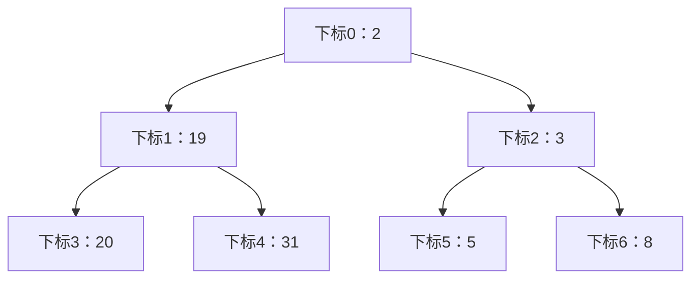
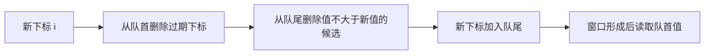

## 堆：动态数据中的最值

任务持续到达时，FIFO 队列不能照顾高优先级任务；保持整个数组有序又让每次插入可能搬移 O(n) 个元素。如果只需要反复取得当前最小或最大值，无须维护完整排序。二叉堆用完全二叉树的形状限制树高为 O(log n)，再维护父子间的局部顺序。

最小堆要求父值≤子值，最大堆要求父值≥子值，允许相等。它不是二叉搜索树，左右子树之间没有排序关系，遍历堆也不等于有序输出。数组表示时，下标 i 的左孩为2i+1，右孩2i+2，父为(i-1)/2；计算父下标前要保证 i>0。



### 插入、删除与线性建堆

插入先追加到数组末尾，保持完全树形状，再沿父链上浮。删除堆顶先保存答案，把末尾元素移到根并缩小长度，再与更优的孩子交换向下。定位任意元素并不快：不知道下标时需 O(n) 搜索；给定下标删除后可能需要上浮或下沉。课件删除动画实际演示内部节点70的删除，应与删除根90区分。

| 最大堆插入80 | 数组的关键变化 | 原因 |
|---|---|---|
| 原始 | [90,70,50,65,44,30,20,35,21,8] | 已满足父≥子 |
| 追加 | 下标10=80 | 保持完全树 |
| 上浮一次 | 与下标4的44交换 | 80>44 |
| 上浮二次 | 与下标1的70交换 | 80>70 |
| 停止 | 父90≥80 | 所有父子约束恢复 |

逐个插入构建堆 O(n log n)。自底向上，从最后一个非叶节点 `n/2-1` 下沉到0，只需 O(n)：高度 h 的节点约 n/2^(h+1) 个，总工作由 `n Σ h/2^(h+1)` 控制，是收敛级数。不能简单用“每个节点最多 log n”得出紧确界。

| 课件 [45,36,18,53,72,30,48,93,15,35] 的下沉 | 数组结果 |
|---|---|
| i=4，72无须移动 | [45,36,18,53,72,30,48,93,15,35] |
| i=3，53与93交换 | [45,36,18,93,72,30,48,53,15,35] |
| i=2，18与48交换 | [45,36,48,93,72,30,18,53,15,35] |
| i=1，36经过93与53 | [45,93,48,53,72,30,18,36,15,35] |
| i=0，45经过93与72 | [93,72,48,53,45,30,18,36,15,35] |

### PriorityQueue、Comparable 与 Comparator

Java `PriorityQueue<Integer>` 默认小根堆。`peek` O(1)，`offer/poll` O(log n)，`remove(Object)` 和 `contains` O(n)，遍历不保证排序。构造参数 initialCapacity 只是初始存储容量，不会限制元素总数；Top K 必须自己执行淘汰。禁止插入 null，空队列 `peek/poll` 返回 null。[Java 8 PriorityQueue 官方说明](https://docs.oracle.com/javase/8/docs/api/java/util/PriorityQueue.html)。

`Comparable<T>` 把自然顺序写进类的 `compareTo`；`Comparator<T>` 从外部提供一种顺序，可为同一类型提供多种比较规则。负结果表示第一个参数排前，0表示等价，正结果排后。`(a,b)->Integer.compare(b,a)` 是 lambda 表达式，作为 `Comparator<Integer>` 的 `compare` 实现，得到大根堆。不能用 `b-a`，因为差值溢出会颠倒顺序；也不建议存 `-x` 模拟大根堆，因为 `-Integer.MIN_VALUE` 仍是负数。课件 `@override` 应写 `@Override`，Java 大小写敏感。

<a id="lc-23"></a>
## LC 23 · 合并 K 个有序链表

**题意。** 输入 k 条升序链表，合并为一条升序链表。两条可双指针；k 条若每次线性找最小表头需 O(Nk)。把每条尚未处理链表的首节点放进小根堆，只用 O(log k) 就能选出全局最小候选。

堆中每条链最多一个节点，且它是这条链尚未输出的最小节点。因此堆顶也是所有剩余节点的最小值。取出节点后，只需让它的后继加入候选。

| 链 [1,4,5]，[1,3,4]，[2,6] | 输出 | 新候选 |
|---|---|---|
| 初始 | 空 | 1A,1B,2C |
| 取1A | 1 | 4A,1B,2C |
| 取1B | 1,1 | 4A,3B,2C |
| 取2C | 1,1,2 | 4A,3B,6C |
| 取3B | 1,1,2,3 | 4A,4B,6C |

```java
import java.util.*;
// LeetCode 提供 ListNode：int val; ListNode next; ListNode(int val)
class Solution {
    public ListNode mergeKLists(ListNode[] lists) {
        PriorityQueue<ListNode> heap = new PriorityQueue<>((a, b) -> Integer.compare(a.val, b.val));
        for (ListNode head : lists) if (head != null) heap.offer(head);
        ListNode dummy = new ListNode(0), tail = dummy;
        while (!heap.isEmpty()) {
            ListNode node = heap.poll();
            ListNode next = node.next;
            tail.next = node;
            tail = node;
            if (next != null) heap.offer(next);
        }
        return dummy.next;
    }
}
```

哨兵 dummy 消除首次插入特判；保存 next 表明后继属于原链。这里重用节点，会改变原链的连接，不是深拷贝。相同值比较返回0是允许的，不要求稳定地按链编号输出。N 为节点总数，时间 O(N log(k+1))，额外空间 O(k)。测试空数组、全为null、一条链、重复值。外部排序也可使用这一模式：先将内存可容纳的块分别排序成 run，再做 k 路归并；磁盘场景还要分析 I/O，锦标赛树/败者树可降低选择常数。

<a id="lc-239"></a>
## LC 239 · 滑动窗口最大值

**题意。** 窗口大小固定 k，每次右移一格，输出每个窗口最大值。堆很自然，但课件 Java 方案每次 `remove(过期值)` 是线性搜索，整体最坏 O(nk)，不能称 O(n log k)。用 `(值,下标)` 堆惰性删除可避免任意删除，但被埋在堆底的过期元素可能一直保留，空间最坏 O(n)、时间 O(n log n)。

更直接的是单调双端队列：下标从队首到队尾递增，对应值递减。新值更大时，旧的小值不仅较小，而且更早过期，永远不可能再成为最大值，可永久删除。队首过期则移除，剩余队首就是最大值。



| nums=[1,3,-1,-3,5,3,6,7], k=3；i | 队列（下标:值） | 输出 |
|---|---|---|
| 0 | 0:1 | — |
| 1 | 1:3 | — |
| 2 | 1:3,2:-1 | 3 |
| 3 | 1:3,2:-1,3:-3 | 3 |
| 4 | 4:5 | 5 |
| 5 | 4:5,5:3 | 5 |
| 6 | 6:6 | 6 |
| 7 | 7:7 | 7 |

```java
import java.util.*;
class Solution {
    public int[] maxSlidingWindow(int[] nums, int k) {
        Deque<Integer> deque = new ArrayDeque<>();
        int[] result = new int[nums.length - k + 1];
        for (int i = 0; i < nums.length; i++) {
            while (!deque.isEmpty() && deque.peekFirst() <= i - k) deque.pollFirst();
            while (!deque.isEmpty() && nums[deque.peekLast()] <= nums[i]) deque.pollLast();
            deque.offerLast(i);
            if (i >= k - 1) result[i - k + 1] = nums[deque.peekFirst()];
        }
        return result;
    }
}
```

`peekFirst/Last` 与 `pollFirst/Last` 分别操作两端；保存下标才能判断过期。相等值可以删除较早那个，新下标活得更久。每下标最多入队出队一次，O(n) 时间、O(k) 空间（不含输出）。测试 k=1 原样输出、k=n 只输出全局最大、相等数组、递减数组。

<a id="lc-215"></a>
## LC 215 · 数组中的第 K 大元素

**题意。** 按排序位置计算第 k 大，重复值也占位置。维护大小至多 k 的小根堆，使堆中始终是已扫描元素最大的 k 个。它们最小的那个恰好是第 k 大。

| [3,2,1,5,6,4],k=2 | 保留的两大元素（示意排序） | 堆顶 |
|---|---|---:|
| 3 | [3] | 3 |
| 2 | [2,3] | 2 |
| 1 | 加后弹1，仍[2,3] | 2 |
| 5 | [3,5] | 3 |
| 6 | [5,6] | 5 |
| 4 | [5,6] | 5 |

```java
import java.util.*;
class Solution {
    public int findKthLargest(int[] nums, int k) {
        PriorityQueue<Integer> heap = new PriorityQueue<>();
        for (int x : nums) {
            heap.offer(x);
            if (heap.size() > k) heap.poll();
        }
        return heap.peek();
    }
}
```

这里“先加入再淘汰”统一处理堆未满和已满两种情况。使用 peek 保留堆内容，poll 虽能返回相同答案却会删除。O(n log(k+1)) 时间，O(k) 空间。测试 k=1、k=n、`[2,2,1],2→2`、负数。排序 O(n log n)，重复找最大 O(nk)；[排序章的 Quickselect](#/lesson/10?section=lc-215) 平均 O(n)，最坏 O(n²)，课件把递归选择直接写成 O(n) 缺少随机化/平衡假设。

<a id="lc-295"></a>
## LC 295 · 数据流的中位数

**题意。** 不断 addNum，随时 findMedian；偶数个元素取中间两数平均。只需要中间边界，使用两个堆：lower 大根堆保存较小一半，upper 小根堆保存较大一半。

不变量一：lower 所有值≤upper 所有值。二：lower 大小等于 upper 或比 upper 多1。先把数加到 lower，再把 lower 最大值移到 upper，顺序边界恢复；若 upper 比 lower 多，把 upper 最小值移回去平衡。

| 插入 [4,2,3,1,5] | lower（较小半） | upper（较大半） | 中位数 |
|---|---|---|---:|
| 4 | 4 | 空 | 4 |
| 2 | 2 | 4 | 3 |
| 3 | 2,3 | 4 | 3 |
| 1 | 1,2 | 3,4 | 2.5 |
| 5 | 1,2,3 | 4,5 | 3 |

```java
import java.util.*;
class MedianFinder {
    private final PriorityQueue<Integer> lower = new PriorityQueue<>(Collections.reverseOrder());
    private final PriorityQueue<Integer> upper = new PriorityQueue<>();
    public void addNum(int num) {
        lower.offer(num);
        upper.offer(lower.poll());
        if (upper.size() > lower.size()) lower.offer(upper.poll());
    }
    public double findMedian() {
        if (lower.size() > upper.size()) return lower.peek();
        return ((long) lower.peek() + upper.peek()) / 2.0;
    }
}
```

`Collections.reverseOrder()` 返回反向自然顺序比较器。平均值先把一个操作数转 long，使加法发生在 long 域，再除2.0得到 double；先用 int 相加再强转已经太晚。方法假设查询时至少一个数，符合题意。插入 O(log n)、查询 O(1)、存储 O(n)。测试 `[1,2]→1.5`，两个最大 int→2147483647.0，重复值和负值。课件取负模拟堆与先 int 相减版本在极端整数下存在溢出风险。

<a id="lc-347"></a>
## 作业 · LC 347 前 K 个高频元素

**题意与推导。** 返回频次最高的 k 种值，先用 map 计数，再对不同值维护“频次最小在顶”的 k 容量堆。这个堆淘汰的是低频，而不是小数值；比较依据决定了优先队列的含义。

| [1,1,1,2,2,3], k=2 | 频次 | 堆中候选 |
|---|---:|---|
| 1 | 3 | 1 |
| 2 | 2 | 2,1 |
| 3 | 1 | 加3后立即淘汰3，仍2,1 |

```java
import java.util.*;
class Solution {
    public int[] topKFrequent(int[] nums, int k) {
        Map<Integer, Integer> frequency = new HashMap<>();
        for (int x : nums) frequency.put(x, frequency.getOrDefault(x, 0) + 1);
        PriorityQueue<Integer> heap = new PriorityQueue<>((a, b) -> Integer.compare(frequency.get(a), frequency.get(b)));
        for (int x : frequency.keySet()) {
            heap.offer(x);
            if (heap.size() > k) heap.poll();
        }
        int[] answer = new int[k];
        for (int i = 0; i < k; i++) answer[i] = heap.poll();
        return answer;
    }
}
```

lambda 捕获 frequency 引用；构建堆之后不能随意改频次，否则已有元素的堆序不会自动修复。答案顺序任意，所以小到大弹出合法。n 个输入、u 个不同值，时间 O(n+u log(k+1))，空间 O(u+k)。测试一个不同值、k=u、值大但频次低。频次桶可做到 O(n) 时间，但需 O(n) 桶空间。

<a id="lc-703"></a>
## 作业 · LC 703 数据流中的第 K 大元素

**题意。** 构造器收到 k 和初始数组，随后每次 add(val) 返回目前所有数据的第 k 大。它是 LC215 的持久化版本：堆作为对象字段跨调用保留，无须每次重新扫描。

| k=3，初始[4,5,8,2] | 保留集合 | 返回 |
|---|---|---:|
| 构造完成 | 4,5,8 | — |
| add(3) | 4,5,8 | 4 |
| add(5) | 5,5,8 | 5 |
| add(10) | 5,8,10 | 5 |
| add(9) | 8,9,10 | 8 |

```java
import java.util.*;
class KthLargest {
    private final int k;
    private final PriorityQueue<Integer> heap = new PriorityQueue<>();
    public KthLargest(int k, int[] nums) {
        this.k = k;
        for (int x : nums) add(x);
    }
    public int add(int val) {
        heap.offer(val);
        if (heap.size() > k) heap.poll();
        return heap.peek();
    }
}
```

`this.k` 区分字段与同名参数；构造器调用 add 复用维护逻辑，其返回值可忽略。题目保证有效查询阶段有足够元素；构造中元素不足时 heap.peek 只是当前最小，不能声称是不存在的第 k 大。构造 O(n log(k+1))，add O(log(k+1))，空间 O(k)。测试 k=1、空初始数组后加入、重复值。

<a id="lc-451"></a>
## 作业 · LC 451 按字符出现频率排序

**题意。** 将所有字符按出现频次从高到低输出，同一字符聚在一起，等频字符次序任意。统计频次后大根堆排序的是不同字符，每次弹出一种字符，重复追加它的频次次。

| tree | 计数 | 弹出顺序的一种 | 输出 |
|---|---|---|---|
| 扫描结束 | t:1,r:1,e:2 | e→r→t | eert |

```java
import java.util.*;
class Solution {
    public String frequencySort(String s) {
        Map<Character, Integer> frequency = new HashMap<>();
        for (char c : s.toCharArray()) frequency.put(c, frequency.getOrDefault(c, 0) + 1);
        PriorityQueue<Character> heap = new PriorityQueue<>((a, b) -> Integer.compare(frequency.get(b), frequency.get(a)));
        heap.addAll(frequency.keySet());
        StringBuilder result = new StringBuilder();
        while (!heap.isEmpty()) {
            char c = heap.poll();
            for (int i = 0; i < frequency.get(c); i++) result.append(c);
        }
        return result.toString();
    }
}
```

`addAll` 把集合中的所有字符加入堆；这里只保证方法正确，不将它误当作 O(u) 的专用 heapify 构造。设不同字符数 u，时间 O(n+u log(u+1))，空间 O(n+u)（含输出）。测试 `cccaaa` 两组均可先出、大小写分别计数、单字符。把队列直接 for-each 遍历无法得到按频率排序的结果，必须反复 poll。
