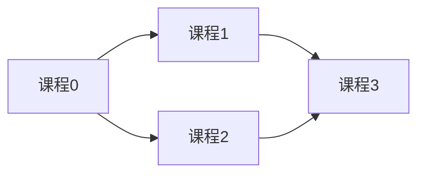
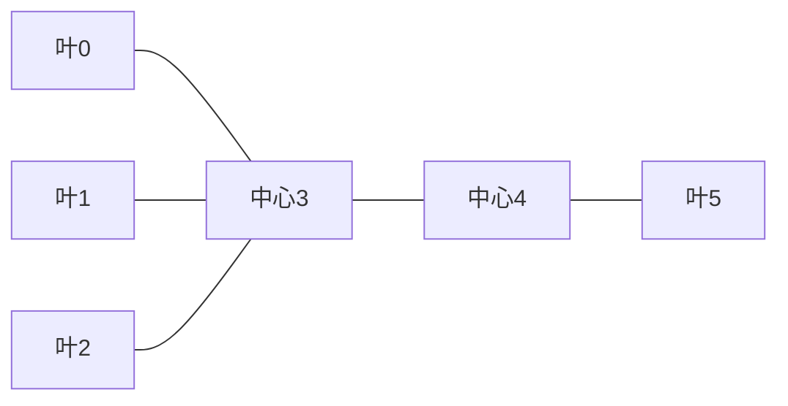

## 图、依赖关系与拓扑排序

图由顶点 V 与边 E 构成，可以有向或无向。树是连通且无环的无向图；一般图可能有环、不连通或多条路径，DFS/BFS 通常需要 visited 防止重复。DAG 是有向无环图，只有 DAG 才存在包含全部顶点的拓扑序。

| 表示法 | 空间 | 查某条边 | 遍历某点邻居 |
|---|---:|---:|---:|
| 邻接矩阵 | O(V²) | O(1) | O(V) |
| 邻接表 | O(V+E) | O(度数)，用集合可平均O(1) | O(度数) |
| GraphNode 对象+neighbors | O(V+E) | 取决于邻居容器 | O(度数) |

无向边在邻接表存两次，但复杂度仍是 O(V+E)。有向边 u→v 表示 u 必须先于 v 时，入度 indegree[v] 统计 v 尚未完成的前置条件。Kahn 算法把所有入度0顶点放队列，取出一个就删去它的出边。若最终处理数不足 V，剩余子图必有环。不同的队列选择可能产生不同但合法的答案。



<a id="lc-207"></a>
## LC 207 · 课程表

**题意。** n 门课程，`[a,b]` 意味着先修 b 才能修 a，判断能否学完所有课程。建边 `b→a`，不能反过来解释课程依赖。课件每次扫描所有课程找零入度，需 O(V²+E)；队列保存“当前可修”课程可降到 O(V+E)。

| n=4，依赖[[1,0],[2,0],[3,1],[3,2]] | 零入度队列 | 入度[0,1,2,3] | 已处理 |
|---|---|---|---:|
| 初始 | 0 | [0,1,1,2] | 0 |
| 修0 | 1,2 | [0,0,0,2] | 1 |
| 修1 | 2 | [0,0,0,1] | 2 |
| 修2 | 3 | [0,0,0,0] | 3 |
| 修3 | 空 | 全0 | 4→true |

```java
import java.util.*;
class Solution {
    public boolean canFinish(int numCourses, int[][] prerequisites) {
        List<List<Integer>> graph = new ArrayList<>();
        for (int i = 0; i < numCourses; i++) graph.add(new ArrayList<>());
        int[] indegree = new int[numCourses];
        for (int[] edge : prerequisites) {
            graph.get(edge[1]).add(edge[0]);
            indegree[edge[0]]++;
        }
        Queue<Integer> queue = new ArrayDeque<>();
        for (int i = 0; i < numCourses; i++) if (indegree[i] == 0) queue.offer(i);
        int completed = 0;
        while (!queue.isEmpty()) {
            int course = queue.poll();
            completed++;
            for (int next : graph.get(course)) if (--indegree[next] == 0) queue.offer(next);
        }
        return completed == numCourses;
    }
}
```

`--indegree[next]` 先递减再比较，表示本次出边刚被移除。`new ArrayList<>(n)` 只有容量，没有 n 个实际元素，必须循环 add；本代码避免这一混淆。队列每顶点最多入一次、每边删一次，时间空间均 O(V+E)。测试无边→true、自环→false、两点环→false、只有某个不连通分量有环→false。不能只从课程0开始搜。

<a id="lc-133"></a>
## LC 133 · 克隆图

**题意。** 深拷贝从输入节点可达的无向图，节点的值与邻居关系保留，新节点不能与旧节点共享。用“旧节点→新节点”映射同时完成 visited 和定位副本的工作。

最容易犯的错是递归完邻居后才登记副本。环 A→B→A 会导致无限递归，必须创建副本后立刻登记，再展开邻居。

| 双向边1—2 | 过程 | map |
|---|---|---|
| dfs(1) | 创建1'并登记 | 1→1' |
| dfs(2) | 创建2'并登记 | 再加2→2' |
| dfs(1) | 已存在，直接返回1' | 不变 |
| 回到2、1 | 连接2'→1'、1'→2' | 完成 |

```java
import java.util.*;
// 平台 Node 包含 int val; List<Node> neighbors; Node(int val)
class Solution {
    public Node cloneGraph(Node node) {
        return copy(node, new HashMap<Node, Node>());
    }
    private Node copy(Node node, Map<Node, Node> map) {
        if (node == null) return null;
        if (map.containsKey(node)) return map.get(node);
        Node result = new Node(node.val);
        map.put(node, result);
        for (Node neighbor : node.neighbors) result.neighbors.add(copy(neighbor, map));
        return result;
    }
}
```

节点对象作键可区分相同 val 的不同实体。`new HashMap<Node,Node>()` 显式写出泛型实参，与菱形写法语义相同。时间 O(V+E)，map与输出 O(V+E)，递归深度最坏 O(V)。深链生产数据可改 BFS 避免栈溢出。测试 null、孤立节点、含环图、自环；确保修改副本不影响原图。课件作业重复要求 Clone Graph (DFS)，本节即为该完整实现。

<a id="lc-269"></a>
## LC 269 · 外星词典

**题意。** 给一组按未知字母序排序的单词，推导所有出现字符的一种合法顺序，无解返回空串。相邻单词只有第一处不同字符提供一条顺序约束。例如 `wrt` 与 `wrf` 给出 t→f，后面的字符不再提供可靠信息。

先把所有字符加入图，孤立字符也必须出现在答案中。边使用 Set 去重，否则同一边重复出现而只减少一次会导致入度错误。若较长单词在它的完整前缀之前，如 `abc,ab`，无论字母序如何都不合法。

| words=[wrt,wrf,er,ett,rftt] | 第一个不同位置 | 约束 |
|---|---|---|
| wrt / wrf | t / f | t→f |
| wrf / er | w / e | w→e |
| er / ett | r / t | r→t |
| ett / rftt | e / r | e→r |
| 拓扑处理 | w,e,r,t,f | wertf |

```java
import java.util.*;
class Solution {
    public String alienOrder(String[] words) {
        Map<Character, Set<Character>> graph = new HashMap<>();
        Map<Character, Integer> indegree = new HashMap<>();
        for (String word : words) for (char c : word.toCharArray()) {
            graph.putIfAbsent(c, new HashSet<Character>());
            indegree.putIfAbsent(c, 0);
        }
        for (int i = 1; i < words.length; i++) {
            String a = words[i - 1], b = words[i];
            int p = 0, limit = Math.min(a.length(), b.length());
            while (p < limit && a.charAt(p) == b.charAt(p)) p++;
            if (p == limit) {
                if (a.length() > b.length()) return "";
            } else {
                char from = a.charAt(p), to = b.charAt(p);
                if (graph.get(from).add(to)) indegree.put(to, indegree.get(to) + 1);
            }
        }
        Queue<Character> queue = new ArrayDeque<>();
        for (char c : indegree.keySet()) if (indegree.get(c) == 0) queue.offer(c);
        StringBuilder answer = new StringBuilder();
        while (!queue.isEmpty()) {
            char c = queue.poll();
            answer.append(c);
            for (char next : graph.get(c)) {
                indegree.put(next, indegree.get(next) - 1);
                if (indegree.get(next) == 0) queue.offer(next);
            }
        }
        return answer.length() == graph.size() ? answer.toString() : "";
    }
}
```

`putIfAbsent` 不覆盖已存在键；`Set.add` 返回值正好表示这是否是新边。哈希遍历顺序不固定，但题目允许任意合法顺序；要字典序最小的合法序可将队列替换为字符小根堆。总字符长度 L，时间 O(L+V+E)，空间 O(V+E)。测试单个词、重复词、前缀逆序、`z,x,z` 的环。课件 Python 将变量命名为 set 会遮蔽内置 set，并且前缀检测索引逻辑有缺陷，本版修正。

<a id="lc-310"></a>
## LC 310 · 最小高度树

**题意。** 输入已保证为无向树，选择根使根到最远节点的边数最小，返回所有最优根。逐根 BFS 需 O(n²)。最优根是树直径的中心，因此只能有一个或两个，且双中心相邻。

课件“任取三个最优根就会形成环”的论证不充分：三个节点并不会自动构成环。正确论证用树的直径：任意根的最远距离至少为到直径两端距离的较大者；该最大值在路径中点最小，路径外节点只会增加距离。逐层剥掉所有叶子等价于同时缩短直径两端，中心不变。



| n=6，边0-3,1-3,2-3,3-4,4-5 | 当轮叶子 | 剩余节点 |
|---|---|---|
| 初始 | 0,1,2,5 | 6 |
| 同时移除一层 | 新叶3,4 | 2 |
| 停止 | 输出3,4 | 2 |

```java
import java.util.*;
class Solution {
    public List<Integer> findMinHeightTrees(int n, int[][] edges) {
        if (n == 1) return new ArrayList<>(Collections.singletonList(0));
        List<List<Integer>> graph = new ArrayList<>();
        for (int i = 0; i < n; i++) graph.add(new ArrayList<>());
        int[] degree = new int[n];
        for (int[] e : edges) {
            graph.get(e[0]).add(e[1]); graph.get(e[1]).add(e[0]);
            degree[e[0]]++; degree[e[1]]++;
        }
        Queue<Integer> leaves = new ArrayDeque<>();
        for (int i = 0; i < n; i++) if (degree[i] == 1) leaves.offer(i);
        int remaining = n;
        while (remaining > 2) {
            int size = leaves.size();
            remaining -= size;
            for (int i = 0; i < size; i++) {
                int leaf = leaves.poll();
                for (int next : graph.get(leaf)) if (--degree[next] == 1) leaves.offer(next);
            }
        }
        return new ArrayList<>(leaves);
    }
}
```

`Collections.singletonList(0)` 生成单元素列表，再复制为 ArrayList。队列 size 必须在本轮开始时固定，保证同步剥一层，不能把刚成为叶子的点同轮继续剥。图不物理删边，用度数下降判断即可。时间空间 O(n)。测试单节点、两节点均为答案、星形中心、长链。普通含环图不满足树前提，不能直接用此算法。

<a id="lc-399"></a>
## 作业 · LC 399 除法求值

**题意。** 已知 a/b=v 等关系，回答 x/y。把变量看作顶点，a→b 权重v，b→a权重1/v；路径连乘就是比值。不存在变量或找不到路径返回-1；已知变量除自己返回1。

| 已知 a/b=2,b/c=3 | 搜索状态 | 连乘 |
|---|---|---:|
| 求a/c，从a开始 | a | 1 |
| a→b | b | 2 |
| b→c | c | 6 |
| 求c/a | c→b→a | 1/3×1/2=1/6 |

```java
import java.util.*;
class Solution {
    public double[] calcEquation(List<List<String>> equations, double[] values, List<List<String>> queries) {
        Map<String, Map<String, Double>> graph = new HashMap<>();
        for (int i = 0; i < equations.size(); i++) {
            String a = equations.get(i).get(0), b = equations.get(i).get(1);
            graph.computeIfAbsent(a, key -> new HashMap<>()).put(b, values[i]);
            graph.computeIfAbsent(b, key -> new HashMap<>()).put(a, 1.0 / values[i]);
        }
        double[] answer = new double[queries.size()];
        for (int i = 0; i < queries.size(); i++) {
            String a = queries.get(i).get(0), b = queries.get(i).get(1);
            answer[i] = !graph.containsKey(a) || !graph.containsKey(b) ? -1.0
                : search(a, b, graph, new HashSet<String>());
        }
        return answer;
    }
    private double search(String from, String target, Map<String, Map<String, Double>> graph, Set<String> seen) {
        if (from.equals(target)) return 1.0;
        seen.add(from);
        for (Map.Entry<String, Double> edge : graph.get(from).entrySet()) {
            if (seen.contains(edge.getKey())) continue;
            double suffix = search(edge.getKey(), target, graph, seen);
            if (suffix != -1.0) return edge.getValue() * suffix;
        }
        return -1.0;
    }
}
```

`computeIfAbsent` 仅在键不存在/值为null时运行创建函数，随后返回对应内层 map。泛型的嵌套描述“变量→(邻居→权重)”。比例为正，-1.0 可作为无路径哨兵。每次查询有独立 seen；回溯不删除 seen，因为只需可达性，已探索失败的节点无需重复。q 个查询时间 O(q(V+E))，空间 O(V+E)。测试不存在的 x/x→-1、已知 a/a→1、不连通关系组、反向除法。浮点结果比较测试应容忍误差。

<a id="lc-210"></a>
## 作业 · LC 210 课程表 II

**题意。** 在课程表 I 的条件下返回一种修课顺序；有环返回空数组。完整沿用 Kahn 算法，但将出队次序写入结果，不是只返回是否可完成。

| n=2，[[1,0]] | 队列 | 写入 |
|---|---|---|
| 开始 | 0 | 空 |
| 出0，解锁1 | 1 | [0] |
| 出1 | 空 | [0,1] |
| 如果再有[0,1] | 初始就空 | count<n，返回[] |

```java
import java.util.*;
class Solution {
    public int[] findOrder(int numCourses, int[][] prerequisites) {
        List<List<Integer>> graph = new ArrayList<>();
        for (int i = 0; i < numCourses; i++) graph.add(new ArrayList<>());
        int[] indegree = new int[numCourses];
        for (int[] e : prerequisites) { graph.get(e[1]).add(e[0]); indegree[e[0]]++; }
        Queue<Integer> queue = new ArrayDeque<>();
        for (int i = 0; i < numCourses; i++) if (indegree[i] == 0) queue.offer(i);
        int[] order = new int[numCourses];
        int count = 0;
        while (!queue.isEmpty()) {
            int u = queue.poll();
            order[count++] = u;
            for (int v : graph.get(u)) if (--indegree[v] == 0) queue.offer(v);
        }
        return count == numCourses ? order : new int[0];
    }
}
```

`order[count++]` 先使用原 count 再递增。失败时不能返回填了一半、后面带默认0的数组。O(V+E) 时间空间。测试多种合法答案时，不宜断言固定数组；应检查所有课程出现一次且每条依赖先修课位置更靠前。
