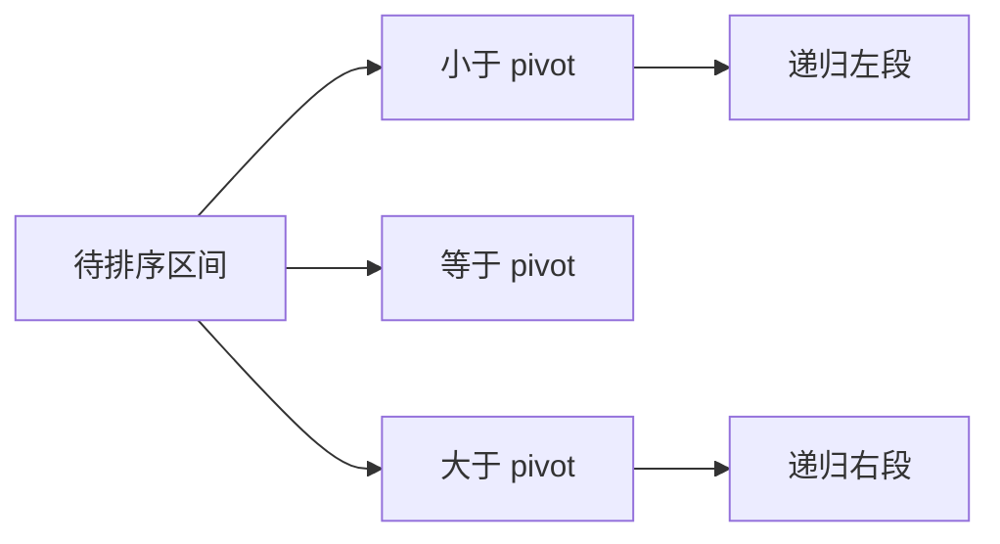
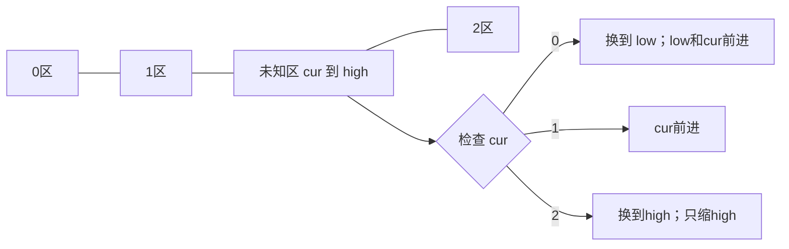

## 排序：顺序、成本与稳定性

排序不仅看平均时间，还要说明最坏情况、额外存储和稳定性。稳定意味着键相等的记录保持原先次序，例如按分数排序时，两位同分学生的先后不变。比较排序只通过比较确定次序，决策树至少区分 n! 种排列，因此最坏比较次数下界是 Ω(n log n)，不是把下界写成 O(n log n)。

| 算法 | 核心步骤 | 平均/最坏时间 | 辅助空间 | 常见实现稳定? |
|---|---|---|---|---|
| 冒泡 | 相邻逆序交换，最大值逐轮到末尾 | O(n²)/O(n²)，有提前退出时最好O(n) | O(1) | 是，只交换严格逆序 |
| 插入 | 将下一元素插入已排前缀 | O(n²)/O(n²)，近乎有序时好 | O(1) | 是，等值不越过 |
| 选择 | 每轮找剩余最小并交换到前面 | O(n²)/O(n²) | O(1) | 通常否，跨距交换破坏顺序 |
| 快排 | 分区后分别处理两边 | 平均O(n log n)，最坏O(n²) | 平均栈O(log n)，最坏O(n) | 通常否 |
| 堆排 | 大根堆堆顶与末尾交换，再下沉 | O(n log n)/O(n log n) | O(1) | 否 |
| 归并 | 排两半，用双指针有序合并 | O(n log n)/O(n log n) | 数组版O(n) | 是，等值先左边 |
| 计数 | 数值映射频次/累计位置 | O(n+K) | 稳定版O(n+K) | 可稳定 |
| 桶 | 分桶后各桶排序、串联 | 均匀分布时预期O(n+K)，最坏可O(n²) | O(n+K) | 取决于桶内实现 |
| 基数 | 从低位到高位做稳定分配 | O(d(n+b)) | O(n+b) | 要求每轮稳定 |

K 是数值范围或桶数，d 是位数，b 是基数。它们不是无条件 O(n)：数据范围过大时计数排序不适合；桶分布严重偏斜会退化；基数每轮稳定才能保留低位的次序。“原地”通常允许很少额外空间；快排虽不使用辅助数组，但递归栈不为 O(1)。

### 其余排序算法如何保持不变量

**冒泡排序。** 一轮从左到右比较相邻对，把更大的向右交换。完整一轮后，未排序段的最大值必到最右端，下一轮就可缩短一格。例如[3,1,2]先变[1,3,2]再变[1,2,3]。如果整轮没有交换，数组已经有序，可立即停止。只有交换严格大于的情况才保留相等记录次序。它适合教学和极小数据，不宜对大数组使用二次循环。

**插入排序。** 每一步保证前缀已排序，先暂存新值，把前缀中比它大的值向右搬，再把新值放入空位。例如已排[2,4,7]插入3，移动7、4，最后得到[2,3,4,7]。比较用严格大于让相等元素不越位。近乎有序时移动少，且常数小，所以常作为快速排序的小区间收尾。若搜索插入位置改为二分，也只是减少比较次数，搬移仍可能O(n)，总最坏仍O(n²)。

**选择排序。** 每轮选未排序部分最小值，与当前开头交换。已完成前缀始终是全局最小的若干元素。交换次数O(n)，但找最小需要反复扫描，总比较O(n²)。对[2a,2b,1]第一次把1与2a交换得到[1,2b,2a]，相等记录a、b顺序颠倒，直接说明不稳定。

**堆排序。** 先O(n)建大根堆，交换根和堆末，把最大值冻结在末尾，然后对缩小后的堆下沉。每轮不变量是前缀仍为堆、后缀有序且都不小于前缀。无需额外输出数组，最坏O(n log n)；但是跨距交换破坏稳定性。只有不断poll才有序，堆数组自身并没有完全排好。

**稳定计数排序。** 数值范围已知且不大时，先统计每个值出现几次，再把计数变成前缀累计位置。例如[2a,1,2b,0]的频次为[1,1,2]，累计为[1,2,4]。从右向左把记录放到`--count[value]`的位置，2b先去最后，2a后来去其前一个位置，保持原次序。只按频次输出数字的简化版不能保留记录身份，不能据此证明稳定。负值可减最小值转为非负桶下标，但如果最大最小差巨大，分配大数组会浪费空间。

**桶排序。** 按数值范围把元素分到有序桶，每个桶内部排序，依次拼接。在均匀分布、桶数与n同阶时，各桶期望很小，总成本可以近线性。如果所有元素进一个桶，就退化成桶内排序的成本；稳定性同样由入桶保序、桶内排序和合并顺序共同决定，不能无条件标YES。

**基数排序。** 以十进制非负整数为例，先按个位稳定排序，再十位、百位，最终得到全局顺序。循环不变量是经过第d轮后，已经按最低d位排好。若中间一轮不稳定，就可能打乱之前建立的低位顺序。用计数排序完成每轮只是常见实现，并不意味着所有计数排序都是基数排序。负数需要额外符号处理；位数与基数共同决定成本。

| 基数排序[170,45,75,90,802,24,2,66] | 每轮稳定排序后的序列 |
|---|---|
| 个位 | [170,90,802,2,24,45,75,66] |
| 十位（缺位视0） | [802,2,24,45,66,170,75,90] |
| 百位 | [2,24,45,66,75,90,170,802] |

### 快排与插入排序的组合

课件使用三数取中、双向扫描并在小区间改用插入排序。三数取中将左、中、右排序，把中值放在右端前一格作为 pivot；两端作为哨兵时，`arr[++low]` 的预先移动不能在翻译为另一种语言时丢失，否则相等元素可能让循环卡住。下面使用更直观的三路分区，重复值直接归入中间段。



```java
import java.util.*;
class Sorting {
    private final Random random = new Random();
    public void quickSort(int[] a) { quick(a, 0, a.length - 1); }
    private void quick(int[] a, int left, int right) {
        if (right - left <= 10) {
            for (int i = left + 1; i <= right; i++) {
                int value = a[i], j = i - 1;
                while (j >= left && a[j] > value) { a[j + 1] = a[j]; j--; }
                a[j + 1] = value;
            }
            return;
        }
        int pivot = a[left + random.nextInt(right - left + 1)];
        int low = left, current = left, high = right;
        while (current <= high) {
            if (a[current] < pivot) swap(a, low++, current++);
            else if (a[current] > pivot) swap(a, current, high--);
            else current++;
        }
        quick(a, left, low - 1);
        quick(a, high + 1, right);
    }
    private void swap(int[] a, int i, int j) {
        int t = a[i]; a[i] = a[j]; a[j] = t;
    }
    public void mergeSort(int[] a) { mergeSort(a, new int[a.length], 0, a.length); }
    private void mergeSort(int[] a, int[] temp, int left, int right) {
        if (right - left <= 1) return;
        int middle = left + (right - left) / 2;
        mergeSort(a, temp, left, middle);
        mergeSort(a, temp, middle, right);
        int i = left, j = middle, write = left;
        while (i < middle && j < right) temp[write++] = a[i] <= a[j] ? a[i++] : a[j++];
        while (i < middle) temp[write++] = a[i++];
        while (j < right) temp[write++] = a[j++];
        System.arraycopy(temp, left, a, left, right - left);
    }
}
```

`Random.nextInt(bound)` 返回 `[0,bound)`，所以区间长度必须加1。三路分区不变量是 `[left,low)<pivot`、`[low,current)=pivot`、`(high,right]>pivot`；与右端交换后 current 不动，因为换回的数还未知。随机化提供期望界，不保证每次划分一半。

归并采用半开区间 `[left,right)`，空区间也自然处理。`temp` 只分配一次并递归共享；`System.arraycopy(src,srcPos,dest,destPos,len)` 把合并好的区间复制回原数组。相等时先取左半使排序稳定。

| 归并 [4,1,3,2] | 左半 | 右半 | 合并输出 |
|---|---|---|---|
| 分解 | [4],[1] | [3],[2] | — |
| 小合并 | [1,4] | [2,3] | — |
| 最终比较 | 1≤2 | 取1 | [1] |
| 继续 | 4>2，4>3 | 取2、3 | [1,2,3] |
| 收尾 | 剩4 | 空 | [1,2,3,4] |

Java `Arrays.sort` 用于数组，`Collections.sort` 用于 List，`List.sort` 可接收比较器。`int[]` 不支持 Comparator 参数，要比较对象可用 `Integer[]` 或其他对象数组。API 的排序实现随类型和版本而异，解题时应依赖排序结果和文档契约，不把具体实现当作语言保证。

### 外部排序

数据大于内存时，先每次读入一块，内存排序后写为有序段；再用 k 路归并，每个文件维持一个缓冲区，优先队列选择最小当前值。若每轮可合并 k 段，需要约 log_k(段数) 轮，每轮读写全量数据，I/O 往往超过 CPU 比较成本。[堆章的合并 K 链表](#/lesson/08?section=lc-23) 正是它的内存抽象。

<a id="lc-179"></a>
## LC 179 · 最大数

**题意。** 重排非负整数，拼成尽可能大的十进制数，结果可能超出整数范围，返回字符串。对 a,b，比较 `ab` 与 `ba`；若 ab 更大，就把 a 排在 b 前。不能按数值大小：3 应在30之前，因为330>303。

| 输入[3,30,34,5,9]的关键比较 | 两种拼接 | 先放谁 |
|---|---|---|
| 3与30 | 330 / 303 | 3 |
| 34与3 | 343 / 334 | 34 |
| 5与34 | 534 / 345 | 5 |
| 9与5 | 95 / 59 | 9 |
| 最终 | 9,5,34,3,30 | 9534330 |

```java
import java.util.*;
class Solution {
    public String largestNumber(int[] nums) {
        String[] values = new String[nums.length];
        for (int i = 0; i < nums.length; i++) values[i] = String.valueOf(nums[i]);
        Arrays.sort(values, (a, b) -> (b + a).compareTo(a + b));
        if (values[0].equals("0")) return "0";
        StringBuilder result = new StringBuilder();
        for (String value : values) result.append(value);
        return result.toString();
    }
}
```

`String.compareTo` 返回字典序比较符号；ab与ba长度相同，字典序等于数值序。比较器反向写 `(b+a)` 是为了降序。相邻逆序交换能够增大整个拼接，因而按规则排列的结果最优。首个是0意味着全为0，避免输出000。设最大位数 d，时间 O(nd log n)，空间 O(nd)。测试 `[0,0]→0`、`[121,12]→12121`、相等拼接顺序均可。课件 Python comparator 没有在相等时返回0，应修正比较契约。

<a id="lc-296"></a>
## LC 296 · 最佳碰头地点

**题意。** 网格1表示居住点，选择集合点使所有人曼哈顿距离之和最小，返回最小总距离。曼哈顿距离按行列相加，可把两个维度独立优化。对一维两个端点 a≤b，p 在[a,b]时距离和恒为b-a；把有序点两端配对，所有配对的最优区间交集就是中位数位置。

| 居住点(0,0),(0,4),(2,2) | 排序坐标 | 中位数 | 距离和 |
|---|---|---:|---:|
| 行 | 0,0,2 | 0 | 2 |
| 列 | 0,2,4 | 2 | 4 |
| 合并 | 集合点(0,2) | — | 6 |

```java
import java.util.*;
class Solution {
    public int minTotalDistance(int[][] grid) {
        List<Integer> rows = new ArrayList<>(), columns = new ArrayList<>();
        for (int r = 0; r < grid.length; r++) for (int c = 0; c < grid[0].length; c++) {
            if (grid[r][c] == 1) { rows.add(r); columns.add(c); }
        }
        Collections.sort(columns);
        int answer = 0;
        for (int left = 0, right = rows.size() - 1; left < right; left++, right--) {
            answer += rows.get(right) - rows.get(left);
            answer += columns.get(right) - columns.get(left);
        }
        return answer;
    }
}
```

按行扫描时 rows 已排序，columns 尚未排序。`List.get` 返回 Integer，算术自动拆箱。偶数人数任意两个中位数之间的位置都最优；配对计算无须显式选点。p个人、m×n网格，时间 O(mn+p log p)，空间 O(p)。按列再扫描收集 columns 可将排序降掉。测试一人距离0、同行多人、偶数人数；平均数优化平方距离，不是绝对距离。

<a id="lc-56"></a>
## LC 56 · 合并区间

**题意。** 合并所有相交的闭区间。先按左端排序，正在处理的新区间只可能与结果最后一段相交。若新左端≤旧右端，扩展右端；否则另开一段。已经结束的更早区间不会再与后续相交，这是排序提供的不变量。

| [1,3],[2,6],[8,10],[15,18] | 判断 | 结果 |
|---|---|---|
| [1,3] | 首段 | [1,3] |
| [2,6] | 2≤3 | [1,6] |
| [8,10] | 8>6 | [1,6],[8,10] |
| [15,18] | 15>10 | 再加[15,18] |

```java
import java.util.*;
class Solution {
    public int[][] merge(int[][] intervals) {
        Arrays.sort(intervals, (a, b) -> Integer.compare(a[0], b[0]));
        List<int[]> answer = new ArrayList<>();
        for (int[] interval : intervals) {
            if (answer.isEmpty() || answer.get(answer.size() - 1)[1] < interval[0]) {
                answer.add(new int[]{interval[0], interval[1]});
            } else {
                int[] last = answer.get(answer.size() - 1);
                last[1] = Math.max(last[1], interval[1]);
            }
        }
        return answer.toArray(new int[answer.size()][]);
    }
}
```

`int[][]` 本质是 `int[]` 对象的数组，因此可提供 Comparator。`toArray(new int[size][])` 将 List<int[]> 转回题目要求的二维数组；课件返回 List<int[]> 不匹配此题标准提交签名。新建区间避免修改输入内层数组，但排序仍改变外层顺序。O(n log n) 时间，O(n) 输出/排序空间。测试 `[1,4],[4,5]→[1,5]`、完全包含、同起点、空数组。

<a id="lc-215"></a>
## LC 215 · Quickselect 只追踪目标所在分区

题意和堆方案见[堆章](#/lesson/08?section=lc-215)。第 k 大等于升序下标 n-k。快排需要排序两侧，选择只需保留含目标下标的那侧。三路分区可一次消除所有等于 pivot 的元素，重复数据表现更稳。

| nums=[3,2,1,5,6,4], k=2，target=4；假设pivot=4 | 分区 | 下一步 |
|---|---|---|
| 分区完成 | 小于:[3,2,1]；等于:[4]；大于:[6,5] | 4在右区 |
| 右区假设pivot=5 | 等于5的位置4 | 命中，返回5 |

```java
import java.util.*;
class Solution {
    public int findKthLargest(int[] nums, int k) {
        int target = nums.length - k, left = 0, right = nums.length - 1;
        Random random = new Random();
        while (left <= right) {
            int pivot = nums[left + random.nextInt(right - left + 1)];
            int low = left, cur = left, high = right;
            while (cur <= high) {
                if (nums[cur] < pivot) swap(nums, low++, cur++);
                else if (nums[cur] > pivot) swap(nums, cur, high--);
                else cur++;
            }
            if (target < low) right = low - 1;
            else if (target > high) left = high + 1;
            else return nums[target];
        }
        throw new IllegalArgumentException("Invalid k");
    }
    private void swap(int[] a, int i, int j) { int x = a[i]; a[i] = a[j]; a[j] = x; }
}
```

目标下标始终是原数组的绝对下标，不随子区间改变而减去 left。随机选择使期望工作量 O(n)，最坏仍 O(n²)，迭代版辅助空间 O(1)。算法改变输入。测试全相等、升序、降序、k两端；固定中间位置作为 pivot 也可能被构造为不平衡，不是保证 O(n) 的方法。

<a id="lc-75"></a>
## LC 75 · 颜色分类

**题意。** 数组仅有0、1、2，原地排成0在前、1居中、2在后，不调用库排序。荷兰国旗算法维护四段：`[0,low)` 为0，`[low,cur)` 为1，`[cur,high]` 未知，`(high,n)` 为2。



| [2,0,2,1,1,0] | low,cur,high | 数组 |
|---|---|---|
| 起始 | 0,0,5 | 2,0,2,1,1,0 |
| 处理2 | 0,0,4 | 0,0,2,1,1,2 |
| 两次处理0 | 2,2,4 | 0,0,2,1,1,2 |
| 处理2 | 2,2,3 | 0,0,1,1,2,2 |
| 两次处理1 | 2,4,3 | 完成 |

```java
class Solution {
    public void sortColors(int[] nums) {
        int low = 0, cur = 0, high = nums.length - 1;
        while (cur <= high) {
            if (nums[cur] == 0) swap(nums, low++, cur++);
            else if (nums[cur] == 2) swap(nums, cur, high--);
            else cur++;
        }
    }
    private void swap(int[] a, int i, int j) { int t = a[i]; a[i] = a[j]; a[j] = t; }
}
```

换到右侧时不能 cur++，新换来的元素未知；与左侧交换后可以前进，因为左侧原来是1或当前位置本身。未知区每次缩小，O(n) 时间、O(1) 空间。测试 `[2,0,1]`、全2、空数组、单0。这个结构也是前节三路 Quickselect 的核心。

<a id="lc-274"></a>
## 作业 · LC 274 H 指数

**题意。** 找最大 h，使至少 h 篇论文各被引用至少 h 次。排序后，位置 i 的右侧共 n-i 篇；若 citations[i]≥n-i，这些都达标，第一处达标给最大 h。

| [3,0,6,1,5] 排为[0,1,3,5,6] | 候选h=n-i | 是否达标 |
|---|---:|---|
| i=0,引用0 | 5 | 否 |
| i=1,引用1 | 4 | 否 |
| i=2,引用3 | 3 | 是→3 |

```java
import java.util.*;
class Solution {
    public int hIndex(int[] citations) {
        Arrays.sort(citations);
        int n = citations.length;
        for (int i = 0; i < n; i++) if (citations[i] >= n - i) return n - i;
        return 0;
    }
}
```

Arrays.sort 原地修改数组；达标比较是≥，不是==。O(n log n) 时间，空间按排序实现计。测试全0→0、`[100]→1`、`[1,1,1]→1`。因为 h≤n，也可用 n+1 个频次桶，把更高引用截到 n 后从高向低累计，实现 O(n) 时间空间。

<a id="lc-57"></a>
## 作业 · LC 57 插入区间

**题意。** 原区间按起点排序且互不重叠，插入一个新区间并合并相交部分。无须重新排序：先复制完全在左边的区间，再合并全部相交区间，最后复制右侧。

| [[1,3],[6,9]] 插入[2,5] | 阶段 | 状态 |
|---|---|---|
| [1,3] | 与新区间相交 | 新区间变[1,5] |
| [6,9] | 在新右端5之后 | 输出[1,5] |
| 收尾 | 复制右侧 | [1,5],[6,9] |

```java
import java.util.*;
class Solution {
    public int[][] insert(int[][] intervals, int[] newInterval) {
        List<int[]> result = new ArrayList<>();
        int i = 0, left = newInterval[0], right = newInterval[1];
        while (i < intervals.length && intervals[i][1] < left) result.add(intervals[i++].clone());
        while (i < intervals.length && intervals[i][0] <= right) {
            left = Math.min(left, intervals[i][0]);
            right = Math.max(right, intervals[i][1]);
            i++;
        }
        result.add(new int[]{left, right});
        while (i < intervals.length) result.add(intervals[i++].clone());
        return result.toArray(new int[result.size()][]);
    }
}
```

数组 `clone()` 对 int[] 复制基本元素，避免结果与输入共享同一行。合并循环比较不断扩展的 right，才能吞并连锁相交。时间 O(n)，输出空间 O(n)。测试空原数组、插在最前/最后、完全包含、端点相等必须合并。

<a id="lc-164"></a>
## 作业 · LC 164 最大间距

**题意。** 找排序后相邻元素的最大差，要求线性时间和线性额外空间；不足2个数返回0。令范围R=max-min，选桶宽 `ceil(R/(n-1))`。最大相邻差至少为该宽，桶内差小于桶宽，因此答案一定来自两个非空桶之间，只需记录每桶最小最大。

| [3,6,9,1]，范围8，桶宽3 | 桶范围 | min/max |
|---|---|---|
| 桶0 | [1,3] | 1/3 |
| 桶1 | [4,6] | 6/6 |
| 桶2 | [7,9] | 9/9 |
| 跨桶 | 6-3=3，9-6=3 | 答案3 |

```java
import java.util.*;
class Solution {
    public int maximumGap(int[] nums) {
        if (nums.length < 2) return 0;
        int min = nums[0], max = nums[0];
        for (int x : nums) { min = Math.min(min, x); max = Math.max(max, x); }
        if (min == max) return 0;
        long range = (long) max - min;
        long width = (range + nums.length - 2) / (nums.length - 1);
        int buckets = (int) (range / width) + 1;
        int[] low = new int[buckets], high = new int[buckets];
        boolean[] used = new boolean[buckets];
        Arrays.fill(low, Integer.MAX_VALUE);
        Arrays.fill(high, Integer.MIN_VALUE);
        for (int x : nums) {
            int index = (int) (((long) x - min) / width);
            used[index] = true;
            low[index] = Math.min(low[index], x);
            high[index] = Math.max(high[index], x);
        }
        long best = 0;
        int previous = min;
        for (int i = 0; i < buckets; i++) if (used[i]) {
            best = Math.max(best, (long) low[i] - previous);
            previous = high[i];
        }
        return (int) best;
    }
}
```

`(a+b-1)/b` 对非负a、正b实现向上取整；long 防止范围计算溢出。used 区分空桶，不能把空桶哨兵参与答案。原题非负数且范围使答案可用int；扩展到完整有符号整数范围应返回long。时间 O(n)，空间 O(n)。测试全相等、两个数、空桶很长、重复最小最大值。

<a id="lc-41"></a>
## 作业 · LC 41 缺失的第一个正数

**题意。** 在线性时间、常数额外空间找最小缺失正整数。n个位置最多覆盖1到n，答案必在[1,n+1]。把数组本身当哈希表：值 x 应放到下标 x-1，其他值无须处理。

| [3,4,-1,1] | 交换 | 数组 |
|---|---|---|
| i=0，3归位 | 0↔2 | [-1,4,3,1] |
| i=1，4归位 | 1↔3 | [-1,1,3,4] |
| i=1，1归位 | 1↔0 | [1,-1,3,4] |
| 检查 | 下标1不是2 | 答案2 |

```java
class Solution {
    public int firstMissingPositive(int[] nums) {
        int n = nums.length;
        for (int i = 0; i < n; i++) {
            while (nums[i] >= 1 && nums[i] <= n && nums[nums[i] - 1] != nums[i]) {
                int target = nums[i] - 1;
                int temp = nums[i]; nums[i] = nums[target]; nums[target] = temp;
            }
        }
        for (int i = 0; i < n; i++) if (nums[i] != i + 1) return i + 1;
        return n + 1;
    }
}
```

`&&` 从左到右短路，先保证数值范围再访问 `nums[nums[i]-1]`。目标已相同则停止，防止重复值互换无限循环。每次有效交换至少使一个值永久到正确位置，所以总交换 O(n)。时间 O(n)、空间 O(1)，会修改输入。测试 `[1,1]→2`、全负数→1、`[1,2,3]→4`、空数组→1。

<a id="lc-324"></a>
## 作业 · LC 324 摆动排序 II

**题意。** 重排为 `a0<a1>a2<a3...`，是严格不等号，题目保证存在解。先排序，把较小半与较大半都从后向前交错放入，重复的中位数被尽量隔开，避免简单正向穿插造成相等邻居。

| [1,5,1,1,6,4] 排为[1,1,1,4,5,6] | 位置 | 放入 |
|---|---:|---:|
| 小半从后取 | 0 | 1 |
| 大半从后取 | 1 | 6 |
| 小半/大半继续 | 2,3 | 1,5 |
| 最后 | 4,5 | 1,4 |
| 结果 | — | [1,6,1,5,1,4] |

```java
import java.util.*;
class Solution {
    public void wiggleSort(int[] nums) {
        int[] sorted = nums.clone();
        Arrays.sort(sorted);
        int small = (nums.length - 1) / 2, large = nums.length - 1;
        for (int i = 0; i < nums.length; i++) {
            nums[i] = (i & 1) == 0 ? sorted[small--] : sorted[large--];
        }
    }
}
```

数组 clone 保留有序副本，写回原数组不会破坏尚未读取的数据。`i&1` 取最低位判断奇偶，三元分支只执行一侧的自减。前半个数为ceil(n/2)，适配奇数长度。此为完整可提交的 O(n log n) 时间/O(n) 空间解；进阶要求可用中位数选择加虚拟下标 `(1+2*i)%(n|1)` 的三路分区，期望 O(n)、O(1)空间，不能把上面方案冒称满足进阶。测试 `[1,3,2,2,3,1]→[2,3,1,3,1,2]`、单元素、大量重复。验证检查严格相邻关系与多重集合不变，而非固定输出顺序。
