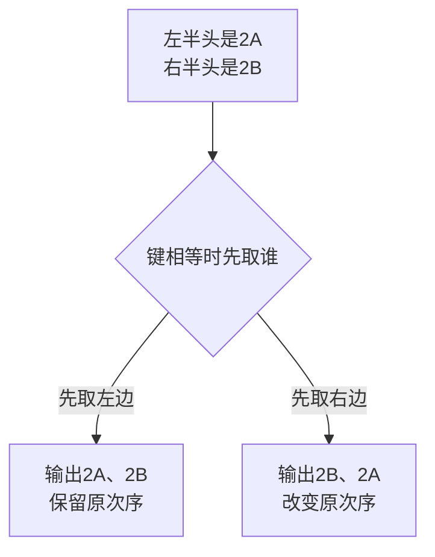
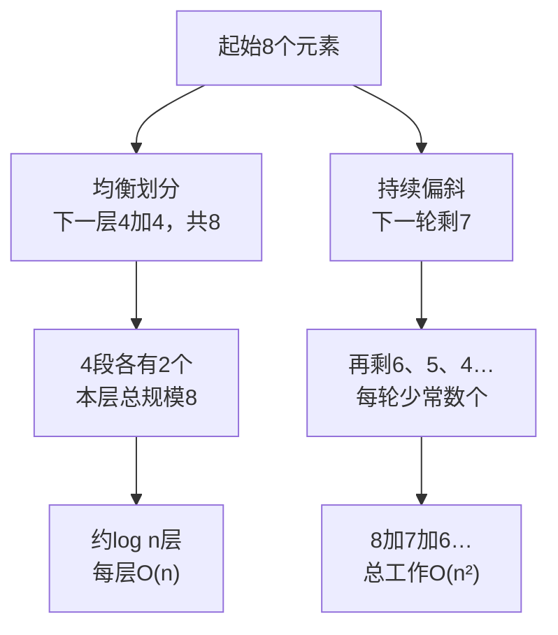
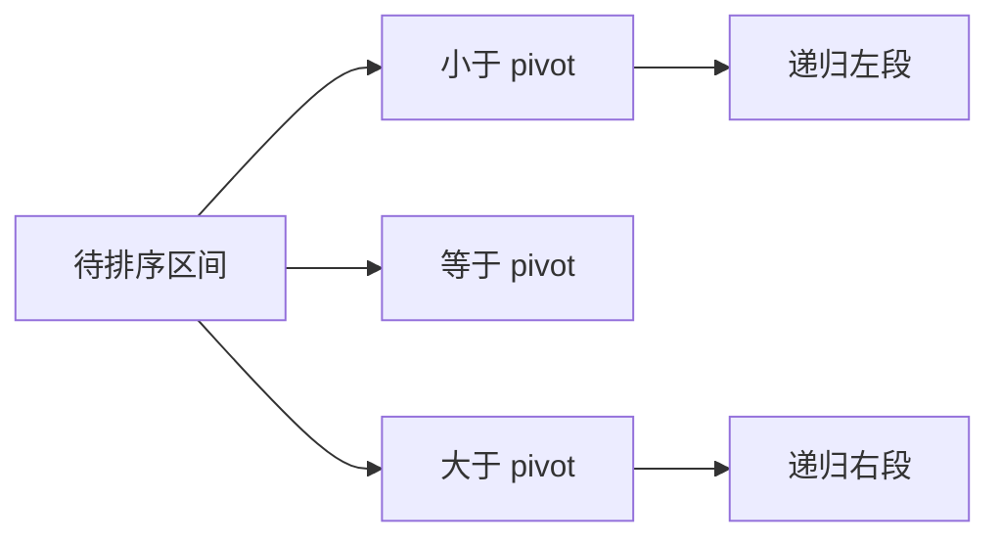
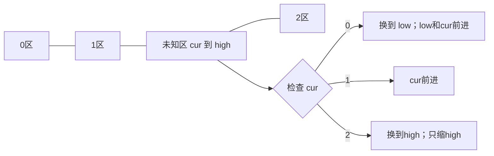

## 排序：顺序、成本与稳定性

排序不仅看平均时间，还要说明最坏情况、额外存储和稳定性。稳定意味着键相等的记录保持原先次序，例如按分数排序时，两位同分学生的先后不变。比较排序只通过比较确定次序，决策树至少区分 n! 种排列，因此最坏比较次数下界是 Ω(n log n)，不是把下界写成 O(n log n)。

| 算法 | 核心步骤 | 平均/最坏时间 | 辅助空间 | 常见实现稳定? |
|---|---|---|---|---|
| 冒泡 | 相邻逆序交换，最大值逐轮到末尾 | O(n²)/O(n²)，有提前退出时最好O(n) | O(1) | 是，只交换严格逆序 |
| 插入 | 将下一元素插入已排前缀 | O(n²)/O(n²)，近乎有序时好 | O(1) | 是，等值不越过 |
| 选择 | 每轮找剩余最小并交换到前面 | O(n²)/O(n²) | O(1) | 通常否，跨距交换破坏顺序 |
| 快排 | 分区后分别处理两边 | 平均O(n log n)，最坏O(n²) | 平均栈O(log n)，最坏O(n) | 通常否 |
| 堆排 | 大根堆堆顶与末尾交换，再下沉 | O(n log n)/O(n log n) | O(1) | 否 |
| 归并 | 排两半，用双指针有序合并 | O(n log n)/O(n log n) | 数组版O(n) | 是，等值先左边 |
| 计数 | 数值映射频次/累计位置 | O(n+K) | 稳定版O(n+K) | 可稳定 |
| 桶 | 分桶后各桶排序、串联 | 均匀分布时预期O(n+K)，最坏可O(n²) | O(n+K) | 取决于桶内实现 |
| 基数 | 从低位到高位做稳定分配 | O(d(n+b)) | O(n+b) | 要求每轮稳定 |

K 是数值范围或桶数，d 是位数，b 是基数。它们不是无条件 O(n)：数据范围过大时计数排序不适合；桶分布严重偏斜会退化；基数每轮稳定才能保留低位的次序。“原地”通常允许很少额外空间；快排虽不使用辅助数组，但递归栈不为 O(1)。

### 稳定性是相等元素的身份是否被保留

给相等键加上身份标签：原序列中2A在2B之前。归并时左半段的元素本来就在右半段之前；若当前键相等，先取左边才能保持原顺序。



这说明“排得对”和“稳定”是两个不同要求。若先按姓名排序，再用稳定排序按成绩分组，同成绩的人仍按姓名排列；第二次排序若不稳定，前一次建立的组内次序可能丢失。只拿普通整数看最终结果无法发现稳定性错误，因为两个2没有可见区别，验证时需要附带原下标或记录身份。

### O(n log n) 来自几层，每层做多少工作

递归本身不自动意味着O(log n)。分治排序的时间由两件事相乘或累加：子问题缩小速度，以及每个子问题处理其区间的成本。下图用8个元素比较均衡划分与持续不均衡划分，框中的数字是每轮尚需扫描的元素规模。



归并按下标取中点，划分的平衡不依赖输入值，所以能保证O(n log n)。快排按pivot分区，若pivot不断落在极端，许多元素会被重复扫描，形成右侧情形。随机选pivot降低持续极端划分的概率，得到期望O(n log n)，没有把每一次运行的最坏界改成O(n log n)。

Quickselect则只进入含目标下标的一侧：在子问题能按常数比例缩小时，工作是`n+n/2+n/4+...`，而不是每层都处理左右两侧，因此为O(n)。它同样需要说明划分质量或随机化假设。

### 其余排序算法如何保持不变量

**冒泡排序。** 一轮从左到右比较相邻对，把更大的向右交换。完整一轮后，未排序段的最大值必到最右端，下一轮就可缩短一格。例如[3,1,2]先变[1,3,2]再变[1,2,3]。如果整轮没有交换，数组已经有序，可立即停止。只有交换严格大于的情况才保留相等记录次序。它适合教学和极小数据，不宜对大数组使用二次循环。

<a id="tpl-bubble-sort"></a>

**冒泡排序：逐轮固定右端最大值**

两边都就地排序 [3,1,2]，输出 [1, 2, 3]。第一轮后 3 已经到达最终位置。

```python
def bubble_sort(values):
    for end in range(len(values) - 1, 0, -1):
        changed = False
        for i in range(end):
            if values[i] > values[i + 1]:
                values[i], values[i + 1] = values[i + 1], values[i]
                changed = True
        if not changed:
            break


values = [3, 1, 2]
bubble_sort(values)
print(values)
```

```java
import java.util.*;

public class Main {
    static void bubbleSort(int[] values) {
        for (int end = values.length - 1; end > 0; end--) {
            boolean changed = false;
            for (int i = 0; i < end; i++) {
                if (values[i] > values[i + 1]) {
                    int tmp = values[i];
                    values[i] = values[i + 1];
                    values[i + 1] = tmp;
                    changed = true;
                }
            }
            if (!changed) break;
        }
    }

    public static void main(String[] args) {
        int[] values = {3, 1, 2};
        bubbleSort(values);
        System.out.println(Arrays.toString(values));
    }
}
```

Python 的倒序 `range(start, 0, -1)` 包含 1。边界 end 是最后一个仍未固定的位置，比较对从 end−1 与 end 截止。

**插入排序。** 每一步保证前缀已排序，先暂存新值，把前缀中比它大的值向右搬，再把新值放入空位。例如已排[2,4,7]插入3，移动7、4，最后得到[2,3,4,7]。比较用严格大于让相等元素不越位。近乎有序时移动少，且常数小，所以常作为快速排序的小区间收尾。若搜索插入位置改为二分，也只是减少比较次数，搬移仍可能O(n)，总最坏仍O(n²)。

短区间插入排序的两份实现位于[快排的短段处理分支](#/lesson/10?section=tpl-quick-merge-sort)。

**选择排序。** 每轮选未排序部分最小值，与当前开头交换。已完成前缀始终是全局最小的若干元素。交换次数O(n)，但找最小需要反复扫描，总比较O(n²)。对[2a,2b,1]第一次把1与2a交换得到[1,2b,2a]，相等记录a、b顺序颠倒，直接说明不稳定。

<a id="tpl-selection-sort"></a>

**选择排序：把区间最小值放在左端**

两边排序 [4,2,1]。第一步扫描全数组，交换 4 和 1；下一轮只扫描剩余后缀。

```python
def selection_sort(values):
    for left in range(len(values)):
        best = left
        for i in range(left + 1, len(values)):
            if values[i] < values[best]:
                best = i
        values[left], values[best] = values[best], values[left]


values = [4, 2, 1]
selection_sort(values)
print(values)
```

```java
import java.util.*;

public class Main {
    static void selectionSort(int[] values) {
        for (int left = 0; left < values.length; left++) {
            int best = left;
            for (int i = left + 1; i < values.length; i++) {
                if (values[i] < values[best]) best = i;
            }
            int tmp = values[best];
            values[best] = values[left];
            values[left] = tmp;
        }
    }

    public static void main(String[] args) {
        int[] values = {4, 2, 1};
        selectionSort(values);
        System.out.println(Arrays.toString(values));
    }
}
```

两边都打印 [1, 2, 4]。best 保存下标，所以找到更小元素后只更新候选，不在内层循环中搬动数据。

**堆排序。** 先O(n)建大根堆，交换根和堆末，把最大值冻结在末尾，然后对缩小后的堆下沉。每轮不变量是前缀仍为堆、后缀有序且都不小于前缀。无需额外输出数组，最坏O(n log n)；但是跨距交换破坏稳定性。只有不断poll才有序，堆数组自身并没有完全排好。

<a id="tpl-heap-sort"></a>

**原地堆排序：下沉与缩小堆边界**

把 [3,1,4,2] 建成大根堆。根和末尾交换后，最大值已经就位，后续下沉只能触及仍属于堆的前缀。

```python
def heap_sort(values):
    def sink(root, end):
        while 2 * root + 1 < end:
            child = 2 * root + 1
            if child + 1 < end and values[child + 1] > values[child]:
                child += 1
            if values[root] >= values[child]:
                break
            values[root], values[child] = values[child], values[root]
            root = child

    for root in range(len(values) // 2 - 1, -1, -1):
        sink(root, len(values))
    for end in range(len(values) - 1, 0, -1):
        values[0], values[end] = values[end], values[0]
        sink(0, end)


values = [3, 1, 4, 2]
heap_sort(values)
print(values)
```

```java
import java.util.*;

public class Main {
    static void sink(int[] values, int root, int end) {
        while (root < end / 2) {
            int child = 2 * root + 1;
            if (child + 1 < end && values[child + 1] > values[child]) child++;
            if (values[root] >= values[child]) break;
            int tmp = values[root];
            values[root] = values[child];
            values[child] = tmp;
            root = child;
        }
    }

    static void heapSort(int[] values) {
        for (int root = values.length / 2 - 1; root >= 0; root--) sink(values, root, values.length);
        for (int end = values.length - 1; end > 0; end--) {
            int tmp = values[0];
            values[0] = values[end];
            values[end] = tmp;
            sink(values, 0, end);
        }
    }

    public static void main(String[] args) {
        int[] values = {3, 1, 4, 2};
        heapSort(values);
        System.out.println(Arrays.toString(values));
    }
}
```

两边都输出 [1, 2, 3, 4]。end 是排除边界。下沉总是与更大的孩子比较，这样交换后的父节点同时支配两个孩子。Java 用 `root < end / 2` 判断还有左孩子，避免先计算可能溢出的孩子下标。

**稳定计数排序。** 数值范围已知且不大时，先统计每个值出现几次，再把计数变成前缀累计位置。例如[2a,1,2b,0]的频次为[1,1,2]，累计为[1,2,4]。从右向左把记录放到`--count[value]`的位置，2b先去最后，2a后来去其前一个位置，保持原次序。只按频次输出数字的简化版不能保留记录身份，不能据此证明稳定。负值可减最小值转为非负桶下标，但如果最大最小差巨大，分配大数组会浪费空间。

<a id="tpl-stable-counting-sort"></a>

**稳定计数排序：把累计频次变成写入位置**

记录由整数键和名字组成。对 (2,A)、(1,X)、(2,B) 按键排序后，名字序列应为 XAB，两个键 2 仍保持 A 在 B 前。

```python
def stable_count(rows, largest_key):
    ends = [0] * (largest_key + 1)
    for key, name in rows:
        ends[key] += 1
    for key in range(1, len(ends)):
        ends[key] += ends[key - 1]
    result = [None] * len(rows)
    for row in reversed(rows):
        key = row[0]
        ends[key] -= 1
        result[ends[key]] = row
    return result


rows = [(2, "A"), (1, "X"), (2, "B")]
print("".join(name for key, name in stable_count(rows, 2)))
```

```java
import java.util.*;

public class Main {
    record Row(int key, String name) {}

    static Row[] stableCount(Row[] rows, int largestKey) {
        int[] ends = new int[largestKey + 1];
        for (Row row : rows) ends[row.key()]++;
        for (int key = 1; key < ends.length; key++) ends[key] += ends[key - 1];
        Row[] result = new Row[rows.length];
        for (int i = rows.length - 1; i >= 0; i--) {
            Row row = rows[i];
            result[--ends[row.key()]] = row;
        }
        return result;
    }

    public static void main(String[] args) {
        Row[] rows = {new Row(2, "A"), new Row(1, "X"), new Row(2, "B")};
        StringBuilder names = new StringBuilder();
        for (Row row : stableCount(rows, 2)) names.append(row.name());
        System.out.println(names);
    }
}
```

假定所有键属于 [0, largestKey] 且这个范围足够小。累计值 ends[k] 是这一类的排除边界，因此写入前先减 1。Python 的 `reversed` 反向迭代原序列，Java 的 `--ends[key]` 读到递减后的下标。

**桶排序。** 按数值范围把元素分到有序桶，每个桶内部排序，依次拼接。在均匀分布、桶数与n同阶时，各桶期望很小，总成本可以近线性。如果所有元素进一个桶，就退化成桶内排序的成本；稳定性同样由入桶保序、桶内排序和合并顺序共同决定，不能无条件标YES。

<a id="tpl-bucket-sort"></a>

**桶排序：先分范围，再排序桶内**

给定 [9,1,8,2]、桶宽 4，值 1 和 2 进入第一个桶，8 和 9 分布在按范围排列的后续桶。

```python
def bucket_sort(values, width):
    if not values:
        return []
    low, high = min(values), max(values)
    buckets = [[] for _ in range((high - low) // width + 1)]
    for value in values:
        buckets[(value - low) // width].append(value)
    result = []
    for bucket in buckets:
        bucket.sort()
        result.extend(bucket)
    return result


print(bucket_sort([9, 1, 8, 2], 4))
```

```java
import java.util.*;

public class Main {
    static List<Integer> bucketSort(int[] values, int width) {
        List<Integer> result = new ArrayList<>();
        if (values.length == 0) return result;
        int low = Arrays.stream(values).min().getAsInt();
        int high = Arrays.stream(values).max().getAsInt();
        int count = Math.toIntExact(((long) high - low) / width + 1);
        List<List<Integer>> buckets = new ArrayList<>(count);
        for (int i = 0; i < count; i++) buckets.add(new ArrayList<>());
        for (int value : values) buckets.get((int) (((long) value - low) / width)).add(value);
        for (List<Integer> bucket : buckets) {
            Collections.sort(bucket);
            result.addAll(bucket);
        }
        return result;
    }

    public static void main(String[] args) {
        System.out.println(bucketSort(new int[] {9, 1, 8, 2}, 4));
    }
}
```

两边输出 [1, 2, 8, 9]。约定 width > 0 且桶数能放入内存。Python 用推导式给每个桶分配独立列表，若写 `[[]] * count` 会共享同一个桶。Java 的构造参数 count 只预留容量，仍需逐桶 add。

**基数排序。** 以十进制非负整数为例，先按个位稳定排序，再十位、百位，最终得到全局顺序。循环不变量是经过第d轮后，已经按最低d位排好。若中间一轮不稳定，就可能打乱之前建立的低位顺序。用计数排序完成每轮只是常见实现，并不意味着所有计数排序都是基数排序。负数需要额外符号处理；位数与基数共同决定成本。

| 基数排序[170,45,75,90,802,24,2,66] | 每轮稳定排序后的序列 |
|---|---|
| 个位 | [170,90,802,2,24,45,75,66] |
| 十位（缺位视0） | [802,2,24,45,66,170,75,90] |
| 百位 | [2,24,45,66,75,90,170,802] |

<a id="tpl-radix-sort"></a>

**基数排序：按低位到高位稳定分桶**

在 [21,13,12] 中，个位排序得到 [21,12,13]；十位排序时 12 与 13 必须继承这一顺序。

```python
def radix_sort(values):
    if not values:
        return
    largest = max(values)
    place = 1
    while place <= largest:
        buckets = [[] for _ in range(10)]
        for value in values:
            digit = (value // place) % 10
            buckets[digit].append(value)
        values[:] = [value for bucket in buckets for value in bucket]
        place *= 10


values = [21, 13, 12]
radix_sort(values)
print(values)
```

```java
import java.util.*;

public class Main {
    static void radixSort(int[] values) {
        int largest = Arrays.stream(values).max().orElse(0);
        for (long place = 1; place <= largest; place *= 10) {
            List<List<Integer>> buckets = new ArrayList<>(10);
            for (int i = 0; i < 10; i++) buckets.add(new ArrayList<>());
            for (int value : values) buckets.get((int) (value / place % 10)).add(value);
            int write = 0;
            for (List<Integer> bucket : buckets) {
                for (int value : bucket) values[write++] = value;
            }
        }
    }

    public static void main(String[] args) {
        int[] values = {21, 13, 12};
        radixSort(values);
        System.out.println(Arrays.toString(values));
    }
}
```

两边输出 [12, 13, 21]。输入约定为非负整数。顺序追加、顺序取回使每一轮稳定。Python 的切片赋值修改调用方传入的列表；Java 用 long 保存位权，避免处理十亿位后乘 10 发生 int 溢出。

### 快排与插入排序的组合

课件使用三数取中、双向扫描并在小区间改用插入排序。三数取中将左、中、右排序，把中值放在右端前一格作为 pivot；两端作为哨兵时，`arr[++low]` 的预先移动不能在翻译为另一种语言时丢失，否则相等元素可能让循环卡住。下面使用更直观的三路分区，重复值直接归入中间段。



<a id="tpl-quick-merge-sort"></a>

**三路快排、短段插入排序与稳定归并**

同一串含重复值的输入分别交给两种排序。快排把等于 pivot 的元素一次放好；归并先要求左右两段各自有序，再从两个段首选较小值。

```python
from random import randrange


def quick_sort(values):
    def quick(left, right):
        if right - left <= 10:
            for i in range(left + 1, right + 1):
                value = values[i]
                j = i - 1
                while j >= left and values[j] > value:
                    values[j + 1] = values[j]
                    j -= 1
                values[j + 1] = value
            return
        pivot = values[randrange(left, right + 1)]
        low = cur = left
        high = right
        while cur <= high:
            if values[cur] < pivot:
                values[low], values[cur] = values[cur], values[low]
                low += 1
                cur += 1
            elif values[cur] > pivot:
                values[cur], values[high] = values[high], values[cur]
                high -= 1
            else:
                cur += 1
        quick(left, low - 1)
        quick(high + 1, right)
    quick(0, len(values) - 1)


def merge_sort(values):
    temp = list(values)

    def sort(left, right):
        if right - left <= 1:
            return
        mid = (left + right) // 2
        sort(left, mid)
        sort(mid, right)
        i, j = left, mid
        for write in range(left, right):
            if i < mid and (j == right or values[i] <= values[j]):
                temp[write] = values[i]
                i += 1
            else:
                temp[write] = values[j]
                j += 1
        for index in range(left, right):
            values[index] = temp[index]
    sort(0, len(values))


data = [9, 8, 7, 3, 5, 6, 1, 3, 2, 4, 0, 3]
for algorithm in (quick_sort, merge_sort):
    values = data.copy()
    algorithm(values)
    print(values)
```

```java
import java.util.*;
class Sorting {
    private final Random random = new Random();
    public void quickSort(int[] a) { quick(a, 0, a.length - 1); }
    private void quick(int[] a, int left, int right) {
        if (right - left <= 10) {
            for (int i = left + 1; i <= right; i++) {
                int value = a[i], j = i - 1;
                while (j >= left && a[j] > value) { a[j + 1] = a[j]; j--; }
                a[j + 1] = value;
            }
            return;
        }
        int pivot = a[left + random.nextInt(right - left + 1)];
        int low = left, current = left, high = right;
        while (current <= high) {
            if (a[current] < pivot) swap(a, low++, current++);
            else if (a[current] > pivot) swap(a, current, high--);
            else current++;
        }
        quick(a, left, low - 1);
        quick(a, high + 1, right);
    }
    private void swap(int[] a, int i, int j) {
        int t = a[i]; a[i] = a[j]; a[j] = t;
    }
    public void mergeSort(int[] a) { mergeSort(a, new int[a.length], 0, a.length); }
    private void mergeSort(int[] a, int[] temp, int left, int right) {
        if (right - left <= 1) return;
        int middle = left + (right - left) / 2;
        mergeSort(a, temp, left, middle);
        mergeSort(a, temp, middle, right);
        int i = left, j = middle, write = left;
        while (i < middle && j < right) temp[write++] = a[i] <= a[j] ? a[i++] : a[j++];
        while (i < middle) temp[write++] = a[i++];
        while (j < right) temp[write++] = a[j++];
        System.arraycopy(temp, left, a, left, right - left);
    }
}

class Demo {
    public static void main(String[] args) {
        int[] data = {9, 8, 7, 3, 5, 6, 1, 3, 2, 4, 0, 3};
        int[] quick = data.clone(), merge = data.clone();
        Sorting sort = new Sorting();
        sort.quickSort(quick);
        sort.mergeSort(merge);
        System.out.println(Arrays.toString(quick));
        System.out.println(Arrays.toString(merge));
    }
}
```

两行均为 [0, 1, 2, 3, 3, 3, 4, 5, 6, 7, 8, 9]。样例长度 12，能进入三路分区；短分区才改用插入排序。Python 随机范围的右端不含在内，所以要传 right+1。嵌套函数复用外层数组；只有重新绑定外层变量时才需要 nonlocal。 Java 的示例入口是 `Demo.main`。

`Random.nextInt(bound)` 返回 `[0,bound)`，所以区间长度必须加1。三路分区不变量是 `[left,low)<pivot`、`[low,current)=pivot`、`(high,right]>pivot`；与右端交换后 current 不动，因为换回的数还未知。随机化提供期望界，不保证每次划分一半。

归并采用半开区间 `[left,right)`，空区间也自然处理。`temp` 只分配一次并递归共享；`System.arraycopy(src,srcPos,dest,destPos,len)` 把合并好的区间复制回原数组。相等时先取左半使排序稳定。

| 归并 [4,1,3,2] | 左半 | 右半 | 合并输出 |
|---|---|---|---|
| 分解 | [4],[1] | [3],[2] | — |
| 小合并 | [1,4] | [2,3] | — |
| 最终比较 | 1≤2 | 取1 | [1] |
| 继续 | 4>2，4>3 | 取2、3 | [1,2,3] |
| 收尾 | 剩4 | 空 | [1,2,3,4] |

Java `Arrays.sort` 用于数组，`Collections.sort` 用于 List，`List.sort` 可接收比较器。`int[]` 不支持 Comparator 参数，要比较对象可用 `Integer[]` 或其他对象数组。API 的排序实现随类型和版本而异，解题时应依赖排序结果和文档契约，不把具体实现当作语言保证。

### 外部排序

数据大于内存时，先每次读入一块，内存排序后写为有序段；再用 k 路归并，每个文件维持一个缓冲区，优先队列选择最小当前值。若每轮可合并 k 段，需要约 log_k(段数) 轮，每轮读写全量数据，I/O 往往超过 CPU 比较成本。[堆章的合并 K 链表](#/lesson/08?section=lc-23) 正是它的内存抽象。

<a id="tpl-merge-runs"></a>

**多路归并：每个有序段只保存一个候选**

每个有序段可以是文件迭代器。先拿到各段首项，每取走最小值，只让该值所在的段补上一项。用 [1,4]、空段、[2,5] 做一次归并。

```python
from heapq import merge

runs = [[1, 4], [], [2, 5]]
for value in merge(*runs):
    print(value)
```

```java
import java.util.*;

public class Main {
    record Head(int value, Iterator<Integer> rest) {}

    static void mergeRuns(List<List<Integer>> runs) {
        PriorityQueue<Head> heap = new PriorityQueue<>(Comparator.comparingInt(Head::value));
        for (List<Integer> run : runs) {
            Iterator<Integer> it = run.iterator();
            if (it.hasNext()) heap.add(new Head(it.next(), it));
        }
        while (!heap.isEmpty()) {
            Head h = heap.remove();
            System.out.println(h.value());
            Iterator<Integer> it = h.rest();
            if (it.hasNext()) heap.add(new Head(it.next(), it));
        }
    }

    public static void main(String[] args) {
        mergeRuns(List.of(List.of(1, 4), List.of(), List.of(2, 5)));
    }
}
```

输出依次为 1、2、4、5。Python 的 `*` 把多个输入段展开为参数，`heapq.merge` 惰性地产生下一个值；Java 的 Iterator 持有各段下一次读取的位置。归并 n 个值、k 个段需 O(n log k) 时间、O(k) 个候选。实际外部排序还要分块产生初始有序段，并将输出顺序写回文件。

<a id="lc-179"></a>
## LC 179 · 最大数

**题意。** 重排非负整数，拼成尽可能大的十进制数，结果可能超出整数范围，返回字符串。对 a,b，比较 `ab` 与 `ba`；若 ab 更大，就把 a 排在 b 前。不能按数值大小：3 应在30之前，因为330>303。

| 输入[3,30,34,5,9]的关键比较 | 两种拼接 | 先放谁 |
|---|---|---|
| 3与30 | 330 / 303 | 3 |
| 34与3 | 343 / 334 | 34 |
| 5与34 | 534 / 345 | 5 |
| 9与5 | 95 / 59 | 9 |
| 最终 | 9,5,34,3,30 | 9534330 |

<a id="tpl-concat-comparator"></a>

**自定义比较器：按拼接结果排序**

对 3 和 30，330 大于 303，排序应将 3 提到前面。两种比较器都必须在两个拼接相等时给出零。

```python
from functools import cmp_to_key


def largest_number(nums):
    def compare(a, b):
        if a + b > b + a:
            return -1
        if a + b < b + a:
            return 1
        return 0

    values = sorted(map(str, nums), key=cmp_to_key(compare))
    return "0" if values[0] == "0" else "".join(values)


print(largest_number([3, 30, 34, 5, 9]))
```

```java
import java.util.*;
class Solution {
    public String largestNumber(int[] nums) {
        String[] values = new String[nums.length];
        for (int i = 0; i < nums.length; i++) values[i] = String.valueOf(nums[i]);
        Arrays.sort(values, (a, b) -> (b + a).compareTo(a + b));
        if (values[0].equals("0")) return "0";
        StringBuilder result = new StringBuilder();
        for (String value : values) result.append(value);
        return result.toString();
    }
}

class Demo {
    public static void main(String[] args) {
        System.out.println(new Solution().largestNumber(new int[] {3, 30, 34, 5, 9}));
    }
}
```

两边均输出 9534330。`cmp_to_key` 将接收两个值的比较函数适配为 `sorted(key=...)` 接受的单参数键函数。示例遵循原题输入至少有一个数字的约定。 Java 的示例入口是 `Demo.main`。

`String.compareTo` 返回字典序比较符号；ab与ba长度相同，字典序等于数值序。比较器反向写 `(b+a)` 是为了降序。相邻逆序交换能够增大整个拼接，因而按规则排列的结果最优。首个是0意味着全为0，避免输出000。设最大位数 d，时间 O(nd log n)，空间 O(nd)。测试 `[0,0]→0`、`[121,12]→12121`、相等拼接顺序均可。课件 Python comparator 没有在相等时返回0，应修正比较契约。

<a id="lc-296"></a>
## LC 296 · 最佳碰头地点

**题意。** 网格1表示居住点，选择集合点使所有人曼哈顿距离之和最小，返回最小总距离。曼哈顿距离按行列相加，可把两个维度独立优化。对一维两个端点 a≤b，p 在[a,b]时距离和恒为b-a；把有序点两端配对，所有配对的最优区间交集就是中位数位置。

| 居住点(0,0),(0,4),(2,2) | 排序坐标 | 中位数 | 距离和 |
|---|---|---:|---:|
| 行 | 0,0,2 | 0 | 2 |
| 列 | 0,2,4 | 2 | 4 |
| 合并 | 集合点(0,2) | — | 6 |

<a id="tpl-median-distance"></a>

**把曼哈顿距离拆成两个一维问题**

在 3×5 网格的 (0,0)、(0,4)、(2,2) 安放三个点。行列分别取中位数，得到集合点 (0,2)，总距离 6。

```python
def total_distance(grid):
    rows, columns = [], []
    for r, row in enumerate(grid):
        for c, cell in enumerate(row):
            if cell == 1:
                rows.append(r)
                columns.append(c)
    columns.sort()
    total = 0
    for left in range(len(rows) // 2):
        right = len(rows) - 1 - left
        total += (rows[right] - rows[left]) + (columns[right] - columns[left])
    return total


grid = [[1, 0, 0, 0, 1], [0, 0, 0, 0, 0], [0, 0, 1, 0, 0]]
print(total_distance(grid))
```

```java
import java.util.*;
class Solution {
    public int minTotalDistance(int[][] grid) {
        List<Integer> rows = new ArrayList<>(), columns = new ArrayList<>();
        for (int r = 0; r < grid.length; r++) for (int c = 0; c < grid[0].length; c++) {
            if (grid[r][c] == 1) { rows.add(r); columns.add(c); }
        }
        Collections.sort(columns);
        int answer = 0;
        for (int left = 0, right = rows.size() - 1; left < right; left++, right--) {
            answer += rows.get(right) - rows.get(left);
            answer += columns.get(right) - columns.get(left);
        }
        return answer;
    }
}

class Demo {
    public static void main(String[] args) {
        int[][] grid = {{1, 0, 0, 0, 1}, {0, 0, 0, 0, 0}, {0, 0, 1, 0, 0}};
        System.out.println(new Solution().minTotalDistance(grid));
    }
}
```

对一个排序维度最左、最右两个坐标，位于中间的点到它们的距离之和等于两端之差。两端配对后可以直接加差值，奇数个坐标时中间点对总距离贡献为零。 Java 的示例入口是 `Demo.main`。

按行扫描时 rows 已排序，columns 尚未排序。`List.get` 返回 Integer，算术自动拆箱。偶数人数任意两个中位数之间的位置都最优；配对计算无须显式选点。p个人、m×n网格，时间 O(mn+p log p)，空间 O(p)。按列再扫描收集 columns 可将排序降掉。测试一人距离0、同行多人、偶数人数；平均数优化平方距离，不是绝对距离。

<a id="lc-56"></a>
## LC 56 · 合并区间

**题意。** 合并所有相交的闭区间。先按左端排序，正在处理的新区间只可能与结果最后一段相交。若新左端≤旧右端，扩展右端；否则另开一段。已经结束的更早区间不会再与后续相交，这是排序提供的不变量。

| [1,3],[2,6],[8,10],[15,18] | 判断 | 结果 |
|---|---|---|
| [1,3] | 首段 | [1,3] |
| [2,6] | 2≤3 | [1,6] |
| [8,10] | 8>6 | [1,6],[8,10] |
| [15,18] | 15>10 | 再加[15,18] |

<a id="tpl-merge-intervals"></a>

**排序后合并闭区间**

合并相邻且共享端点的 [1,4]、[4,5]。如果相等时开新段，这个用例就会失败。

```python
def merge_intervals(intervals):
    intervals.sort(key=lambda pair: pair[0])
    result = []
    for left, right in intervals:
        if not result or result[-1][1] < left:
            result.append([left, right])
        else:
            result[-1][1] = max(result[-1][1], right)
    return result


print(merge_intervals([[1, 4], [4, 5]]))
```

```java
import java.util.*;
class Solution {
    public int[][] merge(int[][] intervals) {
        Arrays.sort(intervals, (a, b) -> Integer.compare(a[0], b[0]));
        List<int[]> answer = new ArrayList<>();
        for (int[] interval : intervals) {
            if (answer.isEmpty() || answer.get(answer.size() - 1)[1] < interval[0]) {
                answer.add(new int[]{interval[0], interval[1]});
            } else {
                int[] last = answer.get(answer.size() - 1);
                last[1] = Math.max(last[1], interval[1]);
            }
        }
        return answer.toArray(new int[answer.size()][]);
    }
}

class Demo {
    public static void main(String[] args) {
        System.out.println(Arrays.deepToString(new Solution().merge(new int[][] {{1, 4}, {4, 5}})));
    }
}
```

两边得到 [[1, 5]]。`lambda pair: pair[0]` 只提取左端点构造排序键，`result[-1]` 读最后一段。两边都新建结果中的区间，排序会改变原输入的区间顺序。 Java 的示例入口是 `Demo.main`。

`int[][]` 本质是 `int[]` 对象的数组，因此可提供 Comparator。`toArray(new int[size][])` 将 List<int[]> 转回题目要求的二维数组；课件返回 List<int[]> 不匹配此题标准提交签名。新建区间避免修改输入内层数组，但排序仍改变外层顺序。O(n log n) 时间，O(n) 输出/排序空间。测试 `[1,4],[4,5]→[1,5]`、完全包含、同起点、空数组。

<a id="lc-215"></a>
## LC 215 · Quickselect 只追踪目标所在分区

题意和堆方案见[堆章](#/lesson/08?section=lc-215)。第 k 大等于升序下标 n-k。快排需要排序两侧，选择只需保留含目标下标的那侧。三路分区可一次消除所有等于 pivot 的元素，重复数据表现更稳。

| nums=[3,2,1,5,6,4], k=2，target=4；假设pivot=4 | 分区 | 下一步 |
|---|---|---|
| 分区完成 | 小于:[3,2,1]；等于:[4]；大于:[6,5] | 4在右区 |
| 右区假设pivot=5 | 等于5的位置4 | 命中，返回5 |

<a id="tpl-quickselect"></a>

**Quickselect：原地选择第 k 大**

输入 [3,2,1,5,6,4]、k=2，目标排序位置是 6−2=4。下面两段代码的 pivot 可能不同，最终选出的值均为 5。

```python
from random import randrange


def kth_largest(nums, k):
    target = len(nums) - k
    left, right = 0, len(nums) - 1
    while left <= right:
        pivot = nums[randrange(left, right + 1)]
        low = cur = left
        high = right
        while cur <= high:
            if nums[cur] < pivot:
                nums[cur], nums[low] = nums[low], nums[cur]
                low += 1
                cur += 1
            elif nums[cur] > pivot:
                nums[cur], nums[high] = nums[high], nums[cur]
                high -= 1
            else:
                cur += 1
        if target < low:
            right = low - 1
        elif target > high:
            left = high + 1
        else:
            return nums[target]
    raise ValueError("invalid k")


print(kth_largest([3, 2, 1, 5, 6, 4], 2))
```

```java
import java.util.*;
class Solution {
    public int findKthLargest(int[] nums, int k) {
        int target = nums.length - k, left = 0, right = nums.length - 1;
        Random random = new Random();
        while (left <= right) {
            int pivot = nums[left + random.nextInt(right - left + 1)];
            int low = left, cur = left, high = right;
            while (cur <= high) {
                if (nums[cur] < pivot) swap(nums, low++, cur++);
                else if (nums[cur] > pivot) swap(nums, cur, high--);
                else cur++;
            }
            if (target < low) right = low - 1;
            else if (target > high) left = high + 1;
            else return nums[target];
        }
        throw new IllegalArgumentException("Invalid k");
    }
    private void swap(int[] a, int i, int j) { int x = a[i]; a[i] = a[j]; a[j] = x; }
}

class Demo {
    public static void main(String[] args) {
        System.out.println(new Solution().findKthLargest(new int[] {3, 2, 1, 5, 6, 4}, 2));
    }
}
```

约定 1 ≤ k ≤ n。low 到 high 是连续的等值段，只要目标下标在其中就可以返回；继续寻找时必须跳过这一整段。 Java 的示例入口是 `Demo.main`。

目标下标始终是原数组的绝对下标，不随子区间改变而减去 left。随机选择使期望工作量 O(n)，最坏仍 O(n²)，迭代版辅助空间 O(1)。算法改变输入。测试全相等、升序、降序、k两端；固定中间位置作为 pivot 也可能被构造为不平衡，不是保证 O(n) 的方法。

<a id="lc-75"></a>
## LC 75 · 颜色分类

**题意。** 数组仅有0、1、2，原地排成0在前、1居中、2在后，不调用库排序。荷兰国旗算法维护四段：`[0,low)` 为0，`[low,cur)` 为1，`[cur,high]` 未知，`(high,n)` 为2。



| [2,0,2,1,1,0] | low,cur,high | 数组 |
|---|---|---|
| 起始 | 0,0,5 | 2,0,2,1,1,0 |
| 处理2 | 0,0,4 | 0,0,2,1,1,2 |
| 两次处理0 | 2,2,4 | 0,0,2,1,1,2 |
| 处理2 | 2,2,3 | 0,0,1,1,2,2 |
| 两次处理1 | 2,4,3 | 完成 |

<a id="tpl-dutch-flag"></a>

**三路分区：划出小、等、大三段**

取 [2,0,1]。第一步把 2 换到右端，换回的 1 尚未处理；当前指针要先留在原位置。

```python
def sort_colors(nums):
    low = cur = 0
    high = len(nums) - 1
    while cur <= high:
        if nums[cur] == 0:
            nums[cur], nums[low] = nums[low], nums[cur]
            low += 1
            cur += 1
        elif nums[cur] == 2:
            nums[cur], nums[high] = nums[high], nums[cur]
            high -= 1
        else:
            cur += 1


values = [2, 0, 1]
sort_colors(values)
print(values)
```

```java
class Solution {
    public void sortColors(int[] nums) {
        int low = 0, cur = 0, high = nums.length - 1;
        while (cur <= high) {
            if (nums[cur] == 0) swap(nums, low++, cur++);
            else if (nums[cur] == 2) swap(nums, cur, high--);
            else cur++;
        }
    }
    private void swap(int[] a, int i, int j) { int t = a[i]; a[i] = a[j]; a[j] = t; }
}

class Demo {
    public static void main(String[] args) {
        int[] values = {2, 0, 1};
        new Solution().sortColors(values);
        System.out.println(java.util.Arrays.toString(values));
    }
}
```

两边都原地得到 [0, 1, 2]。Java 的后缀 ++/-- 把旧下标传给 swap，再更新变量；Python 先交换，再用独立语句更新边界。 Java 的示例入口是 `Demo.main`。

换到右侧时不能 cur++，新换来的元素未知；与左侧交换后可以前进，因为左侧原来是1或当前位置本身。未知区每次缩小，O(n) 时间、O(1) 空间。测试 `[2,0,1]`、全2、空数组、单0。这个结构也是前节三路 Quickselect 的核心。

<a id="lc-274"></a>
## 作业 · LC 274 H 指数

**题意。** 找最大 h，使至少 h 篇论文各被引用至少 h 次。排序后，位置 i 的右侧共 n-i 篇；若 citations[i]≥n-i，这些都达标，第一处达标给最大 h。

| [3,0,6,1,5] 排为[0,1,3,5,6] | 候选h=n-i | 是否达标 |
|---|---:|---|
| i=0,引用0 | 5 | 否 |
| i=1,引用1 | 4 | 否 |
| i=2,引用3 | 3 | 是→3 |

<a id="tpl-sorted-suffix-count"></a>

**排序后扫描后缀：找能满足的最大阈值**

输入 [3,0,6,1,5]。排序后下标 2 对应 3，从这里到末尾恰有 3 篇，每篇至少引用 3 次。

```python
def h_index(citations):
    citations.sort()
    n = len(citations)
    for i, lowest in enumerate(citations):
        papers = n - i
        if lowest >= papers:
            return papers
    return 0


print(h_index([3, 0, 6, 1, 5]))
```

```java
import java.util.*;
class Solution {
    public int hIndex(int[] citations) {
        Arrays.sort(citations);
        int n = citations.length;
        for (int i = 0; i < n; i++) if (citations[i] >= n - i) return n - i;
        return 0;
    }
}

class Demo {
    public static void main(String[] args) {
        System.out.println(new Solution().hIndex(new int[] {3, 0, 6, 1, 5}));
    }
}
```

两边返回 3。枚举的后缀数量依次减少，因此第一次通过的数量就是最大的可行值。若需要保存输入顺序，先复制数组或列表。 Java 的示例入口是 `Demo.main`。

Arrays.sort 原地修改数组；达标比较是≥，不是==。O(n log n) 时间，空间按排序实现计。测试全0→0、`[100]→1`、`[1,1,1]→1`。因为 h≤n，也可用 n+1 个频次桶，把更高引用截到 n 后从高向低累计，实现 O(n) 时间空间。

<a id="lc-57"></a>
## 作业 · LC 57 插入区间

**题意。** 原区间按起点排序且互不重叠，插入一个新区间并合并相交部分。无须重新排序：先复制完全在左边的区间，再合并全部相交区间，最后复制右侧。

| [[1,3],[6,9]] 插入[2,5] | 阶段 | 状态 |
|---|---|---|
| [1,3] | 与新区间相交 | 新区间变[1,5] |
| [6,9] | 在新右端5之后 | 输出[1,5] |
| 收尾 | 复制右侧 | [1,5],[6,9] |

<a id="tpl-insert-interval"></a>

**已有序区间：分三段插入**

把 [2,5] 插入 [[1,3],[6,9]]。左侧、相交、右侧三段依次处理，不需要重新排序。

```python
def insert_interval(intervals, new):
    left, right = new
    result = []
    i = 0
    while i < len(intervals) and intervals[i][1] < left:
        result.append(intervals[i].copy())
        i += 1
    while i < len(intervals) and intervals[i][0] <= right:
        left = min(left, intervals[i][0])
        right = max(right, intervals[i][1])
        i += 1
    result.append([left, right])
    for j in range(i, len(intervals)):
        result.append(intervals[j].copy())
    return result


print(insert_interval([[1, 3], [6, 9]], [2, 5]))
```

```java
import java.util.*;
class Solution {
    public int[][] insert(int[][] intervals, int[] newInterval) {
        List<int[]> result = new ArrayList<>();
        int i = 0, left = newInterval[0], right = newInterval[1];
        while (i < intervals.length && intervals[i][1] < left) result.add(intervals[i++].clone());
        while (i < intervals.length && intervals[i][0] <= right) {
            left = Math.min(left, intervals[i][0]);
            right = Math.max(right, intervals[i][1]);
            i++;
        }
        result.add(new int[]{left, right});
        while (i < intervals.length) result.add(intervals[i++].clone());
        return result.toArray(new int[result.size()][]);
    }
}

class Demo {
    public static void main(String[] args) {
        int[][] result = new Solution().insert(new int[][] {{1, 3}, {6, 9}}, new int[] {2, 5});
        System.out.println(Arrays.deepToString(result));
    }
}
```

输出 [[1, 5], [6, 9]]。Python 的 `.copy()` 和 Java 的 `.clone()` 为每一行创建新容器，保留未相交区间的值。 Java 的示例入口是 `Demo.main`。

数组 `clone()` 对 int[] 复制基本元素，避免结果与输入共享同一行。合并循环比较不断扩展的 right，才能吞并连锁相交。时间 O(n)，输出空间 O(n)。测试空原数组、插在最前/最后、完全包含、端点相等必须合并。

<a id="lc-164"></a>
## 作业 · LC 164 最大间距

**题意。** 找排序后相邻元素的最大差，要求线性时间和线性额外空间；不足2个数返回0。令范围R=max-min，选桶宽 `ceil(R/(n-1))`。最大相邻差至少为该宽，桶内差小于桶宽，因此答案一定来自两个非空桶之间，只需记录每桶最小最大。

| [3,6,9,1]，范围8，桶宽3 | 桶范围 | min/max |
|---|---|---|
| 桶0 | [1,3] | 1/3 |
| 桶1 | [4,6] | 6/6 |
| 桶2 | [7,9] | 9/9 |
| 跨桶 | 6-3=3，9-6=3 | 答案3 |

<a id="tpl-bucket-extrema"></a>

**区间桶：只存最小值与最大值**

对 [3,6,9,1] 取桶宽 3。每桶保留极值，一次扫描求本桶最小值与上个非空桶最大值之差。

```python
def maximum_gap(values):
    if len(values) < 2 or max(values) == min(values):
        return 0
    low, high = min(values), max(values)
    span = high - low
    width = (span + len(values) - 2) // (len(values) - 1)
    count = span // width + 1
    minima, maxima = [None] * count, [None] * count
    for value in values:
        i = (value - low) // width
        if minima[i] is None:
            minima[i] = maxima[i] = value
        else:
            minima[i] = min(minima[i], value)
            maxima[i] = max(maxima[i], value)
    previous, best = low, 0
    for smallest, largest in zip(minima, maxima):
        if smallest is not None:
            best = max(best, smallest - previous)
            previous = largest
    return best


print(maximum_gap([3, 6, 9, 1]))
```

```java
import java.util.*;
class Solution {
    public int maximumGap(int[] nums) {
        if (nums.length < 2) return 0;
        int min = nums[0], max = nums[0];
        for (int x : nums) { min = Math.min(min, x); max = Math.max(max, x); }
        if (min == max) return 0;
        long range = (long) max - min;
        long width = (range + nums.length - 2) / (nums.length - 1);
        int buckets = (int) (range / width) + 1;
        int[] low = new int[buckets], high = new int[buckets];
        boolean[] used = new boolean[buckets];
        Arrays.fill(low, Integer.MAX_VALUE);
        Arrays.fill(high, Integer.MIN_VALUE);
        for (int x : nums) {
            int index = (int) (((long) x - min) / width);
            used[index] = true;
            low[index] = Math.min(low[index], x);
            high[index] = Math.max(high[index], x);
        }
        long best = 0;
        int previous = min;
        for (int i = 0; i < buckets; i++) if (used[i]) {
            best = Math.max(best, (long) low[i] - previous);
            previous = high[i];
        }
        return (int) best;
    }
}

class Demo {
    public static void main(String[] args) {
        System.out.println(new Solution().maximumGap(new int[] {3, 6, 9, 1}));
    }
}
```

两边返回 3。Python 的 None 哨兵区分空桶和数值恰为 0 的桶，两列列表同长，zip 逐桶配对读取。在桶内保存两个极值即可，内存与桶数成正比。 Java 的示例入口是 `Demo.main`。

`(a+b-1)/b` 对非负a、正b实现向上取整；long 防止范围计算溢出。used 区分空桶，不能把空桶哨兵参与答案。原题非负数且范围使答案可用int；扩展到完整有符号整数范围应返回long。时间 O(n)，空间 O(n)。测试全相等、两个数、空桶很长、重复最小最大值。

<a id="lc-41"></a>
## 作业 · LC 41 缺失的第一个正数

**题意。** 在线性时间、常数额外空间找最小缺失正整数。n个位置最多覆盖1到n，答案必在[1,n+1]。把数组本身当哈希表：值 x 应放到下标 x-1，其他值无须处理。

| [3,4,-1,1] | 交换 | 数组 |
|---|---|---|
| i=0，3归位 | 0↔2 | [-1,4,3,1] |
| i=1，4归位 | 1↔3 | [-1,1,3,4] |
| i=1，1归位 | 1↔0 | [1,-1,3,4] |
| 检查 | 下标1不是2 | 答案2 |

<a id="tpl-cyclic-placement"></a>

**把下标当作桶：将正整数原地归位**

给定 [3,4,-1,1]，值 x 属于下标 x−1。每轮重新读取交换回来的值，直到它不在范围内、已经归位或与目标位重复。

```python
def first_missing(nums):
    for i in range(len(nums)):
        while 1 <= nums[i] <= len(nums):
            target = nums[i] - 1
            if nums[target] == nums[i]:
                break
            nums[target], nums[i] = nums[i], nums[target]
    for i, value in enumerate(nums):
        if value != i + 1:
            return i + 1
    return len(nums) + 1


print(first_missing([3, 4, -1, 1]))
```

```java
class Solution {
    public int firstMissingPositive(int[] nums) {
        int n = nums.length;
        for (int i = 0; i < n; i++) {
            while (nums[i] >= 1 && nums[i] <= n && nums[nums[i] - 1] != nums[i]) {
                int target = nums[i] - 1;
                int temp = nums[i]; nums[i] = nums[target]; nums[target] = temp;
            }
        }
        for (int i = 0; i < n; i++) if (nums[i] != i + 1) return i + 1;
        return n + 1;
    }
}

class Demo {
    public static void main(String[] args) {
        System.out.println(new Solution().firstMissingPositive(new int[] {3, 4, -1, 1}));
    }
}
```

两边输出 2。Python 先固定 target 再交换，避免赋值时又按已经改变的 `nums[i]` 重新计算目标下标。 Java 的示例入口是 `Demo.main`。

`&&` 从左到右短路，先保证数值范围再访问 `nums[nums[i]-1]`。目标已相同则停止，防止重复值互换无限循环。每次有效交换至少使一个值永久到正确位置，所以总交换 O(n)。时间 O(n)、空间 O(1)，会修改输入。测试 `[1,1]→2`、全负数→1、`[1,2,3]→4`、空数组→1。

<a id="lc-324"></a>
## 作业 · LC 324 摆动排序 II

**题意。** 重排为 `a0<a1>a2<a3...`，是严格不等号，题目保证存在解。先排序，把较小半与较大半都从后向前交错放入，重复的中位数被尽量隔开，避免简单正向穿插造成相等邻居。

| [1,5,1,1,6,4] 排为[1,1,1,4,5,6] | 位置 | 放入 |
|---|---:|---:|
| 小半从后取 | 0 | 1 |
| 大半从后取 | 1 | 6 |
| 小半/大半继续 | 2,3 | 1,5 |
| 最后 | 4,5 | 1,4 |
| 结果 | — | [1,6,1,5,1,4] |

<a id="tpl-wiggle-interleave"></a>

**用两根倒序指针交错写入**

把 [1,5,1,1,6,4] 的有序副本切成较小半与较大半。偶数位拿小半剩余的最大值，奇数位拿大半剩余的最大值。

```python
def wiggle(nums):
    ordered = sorted(nums)
    small = (len(nums) - 1) // 2
    large = len(nums) - 1
    for i in range(len(nums)):
        if i % 2 == 0:
            nums[i] = ordered[small]
            small -= 1
        else:
            nums[i] = ordered[large]
            large -= 1


values = [1, 5, 1, 1, 6, 4]
wiggle(values)
print(values)
```

```java
import java.util.*;
class Solution {
    public void wiggleSort(int[] nums) {
        int[] sorted = nums.clone();
        Arrays.sort(sorted);
        int small = (nums.length - 1) / 2, large = nums.length - 1;
        for (int i = 0; i < nums.length; i++) {
            nums[i] = (i & 1) == 0 ? sorted[small--] : sorted[large--];
        }
    }
}

class Demo {
    public static void main(String[] args) {
        int[] nums = {1, 5, 1, 1, 6, 4};
        new Solution().wiggleSort(nums);
        System.out.println(Arrays.toString(nums));
    }
}
```

两段对这一输入都写出 [1, 6, 1, 5, 1, 4]。`sorted(nums)` 返回新列表，让读指针始终读取排序副本，写入原数组不会覆盖未来需要的值。 Java 的示例入口是 `Demo.main`。

数组 clone 保留有序副本，写回原数组不会破坏尚未读取的数据。`i&1` 取最低位判断奇偶，三元分支只执行一侧的自减。前半个数为ceil(n/2)，适配奇数长度。此为完整可提交的 O(n log n) 时间/O(n) 空间解；进阶要求可用中位数选择加虚拟下标 `(1+2*i)%(n|1)` 的三路分区，期望 O(n)、O(1)空间，不能把上面方案冒称满足进阶。测试 `[1,3,2,2,3,1]→[2,3,1,3,1,2]`、单元素、大量重复。验证检查严格相邻关系与多重集合不变，而非固定输出顺序。
