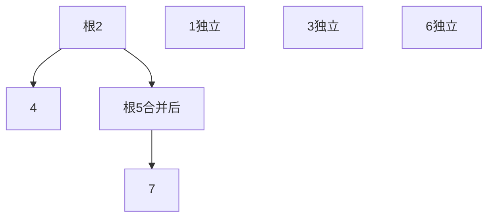
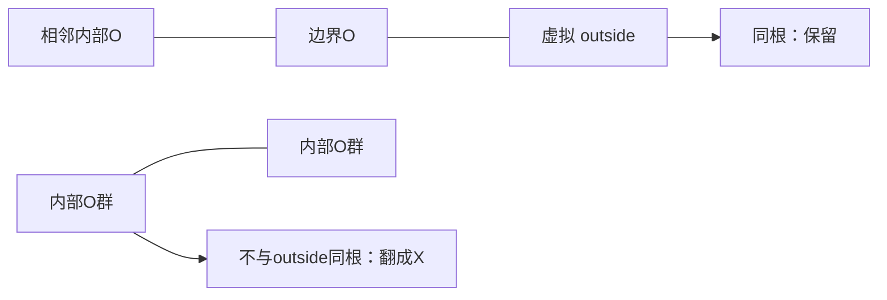

## 并查集：只维护“是否同组”

并查集（Disjoint Set Union，DSU）把元素划分为互不相交的集合，支持 find 查询代表元、union 合并两组。它不保留路径本身，不直接支持删边、拆组，也不能替代最短路。普通 HashMap 能快速按键查找，但如果每个元素记录显式组号，合并可能要改一整组；DSU 用父指针森林延迟这一工作。

初始每个节点指向自己。根满足 `parent[root]==root`；find 沿父链找到根；union 必须合并两个根，而不是随意修改普通节点，否则可能拆散原组。



| 操作 | 集合变化 | find(7) |
|---|---|---|
| 初始 | 每点独立 | 7 |
| union(2,4) | {2,4} | 7 |
| union(5,7) | {5,7} | 5 |
| union(4,7) | {2,4,5,7} | 2（代表元取决于合并策略） |

### 从长链到近似常数时间

未优化实现可能出现 n 长链，find 最坏 O(n)。按大小/秩合并让小树挂到大树上，单独使用可把高度限制到 O(log n)；路径压缩让查询经过的节点更接近根。二者结合，m 次操作的总成本 O((n+m)α(n))，α 是增长极慢的反阿克曼函数，不能把严格复杂度写成无条件 O(1)。

这里使用迭代路径折半：`parent[x]=parent[parent[x]]`，每次把 x 指向祖父。size 只对根有意义，表示集合元素数；它不是树高，也不是深度。union 返回是否真的合并，方便维护分量数、判断冗余边。

```java
class UnionFind {
    private final int[] parent, size;
    public UnionFind(int n) {
        parent = new int[n]; size = new int[n];
        for (int i = 0; i < n; i++) { parent[i] = i; size[i] = 1; }
    }
    public int find(int x) {
        while (x != parent[x]) { parent[x] = parent[parent[x]]; x = parent[x]; }
        return x;
    }
    public boolean union(int a, int b) {
        a = find(a); b = find(b);
        if (a == b) return false;
        if (size[a] < size[b]) { int t = a; a = b; b = t; }
        parent[b] = a; size[a] += size[b];
        return true;
    }
}
```

`private final int[]` 意味着数组字段引用不可重新赋值，数组元素仍可变。每道题下面给出独立完整的 Solution，内部 DSU 使用相同实现，不需要依赖站外代码。

<a id="lc-130"></a>
## LC 130 · 被围绕的区域

**题意。** 网格仅有X/O，把不与边界O连通的O区域改为X。反向思考：先找“不能翻转”的O。增加虚拟 outside 节点，把边界O连接到它，其他四向相邻O合并。最后不与 outside 同根的O就是被包围的区域。



| XXXX / XOOX / XXOX / XOXX | 位置 | 判定 |
|---|---|---|
| (1,1),(1,2),(2,2) | 合并为内部组 | 不连 outside→X |
| (3,1) | 在边界 | 连 outside→保留O |
| X 格 | 不参与 | 保持X |

```java
class Solution {
    public void solve(char[][] board) {
        if (board.length == 0 || board[0].length == 0) return;
        int m = board.length, n = board[0].length, outside = m * n;
        DSU dsu = new DSU(outside + 1);
        for (int r = 0; r < m; r++) for (int c = 0; c < n; c++) {
            if (board[r][c] != 'O') continue;
            int id = r * n + c;
            if (r == 0 || c == 0 || r == m - 1 || c == n - 1) dsu.union(id, outside);
            if (r + 1 < m && board[r + 1][c] == 'O') dsu.union(id, id + n);
            if (c + 1 < n && board[r][c + 1] == 'O') dsu.union(id, id + 1);
        }
        for (int r = 0; r < m; r++) for (int c = 0; c < n; c++) {
            if (board[r][c] == 'O' && dsu.find(r * n + c) != dsu.find(outside)) board[r][c] = 'X';
        }
    }
    private static class DSU {
        int[] p, size;
        DSU(int n) { p = new int[n]; size = new int[n]; for (int i=0;i<n;i++){p[i]=i;size[i]=1;} }
        int find(int x) { while(x!=p[x]){p[x]=p[p[x]];x=p[x];} return x; }
        boolean union(int a,int b){a=find(a);b=find(b);if(a==b)return false;
            if(size[a]<size[b]){int t=a;a=b;b=t;}p[b]=a;size[a]+=size[b];return true;}
    }
}
```

`r*n+c` 把二维格映射到一维，虚拟节点恰为 mn 不冲突；只向下和右合并已覆盖每条无向邻边，无须四方向重复。`static class` 是静态嵌套类，不隐式持有外部 Solution 实例。时间 O(mn α(mn))，空间 O(mn)。测试一行/一列全部保留、全O保留、单独内O翻转。课件用根上的 edge 布尔值也可，但必须合并元数据；成员列表应每次 solve 重置，否则同对象多次调用会出错。本版局部 DSU 避免此问题。

<a id="lc-1970"></a>
## LC 1970 · 仍能穿越的最后一天

**题意。** day0全部是陆地，每天一个格子变水，给出的坐标从1开始。只能在陆地四方向移动，从任意顶行格到任意底行格，求最后可行的天数。

正向加水是删除连接，普通DSU不擅长；倒序从全水开始逐格恢复陆地，变成只增加连接。加 top、bottom 两个虚拟点连接顶行和底行陆地，一旦它们连通就找到答案。

| 2×2，cells=[[1,1],[2,1],[1,2],[2,2]]，倒序 | 恢复陆地 | 对应正向天数 | 是否上下连通 |
|---|---|---:|---|
| i=3 | (2,2) | 3 | 否，仅底部 |
| i=2 | (1,2) | 2 | 是，右列可走 |
| 返回 | — | 2 | 最后一天 |

```java
class Solution {
    public int latestDayToCross(int row, int col, int[][] cells) {
        int total = row * col, top = total, bottom = total + 1;
        DSU dsu = new DSU(total + 2);
        boolean[][] land = new boolean[row][col];
        int[][] directions = {{1,0},{-1,0},{0,1},{0,-1}};
        for (int day = cells.length - 1; day >= 0; day--) {
            int r = cells[day][0] - 1, c = cells[day][1] - 1, id = r * col + c;
            land[r][c] = true;
            if (r == 0) dsu.union(id, top);
            if (r == row - 1) dsu.union(id, bottom);
            for (int[] d : directions) {
                int nr = r + d[0], nc = c + d[1];
                if (nr >= 0 && nr < row && nc >= 0 && nc < col && land[nr][nc]) dsu.union(id, nr * col + nc);
            }
            if (dsu.find(top) == dsu.find(bottom)) return day;
        }
        return 0;
    }
    private static class DSU {
        int[] p, size;
        DSU(int n){p=new int[n];size=new int[n];for(int i=0;i<n;i++){p[i]=i;size[i]=1;}}
        int find(int x){while(x!=p[x]){p[x]=p[p[x]];x=p[x];}return x;}
        void union(int a,int b){a=find(a);b=find(b);if(a==b)return;
            if(size[a]<size[b]){int t=a;a=b;b=t;}p[b]=a;size[a]+=size[b];}
    }
}
```

恢复 `cells[day]` 后，只有下标0到day-1的格子仍是水，正好是正向第 day 天，因此返回 day 而非 day+1。坐标减1仅在局部进行，避免课件直接修改 cells 产生副作用。boolean[][] 记录激活状态，因为DSU节点存在并不等于陆地已恢复。时间 O(RC α(RC))，空间 O(RC)。测试竖直通道被最后封住、不同位置恢复但尚不连接、2×2样例→2。可行性随天数单调，也能二分日期+BFS，O(RC log(RC))。

<a id="lc-547"></a>
## LC 547 · 省份数量（旧名 Friend Circles）

**题意。** 邻接矩阵给城市之间直接相连关系，间接相连也属于同省，求连通分量数。初始n个省，每次 union 真正连接两个不同组时减1；组内冗余连接不减。

| [[1,1,0],[1,1,0],[0,0,1]] | 合并 | 分量数 |
|---|---|---:|
| 初始化 | {0},{1},{2} | 3 |
| (0,1)=1 | {0,1},{2} | 2 |
| 其余非对角无边 | 不变 | 2 |

```java
class Solution {
    public int findCircleNum(int[][] isConnected) {
        int n = isConnected.length, count = n;
        DSU dsu = new DSU(n);
        for (int i = 0; i < n; i++) for (int j = i + 1; j < n; j++) {
            if (isConnected[i][j] == 1 && dsu.union(i, j)) count--;
        }
        return count;
    }
    private static class DSU {
        int[] p, size;
        DSU(int n){p=new int[n];size=new int[n];for(int i=0;i<n;i++){p[i]=i;size[i]=1;}}
        int find(int x){while(x!=p[x]){p[x]=p[p[x]];x=p[x];}return x;}
        boolean union(int a,int b){a=find(a);b=find(b);if(a==b)return false;
            if(size[a]<size[b]){int t=a;a=b;b=t;}p[b]=a;size[a]+=size[b];return true;}
    }
}
```

矩阵对称，只读上三角可避免重复边；对角线不改变连通分量。`&&` 保证只有值为1才执行 union。最坏 O(n²α(n))，存储 O(n)，输入矩阵本身 O(n²)。测试全对角→n，全1→1，单城市→1。不要把“直接朋友数”当作省份数。

<a id="lc-959"></a>
## 作业 · LC 959 由斜杠划分区域

**题意。** n×n网格每格是 `/`、反斜杠或空格，求被线段分出的连通区域数。每格分成上、右、下、左四个三角形。空格把四块连通；`/` 连上-左、右-下；反斜杠连上-右、下-左。再把相邻格接触的三角形合并。

| 单格 | 内部合并 | 单格区域数 |
|---|---|---:|
| 空格 | 0-1-2-3全部连通 | 1 |
| / | 0-3，1-2 | 2 |
| 反斜杠 | 0-1，2-3 | 2 |
| 两格相邻 | 左格右三角1 与 右格左三角3 | 连接跨格区域 |

```java
class Solution {
    public int regionsBySlashes(String[] grid) {
        int n = grid.length;
        DSU dsu = new DSU(4 * n * n);
        for (int r = 0; r < n; r++) for (int c = 0; c < n; c++) {
            int base = 4 * (r * n + c);
            char x = grid[r].charAt(c);
            if (x != '/') { dsu.union(base, base + 1); dsu.union(base + 2, base + 3); }
            if (x != '\\') { dsu.union(base, base + 3); dsu.union(base + 1, base + 2); }
            if (c + 1 < n) dsu.union(base + 1, base + 4 + 3);
            if (r + 1 < n) dsu.union(base + 2, base + 4 * n);
        }
        return dsu.count;
    }
    private static class DSU {
        int[] p, size; int count;
        DSU(int n){count=n;p=new int[n];size=new int[n];for(int i=0;i<n;i++){p[i]=i;size[i]=1;}}
        int find(int x){while(x!=p[x]){p[x]=p[p[x]];x=p[x];}return x;}
        void union(int a,int b){a=find(a);b=find(b);if(a==b)return;
            if(size[a]<size[b]){int t=a;a=b;b=t;}p[b]=a;size[a]+=size[b];count--;}
    }
}
```

Java 字符字面量 `'\\'` 表示一个反斜杠，因为反斜杠是转义前缀。两个独立 if 让空格同时触发两组合并，最终四块全连通。O(n²α(n²))时间，O(n²)空间。测试 `[" "]→1`、`["/"]→2`、`[" /","/ "]→2`。边界三角形不要全部合并为虚拟外部，因为题目数的是网格内区域。

<a id="lc-684"></a>
## 作业 · LC 684 冗余连接

**题意。** 一棵无向树额外加一条边形成一个环，返回可删除以恢复树的边；有多个候选时取输入最后出现的候选。顺序处理边，当两端已经同组时，这条边闭合环，正是本次唯一多余边。

| [[1,2],[1,3],[2,3]] | 两端是否同组 | 操作 |
|---|---|---|
| 1-2 | 否 | 合并 |
| 1-3 | 否 | 合并 |
| 2-3 | 是 | 返回[2,3] |

```java
class Solution {
    public int[] findRedundantConnection(int[][] edges) {
        DSU dsu = new DSU(edges.length + 1);
        for (int[] edge : edges) if (!dsu.union(edge[0], edge[1])) return edge;
        return new int[0];
    }
    private static class DSU {
        int[] p, size;
        DSU(int n){p=new int[n];size=new int[n];for(int i=0;i<n;i++){p[i]=i;size[i]=1;}}
        int find(int x){while(x!=p[x]){p[x]=p[p[x]];x=p[x];}return x;}
        boolean union(int a,int b){a=find(a);b=find(b);if(a==b)return false;
            if(size[a]<size[b]){int t=a;a=b;b=t;}p[b]=a;size[a]+=size[b];return true;}
    }
}
```

节点标签1到n，所以分配 n+1 并让下标0闲置。为何“第一次失败”满足“环中最后出现”？闭环前的全部边都在森林中，直到该环最后一条被读到才首次失败，且题目只有一个环。时间 O(nα(n))、空间 O(n)。测试环出现在输入前半而后续仍有树枝、长链末尾闭环。此法针对无向图，有向冗余边还需处理入度冲突。
