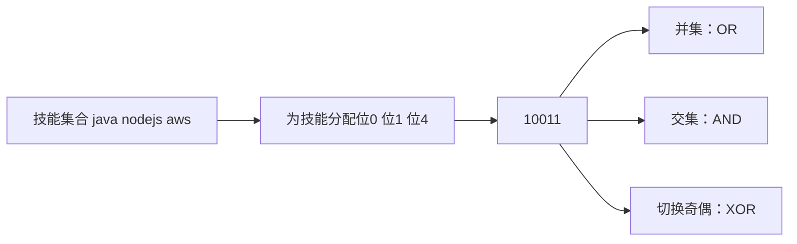
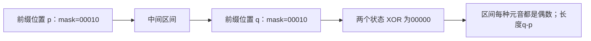

## 位运算：把状态放进二进制

Java `int` 为32位有符号整数，`long` 为64位，`char` 为16位无符号 UTF-16 代码单元。课件把 Boolean/Char 都写成1 byte 不准确：boolean 的取值只有 true/false，语言规范不承诺统一的内存字节数；包装类 Integer/Long 还是对象，不能把其对象占用等同基本类型宽度。[Java 语言规范：基本类型](https://docs.oracle.com/javase/specs/jls/se8/html/jls-4.html)。

补码把负整数编码为按位取反再加1，例如用8位演示：5为00000101，-5为11111011。符号位不是独立附加的“负号”；所有位一起参与固定宽度模运算。`~x=-x-1`，最小整数的相反数在同位宽内不可表示，所以 `-Integer.MIN_VALUE` 溢出回自身。

| 操作 | 逐位规则 | 示例（仅显示4位） |
|---|---|---|
| `~a` | 0变1，1变0 | ~0111→1000 |
| `a & b` | 两位都是1才1 | 0101 & 1100→0100 |
| `a \| b` | 至少一位1就1 | 0101 \| 1010→1111 |
| `a ^ b` | 不同才1 | 0101 ^ 0011→0110 |
| `a << k` | 左移，低位补0，高位丢弃 | 0001<<3→1000 |
| `a >> k` | 算术右移，高位补符号位 | 负的1100>>1→1110 |
| `a >>> k` | 逻辑右移，高位补0 | 1100>>>1→0110 |

Java 没有4位 int，上表是位模式示意。对正整数右移一位等于除2；对负奇数不同：`-3>>1=-2`，但 `-3/2=-1`，因为除法向零截断而算术右移相当于向负无穷取整。左移相当于乘2的幂仅在无溢出时能按普通整数解释；代码里的 `^` 是异或，不是幂。int 移位距离只使用低5位，所以 `1<<32` 实际等于1；long 用低6位，构造宽掩码要写 `1L<<k`。[Java 表达式与移位规则](https://docs.oracle.com/javase/specs/jls/se8/html/jls-15.html)。

### 掩码操作与常用恒等式

第 k 位从0开始。取位 `(a >>> k)&1`；置1 `a | (1<<k)`；清0 `a & ~(1<<k)`；翻转 `a ^ (1<<k)`。奇偶判断写 `(n&1)==1`，必须加括号避免优先级误读。`a^a=0`、`a^0=a`，异或满足交换律与结合律。`a&(a-1)` 清掉最低的一个1；`a&-a` 保留最低的一个1。



<a id="lc-136"></a>
## LC 136 · 只出现一次的数字

**题意。** 每个数字都恰好出现两次，只有一个出现一次，找它。异或的交换结合律允许把相等数配对消除，剩下唯一数。这个方法依赖出现次数；若其他数出现三次，不能直接套用。

| [4,1,2,1,2] | 累计异或（十进制） | 说明 |
|---|---:|---|
| 4 | 4 | 0^4 |
| 1 | 5 | 4^1 |
| 2 | 7 | 5^2 |
| 1 | 6 | 成对的1最终抵消 |
| 2 | 4 | 成对的2最终抵消 |

```java
class Solution {
    public int singleNumber(int[] nums) {
        int answer = 0;
        for (int x : nums) answer ^= x;
        return answer;
    }
}
```

`^=` 是异或后赋回左变量，不是乘方或逻辑“或者”。本实现不修改输入，课件前缀异或写回原数组会产生副作用。时间 O(n)、空间 O(1)，负数的补码也遵循同样恒等式。测试 `[2,2,1]→1`、`[-1,2,2]→-1`、单个0→0。

<a id="lc-191"></a>
## LC 191 · 位1的个数

**题意。** 返回32位模式中1的数量。课件循环32次检查最低位，即使使用 `>>` 补符号位也能在固定32步中数对；若改为 `while(n!=0)` 配合 `>>`，负数会永远变不成0。下面使用清除最低1的方法，每轮少一个1。

| n=13（二进制1101） | n-1 | n&(n-1) | 计数 |
|---|---|---|---:|
| 1101 | 1100 | 1100 | 1 |
| 1100 | 1011 | 1000 | 2 |
| 1000 | 0111 | 0000 | 3 |

```java
class Solution {
    public int hammingWeight(int n) {
        int count = 0;
        while (n != 0) {
            n &= n - 1;
            count++;
        }
        return count;
    }
}
```

为什么可清位：减1会把最低1变0，并把它右侧所有0变1；与原值 AND 后，右侧仍0，最低1被消去，高位保留。O(popcount(n))时间，32位域最多32次；O(1)空间。测试0→0、`Integer.MIN_VALUE→1`、-1的32位模式→32。现代题目可能限制正数，但本实现也处理全部32位模式。

<a id="lc-190"></a>
## 课件提及练习 · LC 190 颠倒二进制位

**题意。** 将一个32位整数的位次序反转，必须包含前导0，不能只处理到最高1。每次从输入最低位取一位，追加到答案的右侧：答案先左移腾位置，再 OR 当前位。

| 以8位00001101演示，实际代码固定32位 | 取出的位 | 答案逐步变化 |
|---|---:|---|
| 第1轮 | 1 | 00000001 |
| 第2轮 | 0 | 00000010 |
| 第3轮 | 1 | 00000101 |
| 第4轮 | 1 | 00001011 |
| 再处理4个0 | 0,0,0,0 | 10110000 |

```java
class Solution {
    public int reverseBits(int n) {
        int answer = 0;
        for (int i = 0; i < 32; i++) {
            answer = (answer << 1) | (n & 1);
            n >>>= 1;
        }
        return answer;
    }
}
```

`>>>=` 无符号右移后赋值，确保新高位为0。返回类型仍为 int，若答案最高位是1，Java十进制显示为负数，但32位模式正确。固定 O(32) 时间、O(1)空间。测试0→0、1→最高位1、重复反转两次回到原模式；不能用十进制字符串反转代替位反转。

<a id="lc-1371"></a>
## LC 1371 · 每个元音出现偶数次的最长子串

**题意。** a/e/i/o/u 每一种在子串中都要出现偶数次，0也算偶数，求最长连续子串长度。只关心奇偶，不需要精确次数，用5位状态保存五种元音的奇偶。读到某元音就 XOR 翻转对应位。

两个前缀状态相同，区间内每个元音都被翻转偶数次，因此该区间合法。为了最长，记每个状态最早出现的位置，而不是最近位置；初始全偶状态0在下标-1出现。



| s=eleet | 字符 | mask（u o i e a） | 最早该状态位置 | 最长 |
|---|---|---|---:|---:|
| 初始 | — | 00000 | -1 | 0 |
| i=0 | e | 00010 | 0 | 0 |
| i=1 | l | 00010 | 0 | 1 |
| i=2 | e | 00000 | -1 | 3 |
| i=3 | e | 00010 | 0 | 3 |
| i=4 | t | 00010 | 0 | 4（leet） |

```java
import java.util.*;
class Solution {
    public int findTheLongestSubstring(String s) {
        int[] first = new int[32];
        Arrays.fill(first, -2);
        first[0] = -1;
        int mask = 0, best = 0;
        for (int i = 0; i < s.length(); i++) {
            int bit = "aeiou".indexOf(s.charAt(i));
            if (bit >= 0) mask ^= 1 << bit;
            if (first[mask] == -2) first[mask] = i;
            else best = Math.max(best, i - first[mask]);
        }
        return best;
    }
}
```

`Arrays.fill` 统一设置哨兵-2，因为-1已用于真实的空前缀位置。`String.indexOf(char)` 找到返回位置，没找到返回-1；不能对-1做位移，Java会掩码移位距离，得到无关高位。状态最多32种，O(n)时间、O(1)空间。测试纯辅音→全长、单a→0、`eleetminicoworoep→13`、`aeiouaeiou→10`。课件 Python保存一串二进制字符和多个位置可工作但多余，整数掩码+最早位置已充分。

<a id="lc-1125"></a>
## LC 1125 · 最小的必要团队

**题意。** req_skills 给出必需技能，people[i] 为第i个人的技能，选人数最少的一组覆盖全部技能，返回成员下标。答案保证存在。只选当前覆盖最多新技能的人是贪心，并不保证最优；技能数较小才能用2^m种覆盖状态做动态规划。

`dp[mask]` 表示用已经考虑的人，达到 mask 所需的最小成员列表。考虑新成员i，有两种选择：不选（保留原状态），选（新状态 `mask|personMask`，人数+1）。每轮从旧表读、写新表，保证每个人最多使用一次。相同技能集合只保留最短队伍，因为未来新增人的效果只取决于已覆盖技能。

| 必需[java,nodejs,reactjs]，位0,1,2 | 个人mask | 新的关键状态 |
|---|---|---|
| 初始 | — | 000→[] |
| 人0：[java] | 001 | 001→[0] |
| 人1：[nodejs] | 010 | 010→[1]，011→[0,1] |
| 人2：[nodejs,reactjs] | 110 | 110→[2]，111→[0,2] |
| 目标111 | — | [0,2]两人最优 |

```java
import java.util.*;
class Solution {
    public int[] smallestSufficientTeam(String[] req_skills, List<List<String>> people) {
        Map<String, Integer> index = new HashMap<>();
        for (int i = 0; i < req_skills.length; i++) index.put(req_skills[i], i);
        Map<Integer, List<Integer>> dp = new HashMap<>();
        dp.put(0, new ArrayList<Integer>());
        for (int person = 0; person < people.size(); person++) {
            int skills = 0;
            for (String skill : people.get(person)) {
                Integer bit = index.get(skill);
                if (bit != null) skills |= 1 << bit;
            }
            if (skills == 0) continue;
            Map<Integer, List<Integer>> next = new HashMap<>(dp);
            for (Map.Entry<Integer, List<Integer>> entry : dp.entrySet()) {
                int combined = entry.getKey() | skills;
                List<Integer> team = entry.getValue();
                if (!next.containsKey(combined) || team.size() + 1 < next.get(combined).size()) {
                    List<Integer> candidate = new ArrayList<>(team);
                    candidate.add(person);
                    next.put(combined, candidate);
                }
            }
            dp = next;
        }
        List<Integer> best = dp.get((1 << req_skills.length) - 1);
        int[] answer = new int[best.size()];
        for (int i = 0; i < answer.length; i++) answer[i] = best.get(i);
        return answer;
    }
}
```

`new HashMap<>(dp)` 只浅复制键值关联；因为从不原地修改旧的 team，这样安全。新候选必须 `new ArrayList<>(team)` 后再 add，否则不同状态会意外共享并改变成员列表。`(1<<m)-1` 生成低m位全1，依赖m足够小；[官方约束](https://leetcode.com/problems/smallest-sufficient-team/)限定技能数m≤16、人数p≤60，技能状态最多65536，支持int掩码。最优队伍可选至多m人，故复制列表版本时间 O(p·m·2^m+技能输入长度)、空间 O(m·2^m)，p为人数；只记人数与前驱可进一步省复制成本。测试一个人全会、人人只有一技、有重复技能、无相关技能的人、存在多个同样最优队伍。

课件19页的五技能例子：java/nodejs/scala/csharp/aws 对应位0到4，A={java,nodejs}=00011，B={nodejs,aws}=10010，A∪B=10011，仍缺 scala/csharp，因此“选两个人”不自动等于足够团队。课件20–21页代码被页面裁断，上面补齐了保留旧状态、复制队伍、转数组和最终返回。

<a id="bit-subsets"></a>
## 课件提及练习 · 用位掩码枚举子集与固定大小组合

课件仅写 Combination，未给定题号或完整题干。这里明确两个练习版本：给不同元素数组返回全部子集；给 n、k 返回1到n中所有大小为k的组合。每个元素有选/不选两态，n个元素的选择恰好对应0到2^n-1的掩码；第i位为1表示选第i个元素。

| nums=[a,b,c] | 二进制 | 子集 | 是否大小2 |
|---|---|---|---|
| mask=0 | 000 | [] | 否 |
| mask=3 | 011 | [a,b] | 是 |
| mask=5 | 101 | [a,c] | 是 |
| mask=6 | 110 | [b,c] | 是 |
| mask=7 | 111 | [a,b,c] | 否 |

```java
import java.util.*;
class Solution {
    public List<List<Integer>> subsets(int[] nums) {
        List<List<Integer>> answer = new ArrayList<>();
        int limit = 1 << nums.length;
        for (int mask = 0; mask < limit; mask++) {
            List<Integer> subset = new ArrayList<>();
            for (int i = 0; i < nums.length; i++) if ((mask & (1 << i)) != 0) subset.add(nums[i]);
            answer.add(subset);
        }
        return answer;
    }
    public List<List<Integer>> combine(int n, int k) {
        List<List<Integer>> answer = new ArrayList<>();
        for (int mask = 0; mask < (1 << n); mask++) {
            if (Integer.bitCount(mask) != k) continue;
            List<Integer> combination = new ArrayList<>();
            for (int i = 0; i < n; i++) if ((mask & (1 << i)) != 0) combination.add(i + 1);
            answer.add(combination);
        }
        return answer;
    }
}
```

`Integer.bitCount(mask)` 返回1的数量；测试 `(mask&(1<<i))!=0`，不能一律等于1，因为高位掩码结果可能是2、4、8。每次创建新List，不能复用同一对象存入所有答案。这里限定 n≤20 等可枚举规模，并且必须 n<31 才能安全用正 int 上界；n增加会指数爆炸，不是换long即可解决。全部子集时间/输出空间 O(n2^n)，固定k版仍扫描2^n状态，回溯仅生成 C(n,k) 个组合通常更合适。测试空数组产生一个空集、k=0产生一个空组合、k=n仅一个全集。
