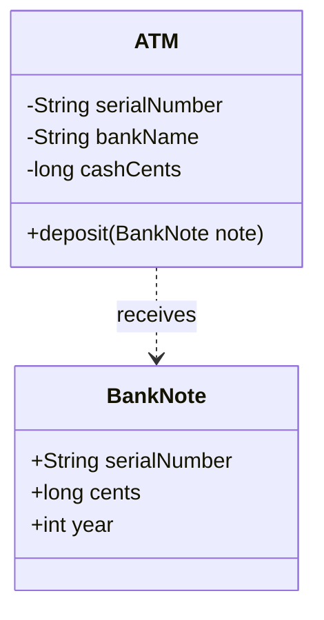
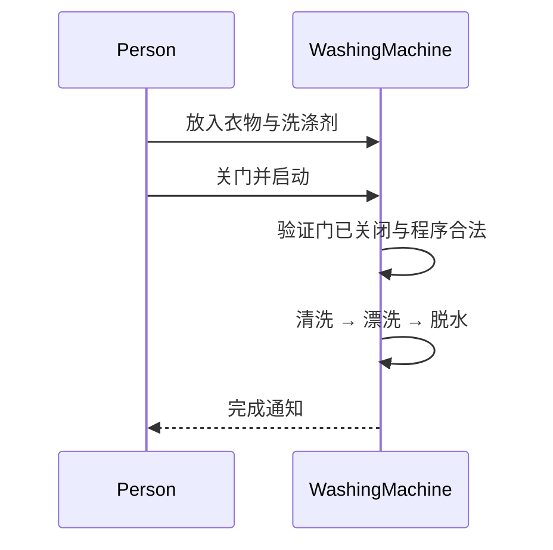
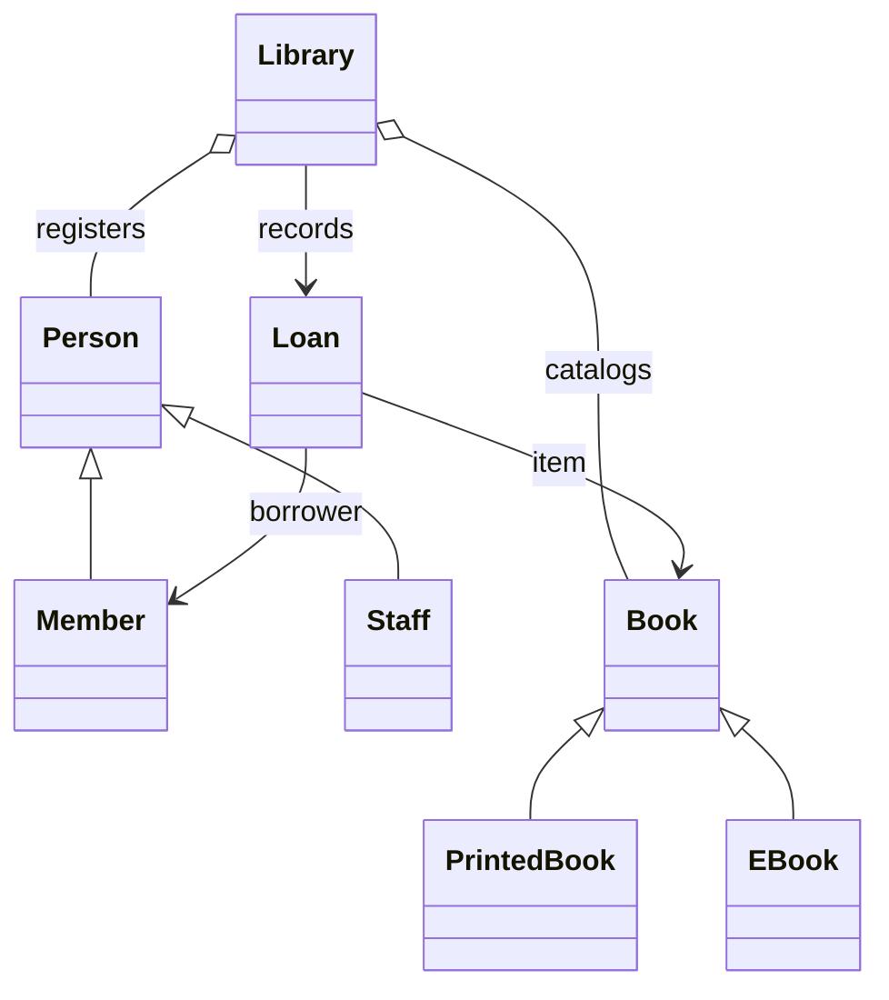
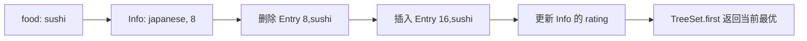

## 从数据与行为开始理解对象

课件用 ATM、洗衣机、游戏角色和图书馆说明面向对象，再把对象设计落实到三道 LeetCode 题。核心问题是：**哪些数据应该放在一起，谁负责维护这些数据始终合法，调用者应该知道多少实现细节？**

类（class）描述一类对象的状态与行为；对象（instance）是在运行时创建的具体实例。`ATM a` 是引用变量，`new ATM(...)` 才创建实例。抽象是选出当前问题需要的特征，例如存取款只关心钞票面额，不一定关心纸张纤维。抽象不要求必须使用 `abstract` 关键字。

课件把 Java 称为“完全的面向对象语言”。更准确地说，Java 以类和对象为主要组织方式，同时有 `int` 等基本类型和静态方法；Python 同时支持过程式与对象式。两种方式可以协作：对象负责边界与状态，方法内部仍然按步骤执行。

### ATM：让参数有归属

`deposit(value, serialNumber, atmNumber, bankName, branchName, year)` 把不同实体属性混在同一参数列表。serialNumber 究竟是谁的编号也不明确。把 ATM 的编号、银行、网点放进 ATM，把面额、发行年份、钞票编号放进 BankNote，调用可以写为 `atm.deposit(note)`。减少参数的目的，是让不变量有明确维护者。



金额用整数分或 BigDecimal，不能假设二进制 double 可以精确表示所有十进制金额。ATM 的现金库存和银行账户余额是两个状态：塞入钞票不能凭空决定记入谁的账户。生产系统还需身份验证、事务与审计，这个小模型只解释属性归属。

下面完整示例保存为 `AtmDemo.java`，执行 `javac AtmDemo.java && java AtmDemo`：

```java
import java.util.Objects;

public class AtmDemo {
    record BankNote(String serialNumber, long cents, int year) {
        BankNote {
            Objects.requireNonNull(serialNumber);
            if (cents <= 0) throw new IllegalArgumentException("面额必须为正");
        }
    }
    static final class ATM {
        private final String serialNumber;
        private final String bankName;
        private long cashCents;
        ATM(String serialNumber, String bankName) {
            this.serialNumber = Objects.requireNonNull(serialNumber);
            this.bankName = Objects.requireNonNull(bankName);
        }
        void deposit(BankNote note) {
            cashCents = Math.addExact(cashCents, note.cents());
        }
        long cashCents() { return cashCents; }
    }
    public static void main(String[] args) {
        ATM atm = new ATM("ATM-001", "Demo Bank");
        atm.deposit(new BankNote("NOTE-001", 10000, 2020));
        System.out.println(atm.cashCents()); // 10000
    }
}
```

`record` 是数据载体语法：编译器生成字段、构造器、`cents()` 等访问器、按字段值比较的 equals/hashCode 与 toString。紧凑构造器 `BankNote { ... }` 在自动赋值之前校验参数。record 的字段是 final，但如果字段引用可变列表，列表内容仍能改变。`Objects.requireNonNull` 遇到 null 立即抛异常。`Math.addExact` 在整数溢出时抛异常，普通加法则会回绕。嵌套类上的 static 表示不需要外层实例；final class 禁止继承。

### 洗衣机：给行为找负责人

过程式版本是放衣服、放洗衣粉、开机、清洗、烘干。对象版本保留物理顺序，明确动作属于谁：`Person.put(...)`、`Person.turnOn(machine)`，`WashingMachine.clean()`、`WashingMachine.dry()`。机器应该检查自己的状态，例如未关门不可开始洗涤，避免每个调用者都重复维护规则。



对象设计不是把每个名词都建成类。一个无状态 CSV 转换任务可能用纯函数更清楚；当状态、约束、独立变化的规则增加时，对象边界才更有价值。

## 封装、继承、多态与 Java 语义

### 封装：保护不变量

游戏角色的生命值不能小于 0，也不能超过上限。公开 health 允许任意赋值；private health 配合 takeDamage 和 heal 可以集中检查。无条件的 setHealth 只是换了入口，没有保护状态。

Python 的 `_value` 是内部使用约定，`__value` 会发生名称改写（name mangling），并非完全不能从外部访问。Java 的 private、包可见、protected、public 则是访问控制。Java protected 跨包访问还受接收者类型限制，不能简单理解成子类可随意访问所有父类实例。

### 继承与重写

`Dog extends Animal` 表达 Dog 能满足 Animal 的契约。子类继承可访问行为，并可用相同签名重写实例方法。构造器不被继承；`super(...)` 调用父类构造器，本章采用 Java 21 语法时须位于构造器首个显式构造器调用位置。`super.speak()` 可复用父类实现。

课件 Champion 保存生命、法力、攻击力、法术强度；Ahri、Fizz 等角色对技能有不同实现。但装备、移动方式和攻击策略常适合组合，否则不同能力的组合会产生大量子类。

### 多态：声明类型与运行时类型分工

`Bird bird = new Parrot();` 中编译器只允许使用 Bird 暴露的方法，调用重写的实例方法 `bird.sound()` 时实际执行 Parrot 版本。因此 `listen(Bird bird)` 能接受鹦鹉、猫头鹰、蜂鸟，新增鸟类无需给监听者再加分支。

重载（overload）是同名但参数列表不同，主要在编译期按声明类型决定签名；重写（override）是子类型实现相同签名的实例方法，运行时接收者决定实现。静态方法属于类，不能用实例方法的动态派发理解；字段也不会像方法那样多态。

### 抽象类、接口、final、static

| 工具 | 表达的约束 | 常见误解 |
|---|---|---|
| 抽象类 | 不能直接实例化，可持有实例状态、构造器及具体/抽象方法 | 并非只能包含抽象方法 |
| 接口 | 客户端所需能力，可由多个类实现 | 现代 Java 接口可有 default、static、private 方法 |
| final 变量 | 赋值后引用或值不能再改 | final List 的内容仍可修改 |
| final 方法/类 | 禁止重写/继承 | 不自动带来线程安全 |
| static 字段/方法 | 归属于类而非每个实例 | 静态共享状态仍会产生竞态 |

类只能直接继承一个类，但能实现多个接口。接口字段隐含 public static final。`@Override` 让编译器检查是否真的在重写，可发现拼错方法名、写错参数。

## 图书馆：从类图到一致的借还流程

课件包含 Person、Member/Reader、Staff/Librarian、Book、PrintedBook、EBook、Library，完成添加图书、注册用户、按 ID 查找、借书、还书和显示信息。Person→Member/Staff 和 Book→PrintedBook/EBook 是继承；Library 管理这些对象是关联，不应写成 Library extends Book。



课件分别维护 book.is_issued 和 member.borrowed_books，改一处而遗漏另一处会产生矛盾。这里用 loans 作为借阅事实的唯一来源，再从它生成展示数据。一本 Book 表示一个可借副本；同名多副本、电子书多许可属于需要扩展的需求。

```java
import java.util.LinkedHashMap;
import java.util.Map;
import java.util.Objects;
import java.util.stream.Collectors;

public class LibraryDemo {
    abstract static class Person {
        final String id;
        final String name;
        Person(String id, String name) {
            this.id = Objects.requireNonNull(id);
            this.name = Objects.requireNonNull(name);
        }
        abstract String info();
    }
    static final class Member extends Person {
        Member(String id, String name) { super(id, name); }
        @Override String info() { return "Member: " + name + " (" + id + ")"; }
    }
    static final class Staff extends Person {
        final String position;
        Staff(String id, String name, String position) {
            super(id, name); this.position = position;
        }
        @Override String info() { return "Staff: " + name + " / " + position; }
    }
    abstract static class Book {
        final String id;
        final String title;
        final String author;
        Book(String id, String title, String author) {
            this.id = id; this.title = title; this.author = author;
        }
        String info() { return "[" + id + "] " + title + " by " + author; }
    }
    static final class PrintedBook extends Book {
        final String shelf;
        PrintedBook(String id, String title, String author, String shelf) {
            super(id, title, author); this.shelf = shelf;
        }
        @Override String info() { return super.info() + " / Shelf " + shelf; }
    }
    static final class EBook extends Book {
        final String url;
        EBook(String id, String title, String author, String url) {
            super(id, title, author); this.url = url;
        }
        @Override String info() { return super.info() + " / Download " + url; }
    }
    record Loan(String bookId, String memberId) {}
    static final class Library {
        private final Map<String, Book> books = new LinkedHashMap<>();
        private final Map<String, Person> people = new LinkedHashMap<>();
        private final Map<String, Loan> loans = new LinkedHashMap<>();
        void addBook(Book book) {
            if (books.putIfAbsent(book.id, book) != null)
                throw new IllegalArgumentException("重复图书 ID");
        }
        void register(Person person) {
            if (people.putIfAbsent(person.id, person) != null)
                throw new IllegalArgumentException("重复用户 ID");
        }
        Book findBook(String id) { return books.get(id); }
        Person findPerson(String id) { return people.get(id); }
        void borrow(String bookId, String memberId) {
            if (!books.containsKey(bookId)) throw new IllegalArgumentException("图书不存在");
            if (!(people.get(memberId) instanceof Member))
                throw new IllegalArgumentException("仅注册读者可以借书");
            if (loans.putIfAbsent(bookId, new Loan(bookId, memberId)) != null)
                throw new IllegalStateException("已被借走");
        }
        void giveBack(String bookId, String memberId) {
            Loan loan = loans.get(bookId);
            if (loan == null || !loan.memberId().equals(memberId))
                throw new IllegalStateException("不是此人的借阅记录");
            loans.remove(bookId);
        }
        String borrowedTitles(String memberId) {
            return loans.values().stream()
                .filter(loan -> loan.memberId().equals(memberId))
                .map(loan -> books.get(loan.bookId()).title)
                .collect(Collectors.joining(", "));
        }
        void printAll() {
            books.values().forEach(book -> System.out.println(book.info()));
            people.values().forEach(person -> System.out.println(person.info()));
        }
    }
    public static void main(String[] args) {
        Library lib = new Library();
        lib.addBook(new PrintedBook("b1", "Algorithms", "Ada", "A-01"));
        lib.addBook(new EBook("b2", "Networks", "Lin", "https://example.org/book"));
        lib.register(new Member("m1", "Alice"));
        lib.register(new Staff("s1", "Bob", "Librarian"));
        lib.borrow("b1", "m1");
        System.out.println(lib.borrowedTitles("m1")); // Algorithms
        lib.giveBack("b1", "m1");
        lib.printAll();
    }
}
```

语法与 API 拆解：

- `Map<String, Book>` 是泛型，编译器约束键和值的类型；菱形语法 `<>` 从左侧推断类型。LinkedHashMap 保留插入顺序，让展示稳定，平均查找仍为 O(1)。
- `putIfAbsent` 在键没有映射到非 null 值时加入，返回旧值。本模型禁止存 null，因此返回非 null 表示冲突。普通 Map 不让整个 Library 自动线程安全；并发借还需要同一把锁或数据库事务。
- `instanceof Member` 检查运行时类型，null 的检查结果为 false。
- `stream()` 创建流水线；filter 保留满足条件的 Loan；map 转为书名；`collect(joining(", "))` 连接结果。`loan -> ...` 是 Lambda，实现上下文需要的函数式接口。终结操作 collect 才触发遍历。
- 字符串内容用 equals，不能用 `==`。`super.info()` 先复用 Book 的文字再追加子类信息。
- 查找从课件线性扫描 O(n) 改为哈希查找，实体关系相同。借阅清单仍需扫描 L 条记录，时间 O(L)。

原课件Python图书馆代码还有几处非基础写法：`super().__init__(...)`复用父类初始化，`super().display_info()`复用父类展示；`f"{self.name} (ID: {self.id})"`是f-string，在花括号内求表达式值；`", ".join(book.title for book in self.borrowed_books)`中的`for`是生成器表达式，逐个产生书名而不是先显式建列表，join要求各元素都是字符串。`isinstance(member, Member)`包含子类实例；`if book and member`使用短路与真假值，不只是检验变量名字存在。列表的append在尾部加入，`book in borrowed_books`按相等关系查找，remove移除第一个相等项；这些成员查询/移除通常O(n)。课件类型标注`id: int`、`-> None`、`List[str]`表达参数/返回/容器元素类型，供工具检查，本身不强制运行时输入满足类型。

<a id="lc-1396"></a>

## LeetCode 1396：地铁平均行程时间

[官方题目：Design Underground System](https://leetcode.com/problems/design-underground-system/)。对象支持进站、出站、查询某方向线路的历史平均时间；进站未出站的人不能加入统计，A→B 与 B→A 独立，操作保证合法。

### 第一步：区分未完成状态与历史统计

直接保存所有历史，每次查询遍历，Q 次操作最坏接近 O(Q²)。平均值只需要总时长与次数，所以可以保存充分统计量，舍弃每条历史。

建两张表：`active[id]=(startStation,startTime)`，`history[(start,end)]=(totalTime,count)`。前者解释“此人从哪来”，后者解释“有向线路已完成多少旅行”。路线用二元值对象作键，避免直接拼接时 ab+c 与 a+bc 碰撞。

### 第二步：逐事件更新

| 调用 | active 相关记录 | A→B 的 (总时长,次数) | 解释 |
|---|---|---|---|
| checkIn(7,A,3) | 7→(A,3) | 无 | 尚未完成 |
| checkIn(8,A,5) | 7→(A,3),8→(A,5) | 无 | 多人同时在站内 |
| checkOut(7,B,13) | 8→(A,5) | (10,1) | 出站减进站，删除活动记录 |
| checkOut(8,B,17) | 空 | (22,2) | 第二次耗时12 |
| getAverageTime(A,B) | 空 | (22,2) | 返回11.0 |

正确性不变量：active 恰好保存未完成旅客；每次出站恰好向正确方向累加一次时间和次数。因此累计值等于所有已完成行程之和，除以次数即定义中的均值。

### 第三步：完整 Java 实现

保存为 `UndergroundSystem.java` 可直接运行，也可提交到题目。记录类型要求 Java 16+，本网站统一用 Java 21 检查。

```java
import java.util.HashMap;
import java.util.Map;

class UndergroundSystem {
    private record CheckIn(String station, int time) {}
    private record Route(String start, String end) {}
    private static final class Stats {
        long total;
        long count;
    }
    private final Map<Integer, CheckIn> active = new HashMap<>();
    private final Map<Route, Stats> history = new HashMap<>();
    public void checkIn(int id, String stationName, int t) {
        active.put(id, new CheckIn(stationName, t));
    }
    public void checkOut(int id, String stationName, int t) {
        CheckIn start = active.remove(id);
        Route route = new Route(start.station(), stationName);
        Stats stats = history.computeIfAbsent(route, key -> new Stats());
        stats.total += (long) t - start.time();
        stats.count++;
    }
    public double getAverageTime(String startStation, String endStation) {
        Stats stats = history.get(new Route(startStation, endStation));
        return (double) stats.total / stats.count;
    }
    public static void main(String[] args) {
        UndergroundSystem u = new UndergroundSystem();
        u.checkIn(7, "A", 3);
        u.checkIn(8, "A", 5);
        u.checkOut(7, "B", 13);
        u.checkOut(8, "B", 17);
        System.out.println(u.getAverageTime("A", "B")); // 11.0
    }
}
```

`Map<Integer,...>` 不能用 int 作泛型参数；自动装箱将 int 转为 Integer。remove 一边删键一边返回原值，使历史乘客不占 active 空间。computeIfAbsent 不存在才执行 Lambda 创建 Stats；存在则返回旧对象。修改 stats 字段就是修改 map 中的同一实例，无需再次 put。

`(long) t` 在减法之前提升类型；total 使用 long 防止多次累加溢出。`(double)` 在除法前转换，避免整数除法截断。Route 的 record 生成按两个字段比较的 equals/hashCode，因此新建的同值路线能查到旧统计。

设活动乘客 A、出现过的有向路线 R，空间 O(A+R)。站名长度有界时每个操作平均 O(1)；一般长度 L 还要计入字符串哈希与比较。生产环境应处理重复进站、无进站出站、非法时间；题目保证下无需额外分支。

课件 Python 的 `defaultdict(lambda: [0,0])` 为每个新键创建独立列表；pop 对应删除并取值；`start_station,start_time=...` 是解包；二元 tuple 可作字典键。Python `/` 返回浮点值，Java 整数 `/` 会截断。

<a id="lc-1845"></a>

## LeetCode 1845：每次预订最小空座位

[官方题目：Seat Reservation Manager](https://leetcode.com/problems/seat-reservation-manager/)。座位 1 到 n，reserve 取最小空号，unreserve 释放当前已占用的座位。题目保证 reserve 时有空座且不会重复释放空座。

### 第一步：为什么用最小堆

布尔数组能记空闲，但每次扫描最坏 O(n)。本题反复问动态集合的最小值，最小堆正适合。堆只保证根最小，不需要所有元素完全有序。

初始空座 `{1,2,3,4,5}`，两次 reserve 返回1、2，unreserve(1) 后下一次返回1。集合表示成员，不代表底层堆数组已经排序。

```java
import java.util.PriorityQueue;

class SeatManager {
    private final PriorityQueue<Integer> free = new PriorityQueue<>();
    public SeatManager(int n) {
        for (int seat = 1; seat <= n; seat++) free.offer(seat);
    }
    public int reserve() { return free.remove(); }
    public void unreserve(int seatNumber) { free.offer(seatNumber); }
    public static void main(String[] args) {
        SeatManager s = new SeatManager(5);
        System.out.println(s.reserve()); // 1
        System.out.println(s.reserve()); // 2
        s.unreserve(1);
        System.out.println(s.reserve()); // 1
    }
}
```

PriorityQueue 默认按自然顺序形成最小堆。offer 插入并向上调整；无参数 remove 删除堆顶，空堆会抛异常；poll 空时返回 null，拆箱为 int 时可能 NPE。`remove(Object)` 是查找任意元素的另一个重载，通常 O(n)，不能与删除堆顶混淆。

不变量：堆中恰好包含全部空座，每个一次。初始化成立；reserve 删除最小空座；unreserve 只把已占座放回，所以保持不变量。每次操作 O(log n)，空间 O(n)。逐项建堆一般上界 O(n log n)，本段特殊升序插入不持续上浮，实际初始化可线性完成；一般批量 heapify 也能 O(n)。

### 第二步：优化连续的未使用后缀

维护 next=1，表示从未被预订的最小号；堆只放释放回来的旧号，旧号一定小于 next。堆非空便先取旧号，否则返回 next 并自增。初始化 O(1)，若回收堆最大大小 k，操作 O(log k)，空间 O(k)。

```java
import java.util.PriorityQueue;

class CompactSeatManager {
    private final PriorityQueue<Integer> returned = new PriorityQueue<>();
    private int next = 1;
    public CompactSeatManager(int n) { /* 有空座由题目保证 */ }
    public int reserve() { return returned.isEmpty() ? next++ : returned.remove(); }
    public void unreserve(int seatNumber) { returned.offer(seatNumber); }
    public static void main(String[] args) {
        CompactSeatManager s = new CompactSeatManager(3);
        System.out.println(s.reserve()); // 1
        s.unreserve(1);
        System.out.println(s.reserve()); // 1
        System.out.println(s.reserve()); // 2
    }
}
```

后置 next++ 先产生旧值再递增。课件 Python heapq 用普通 list 存储堆，heappop/heappush 负责维持结构；直接删除列表第0项并不能维护堆性质。

<a id="lc-2353"></a>

## LeetCode 2353：动态菜品评分排行

[官方题目：Design a Food Rating System](https://leetcode.com/problems/design-a-food-rating-system/)。每道菜有唯一名字、固定菜系和可变评分。查询返回菜系最高评分的名字，同分时字典序最小。

### 第一步：两个访问方向需要两个索引

改分数从菜名开始，查排行从菜系开始。只有 food→rating 会让最高分查询遍历；只有菜系列表又不好定位旧分数。维护 `foods[food]=(cuisine,rating)` 与 `rankings[cuisine]=有序菜品集合`，每次更新同时维护二者。

最小堆也能懒删除：更新时插新项，查询时去掉过期堆顶。空间却会随更新次数增长。课件采用 SortedList；Java 版采用 TreeSet 明确删除旧项，空间稳定 O(n)。

### 第二步：定义完全排序

先按评分降序，再按名字升序。比较器负数意味着 a 排在 b 前，因此评分用 `Integer.compare(b.rating(),a.rating())`；不要直接用 b.rating-a.rating，在更一般范围会溢出。若只比较评分，TreeSet 会把两道同分菜视为同一元素。



### 第三步：逐操作追踪

日本菜初始 ramen14、miso12、sushi8，首项 ramen。sushi 改16：删(8,sushi)，加(16,sushi)，首项 sushi。ramen 也改16：首项 ramen，因为名字字典序比 sushi 小。不要直接修改树中对象的排序字段：树的位置不会随字段变化自动调整。应使用不可变 Entry 并执行删除/插入。

```java
import java.util.Comparator;
import java.util.HashMap;
import java.util.Map;
import java.util.TreeSet;

class FoodRatings {
    private record Info(String cuisine, int rating) {}
    private record Entry(String name, int rating) {}
    private static final Comparator<Entry> ORDER = (a, b) -> {
        int byRating = Integer.compare(b.rating(), a.rating());
        return byRating != 0 ? byRating : a.name().compareTo(b.name());
    };
    private final Map<String, Info> foods = new HashMap<>();
    private final Map<String, TreeSet<Entry>> rankings = new HashMap<>();
    public FoodRatings(String[] names, String[] cuisines, int[] ratings) {
        for (int i = 0; i < names.length; i++) {
            foods.put(names[i], new Info(cuisines[i], ratings[i]));
            rankings.computeIfAbsent(cuisines[i], key -> new TreeSet<>(ORDER))
                .add(new Entry(names[i], ratings[i]));
        }
    }
    public void changeRating(String food, int newRating) {
        Info old = foods.get(food);
        TreeSet<Entry> set = rankings.get(old.cuisine());
        set.remove(new Entry(food, old.rating()));
        set.add(new Entry(food, newRating));
        foods.put(food, new Info(old.cuisine(), newRating));
    }
    public String highestRated(String cuisine) {
        return rankings.get(cuisine).first().name();
    }
    public static void main(String[] args) {
        FoodRatings f = new FoodRatings(
            new String[]{"ramen", "miso", "sushi"},
            new String[]{"japanese", "japanese", "japanese"},
            new int[]{14, 12, 8});
        System.out.println(f.highestRated("japanese")); // ramen
        f.changeRating("sushi", 16);
        System.out.println(f.highestRated("japanese")); // sushi
        f.changeRating("ramen", 16);
        System.out.println(f.highestRated("japanese")); // ramen
    }
}
```

Comparator 是函数式接口，这个 Lambda 接收两项并返回比较结果；块式 Lambda 需要 return。String.compareTo 按编码单元比较，本题英文字符范围内对应要求的字典序，与长度排序不同。TreeSet 将 ORDER 用于搜索、插入、查重与删除；删除不要求对象引用相同，只要求比较器视其为同一键。

`first()` 取排序首项，TreeSet 不提供 get(0)。Java 实现通常沿最左链查找，按 O(log m) 分析，不无依据声称严格 O(1)。修改执行两次树操作仍 O(log m)，构造 O(n log n)，空间 O(n)，字符串比较还需计入名字长度。

正确性不变量：每道菜在其菜系树中恰好有一条 Entry，评分与 foods 一致。构造建立不变量；更新删除旧项再加入新项并改元数据；查询 first 按排序契约取得正确答案。

课件 Python：zip 并行取三个数组的对应元素，题目保证等长；defaultdict(SortedList) 首次遇菜系时构造独立容器；`(-rating,food)` 利用元组逐项比较，把升序改为评分降序；`[0][1]` 先取首项再取名字。sortedcontainers 是第三方库，Java 版仅使用标准库。

## 把类设计成可维护的状态机

先写操作，再选索引，最后写始终成立的不变量。地铁保存充分统计量，座位维护动态最小值，评分维护两个一致索引，图书馆维护角色与借阅关系。设计是否正确，取决于每个状态转移能否维护约束。

自测：为何 active 应删除出站者？为何评分树不能只比较分数？为何 final List 仍能 add？两个线程同时借同一本书，哪段操作必须原子化？
