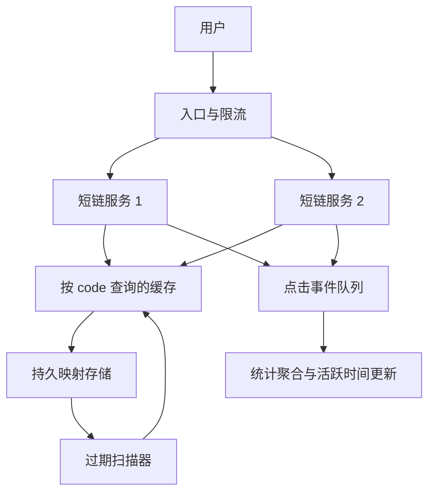
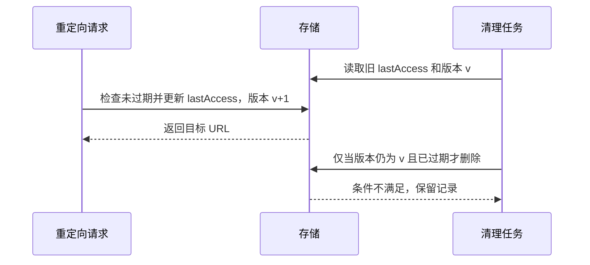

## 短链接：把模糊需求变成接口与约束

这份课件从“输入长 URL，返回短 URL；点击后跳转；连续72小时无人点击则删除”展开，连接编码、数据库、缓存、负载均衡与 HTTP。它是系统设计题，不是单纯把字符串哈希一下。

先固定语义：短码区分不同映射，重定向访问要快；72小时指**自最后一次有效点击起的滑动空闲时间**，而非创建后固定72小时。是否允许自定义短码、是否统计点击、是否同一长 URL 复用同一短码、过期是否可恢复，都影响模型。本章选择允许相同目标创建不同短链，以便不同活动独立统计；到期返回410；短码不重新分配给不同目标，避免旧书签突然跳到陌生页面。

短链常用于节省展示空间、便于口头传播、为一次营销活动记录点击。URL 中的非 ASCII 字符可通过标准编码表达，不能把“长 URL 有无效 ASCII”理解成 HTTP 无法支持国际化内容。现代产品对字符长度的计算规则也不一定等于原始字符串长度。

## 短码从哪里来

### 容量估计

若字符集是0—9和a—z，7位容量为 `36^7 = 78,364,164,096`，约783.6亿。若采用大小写字母加数字的 Base62，7位约3.52万亿。固定长度 L、字符种类 B，容量是 B^L；缩短域名往往比把7位变6位更明显。

UUID 的128位空间便于独立生成，但直接展示比较长。MD5 输出128位，也不短；截断哈希可以变短，但截断后的碰撞概率必须重新计算。哈希的确定性、随机码的随机性、数据库的唯一约束是三件事。

| 生成方法 | 如何产生 | 优点 | 需要处理 |
|---|---|---|---|
| 自增 ID + Base62 | 将唯一整数换进制 | 不发生编码碰撞，短 | 分布式发号、可枚举、泄露大致规模 |
| 随机短码 | 随机选字符 | 节点间独立产生，不连续 | 唯一约束、冲突重试、随机源 |
| 长 URL 哈希截断 | 对目标算摘要取部分 | 相同输入稳定 | 哈希碰撞、租户/过期/活动语义 |
| 预生成池 | 提前生成并验证空闲码 | 在线创建只取一个 | 原子领取、池容量、补充与恢复 |

随机生成 n 个码时，生日碰撞概率近似 `1-exp(-n(n-1)/(2M))`。空间 M 很大，也不能据此认为完全不会撞。正确策略是数据库唯一键插入成功才算分配成功，冲突再生成，而不是先查不存在再写入——两个并发创建可能同时查到不存在。

课件“每次只查表、不生成”的页可理解为预生成码池或查已有映射，但查表本身不会创造唯一性。若采用池，领取必须是原子操作；若采用去重，必须定义相同 URL 的范围，例如同用户同活动复用，而非全站永久共享。

### Base62 换进制的步骤

把非负数除以62，余数是最低位字符，商继续除以62，最后反转。例如用简化 Base36 编码数字1331：1331÷36得到商36余35，即 z；36÷36商1余0；1÷36商0余1，反转得到10z。编码并不加密，知道规则可以解回 ID。

## API 与数据模型

建议创建 `POST /api/links`，请求 JSON 含 url、可选 idleHours；返回201与 code、shortUrl、expiresAt。重定向 `GET /s/{code}`，命中且未过期时返回302与 Location，过期410、未存在404。查询统计可用 `GET /api/links/{code}/stats`，管理接口需要验证所有者。

```http
POST /api/links HTTP/1.1
Content-Type: application/json

{"url":"https://example.org/articles?id=42","idleHours":72}
```

```http
HTTP/1.1 201 Created
Content-Type: application/json

{"code":"a91q0kz","shortUrl":"https://sho.example/s/a91q0kz"}
```

```http
HTTP/1.1 302 Found
Location: https://example.org/articles?id=42
Cache-Control: no-store
```

需要每次点击参与续期和统计时，长期可缓存的301可能让后续访问直接到目标而绕开短链服务。302适合可变映射；307/308对保留原方法有明确语义。这里短链只开放 GET/HEAD，HEAD 是否计作点击要单独定义。[HTTP 重定向语义](https://www.rfc-editor.org/rfc/rfc9110.html#name-redirection-3xx)

数据最少包含 `code`、`target_url`、`created_at`、`last_access_at`、`idle_seconds`、`status`；若需要用户管理再加 owner_id。主查询按 code，因此 code 是主键；清理任务可用 last_access_at/expiry 索引。长 URL 通常不宜直接当主键：长度大，业务去重语义也不总是成立。

```sql
CREATE TABLE short_link (
    code VARCHAR(16) PRIMARY KEY,
    target_url TEXT NOT NULL,
    created_at TIMESTAMP WITH TIME ZONE NOT NULL,
    last_access_at TIMESTAMP WITH TIME ZONE NOT NULL,
    idle_seconds BIGINT NOT NULL CHECK (idle_seconds > 0),
    status VARCHAR(16) NOT NULL
);
CREATE INDEX short_link_idle ON short_link(last_access_at);
```

PRIMARY KEY 同时表达非空与唯一；CHECK 限制参数；时区明确的时间避免不同服务器解释本地时间不一致。数据库索引不等于业务正确性：单独 last_access_at 索引方便按统一超时清理，若每条超时不同，预计算 expires_at 并给它建索引更直接。

## 从单机到高读取量架构



先把代码部署成无状态服务，多个实例经 LB 接请求，映射存储持久化。查询按 code 做键值读取；关系数据库单表主键查找同样能很好完成，不能因为高读 QPS 就断言关系数据库不行。数据量与吞吐足够大时再评估分区、读副本、缓存或分布式键值服务。

课件列出的 MongoDB、CouchDB、Couchbase、Redis 不是可随意互换的黑盒，要比较持久化、复制、一致性、过期精度、运维成本。Redis 可以做缓存，也可按相应可靠性配置做主数据，但缓存淘汰策略绝不能悄悄删除唯一映射。

### SQL + NoSQL 的组合究竟是什么

一种常见组合是关系数据库保存事实，Redis 保存热门查询结果。另一种是通过变更数据捕获（CDC）把数据库提交后的日志转换为查询投影。课件的 Database Listener 可对应这种提交日志监听，不建议在应用里不加补偿地先写 SQL 再写缓存：第二次写失败便造成分歧。

CDC 更新是异步的，缓存/投影可能短暂落后。创建后立即读取要么直接读主库，要么先写入版本化缓存，再保证后到的旧事件不会覆盖新值。消费端应幂等并保存版本；删除也需要传播 tombstone，不能只处理新增。

## 72小时无人访问：最容易被低估的竞争问题

### 逻辑过期与物理删除分开

读取时先检查 `now-lastAccess >= idleTimeout`，达到边界便拒绝并返回410，即使后台还没删行。扫描器负责稍后物理清理，减轻存储压力。数据库 TTL 通常是异步清理，不能把它当成精确到毫秒的访问授权判断。

一条链接创建于周一10点，周三9点访问后新的到期时间为周六9点。若始终按创建时间算 TTL，周四10点就删除，违反“无人访问72小时”的要求。



仅“扫描出候选，再按 code 删除”会误删扫描之后刚被访问的链接。删除必须再次检查更新时间/版本，或使用事务把条件判断与删除放在同一原子动作里。重定向读取与续期也要明确线性化点：若判断时已经过期，本次点击是否允许复活？本章选择不允许。

### 热门链接每次更新时间会不会拖慢读取

如果严格保证任何一次点击都准确续期，那么活跃时间的写入是读取路径的一部分，重定向确认与这次更新需要可靠关联。每秒几万点击的同一短码会产生写热点。

可以按一分钟窗口合并活跃更新，或把点击事件写入持久队列后异步更新。但这会改变过期精度：更新延迟时不得把仍活跃的链接删掉，需要清理宽限期、消费水位或可接受的误差契约。不能在图里加一个队列就宣称兼得严格时效、零写入成本和绝不丢更新。

缓存命中也必须参与活跃时间更新；否则越热门越可能因一直走缓存而被数据库扫描器误判不活跃。分析统计可异步聚合，决定“是否允许访问”的状态要有更严格策略。

## 可运行核心：唯一分配、访问续期、条件过期

下面的 Java 21 程序是内存中的核心模型，不依赖数据库或外部库。使用可注入时间，能在几行测试中验证72小时，而不用真的等待。整个服务用 synchronized 串行化状态操作，易于证明竞争安全；大规模实现应改为数据库条件写或分片锁。

```java
import java.net.URI;
import java.security.SecureRandom;
import java.time.Duration;
import java.util.HashMap;
import java.util.HashSet;
import java.util.Set;
import java.util.Iterator;
import java.util.Map;
import java.util.concurrent.atomic.AtomicLong;
import java.util.function.LongSupplier;

public class ShortLinkDemo {
    static final class Link {
        final URI target;
        final long idleMillis;
        long lastAccess;
        Link(URI target, long idleMillis, long now) {
            this.target = target;
            this.idleMillis = idleMillis;
            this.lastAccess = now;
        }
    }
    static final class ShortLinks {
        private static final char[] ALPHABET = "0123456789abcdefghijklmnopqrstuvwxyz".toCharArray();
        private final SecureRandom random = new SecureRandom();
        private final Map<String, Link> links = new HashMap<>();
        private final Set<String> issued = new HashSet<>();
        private final LongSupplier now;
        ShortLinks(LongSupplier now) { this.now = now; }
        synchronized String create(String target, Duration idle) {
            URI uri = URI.create(target);
            if (!("http".equalsIgnoreCase(uri.getScheme()) ||
                  "https".equalsIgnoreCase(uri.getScheme())) || uri.getHost() == null)
                throw new IllegalArgumentException("需要绝对 HTTP/HTTPS URL");
            long timeout = idle.toMillis();
            if (timeout <= 0) throw new IllegalArgumentException("idle 必须为正");
            String code;
            do {
                StringBuilder b = new StringBuilder(7);
                for (int i = 0; i < 7; i++)
                    b.append(ALPHABET[random.nextInt(ALPHABET.length)]);
                code = b.toString();
            } while (!issued.add(code));
            links.put(code, new Link(uri, timeout, now.getAsLong()));
            return code;
        }
        synchronized URI resolve(String code) {
            Link link = links.get(code);
            if (link == null) throw new IllegalArgumentException("404: 未找到");
            long time = now.getAsLong();
            if (time - link.lastAccess >= link.idleMillis)
                throw new IllegalStateException("410: 已过期");
            link.lastAccess = time;
            return link.target;
        }
        synchronized int purge() {
            long time = now.getAsLong();
            int removed = 0;
            Iterator<Map.Entry<String, Link>> it = links.entrySet().iterator();
            while (it.hasNext()) {
                Link link = it.next().getValue();
                if (time - link.lastAccess >= link.idleMillis) {
                    it.remove();
                    removed++;
                }
            }
            return removed;
        }
    }
    public static void main(String[] args) {
        AtomicLong clock = new AtomicLong(0);
        ShortLinks service = new ShortLinks(clock::get);
        String code = service.create("https://example.org/course", Duration.ofHours(72));
        clock.set(Duration.ofHours(71).toMillis());
        System.out.println(service.resolve(code)); // 71 小时访问，续期
        clock.set(Duration.ofHours(100).toMillis());
        System.out.println(service.purge()); // 0，距最后访问仅 29 小时
        clock.set(Duration.ofHours(143).toMillis());
        System.out.println(service.purge()); // 1，恰好空闲 72 小时
    }
}
```

非基础语法/API 逐项解释：

- URI.create 解析语法，getScheme/getHost 检查绝对 HTTP(S) 地址；它不执行网络请求，也不证明目标可信或可访问。真实服务还要拒绝控制字符、设置长度上限并处理滥用。
- SecureRandom 用于难以预测的随机选择；随机不是唯一性保证，唯一性来自冲突检测。单机锁使检查与插入不可交错；分布式时需要共享存储的唯一约束。issued集合永久记录本进程已发过的码，add返回false表示碰撞，即使链接已清理也不复用。它的空间随累计发码数增长；生产可用不复用的持久ID序列或持久化墓碑权衡这笔成本。
- LongSupplier 是无参数、返回 long 的函数式接口。`clock::get` 是方法引用，相当于 `() -> clock.get()`，让服务从外部获取时间。真实服务使用统一可信时间，并考虑时钟回拨；计算纯耗时时单调时钟更稳妥，持久化跨进程时间则需要另外建模。
- AtomicLong 的 get/set 在多线程下可见且原子；这里主要用来模拟时间。Duration.ofHours(72).toMillis 将单位显式化，减少秒与毫秒混用。
- synchronized 实例方法获取同一个 service 实例的监视器；离开方法或抛异常都会释放。它不锁住另一台机器的服务实例。
- 遍历 HashMap 时通过迭代器自身 remove 删除当前项，避免外部结构修改触发 ConcurrentModificationException。该异常是快速发现错误的机制，不是线程安全保证。

单机 create/resolve 在冲突率低时平均 O(1)，purge 扫描n条活跃记录为O(n)；issued集合额外占累计发码数O(U)空间。真实存储通过到期索引分批扫描，限制每批工作，记录水位并支持中断恢复。演示重启会丢数据，部署服务必须接持久层。

## 安全、运维与扩展的具体边界

HTTPS 保护客户端与短链服务之间传输，不能让重定向目的地自动安全。短链可能隐藏钓鱼目标，需要限流、滥用举报、管理权限与目标策略。若服务会抓取目标网页生成预览，还需防服务端请求伪造；纯返回 Location 与主动抓取目标是不同风险面。

Apache/Nginx 可以做 HTTP 入口与反向代理，Tomcat 是 Java Servlet 容器，JSON 是交换格式，REST 是接口设计风格，它们不是同一层的备选项。无状态重定向服务通常不需要 Sticky Session。

监控至少观察创建/重定向 QPS、p99延迟、命中率、4xx/5xx、碰撞重试率、存储容量、队列积压和过期任务延迟。故障演练要验证缓存全空、数据库主节点切换、队列延迟、时钟异常与热点短链。在这些问题有答案后，系统图才真正代表一个可运行方案。
