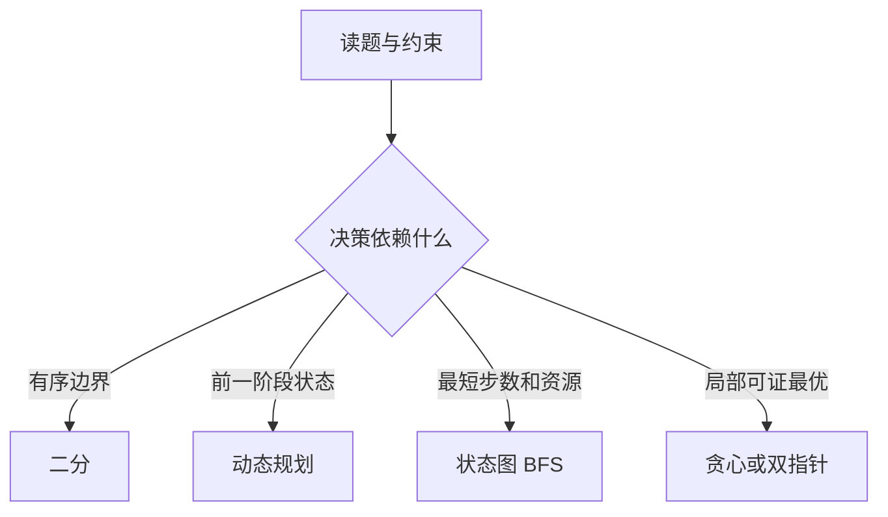
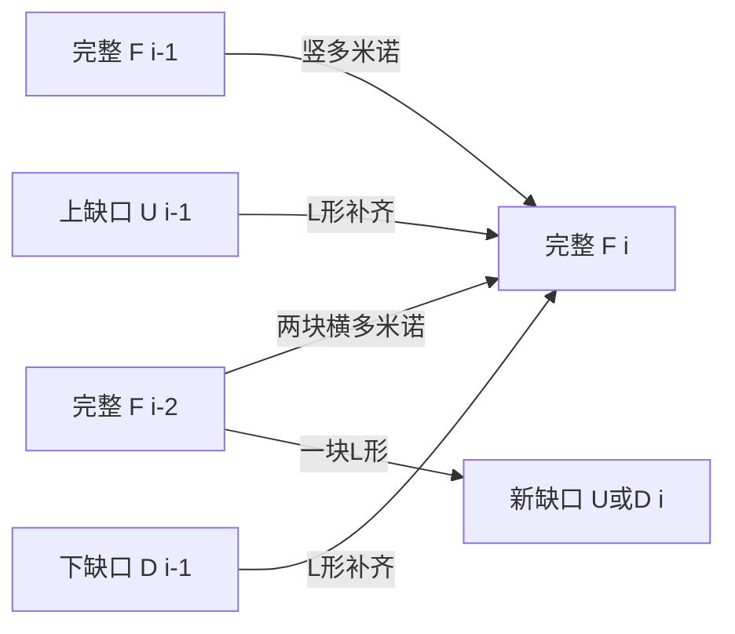

## 综合复习：从约束中选择状态

本章把之前的数据结构与算法组合起来。先找输入中可利用的结构，再决定保存什么状态：有序数组配对位置变化带来二分；按行决策带来DP；位置加钥匙集合构成BFS状态；字符串首字母互换可化为集合交集；正权树分割可自底向上消去；链表与数组连续性让双指针维护不变量。

| 观察到的条件 | 可以考虑的工具 | 必须证明 |
|---|---|---|
| 有序、成对元素只有一处破坏 | 二分 | 哪一侧仍包含唯一值 |
| 跨行转移代价是绝对值 | 两次方向扫描 | 覆盖左来源与右来源 |
| 同一位置携带不同资源 | 状态压缩+BFS | visited 必须包含资源 |
| 正权树分成等和块 | 枚举目标+后序 | 达到目标时可安全切断 |
| 只从两端取固定数量 | 补集窗口 | 剩下的恰为一个连续区间 |



<a id="lc-540"></a>
## LC 540 · 有序数组中的单一元素

**题意。** 升序数组中每个值恰好出现两次，只有一个出现一次，要求 O(log n) 时间与 O(1) 空间。线性两两检查或异或 O(n) 虽正确，但没有利用有序结构。单值之前，相等对从偶数下标开始；之后相等对从奇数下标开始。二分偶数位置，检查它与后一项是否成对。

| [1,1,2,3,3,4,4,8,8] | left,right | 偶数mid | 比较 | 新范围 |
|---|---|---:|---|---|
| 第1轮 | 0,8 | 4 | 3≠4 | [0,4] |
| 第2轮 | 0,4 | 2 | 2≠3 | [0,2] |
| 第3轮 | 0,2 | 0 | 1=1 | [2,2] |
| 返回 | — | — | nums[2] | 2 |

```java
class Solution {
    public int singleNonDuplicate(int[] nums) {
        int left = 0, right = nums.length - 1;
        while (left < right) {
            int mid = left + (right - left) / 2;
            if ((mid & 1) == 1) mid--;
            if (nums[mid] == nums[mid + 1]) left = mid + 2;
            else right = mid;
        }
        return nums[left];
    }
}
```

`mid&1` 检查奇偶；把mid移到偶数确保比较一整对。right 从偶数 n-1 开始、更新也保持偶数，所以 left<right 时 mid+1 不越界。`left+(right-left)/2` 避免左右端直接相加溢出。课件Java代码在循环后缺少返回，上面补齐。每轮排除约一半，O(log n)/O(1)。测试 `[7]→7`、唯一值在首/尾、负数、重复对数很多。

<a id="lc-1937"></a>
## LC 1937 · 扣分后的最大得分

**题意。** 每行选一个格子，加上该格分数；相邻两行选的列分别k、j时扣 `|j-k|`，求最大总分。朴素状态 `cur[j]=points[row][j]+max_k(pre[k]-|j-k|)`，直接枚举来源O(mn²)。

拆开绝对值：来源k≤j时，距离每向右一步多扣1，故 `left[j]=max(pre[j],left[j-1]-1)`；右来源同理 `right[j]=max(pre[j],right[j+1]-1)`。两方向一起覆盖所有来源，再加当前行得分。

| points=[[1,2,3],[1,5,1],[3,1,1]] | pre | left | right | cur |
|---|---|---|---|---|
| 初始行 | [1,2,3] | — | — | — |
| 处理第2行 | [1,2,3] | [1,2,3] | [1,2,3] | [2,7,4] |
| 处理第3行 | [2,7,4] | [2,7,6] | [6,7,4] | [9,8,7] |
| 答案 | — | — | — | 9 |

```java
class Solution {
    public long maxPoints(int[][] points) {
        int m = points.length, n = points[0].length;
        long[] pre = new long[n];
        for (int c = 0; c < n; c++) pre[c] = points[0][c];
        for (int r = 1; r < m; r++) {
            long[] left = new long[n], right = new long[n], current = new long[n];
            left[0] = pre[0];
            for (int c = 1; c < n; c++) left[c] = Math.max(pre[c], left[c - 1] - 1);
            right[n - 1] = pre[n - 1];
            for (int c = n - 2; c >= 0; c--) right[c] = Math.max(pre[c], right[c + 1] - 1);
            for (int c = 0; c < n; c++) current[c] = points[r][c] + Math.max(left[c], right[c]);
            pre = current;
        }
        long answer = Long.MIN_VALUE;
        for (long value : pre) answer = Math.max(answer, value);
        return answer;
    }
}
```

long 数组保存多行累计得分，`int+long` 自动提升到long。`pre=current` 更新引用，不复制数组；旧pre此后不再使用，安全。每行三次O(n)扫描，总O(mn)，滚动数组空间O(n)。测试单行→行最大、单列→列和、最优路线需要换列、分数总和超过int。课件Python单行分支 `max(p)` 变量名错误，应该用当前首行；上面无需特判也覆盖。

<a id="lc-864"></a>
## LC 864 · 获取所有钥匙的最短路径

**题意。** 网格`@`起点、`.`空地、`#`墙，小写a–f是钥匙，大写A–F是对应锁；四方向每走一格一步，持有钥匙才能过锁，返回收集全部钥匙最少步数或-1。拿到钥匙后可能需要返回原位置，因此 visited 不能只有行列，必须是 `(row,col,keysMask)`。


| grid=["@.a..","###.#","b.A.B"] | 路径前缀/位置 | mask | 步数 |
|---|---|---|---:|
| 起点 | (0,0) | 00 | 0 |
| 取得a | (0,2) | 01 | 2 |
| 向右再下两格 | (2,3) | 01 | 5 |
| 经A左移 | (2,2),(2,1) | 01 | 6、7 |
| 取得b | (2,0) | 11 | 8 |

```java
import java.util.*;
class Solution {
    public int shortestPathAllKeys(String[] grid) {
        int m = grid.length, n = grid[0].length(), sr = 0, sc = 0, target = 0;
        for (int r = 0; r < m; r++) for (int c = 0; c < n; c++) {
            char x = grid[r].charAt(c);
            if (x == '@') { sr = r; sc = c; }
            else if (x >= 'a' && x <= 'f') target |= 1 << (x - 'a');
        }
        boolean[][][] seen = new boolean[m][n][64];
        Queue<int[]> queue = new ArrayDeque<>();
        queue.offer(new int[]{sr, sc, 0}); seen[sr][sc][0] = true;
        int[][] directions = {{1,0},{-1,0},{0,1},{0,-1}};
        int steps = 0;
        while (!queue.isEmpty()) {
            for (int size = queue.size(); size > 0; size--) {
                int[] state = queue.poll();
                if (state[2] == target) return steps;
                for (int[] d : directions) {
                    int r = state[0] + d[0], c = state[1] + d[1], mask = state[2];
                    if (r < 0 || r >= m || c < 0 || c >= n) continue;
                    char x = grid[r].charAt(c);
                    if (x == '#') continue;
                    if (x >= 'A' && x <= 'F' && (mask & (1 << (x - 'A'))) == 0) continue;
                    if (x >= 'a' && x <= 'f') mask |= 1 << (x - 'a');
                    if (seen[r][c][mask]) continue;
                    seen[r][c][mask] = true;
                    queue.offer(new int[]{r, c, mask});
                }
            }
            steps++;
        }
        return -1;
    }
}
```

`Queue<int[]>` 将三个整数作为一个状态；出队得到同一数组引用，但本代码从不再修改它。入队时立即标记 seen 防止同层重复。固定本层 size 才能让 steps 表示真实距离。用按实际钥匙OR得到 target，即使字母不连续也兼容；第三维64覆盖6位状态。k种钥匙的通用复杂度 O(mn2^k) 时间空间，本题最多6。测试被墙隔绝→-1、钥匙在锁后且无替代路→-1、拿钥匙再回头、只有起点无钥匙的扩展情形→0。

<a id="lc-2306"></a>
## LC 2306 · 公司命名

**题意。** 选两个不同名字，交换首字母，要求交换后的两个名字都不在原列表中，计算有序的有效名字对数量。枚举所有名字对太慢。按首字母分组，只存后缀：两组共同拥有的后缀不能使用，因为换首字母后会撞回原名。

若两组大小分别a,b，公共后缀数c，有效无序组合数 `(a-c)(b-c)`，再乘2计算两种名字排列。两组不同首字母，组内不能交换得到新名。

| ideas=[coffee,donuts,time,toffee] | 后缀集合 | 与另一组交集 | 有效有序对 |
|---|---|---|---:|
| c组 | {offee} | 与d组为空 | 2×1×1=2 |
| t组 | {ime,offee} | 与c组为{offee} | 0 |
| d组 | {onuts} | 与t组为空 | 2×1×2=4 |
| 总计 | — | — | 6 |

```java
import java.util.*;
class Solution {
    public long distinctNames(String[] ideas) {
        List<Set<String>> groups = new ArrayList<>();
        for (int i = 0; i < 26; i++) groups.add(new HashSet<>());
        for (String idea : ideas) groups.get(idea.charAt(0) - 'a').add(idea.substring(1));
        long answer = 0;
        for (int i = 0; i < 26; i++) for (int j = i + 1; j < 26; j++) {
            int common = 0;
            Set<String> a = groups.get(i), b = groups.get(j);
            for (String suffix : a) if (b.contains(suffix)) common++;
            answer += 2L * (a.size() - common) * (b.size() - common);
        }
        return answer;
    }
}
```

`substring(1)` 可以返回空后缀，单字母名字也自然支持。使用List<Set<String>>避免课件泛型数组 `new HashSet[26]` 的未检查警告。`2L` 使乘法从一开始就在long里进行，避免int中间结果先溢出。n个名字、平均长度d，时间约O(26nd)，空间O(nd)，字母表26固定。测试所有名字同首字母→0、不同首字母同后缀→0、两组无共同后缀、空后缀。不要把2漏掉，因为(A,B)与(B,A)是不同公司名。

<a id="lc-2440"></a>
## LC 2440 · 创建价值相同的连通块

**题意。** 正权无向树删若干边，使每个连通块的节点值之和相同，最大化删边数。删k-1条边得到k块；总和total必须能被k整除，目标块和=total/k。由大到小枚举k，第一次可行就是最多分块。

固定目标后后序处理：子树凑到目标就切成一块，向父亲贡献0；小于目标继续向父贡献剩余和；大于目标直接失败。正权是此贪心成立的关键：超过目标后加入祖先只会更大，不能抵消。

| nums=[6,2,2,2,6]，边0-1,1-2,1-3,3-4，目标6 | 后序节点 | 向父贡献 |
|---|---:|---:|
| 叶4值6 | 达到6，切断3-4 | 0 |
| 节点3值2 | 未满 | 2 |
| 叶2值2 | 未满 | 2 |
| 节点1 | 2+2+2=6，切断0-1 | 0 |
| 根0 | 6，最后一块 | 0，合计3块删2边 |

```java
import java.util.*;
class Solution {
    public int componentValue(int[] nums, int[][] edges) {
        int n = nums.length;
        List<List<Integer>> graph = new ArrayList<>();
        for (int i = 0; i < n; i++) graph.add(new ArrayList<>());
        for (int[] e : edges) { graph.get(e[0]).add(e[1]); graph.get(e[1]).add(e[0]); }
        int[] parent = new int[n], order = new int[n];
        Arrays.fill(parent, -1);
        order[0] = 0;
        int used = 1;
        for (int i = 0; i < used; i++) {
            int u = order[i];
            for (int v : graph.get(u)) if (v != parent[u]) {
                parent[v] = u;
                order[used++] = v;
            }
        }
        long total = 0;
        for (int x : nums) total += x;
        for (int parts = n; parts >= 1; parts--) {
            if (total % parts != 0) continue;
            long target = total / parts;
            long[] subtotal = new long[n];
            for (int i = 0; i < n; i++) subtotal[i] = nums[i];
            boolean valid = true;
            for (int i = n - 1; i >= 0; i--) {
                int u = order[i];
                if (subtotal[u] > target) { valid = false; break; }
                if (subtotal[u] == target) subtotal[u] = 0;
                if (parent[u] != -1) subtotal[parent[u]] += subtotal[u];
            }
            if (valid && subtotal[0] == 0) return parts - 1;
        }
        return 0;
    }
}
```

order 是父先于子的遍历序，倒着处理保证所有子贡献已到达；不用递归可避免长链调用栈溢出。因为输入是树，跳过父节点已经足够，不需额外visited。`long[]` 避免累计溢出；`total%parts` 只筛候选，整除不等于一定可行。若d是total在1..n中的约数个数，时间 O(n+nd)，空间O(n)，粗略最坏可写O(n²)。测试单节点→0、所有值相等可删n-1、total可整除但树形限制不可分、星形和长链。课件DFS含义相同：返回0表示完整块、-1失败、正数为剩余和。

<a id="lc-790"></a>
## LC 790 · 多米诺和托米诺平铺

**题意。** 用2×1多米诺和L形三格托米诺铺满2×n棋盘，可旋转，计数对1,000,000,007取模。课件写“2×2 domino”是笔误，2×2是四格方块，会变成另一道题。

只记完整棋盘不易直接描述托米诺的交错。定义 F[i] 为铺满2×i；U[i] 为2×i最右上格空着、其他都铺满；D[i] 为最右下格空着。最后一块分类得到：`F[i]=F[i-1]+F[i-2]+U[i-1]+D[i-1]`；`U[i]=F[i-2]+D[i-1]`，`D[i]=F[i-2]+U[i-1]`。前两项分别是末列竖多米诺、最后两列横多米诺，后两项是托米诺补上一个缺口。



| 宽i | F完整 | U上缺 | D下缺 | 说明 |
|---|---:|---:|---:|---|
| 0 | 1 | 0 | 0 | 空棋盘有一种铺法 |
| 1 | 1 | 0 | 0 | 只有竖多米诺 |
| 2 | 2 | 1 | 1 | 完整两种，缺口各一种L |
| 3 | 5 | 2 | 2 | 2+1+1+1=5 |
| 4 | 11 | 4 | 4 | 5+2+2+2=11 |

```java
class Solution {
    public int numTilings(int n) {
        final int MOD = 1_000_000_007;
        long[][] dp = new long[n + 1][3];
        dp[0][0] = 1;
        if (n >= 1) dp[1][0] = 1;
        for (int i = 2; i <= n; i++) {
            dp[i][0] = (dp[i-1][0] + dp[i-2][0] + dp[i-1][1] + dp[i-1][2]) % MOD;
            dp[i][1] = (dp[i-2][0] + dp[i-1][2]) % MOD;
            dp[i][2] = (dp[i-2][0] + dp[i-1][1]) % MOD;
        }
        return (int) dp[n][0];
    }
}
```

数字下划线仅提高可读性，不改变数值；final 表示常量不可重新赋值。多个模内数相加仍可能超int，所以dp用long，最后已模到int范围才强转。时间 O(n)，空间 O(n)，滚动保留两列可降O(1)。测试n=1→1、2→2、3→5、4→11；空棋盘扩展n=0→1。消去缺口状态还可得到 `F[n]=2F[n-1]+F[n-3]`，但不能在没说明初值与推导时直接背公式。

<a id="lc-206"></a>
## LC 206 · 反转链表

**题意。** 改变单链表每条next方向，返回新头。循环不变量：prev是已反转前缀的头，current是尚未处理后缀的头。先保存current.next，再改指针，否则后缀会丢失。

| 原1→2→3 | 保存next | 改后已反转部分 | 未处理 |
|---|---|---|---|
| current=1 | 2 | 1→null | 2→3 |
| current=2 | 3 | 2→1→null | 3 |
| current=3 | null | 3→2→1→null | 空 |

```java
// 平台提供 ListNode：int val; ListNode next
class Solution {
    public ListNode reverseList(ListNode head) {
        ListNode previous = null, current = head;
        while (current != null) {
            ListNode next = current.next;
            current.next = previous;
            previous = current;
            current = next;
        }
        return previous;
    }
}
```

节点变量存引用，不是复制节点；`current.next=previous` 直接改变原链表。返回previous因为结束时current=null。O(n)时间/O(1)额外空间。测试null、单节点、两节点，反转两次回原顺序且节点对象保持相同。无环链表是前提，有环输入此循环不能正常终止。

<a id="lc-876"></a>
## LC 876 · 链表的中间结点

**题意。** 返回中间节点，偶数长度返回第二个中间节点。slow每轮走1，fast每轮走2；fast到末尾时slow走过约一半。

| 1→2→3→4→5→6 | slow | fast |
|---|---:|---|
| 初始 | 1 | 1 |
| 第1轮 | 2 | 3 |
| 第2轮 | 3 | 5 |
| 第3轮 | 4 | null |
| 返回 | 4（第二个中点） | — |

```java
class Solution {
    public ListNode middleNode(ListNode head) {
        ListNode slow = head, fast = head;
        while (fast != null && fast.next != null) {
            slow = slow.next;
            fast = fast.next.next;
        }
        return slow;
    }
}
```

`&&` 短路避免fast为null时读取fast.next；fast.next非null才能安全读取其next，但读取结果允许null。O(n)时间/O(1)空间。测试单节点返回自己、2节点返回第二个、5节点返回第三个。若要第一个中点，循环条件必须改变，不能把两种定义混用。

<a id="lc-283"></a>
## LC 283 · 移动零

**题意。** 原地把所有0移到末尾，保留非零元素相对顺序。write指向下一个非零应落的位置；扫描read时，`[0,write)` 已按原顺序保存全部已见非零，write到read之间均可变成0。

| [0,1,0,3,12] | 遇到非零 | write变化 | 数组 |
|---|---|---|---|
| read=1 | 1 | 0→1 | [1,0,0,3,12] |
| read=3 | 3 | 1→2 | [1,3,0,0,12] |
| read=4 | 12 | 2→3 | [1,3,12,0,0] |

```java
class Solution {
    public void moveZeroes(int[] nums) {
        int write = 0;
        for (int read = 0; read < nums.length; read++) {
            if (nums[read] != 0) {
                nums[write] = nums[read];
                if (write != read) nums[read] = 0;
                write++;
            }
        }
    }
}
```

必须检查write!=read，否则没有移动的非零也会被立即清成0。O(n)时间/O(1)空间，稳定保留顺序。测试全零、无零、空数组、负数与零混合。把0与末尾交换虽然快但会破坏非零相对顺序，不符合题目。

<a id="lc-1423"></a>
## LC 1423 · 可获得的最大点数

**题意更正。** 从一排卡牌的最左或最右每次取一张，共取k张，最大化分数。课件28页错贴了移动零的题干；29–30页代码实际对应本题。

取走两端总共k张后，留下的必是长度n-k的连续中间段；反过来，每个这种长度的段都对应一种从两端取牌方案。所以最大拿走分数=总和-最小剩余窗口和。固定长度窗口每右移一步加新数、减旧数。

| [1,2,3,4,5,6,1],k=3，剩余窗口4 | 窗口 | 和 | 最小 |
|---|---|---:|---:|
| 0..3 | 1,2,3,4 | 10 | 10 |
| 1..4 | 2,3,4,5 | 14 | 10 |
| 2..5 | 3,4,5,6 | 18 | 10 |
| 3..6 | 4,5,6,1 | 16 | 10 |
| 总和22 | 22-10 | 答案12 | 取5,6,1 |

```java
class Solution {
    public int maxScore(int[] cardPoints, int k) {
        int window = cardPoints.length - k, total = 0;
        for (int x : cardPoints) total += x;
        if (window == 0) return total;
        int sum = 0, minimum = Integer.MAX_VALUE;
        for (int right = 0; right < cardPoints.length; right++) {
            sum += cardPoints[right];
            if (right >= window) sum -= cardPoints[right - window];
            if (right >= window - 1) minimum = Math.min(minimum, sum);
        }
        return total - minimum;
    }
}
```

right≥window 才移除前一窗口的左端；只有达到window个元素才能更新最小值。k=n时剩余空段，直接取总和防止边界含义混乱。O(n)时间/O(1)空间。测试k=1取两端较大值、k=n取总和、所有分数相同、最优同时取左右两边。原题总和范围可用int，通用更大分数改long。

<a id="lc-55"></a>
## LC 55 · 跳跃游戏

**题意。** nums[i]表示在i处最多向右跳多少格，判断能否从0到最后位置。无须枚举每条路径，只维护当前所有已知可达位置能扩展出的最远下标reach。扫描到i时若i>reach，则中间缺口无法跨越；否则允许用i扩展reach。

| [2,3,1,1,4] | i | 更新前reach | 更新后 |
|---|---:|---:|---:|
| 起点 | 0 | 0 | 2 |
| 可到位置1 | 1 | 2 | 4 |
| 已覆盖末尾 | — | 4 | true |
| 对照[3,2,1,0,4] | i=4 | 3 | 不可达→false |

```java
class Solution {
    public boolean canJump(int[] nums) {
        int reach = 0;
        for (int i = 0; i < nums.length; i++) {
            if (i > reach) return false;
            reach = Math.max(reach, i + nums[i]);
            if (reach >= nums.length - 1) return true;
        }
        return true;
    }
}
```

先确认i可达再使用nums[i]，否则不可达位置的“大跳跃”会制造错误答案。reach只表示某个可达点能跳到的最远端，不需要记录具体路径，因为最大跳长允许更短跳跃，使从0到reach之间所有点都可达。时间 O(n)、空间 O(1)。测试 `[0]→true`、`[0,1]→false`、跨过0的数组、末尾值为0仍可成功。该题只问能否到达，求最少跳数需要额外分层边界，不可直接返回reach。
