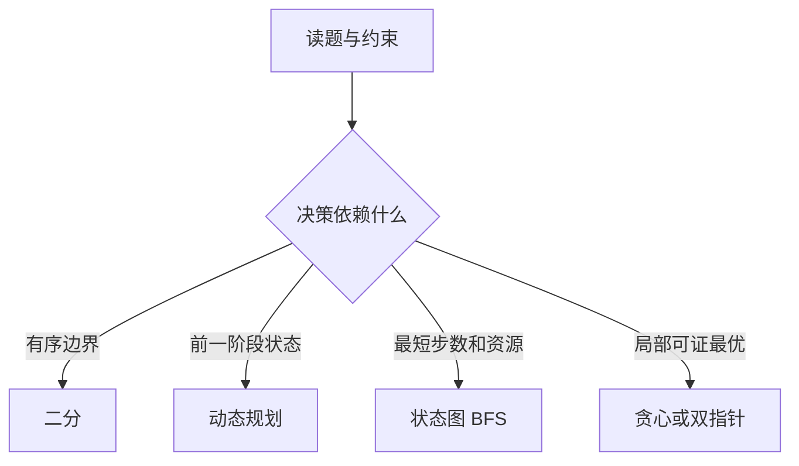
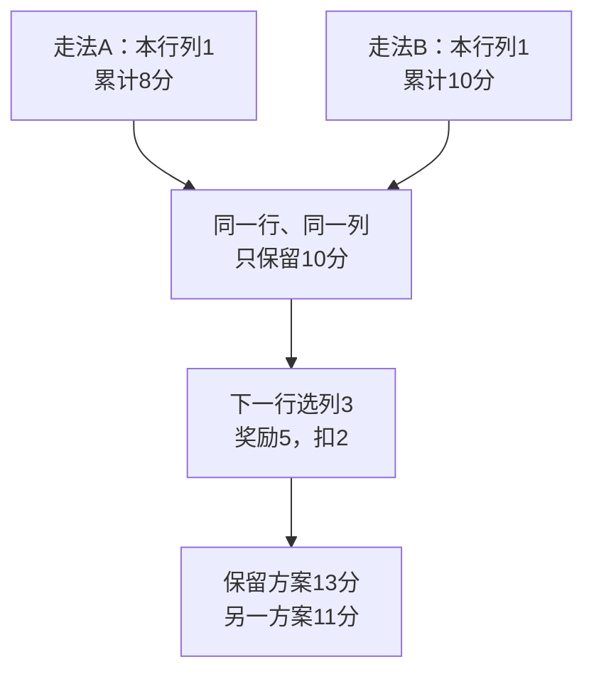
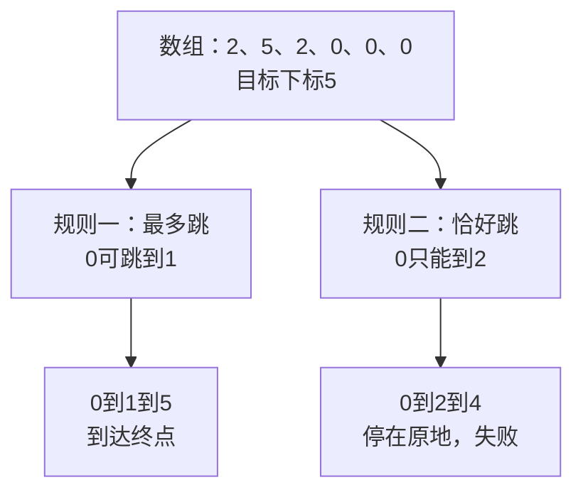
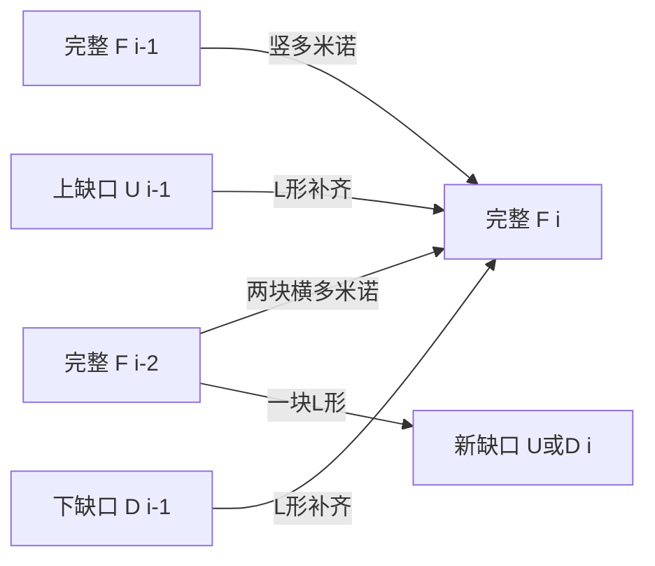

## 综合复习：从约束中选择状态

本章把之前的数据结构与算法组合起来。先找输入中可利用的结构，再决定保存什么状态：有序数组配对位置变化带来二分；按行决策带来DP；位置加钥匙集合构成BFS状态；字符串首字母互换可化为集合交集；正权树分割可自底向上消去；链表与数组连续性让双指针维护不变量。

| 观察到的条件 | 可以考虑的工具 | 必须证明 |
|---|---|---|
| 有序、成对元素只有一处破坏 | 二分 | 哪一侧仍包含唯一值 |
| 跨行转移代价是绝对值 | 两次方向扫描 | 覆盖左来源与右来源 |
| 同一位置携带不同资源 | 状态压缩+BFS | visited 必须包含资源 |
| 正权树分成等和块 | 枚举目标+后序 | 达到目标时可安全切断 |
| 只从两端取固定数量 | 补集窗口 | 剩下的恰为一个连续区间 |



### 先证明两个历史可以合并，再写 dp

假设逐行选格子的两个走法都到了同一行、同一列1，累计得分分别是8与10。从这里出发，两者未来可选的列和转移费用完全相同，因此较低的8永远不会反超10，可以只保留10。



这不是“局部大的总是好”，而是**剩余决策相同**才允许比较历史代价。若两个角色虽然站在同一格，却携带不同钥匙，它们能通过的门不同，就不能只按位置合并；BFS状态必须加上钥匙集合。若转移还依赖上一步选择的类型，DP状态也需要包含该类型。

实际推导时先用一句话写清状态：“已经处理到哪一步、还会影响未来的条件是什么”。然后才决定该状态保存最大值、最小值、计数还是最早位置。这能解释本章为什么有的题用一维滚动数组，有的题必须用位置乘掩码的三维visited。

### 贪心的一维边界，依赖可达集合没有空洞

跳跃游戏里，每个数表示**最多**跳多少格，所以从一个已可达位置出发，较短跳跃也都允许。若当前可达范围是0到reach，处理其中的位置i后，只需把右端更新为`max(reach,i+nums[i])`，范围内部不会突然出现不可达的洞。



同一个数组，改掉“最多”两个字，连续区间不变量就消失了：在第二种规则下，知道某个最远点可达，并不能推出它之前每一点都可达。此时把位置1的5用于扩张，会使用一个实际上到不了的位置。

因此贪心证明需要交代“被省略的信息为何不影响未来”。同理，卡牌题能变成固定窗口，是因为只能从两端取走，留下的一定连续；树分块能在超出目标时判失败，是因为节点值为正、后续不能用负数抵消。条件改变时应重新检查证明，而不是仅修改边界代码。

<a id="lc-540"></a>
## LC 540 · 有序数组中的单一元素

**题意。** 升序数组中每个值恰好出现两次，只有一个出现一次，要求 O(log n) 时间与 O(1) 空间。线性两两检查或异或 O(n) 虽正确，但没有利用有序结构。单值之前，相等对从偶数下标开始；之后相等对从奇数下标开始。二分偶数位置，检查它与后一项是否成对。

| [1,1,2,3,3,4,4,8,8] | left,right | 偶数mid | 比较 | 新范围 |
|---|---|---:|---|---|
| 第1轮 | 0,8 | 4 | 3≠4 | [0,4] |
| 第2轮 | 0,4 | 2 | 2≠3 | [0,2] |
| 第3轮 | 0,2 | 0 | 1=1 | [2,2] |
| 返回 | — | — | nums[2] | 2 |

<a id="tpl-review-pair-binary-search"></a>
**双语模板：二分定位配对规律的分界**

适用于有序奇数长度数组，其中恰好一个值出现一次，其余每个值出现两次。把 mid 调到偶数下标后比较完整的一对；这个配对规律不是普通无序数组的性质。共同输入 `[1,1,2,3,3,4,4,8,8]`，Python 调用 `single_non_duplicate(nums)`，Java 调用 `new Solution().singleNonDuplicate(nums)`，预期 `2`。下面的 Java 直接沿用本节已有实现。

```python
def single_non_duplicate(nums):
    left, right = 0, len(nums) - 1
    while left < right:
        middle = left + (right - left) // 2
        if middle & 1:
            middle -= 1
        if nums[middle] == nums[middle + 1]:
            left = middle + 2
        else:
            right = middle
    return nums[left]
```
```java
class Solution {
    public int singleNonDuplicate(int[] nums) {
        int left = 0, right = nums.length - 1;
        while (left < right) {
            int mid = left + (right - left) / 2;
            if ((mid & 1) == 1) mid--;
            if (nums[mid] == nums[mid + 1]) left = mid + 2;
            else right = mid;
        }
        return nums[left];
    }
}
```

Python 的 `//` 是整除；本模板参与计算的下标非负，所以与 Java 整数除法结果相同。`middle & 1` 检查最低位；Python 把0视为假，Java写显式的 `== 1`。两份代码维持相同的包含答案区间，不需要复制数组。

`mid&1` 检查奇偶；把mid移到偶数确保比较一整对。right 从偶数 n-1 开始、更新也保持偶数，所以 left<right 时 mid+1 不越界。`left+(right-left)/2` 避免左右端直接相加溢出。课件Java代码在循环后缺少返回，上面补齐。每轮排除约一半，O(log n)/O(1)。测试 `[7]→7`、唯一值在首/尾、负数、重复对数很多。

<a id="lc-1937"></a>
## LC 1937 · 扣分后的最大得分

**题意。** 每行选一个格子，加上该格分数；相邻两行选的列分别k、j时扣 `|j-k|`，求最大总分。朴素状态 `cur[j]=points[row][j]+max_k(pre[k]-|j-k|)`，直接枚举来源O(mn²)。

拆开绝对值：来源k≤j时，距离每向右一步多扣1，故 `left[j]=max(pre[j],left[j-1]-1)`；右来源同理 `right[j]=max(pre[j],right[j+1]-1)`。两方向一起覆盖所有来源，再加当前行得分。

| points=[[1,2,3],[1,5,1],[3,1,1]] | pre | left | right | cur |
|---|---|---|---|---|
| 初始行 | [1,2,3] | — | — | — |
| 处理第2行 | [1,2,3] | [1,2,3] | [1,2,3] | [2,7,4] |
| 处理第3行 | [2,7,4] | [2,7,6] | [6,7,4] | [9,8,7] |
| 答案 | — | — | — | 9 |

<a id="tpl-review-two-direction-dp"></a>
**双语模板：绝对值转移拆为左右两次扫描**

适用于每阶段从一排位置选一个，换位置的代价为列距离的绝对值；不能直接推广到任意费用函数。共同输入 `[[1,2,3],[1,5,1],[3,1,1]]`，Python 调用 `max_points(points)`，Java 调用 `new Solution().maxPoints(points)`，预期 `9`。矩阵非空、各行等长，累计结果在 Java long 范围内。

```python
def max_points(points):
    previous = points[0].copy()
    width = len(previous)
    for row_index in range(1, len(points)):
        row = points[row_index]
        left = [0] * width
        right = [0] * width
        left[0] = previous[0]
        for column in range(1, width):
            left[column] = max(previous[column], left[column - 1] - 1)
        right[-1] = previous[-1]
        for column in range(width - 2, -1, -1):
            right[column] = max(previous[column], right[column + 1] - 1)
        previous = [row[column] + max(left[column], right[column])
                    for column in range(width)]
    return max(previous)
```
```java
class Solution {
    public long maxPoints(int[][] points) {
        int m = points.length, n = points[0].length;
        long[] pre = new long[n];
        for (int c = 0; c < n; c++) pre[c] = points[0][c];
        for (int r = 1; r < m; r++) {
            long[] left = new long[n], right = new long[n], current = new long[n];
            left[0] = pre[0];
            for (int c = 1; c < n; c++) left[c] = Math.max(pre[c], left[c - 1] - 1);
            right[n - 1] = pre[n - 1];
            for (int c = n - 2; c >= 0; c--) right[c] = Math.max(pre[c], right[c + 1] - 1);
            for (int c = 0; c < n; c++) current[c] = points[r][c] + Math.max(left[c], right[c]);
            pre = current;
        }
        long answer = Long.MIN_VALUE;
        for (long value : pre) answer = Math.max(answer, value);
        return answer;
    }
}
```

Python 的 `.copy()` 让首行成为独立工作数组；`range(width-2,-1,-1)` 从倒数第二列走到第0列，width=1时自然为空。每次列表推导式生成新行，对应 Java 的 current 数组再令 pre=current。左右扫描只读取上一行与本方向已完成的邻居，因此不会混用两行状态。

long 数组保存多行累计得分，`int+long` 自动提升到long。`pre=current` 更新引用，不复制数组；旧pre此后不再使用，安全。每行三次O(n)扫描，总O(mn)，滚动数组空间O(n)。测试单行→行最大、单列→列和、最优路线需要换列、分数总和超过int。课件Python单行分支 `max(p)` 变量名错误，应该用当前首行；上面无需特判也覆盖。

<a id="lc-864"></a>
## LC 864 · 获取所有钥匙的最短路径

**题意。** 网格`@`起点、`.`空地、`#`墙，小写a–f是钥匙，大写A–F是对应锁；四方向每走一格一步，持有钥匙才能过锁，返回收集全部钥匙最少步数或-1。拿到钥匙后可能需要返回原位置，因此 visited 不能只有行列，必须是 `(row,col,keysMask)`。


| grid=["@.a..","###.#","b.A.B"] | 路径前缀/位置 | mask | 步数 |
|---|---|---|---:|
| 起点 | (0,0) | 00 | 0 |
| 取得a | (0,2) | 01 | 2 |
| 向右再下两格 | (2,3) | 01 | 5 |
| 经A左移 | (2,2),(2,1) | 01 | 6、7 |
| 取得b | (2,0) | 11 | 8 |

<a id="tpl-review-bfs-resource-mask"></a>
**双语模板：把位置与资源一起作为 BFS 状态**

适用于单位步长网格、可永久获得的少量钥匙，以及对应的门锁。这里约定非空矩形网格、恰好一个 @、钥匙与锁字符仅为 a–f/A–F。共同输入 `["@.a..","###.#","b.A.B"]`，Python 调用 `shortest_path_all_keys(grid)`，Java 调用 `new Solution().shortestPathAllKeys(grid)`，预期 `8`；没有钥匙时返回0。

```python
from collections import deque


def shortest_path_all_keys(grid):
    rows, columns = len(grid), len(grid[0])
    start_row = start_column = target = 0
    for row in range(rows):
        for column, cell in enumerate(grid[row]):
            if cell == "@":
                start_row, start_column = row, column
            elif "a" <= cell <= "f":
                target |= 1 << (ord(cell) - ord("a"))
    queue = deque([(start_row, start_column, 0)])
    seen = {(start_row, start_column, 0)}
    directions = [(1, 0), (-1, 0), (0, 1), (0, -1)]
    steps = 0
    while queue:
        for _ in range(len(queue)):
            row, column, keys = queue.popleft()
            if keys == target:
                return steps
            for dr, dc in directions:
                nr, nc = row + dr, column + dc
                if not (0 <= nr < rows and 0 <= nc < columns):
                    continue
                cell = grid[nr][nc]
                if cell == "#":
                    continue
                if "A" <= cell <= "F" and not (keys & (1 << (ord(cell) - ord("A")))):
                    continue
                next_keys = keys
                if "a" <= cell <= "f":
                    next_keys |= 1 << (ord(cell) - ord("a"))
                state = (nr, nc, next_keys)
                if state not in seen:
                    seen.add(state)
                    queue.append(state)
        steps += 1
    return -1
```
```java
import java.util.*;
class Solution {
    public int shortestPathAllKeys(String[] grid) {
        int m = grid.length, n = grid[0].length(), sr = 0, sc = 0, target = 0;
        for (int r = 0; r < m; r++) for (int c = 0; c < n; c++) {
            char x = grid[r].charAt(c);
            if (x == '@') { sr = r; sc = c; }
            else if (x >= 'a' && x <= 'f') target |= 1 << (x - 'a');
        }
        boolean[][][] seen = new boolean[m][n][64];
        Queue<int[]> queue = new ArrayDeque<>();
        queue.offer(new int[]{sr, sc, 0}); seen[sr][sc][0] = true;
        int[][] directions = {{1,0},{-1,0},{0,1},{0,-1}};
        int steps = 0;
        while (!queue.isEmpty()) {
            for (int size = queue.size(); size > 0; size--) {
                int[] state = queue.poll();
                if (state[2] == target) return steps;
                for (int[] d : directions) {
                    int r = state[0] + d[0], c = state[1] + d[1], mask = state[2];
                    if (r < 0 || r >= m || c < 0 || c >= n) continue;
                    char x = grid[r].charAt(c);
                    if (x == '#') continue;
                    if (x >= 'A' && x <= 'F' && (mask & (1 << (x - 'A'))) == 0) continue;
                    if (x >= 'a' && x <= 'f') mask |= 1 << (x - 'a');
                    if (seen[r][c][mask]) continue;
                    seen[r][c][mask] = true;
                    queue.offer(new int[]{r, c, mask});
                }
            }
            steps++;
        }
        return -1;
    }
}
```

Python 用由三个整数组成的不可变元组作 set 的键；Java 用三维 boolean 数组直接索引同样的状态。`ord` 把字符转换成码点，减去 a/A 的码点后取得0…5的位下标；`|` 加入钥匙，`&` 检查是否持有。next_keys 每个方向重新从 keys 复制，避免把另一个邻居的钥匙错误带入当前分支。

`Queue<int[]>` 将三个整数作为一个状态；出队得到同一数组引用，但本代码从不再修改它。入队时立即标记 seen 防止同层重复。固定本层 size 才能让 steps 表示真实距离。用按实际钥匙OR得到 target，即使字母不连续也兼容；第三维64覆盖6位状态。k种钥匙的通用复杂度 O(mn2^k) 时间空间，本题最多6。测试被墙隔绝→-1、钥匙在锁后且无替代路→-1、拿钥匙再回头、只有起点无钥匙的扩展情形→0。

<a id="lc-2306"></a>
## LC 2306 · 公司命名

**题意。** 选两个不同名字，交换首字母，要求交换后的两个名字都不在原列表中，计算有序的有效名字对数量。枚举所有名字对太慢。按首字母分组，只存后缀：两组共同拥有的后缀不能使用，因为换首字母后会撞回原名。

若两组大小分别a,b，公共后缀数c，有效无序组合数 `(a-c)(b-c)`，再乘2计算两种名字排列。两组不同首字母，组内不能交换得到新名。

| ideas=[coffee,donuts,time,toffee] | 后缀集合 | 与另一组交集 | 有效有序对 |
|---|---|---|---:|
| c组 | {offee} | 与d组为空 | 2×1×1=2 |
| t组 | {ime,offee} | 与c组为{offee} | 0 |
| d组 | {onuts} | 与t组为空 | 2×1×2=4 |
| 总计 | — | — | 6 |

```java
import java.util.*;
class Solution {
    public long distinctNames(String[] ideas) {
        List<Set<String>> groups = new ArrayList<>();
        for (int i = 0; i < 26; i++) groups.add(new HashSet<>());
        for (String idea : ideas) groups.get(idea.charAt(0) - 'a').add(idea.substring(1));
        long answer = 0;
        for (int i = 0; i < 26; i++) for (int j = i + 1; j < 26; j++) {
            int common = 0;
            Set<String> a = groups.get(i), b = groups.get(j);
            for (String suffix : a) if (b.contains(suffix)) common++;
            answer += 2L * (a.size() - common) * (b.size() - common);
        }
        return answer;
    }
}
```

`substring(1)` 可以返回空后缀，单字母名字也自然支持。使用List<Set<String>>避免课件泛型数组 `new HashSet[26]` 的未检查警告。`2L` 使乘法从一开始就在long里进行，避免int中间结果先溢出。n个名字、平均长度d，时间约O(26nd)，空间O(nd)，字母表26固定。测试所有名字同首字母→0、不同首字母同后缀→0、两组无共同后缀、空后缀。不要把2漏掉，因为(A,B)与(B,A)是不同公司名。

<a id="lc-2440"></a>
## LC 2440 · 创建价值相同的连通块

**题意。** 正权无向树删若干边，使每个连通块的节点值之和相同，最大化删边数。删k-1条边得到k块；总和total必须能被k整除，目标块和=total/k。由大到小枚举k，第一次可行就是最多分块。

固定目标后后序处理：子树凑到目标就切成一块，向父亲贡献0；小于目标继续向父贡献剩余和；大于目标直接失败。正权是此贪心成立的关键：超过目标后加入祖先只会更大，不能抵消。

| nums=[6,2,2,2,6]，边0-1,1-2,1-3,3-4，目标6 | 后序节点 | 向父贡献 |
|---|---:|---:|
| 叶4值6 | 达到6，切断3-4 | 0 |
| 节点3值2 | 未满 | 2 |
| 叶2值2 | 未满 | 2 |
| 节点1 | 2+2+2=6，切断0-1 | 0 |
| 根0 | 6，最后一块 | 0，合计3块删2边 |

<a id="tpl-review-tree-postorder-cut"></a>
**双语模板：正权树的后序贡献与等和分割**

适用于节点值严格为正的连通无环树；不能用本模板处理负权抵消或普通含环图。共同输入 values=`[6,2,2,2,6]`，edges=`[[0,1],[1,2],[1,3],[3,4]]`，Python 调用 `component_value(values, edges)`，Java 调用 `new Solution().componentValue(values, edges)`，预期删边数 `2`。用父先子后的 order 的逆序执行后序，避免长链递归栈。

```python
def component_value(values, edges):
    size = len(values)
    graph = [[] for _ in range(size)]
    for left, right in edges:
        graph[left].append(right)
        graph[right].append(left)
    parent = [-1] * size
    order = [0]
    index = 0
    while index < len(order):
        node = order[index]
        for neighbor in graph[node]:
            if neighbor != parent[node]:
                parent[neighbor] = node
                order.append(neighbor)
        index += 1
    total = sum(values)
    for parts in range(size, 0, -1):
        if total % parts:
            continue
        target = total // parts
        subtotal = values.copy()
        valid = True
        for node in reversed(order):
            if subtotal[node] > target:
                valid = False
                break
            if subtotal[node] == target:
                subtotal[node] = 0
            if parent[node] != -1:
                subtotal[parent[node]] += subtotal[node]
        if valid and subtotal[0] == 0:
            return parts - 1
    return 0
```
```java
import java.util.*;
class Solution {
    public int componentValue(int[] nums, int[][] edges) {
        int n = nums.length;
        List<List<Integer>> graph = new ArrayList<>();
        for (int i = 0; i < n; i++) graph.add(new ArrayList<>());
        for (int[] e : edges) { graph.get(e[0]).add(e[1]); graph.get(e[1]).add(e[0]); }
        int[] parent = new int[n], order = new int[n];
        Arrays.fill(parent, -1);
        order[0] = 0;
        int used = 1;
        for (int i = 0; i < used; i++) {
            int u = order[i];
            for (int v : graph.get(u)) if (v != parent[u]) {
                parent[v] = u;
                order[used++] = v;
            }
        }
        long total = 0;
        for (int x : nums) total += x;
        for (int parts = n; parts >= 1; parts--) {
            if (total % parts != 0) continue;
            long target = total / parts;
            long[] subtotal = new long[n];
            for (int i = 0; i < n; i++) subtotal[i] = nums[i];
            boolean valid = true;
            for (int i = n - 1; i >= 0; i--) {
                int u = order[i];
                if (subtotal[u] > target) { valid = false; break; }
                if (subtotal[u] == target) subtotal[u] = 0;
                if (parent[u] != -1) subtotal[parent[u]] += subtotal[u];
            }
            if (valid && subtotal[0] == 0) return parts - 1;
        }
        return 0;
    }
}
```

Python `reversed(order)` 反向迭代而不修改原列表，对应 Java 的倒序下标循环。每个目标都重新复制 values 作为 subtotal，上一轮失败留下的部分和不会污染下一轮。parent 只用来跳过树中的来路；输入若含环，仅跳过父节点不能防止重复访问。

order 是父先于子的遍历序，倒着处理保证所有子贡献已到达；不用递归可避免长链调用栈溢出。因为输入是树，跳过父节点已经足够，不需额外visited。`long[]` 避免累计溢出；`total%parts` 只筛候选，整除不等于一定可行。若d是total在1..n中的约数个数，时间 O(n+nd)，空间O(n)，粗略最坏可写O(n²)。测试单节点→0、所有值相等可删n-1、total可整除但树形限制不可分、星形和长链。课件DFS含义相同：返回0表示完整块、-1失败、正数为剩余和。

<a id="lc-790"></a>
## LC 790 · 多米诺和托米诺平铺

**题意。** 用2×1多米诺和L形三格托米诺铺满2×n棋盘，可旋转，计数对1,000,000,007取模。课件写“2×2 domino”是笔误，2×2是四格方块，会变成另一道题。

只记完整棋盘不易直接描述托米诺的交错。定义 F[i] 为铺满2×i；U[i] 为2×i最右上格空着、其他都铺满；D[i] 为最右下格空着。最后一块分类得到：`F[i]=F[i-1]+F[i-2]+U[i-1]+D[i-1]`；`U[i]=F[i-2]+D[i-1]`，`D[i]=F[i-2]+U[i-1]`。前两项分别是末列竖多米诺、最后两列横多米诺，后两项是托米诺补上一个缺口。



| 宽i | F完整 | U上缺 | D下缺 | 说明 |
|---|---:|---:|---:|---|
| 0 | 1 | 0 | 0 | 空棋盘有一种铺法 |
| 1 | 1 | 0 | 0 | 只有竖多米诺 |
| 2 | 2 | 1 | 1 | 完整两种，缺口各一种L |
| 3 | 5 | 2 | 2 | 2+1+1+1=5 |
| 4 | 11 | 4 | 4 | 5+2+2+2=11 |

<a id="tpl-review-frontier-profile-dp"></a>
**双语模板：用完整与缺口轮廓表达铺砖边界**

适用于这里的2×n棋盘、多米诺与L形三格托米诺；三种状态是针对这组棋盘宽度和砖形推导的，不是任意铺砖问题的固定三状态。共同输入 n=4，Python 调用 `num_tilings(4)`，Java 调用 `new Solution().numTilings(4)`，预期 `11`；n=0的空棋盘有1种铺法。

```python
def num_tilings(n):
    modulus = 1_000_000_007
    count = [[0, 0, 0] for _ in range(n + 1)]
    count[0][0] = 1
    if n >= 1:
        count[1][0] = 1
    for width in range(2, n + 1):
        full, upper_gap, lower_gap = count[width - 1]
        earlier_full = count[width - 2][0]
        count[width][0] = (full + earlier_full + upper_gap + lower_gap) % modulus
        count[width][1] = (earlier_full + lower_gap) % modulus
        count[width][2] = (earlier_full + upper_gap) % modulus
    return count[n][0]
```
```java
class Solution {
    public int numTilings(int n) {
        final int MOD = 1_000_000_007;
        long[][] dp = new long[n + 1][3];
        dp[0][0] = 1;
        if (n >= 1) dp[1][0] = 1;
        for (int i = 2; i <= n; i++) {
            dp[i][0] = (dp[i-1][0] + dp[i-2][0] + dp[i-1][1] + dp[i-1][2]) % MOD;
            dp[i][1] = (dp[i-2][0] + dp[i-1][2]) % MOD;
            dp[i][2] = (dp[i-2][0] + dp[i-1][1]) % MOD;
        }
        return (int) dp[n][0];
    }
}
```

Python 的元组解包为三个轮廓状态命名，Java 用下标0/1/2保存相同含义。每个新状态都只读取更小宽度，先取模再保存使后续数值受控；Java仍用long承接多项相加。Python每行独立创建，避免多个轮廓行共享同一个可变列表。

数字下划线仅提高可读性，不改变数值；final 表示常量不可重新赋值。多个模内数相加仍可能超int，所以dp用long，最后已模到int范围才强转。时间 O(n)，空间 O(n)，滚动保留两列可降O(1)。测试n=1→1、2→2、3→5、4→11；空棋盘扩展n=0→1。消去缺口状态还可得到 `F[n]=2F[n-1]+F[n-3]`，但不能在没说明初值与推导时直接背公式。

<a id="lc-206"></a>
## LC 206 · 反转链表

**题意。** 改变单链表每条next方向，返回新头。循环不变量：prev是已反转前缀的头，current是尚未处理后缀的头。先保存current.next，再改指针，否则后缀会丢失。

| 原1→2→3 | 保存next | 改后已反转部分 | 未处理 |
|---|---|---|---|
| current=1 | 2 | 1→null | 2→3 |
| current=2 | 3 | 2→1→null | 3 |
| current=3 | null | 3→2→1→null | 空 |

<a id="tpl-review-linked-list-reversal"></a>
**双语模板：先保存后继，再反转 next**

适用于无环单链表，操作会原地改变连接。共同输入链 `1→2→3`，Python 调用 `reverse_list(head)`，Java 调用 `new Solution().reverseList(head)`，把返回的链读取为数组时预期 `[3,2,1]`；空链返回空。以下两段都提供可独立使用的节点类型，在线评测已提供 ListNode 时省略该类型即可。

```python
class ListNode:
    def __init__(self, value, next_node=None):
        self.val = value
        self.next = next_node


def reverse_list(head):
    previous = None
    current = head
    while current is not None:
        next_node = current.next
        current.next = previous
        previous = current
        current = next_node
    return previous
```
```java
class ListNode {
    int val;
    ListNode next;
    ListNode(int val) { this.val = val; }
}

// 平台提供 ListNode：int val; ListNode next
class Solution {
    public ListNode reverseList(ListNode head) {
        ListNode previous = null, current = head;
        while (current != null) {
            ListNode next = current.next;
            current.next = previous;
            previous = current;
            current = next;
        }
        return previous;
    }
}
```

Python变量和Java节点变量都持有对象引用；赋给next_node只是保留后继引用，不复制后面的链。改写current.next之前保存它，保证未处理后缀始终可达。这里特意逐句移动三个引用，便于对应不变量，而没有把它们压成难以跟踪的多重赋值。

节点变量存引用，不是复制节点；`current.next=previous` 直接改变原链表。返回previous因为结束时current=null。O(n)时间/O(1)额外空间。测试null、单节点、两节点，反转两次回原顺序且节点对象保持相同。无环链表是前提，有环时已处理前缀与未处理后缀不再分离，返回结果不保证是一条以 null 结尾的反转链。

<a id="lc-876"></a>
## LC 876 · 链表的中间结点

**题意。** 返回中间节点，偶数长度返回第二个中间节点。slow每轮走1，fast每轮走2；fast到末尾时slow走过约一半。

| 1→2→3→4→5→6 | slow | fast |
|---|---:|---|
| 初始 | 1 | 1 |
| 第1轮 | 2 | 3 |
| 第2轮 | 3 | 5 |
| 第3轮 | 4 | null |
| 返回 | 4（第二个中点） | — |

<a id="tpl-review-fast-slow-middle"></a>
**双语模板：快慢指针定位第二个中点**

适用于无环单链表，偶数长度要求返回第二个中点。共同输入 `1→2→3→4→5→6`，Python调用 `middle_node(head)`、Java调用 `new Solution().middleNode(head)`，返回节点值预期 `4`，并且是原链中的同一个节点。空链作为扩展输入返回空引用。

```python
class ListNode:
    def __init__(self, value, next_node=None):
        self.val = value
        self.next = next_node


def middle_node(head):
    slow = fast = head
    while fast is not None and fast.next is not None:
        slow = slow.next
        fast = fast.next.next
    return slow
```
```java
class ListNode {
    int val;
    ListNode next;
    ListNode(int val) { this.val = val; }
}

class Solution {
    public ListNode middleNode(ListNode head) {
        ListNode slow = head, fast = head;
        while (fast != null && fast.next != null) {
            slow = slow.next;
            fast = fast.next.next;
        }
        return slow;
    }
}
```

Python的 `and` 与Java的 `&&` 都短路，因此fast为空时不会读取fast.next。快指针一次走两格，慢指针一次一格；循环结束位置和“第二个中点”的定义一起决定边界，不能为另一个中点定义原样照搬。

`&&` 短路避免fast为null时读取fast.next；fast.next非null才能安全读取其next，但读取结果允许null。O(n)时间/O(1)空间。测试单节点返回自己、2节点返回第二个、5节点返回第三个。若要第一个中点，循环条件必须改变，不能把两种定义混用。

<a id="lc-283"></a>
## LC 283 · 移动零

**题意。** 原地把所有0移到末尾，保留非零元素相对顺序。write指向下一个非零应落的位置；扫描read时，`[0,write)` 已按原顺序保存全部已见非零，write到read之间均可变成0。

| [0,1,0,3,12] | 遇到非零 | write变化 | 数组 |
|---|---|---|---|
| read=1 | 1 | 0→1 | [1,0,0,3,12] |
| read=3 | 3 | 1→2 | [1,3,0,0,12] |
| read=4 | 12 | 2→3 | [1,3,12,0,0] |

<a id="tpl-review-stable-filter"></a>
**双语模板：读写双指针稳定保留元素**

适用于本例“保留非零元素的相对顺序、其余位置补零”的原地操作；若换筛选条件，还要重新约定剩余位置如何处理。共同输入 nums=`[0,1,0,3,12]`，Python调用 `move_zeroes(nums)`、Java调用 `new Solution().moveZeroes(nums)`，均无须返回数组，调用后 nums 预期 `[1,3,12,0,0]`。

```python
def move_zeroes(nums):
    write = 0
    for read in range(len(nums)):
        if nums[read] != 0:
            nums[write] = nums[read]
            if write != read:
                nums[read] = 0
            write += 1
```
```java
class Solution {
    public void moveZeroes(int[] nums) {
        int write = 0;
        for (int read = 0; read < nums.length; read++) {
            if (nums[read] != 0) {
                nums[write] = nums[read];
                if (write != read) nums[read] = 0;
                write++;
            }
        }
    }
}
```

这两份代码读写同一个数组/列表，调用者会看到修改。write不会超过read，所以写入已处理前缀不会覆盖尚未读取的数据；仅当元素真的移动时才把原位置清零。与删除时从末尾换一个元素过来相比，这种按原顺序向左写的方法保持稳定性。

必须检查write!=read，否则没有移动的非零也会被立即清成0。O(n)时间/O(1)空间，稳定保留顺序。测试全零、无零、空数组、负数与零混合。把0与末尾交换虽然快但会破坏非零相对顺序，不符合题目。

<a id="lc-1423"></a>
## LC 1423 · 可获得的最大点数

**题意更正。** 从一排卡牌的最左或最右每次取一张，共取k张，最大化分数。课件28页错贴了移动零的题干；29–30页代码实际对应本题。

取走两端总共k张后，留下的必是长度n-k的连续中间段；反过来，每个这种长度的段都对应一种从两端取牌方案。所以最大拿走分数=总和-最小剩余窗口和。固定长度窗口每右移一步加新数、减旧数。

| [1,2,3,4,5,6,1],k=3，剩余窗口4 | 窗口 | 和 | 最小 |
|---|---|---:|---:|
| 0..3 | 1,2,3,4 | 10 | 10 |
| 1..4 | 2,3,4,5 | 14 | 10 |
| 2..5 | 3,4,5,6 | 18 | 10 |
| 3..6 | 4,5,6,1 | 16 | 10 |
| 总和22 | 22-10 | 答案12 | 取5,6,1 |

<a id="tpl-review-fixed-window-complement"></a>
**双语模板：固定窗口维护与两端选择的补集**

适用于每次从两端取卡牌、恰好取k张且 `0≤k≤n` 的问题。共同输入 cards=`[1,2,3,4,5,6,1]`、k=3，Python调用 `max_score(cards,3)`、Java调用 `new Solution().maxScore(cards,3)`，预期 `12`。固定窗口内核保持“加入右端、移除过期左端、长度满足后更新答案”；Java按本题范围使用int累计。

```python
def max_score(cards, k):
    window = len(cards) - k
    total = sum(cards)
    if window == 0:
        return total
    current = 0
    minimum = float("inf")
    for right, value in enumerate(cards):
        current += value
        if right >= window:
            current -= cards[right - window]
        if right >= window - 1:
            minimum = min(minimum, current)
    return total - minimum
```
```java
class Solution {
    public int maxScore(int[] cardPoints, int k) {
        int window = cardPoints.length - k, total = 0;
        for (int x : cardPoints) total += x;
        if (window == 0) return total;
        int sum = 0, minimum = Integer.MAX_VALUE;
        for (int right = 0; right < cardPoints.length; right++) {
            sum += cardPoints[right];
            if (right >= window) sum -= cardPoints[right - window];
            if (right >= window - 1) minimum = Math.min(minimum, sum);
        }
        return total - minimum;
    }
}
```

Python 用正无穷初始化尚未见到完整窗口的最小值，第一份合法窗口会把它替换成整数；共同契约保证window>0时一定有完整窗口。k=n时剩余窗口为空，必须提前返回total；k=0时留下整段，答案为0。

right≥window 才移除前一窗口的左端；只有达到window个元素才能更新最小值。k=n时剩余空段，直接取总和防止边界含义混乱。O(n)时间/O(1)空间。测试k=1取两端较大值、k=n取总和、所有分数相同、最优同时取左右两边。原题总和范围可用int，通用更大分数改long。

<a id="lc-55"></a>
## LC 55 · 跳跃游戏

**题意。** nums[i]表示在i处最多向右跳多少格，判断能否从0到最后位置。无须枚举每条路径，只维护当前所有已知可达位置能扩展出的最远下标reach。扫描到i时若i>reach，则中间缺口无法跨越；否则允许用i扩展reach。

| [2,3,1,1,4] | i | 更新前reach | 更新后 |
|---|---:|---:|---:|
| 起点 | 0 | 0 | 2 |
| 可到位置1 | 1 | 2 | 4 |
| 已覆盖末尾 | — | 4 | true |
| 对照[3,2,1,0,4] | i=4 | 3 | 不可达→false |

<a id="tpl-review-reachable-frontier"></a>
**双语模板：连续可达区间只保存右边界**

适用于每个nums[i]表示“最多向右跳这么多格”的非负数组；不是恰好跳，也不是最少跳数。共同输入 `[2,3,1,1,4]`，Python调用 `can_jump(nums)`、Java调用 `new Solution().canJump(nums)`，逻辑结果均为真；对照 `[3,2,1,0,4]` 均为假。沿用Java实现的int运算，约定 `i+nums[i]` 不溢出。

```python
def can_jump(nums):
    reach = 0
    for index, length in enumerate(nums):
        if index > reach:
            return False
        reach = max(reach, index + length)
        if reach >= len(nums) - 1:
            return True
    return True
```
```java
class Solution {
    public boolean canJump(int[] nums) {
        int reach = 0;
        for (int i = 0; i < nums.length; i++) {
            if (i > reach) return false;
            reach = Math.max(reach, i + nums[i]);
            if (reach >= nums.length - 1) return true;
        }
        return true;
    }
}
```

Python的True/False与Java的true/false表示相同布尔结果，显示大小写不同。先判当前位置可达，再把它的跳长用于扩张；若颠倒两步，不可达位置可能凭自己的大跳长错误地“拯救”路径。空输入沿用现有Java的扩展约定返回真。

先确认i可达再使用nums[i]，否则不可达位置的“大跳跃”会制造错误答案。reach只表示某个可达点能跳到的最远端，不需要记录具体路径，因为最大跳长允许更短跳跃，使从0到reach之间所有点都可达。时间 O(n)、空间 O(1)。测试 `[0]→true`、`[0,1]→false`、跨过0的数组、末尾值为0仍可成功。该题只问能否到达，求最少跳数需要额外分层边界，不可直接返回reach。
