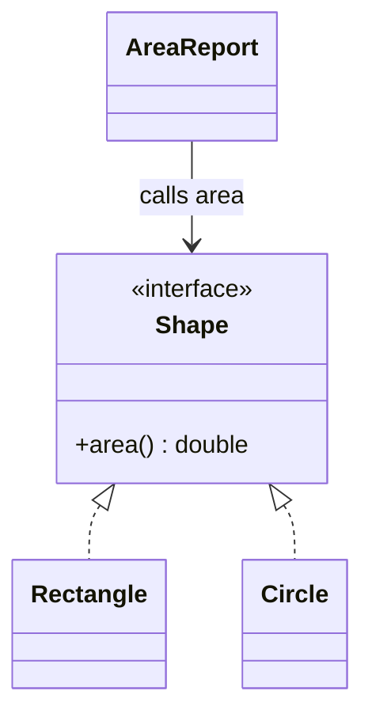
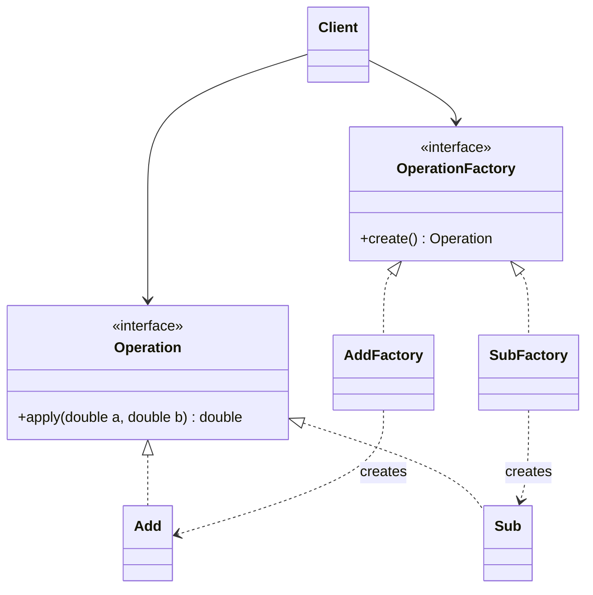
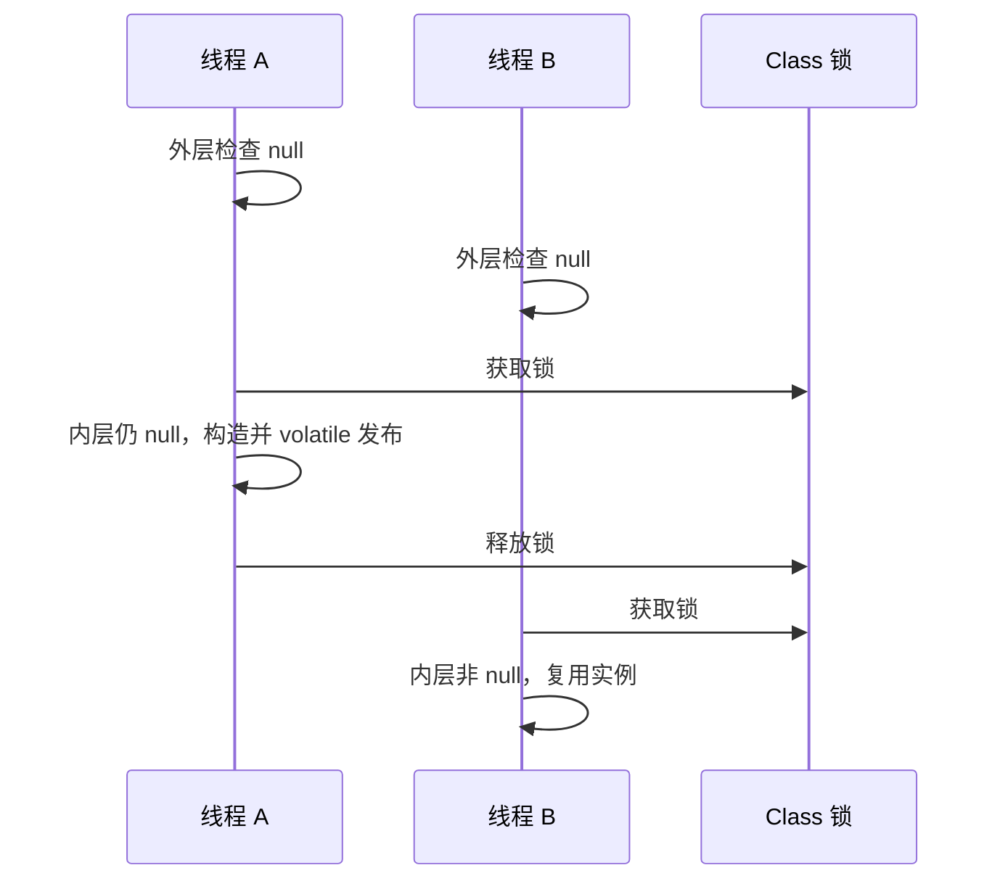

## 模式的价值：给反复出现的设计问题命名

设计模式不是必须背出的类图模板，而是对某类变化的安排。工厂把创建选择集中起来，策略把算法替换放到接口后面，观察者把事件源与订阅者分开。先识别变化与约束，再决定是否需要模式；只有一个简单实现时，直接构造对象可能更容易理解。

课件前半是七个设计原则，后半详细展开简单工厂、工厂方法、抽象工厂、单例；大纲还列出其他创建型、结构型和行为型模式。本章保留这些案例，并把截图里的代码补成可运行 Java。面试中应讲清实际项目的变化需求、原代码为何难改、抽象放在哪里以及增加了多少复杂度。

## 七个原则：把口号还原为代码约束

### 开闭原则：为确定会变化的维度留下扩展点

课件 Course 同时塞入 content、videoUrl、audioUrl、liveUrl，容易出现大量无意义空字段。若不同课程有不同展示行为，可抽象 Course，让 TextCourse、VideoCourse 等提供自己的渲染/资源能力。若只是四种简单数据格式，一个带类型标签的数据模型也可能更简单，继承不是唯一答案。

矩形面积计算器从 `area(Rectangle)` 改成 `area(Object)` 并不断判断 instanceof，每增加圆形/三角形都得改旧函数。定义 `Shape.area()` 后，每个形状负责面积，调用者只依赖 Shape。所谓关闭是相对于已知变化维度，不是永远不准改旧代码；抽象有错误时仍应重构。



课件说“只测试新增代码就好”过于乐观。接口契约、装配与跨类型行为仍需回归测试；开闭原则减少变更影响，不消除验证责任。

### 单一职责：按变化原因划边界

Employee 同时包含工资算法与晋升规则时，财务政策和人事政策会推动同一个类修改。可以保留 Employee 的身份数据，让 Payroll 处理工资，让 PromotionPolicy 处理晋升。职责是受同类业务原因驱动的一组行为，不是“一类只能有一个方法”。

课件 Animal.breathe 起初只打印牛、羊、猪呼吸空气，后来加鱼就出现条件分支。拆成 Terrestrial/Aquatic，或注入呼吸策略，能隔离不同规则；简单场景也可使用命名清晰的两个方法。生物学上鱼是从水中获取溶解氧，示例的“呼吸水”只是简化标签。不要为一个打印语句制造庞大继承体系。

### 依赖倒置：让业务规则决定它需要的接口

Project 不应该绑死 FrontEndDeveloper.writeJavaScriptCode 和 BackEndDeveloper.writeJavaCode，而可调用 Developer.writeCode；Mother 讲故事不应只接收 Book，可接收 Reader.content，Book 和 Newspaper 实现该接口。

“倒置”针对源码依赖方向：高层策略定义所需能力，底层实现适配能力。依赖注入是把实例传进来的一种装配方式，和原则并非同义词。接口最好用业务语言，若直接暴露数据库连接与 SQL 语句，高层仍然理解底层细节。

课件“每个类都提供接口”“不能继承具体类”不是硬性语言规则。只在确实存在替换、测试边界或独立变化时引入接口；否则一类一接口可能徒增跳转。

### 接口隔离：调用者只依赖自己需要的能力

课件餐厅大接口要求在线、电话、到店客户全部实现在线支付、现场支付与多种下单方式，迫使很多方法空实现或抛异常。拆出 Ordering 与 Payment 等能力后，每个客户端只接收需要的接口，或者只实现它实际提供的能力。

与单一职责相比，SRP 问“这份实现为什么改变”，ISP 问“这个客户端为何被迫依赖它用不到的方法”。一个类可以实现多个小接口，不意味着一定要拆成多个类。接口太碎也会增加装配成本。

### 迪米特法则：不要穿透别人的内部结构

课件 Client 通过 Car 获取 GasEngine 再取 brandName，会知道汽车内部的引擎类型。改为 `car.engineBrand()` 后，Car 自己决定如何回答，未来更换动力系统不直接影响 Client。明星与粉丝通过经纪人安排活动，也说明协调边界的作用。

重点不是机械禁止链式调用。不可变数据查询、Stream 流水线不一定造成领域耦合；需要警惕的是调用者依赖深层对象的内部生命周期与结构。若每层只转发一行方法却没有稳定职责，可能产生大量中介样板。

### 里氏替换：子类型必须维持父类型契约

课件“正方形不是长方形”针对**可变接口契约**：若 Rectangle.setWidth 只改宽、setHeight 只改高，Square 为保持边相等而同时改两者，就破坏使用者的假设。例如循环“宽不变，反复加高直到高大于宽”在 Square 中可能永不结束。

数学上的集合包含关系不直接决定可变软件类型关系。让 Rectangle、Square 各自实现只读 Shape.area，或者使用不可变值对象，便可避免这个冲突。

课件说“不能重写父类非抽象方法”不准确；重写本身正是多态的一部分。正确要求是：不能强化前置条件、不能弱化后置条件、必须保持父类不变量与有效操作历史。例如父接口允许0以上任意金额，子类不能突然只接受100以上；承诺排序后返回全部元素，子类不能默默丢掉重复项。重载签名与类型转换规则也不能代替行为契约。

### 合成复用：把可替换能力作为成员

继承表达 is-a，组合表达 has-a。若只是想复用一个日志对象，让服务持有 Logger，比继承 Logger 更自然。继承让子类与父类协议甚至内部扩展点耦合；组合可在构造时选择实现，有时也能在运行时替换。

UML 实心菱形的组合通常表示整体拥有部分生命周期，空心菱形的聚合表示较弱共享关系。Java 不用某个关键字强制这种生命周期，仍需由对象所有权与资源关闭逻辑体现。

### 七原则的可运行小模型

```java
import java.util.List;

public class PrinciplesDemo {
    interface Shape { double area(); }
    record Rectangle(double width, double height) implements Shape {
        public double area() { return width * height; }
    }
    record Circle(double radius) implements Shape {
        public double area() { return Math.PI * radius * radius; }
    }
    interface Reader { String content(); }
    record Book(String content) implements Reader {}
    record Newspaper(String content) implements Reader {}
    static final class Mother {
        void narrate(Reader reader) { System.out.println(reader.content()); }
    }
    interface Breathing { String describe(); }
    record Animal(String name, Breathing breathing) {
        String description() { return name + ": " + breathing.describe(); }
    }
    record Engine(String brand) {}
    static final class Car {
        private final Engine engine;
        Car(Engine engine) { this.engine = engine; }
        String engineBrand() { return engine.brand(); }
    }
    public static void main(String[] args) {
        List<Shape> shapes = List.of(new Rectangle(3, 4), new Circle(2));
        shapes.forEach(shape -> System.out.println(shape.area()));
        Mother mother = new Mother();
        mother.narrate(new Book("从前有座山"));
        mother.narrate(new Newspaper("今天的科学新闻"));
        System.out.println(new Animal("鱼", () -> "从水中获取氧气").description());
        System.out.println(new Car(new Engine("DemoEngine")).engineBrand());
    }
}
```

record 的 `content()` 自动满足 Reader 的方法签名；implements 表达能力契约；List.of 创建不可修改列表，并不是列表元素一定不可变；forEach 接收 Consumer Lambda。`()->...` 没有参数，编译器从 Breathing 推断返回 String。Car 没有暴露 Engine 对象，只提供稳定的业务查询。

## 工厂家族：决定谁拥有创建逻辑

### 简单工厂：集中一处选择产品

计算器用 Operation 接口表示运算，Add/Sub/Mul/Div 实现它；工厂根据字符选择实例。调用者不用知道具体类名，创建、参数校验、缓存可以集中在工厂。但新运算通常需要修改工厂的选择分支，工厂可能变大。

简单工厂常用静态方法实现，但“不使用 static 就不是简单工厂”不成立；它也不是 GoF 23种中的独立一项。课件英文“let subclasses decide”对应工厂方法，不是简单工厂的核心定义。

### 工厂方法：把一个产品的创建延迟给具体工厂

定义 OperationFactory.create，由 AddFactory、SubFactory 分别创建具体产品。高层计算流程只依赖 OperationFactory 和 Operation。新增乘法新增产品与工厂，原有业务逻辑不用改，但装配入口总要决定用哪个工厂；“不改任何代码”并不包括连配置也神奇自动更新。

课件把操作数存进 Operation 的 num1/num2，再调用 getResult。下面保持运算无状态，将数作为方法参数传入，避免同一运算对象并发使用时互相覆盖操作数。两种写法的工厂关系相同。



### 抽象工厂：一次选择相容的产品族

课件用海尔/TCL 的电视和空调区分“等级”与“族”：电视/空调是不同产品种类，同品牌配套是一族。抽象工厂提供 createTV 和 createAirConditioner；选定工厂后拿到同族产品，减少客户端混用不兼容实现的机会。

新增品牌只加一个工厂及相应产品；新增产品种类如冰箱，则工厂接口与每个具体工厂都需要扩展。因此“对扩展开放”必须说明是对哪一个维度开放。

### 三类工厂的完整 Java 示例

```java
public class FactoryDemo {
    interface Operation { double apply(double a, double b); }
    static final class Add implements Operation {
        public double apply(double a, double b) { return a + b; }
    }
    static final class Sub implements Operation {
        public double apply(double a, double b) { return a - b; }
    }
    static Operation simpleFactory(char operator) {
        return switch (operator) {
            case '+' -> new Add();
            case '-' -> new Sub();
            case '*' -> (a, b) -> a * b;
            case '/' -> (a, b) -> {
                if (b == 0) throw new ArithmeticException("division by zero");
                return a / b;
            };
            default -> throw new IllegalArgumentException("unknown operator");
        };
    }
    interface OperationFactory { Operation create(); }
    static final class AddFactory implements OperationFactory {
        public Operation create() { return new Add(); }
    }
    static final class SubFactory implements OperationFactory {
        public Operation create() { return new Sub(); }
    }
    interface TV { String brand(); }
    interface AirConditioner { String brand(); }
    record BrandedTV(String brand) implements TV {}
    record BrandedAirConditioner(String brand) implements AirConditioner {}
    interface ApplianceFactory {
        TV createTV();
        AirConditioner createAirConditioner();
    }
    static final class HaierFactory implements ApplianceFactory {
        public TV createTV() { return new BrandedTV("Haier"); }
        public AirConditioner createAirConditioner() {
            return new BrandedAirConditioner("Haier");
        }
    }
    static final class TCLFactory implements ApplianceFactory {
        public TV createTV() { return new BrandedTV("TCL"); }
        public AirConditioner createAirConditioner() {
            return new BrandedAirConditioner("TCL");
        }
    }
    static void useFamily(ApplianceFactory factory) {
        System.out.println(factory.createTV().brand() + " TV / " +
            factory.createAirConditioner().brand() + " AC");
    }
    public static void main(String[] args) {
        for (char op : new char[]{'+', '-', '*', '/'})
            System.out.println(simpleFactory(op).apply(3, 5));
        OperationFactory factory = new AddFactory();
        System.out.println(factory.create().apply(5, 3)); // 8.0
        useFamily(new HaierFactory());
        useFamily(new TCLFactory());
    }
}
```

switch 表达式产生返回值，箭头分支不贯穿后续分支；default 抛异常，因此每种输入都有明确结果。Operation 只有一个抽象方法，所以乘除可用 Lambda 创建行为对象。这里的 double 除零我们显式拒绝；Java 浮点数除零原本可能产生 Infinity/NaN，不要套用整数除零行为。

原课件抽象工厂产品用`getClass().getSimpleName()`打印运行时类名：getClass取得对象实际类型的Class对象，getSimpleName只取不含包名的展示名称；这适合演示，不应把名称字符串当稳定业务ID。

返回类型写 Operation 而不是 Add，使客户端依赖抽象。抽象工厂用同一具体工厂创建两种产品，其保证来自装配纪律，若客户端故意混用两个工厂，接口本身不必然阻止。课件“捕获异常、打印后 return null”会把错误推迟成 NPE，这里直接抛有意义异常。

## 单例：唯一实例与共享状态安全是两道题

单例把构造入口设为 private，让类保存实例并暴露静态访问点。常用于应用级配置或共享协调对象，但线程池、连接池并非全局只能有一个：多个业务可能需要独立隔离。单例范围通常是**一个定义类加载器中的一个类**，不是跨进程、跨机器唯一。

### 饿汉与同步懒汉

饿汉在类初始化时创建 `static final INSTANCE`，利用 JVM 类初始化同步保证安全发布。它不是只要字节码一加载就必定创建；加载与初始化是不同阶段。同步懒汉把整个 getInstance 加 synchronized，第一次调用才创建，之后每次仍会获取锁并检查，课件“一旦创建后 synchronized 和 if 都不执行”的描述不正确。

### 双重检查锁：为何要 volatile 与两次判断

第一次判空让常见的已初始化路径不获取锁；两个线程都看到空时，必须竞争同一把锁；第二次判空让后拿锁线程看到前者已完成创建，不重复构造。volatile 建立安全发布所需的可见性与顺序，防止另一个线程通过引用观察未正确发布的初始化状态。不是“禁止所有指令重排”，而是限制会违反内存模型可观察保证的重排。



### Holder 与枚举

静态内部 Holder 的 INSTANCE 在首次主动使用 Holder 时初始化，兼有延迟加载与清楚实现。直接 `enum Settings { INSTANCE }` 利用枚举的构造与序列化语义。课件用枚举保存外层对象也能实现，但若外层构造器公开仍可直接 new，不能只套一个枚举就宣称外层唯一。

```java
public class SingletonDemo {
    static final class Eager {
        private static final Eager INSTANCE = new Eager();
        private Eager() {}
        static Eager getInstance() { return INSTANCE; }
    }
    static final class Lazy {
        private static Lazy instance;
        private Lazy() {}
        static synchronized Lazy getInstance() {
            if (instance == null) instance = new Lazy();
            return instance;
        }
    }
    static final class Dcl {
        private static volatile Dcl instance;
        private Dcl() {}
        static Dcl getInstance() {
            Dcl result = instance;
            if (result == null) {
                synchronized (Dcl.class) {
                    result = instance;
                    if (result == null) {
                        result = new Dcl();
                        instance = result;
                    }
                }
            }
            return result;
        }
    }
    static final class HolderSingleton {
        private HolderSingleton() {}
        private static final class Holder {
            static final HolderSingleton INSTANCE = new HolderSingleton();
        }
        static HolderSingleton getInstance() { return Holder.INSTANCE; }
    }
    enum Counter {
        INSTANCE;
        private int value;
        synchronized int next() { return ++value; }
    }
    public static void main(String[] args) {
        System.out.println(Eager.getInstance() == Eager.getInstance());
        System.out.println(Lazy.getInstance() == Lazy.getInstance());
        System.out.println(Dcl.getInstance() == Dcl.getInstance());
        System.out.println(HolderSingleton.getInstance() == HolderSingleton.getInstance());
        System.out.println(Counter.INSTANCE.next());
    }
}
```

Dcl.class 是这个类的 Class 对象，所有调用共享同一锁；局部 result 避免已初始化路径反复读取 volatile，并在锁内重新取值。Counter 唯一并不自动保护 value，next 仍需 synchronized 或 AtomicInteger。`==` 在这里有意比较对象身份，和比较字符串内容不同。发布语义见 [Java 语言规范的 happens-before 规则](https://docs.oracle.com/javase/specs/jls/se21/html/jls-17.html#jls-17.4.5)。

单例的代价包括隐式全局依赖、测试难隔离、状态污染与资源生命周期难管理。通常可以由应用装配层只创建一次，再注入接口；共享资源的“一个实例”不要求业务到处直接调用 getInstance。

## 大纲中的其他模式：识别问题、变化点与代价

下表把课件总览中的23种 GoF 模式补全到同一框架，简单工厂另列在前文。

| 类别与模式 | 解决什么问题 | 具体例子与边界 |
|---|---|---|
| 创建型：Factory Method | 创建某一产品交给子类/实现 | 文档程序创建不同文档；类数量增加 |
| 创建型：Abstract Factory | 生成配套产品族 | 同风格按钮与菜单；新增产品种类影响所有工厂 |
| 创建型：Singleton | 限制特定作用域实例 | 应用配置；全局状态难测试 |
| 创建型：Builder | 分步骤创建复杂对象 | HTTP请求的header/body/timeout；build时统一校验 |
| 创建型：Prototype | 从已有原型复制 | 模板图形复制；明确浅拷贝/深拷贝 |
| 结构型：Facade 外观 | 给复杂子系统一个任务入口 | 一键下单协调库存与付款；不应变成万能类 |
| 结构型：Adapter 适配器 | 转换不兼容接口 | 旧支付SDK适配新 Payment；重点是接口转换 |
| 结构型：Bridge 桥接 | 两个变化维度分别扩展 | 图形类型与渲染后端；组合避免交叉子类爆炸 |
| 结构型：Proxy 代理 | 控制对目标的访问 | 远程、权限、延迟加载代理；注意异常与延迟透明度 |
| 结构型：Decorator 装饰器 | 保持接口并叠加能力 | 流的缓冲/压缩；包装顺序影响语义 |
| 结构型：Flyweight 享元 | 共享大量相同内部状态 | 字体字形；外部位置由调用者传入，勿共享可变上下文 |
| 结构型：Composite 组合 | 统一处理树的叶子与容器 | 文件与目录、UI节点；只放语义合理的共同操作 |
| 行为型：Template Method | 固定流程骨架，开放少数步骤 | 导入流程读取/校验/写入；继承耦合较强 |
| 行为型：Strategy 策略 | 替换同一任务的算法 | 优惠计算、路线规划；调用者选择策略 |
| 行为型：Chain of Responsibility | 请求逐个处理器流转 | HTTP中间件、审批链；明确终止与未处理结果 |
| 行为型：State 状态 | 行为随内部状态切换 | 订单待付/已付/已发货；迁移规则属于状态机 |
| 行为型：Command 命令 | 将请求封装成对象 | 撤销、任务队列；保存操作参数与必要上下文 |
| 行为型：Observer 观察者 | 事件发布后通知订阅者 | 库存变化通知UI；退订、异常与并发需定义 |
| 行为型：Mediator 中介者 | 集中多方协作协议 | 聊天室、复杂表单联动；防止中介变巨大 |
| 行为型：Iterator 迭代器 | 隐藏集合内部遍历方式 | Java Iterator；遍历中修改要遵守契约 |
| 行为型：Memento 备忘录 | 保存并恢复状态快照 | 编辑器撤销；快照大小与敏感状态需控制 |
| 行为型：Visitor 访问者 | 给稳定结构添加新操作 | AST打印、类型检查；新增节点类型影响访问者 |
| 行为型：Interpreter 解释器 | 用对象表示语法规则并求值 | 简单过滤表达式；复杂语言宜用成熟解析工具 |

策略与状态都常“持有接口并委托”，区别在意图：策略通常由外部选择算法，状态内部迁移影响允许的操作。适配器改变接口，装饰器增强同一接口，代理控制对同一目标的访问。模板方法用继承固定流程，策略用组合替换行为。

### 适配器、装饰器、观察者的完整联动示例

课件在面试重点中单列了这三种模式。下面让旧通知服务经适配器变为统一 Notifier，再用日志装饰器增强，最终作为事件订阅者：

```java
import java.util.ArrayList;
import java.util.List;
import java.util.function.Consumer;

public class NotificationPatternsDemo {
    interface Notifier { void send(String message); }
    static final class LegacySender {
        void deliverText(String text, int priority) {
            System.out.println("legacy priority=" + priority + ": " + text);
        }
    }
    static final class SenderAdapter implements Notifier {
        private final LegacySender legacy;
        SenderAdapter(LegacySender legacy) { this.legacy = legacy; }
        public void send(String message) { legacy.deliverText(message, 1); }
    }
    static final class LoggingNotifier implements Notifier {
        private final Notifier next;
        LoggingNotifier(Notifier next) { this.next = next; }
        public void send(String message) {
            System.out.println("before send");
            next.send(message);
            System.out.println("after send");
        }
    }
    static final class EventBus {
        private final List<Consumer<String>> listeners = new ArrayList<>();
        void subscribe(Consumer<String> listener) { listeners.add(listener); }
        void unsubscribe(Consumer<String> listener) { listeners.remove(listener); }
        void publish(String event) {
            for (Consumer<String> listener : List.copyOf(listeners)) listener.accept(event);
        }
    }
    public static void main(String[] args) {
        Notifier notifier = new LoggingNotifier(new SenderAdapter(new LegacySender()));
        EventBus bus = new EventBus();
        Consumer<String> observer = notifier::send;
        bus.subscribe(observer);
        bus.publish("订单已经发货");
        bus.unsubscribe(observer);
        bus.publish("此时没有订阅者");
    }
}
```

Consumer<String> 接收 String 并返回 void；`notifier::send` 绑定当前 notifier 实例的方法。退订保留同一个 observer 引用，不应重新创建 Lambda 并假定相等。List.copyOf 在通知前取快照，使某个回调的退订不破坏当前遍历；这只是单线程演示，不保证多线程访问 EventBus 安全。同步 publish 中某回调抛异常会中断后续通知，生产设计可选择逐个隔离异常、异步队列或失败重试，并明确交付语义。

## 设计模式的使用检查

可以用四个问题检查设计：变化点是否真实存在？抽象是否表达稳定的业务契约？新增一种实现是否局部完成？代价是否比直接代码更低？模式的成功是调用者更容易正确使用，而不是类图看起来更复杂。
