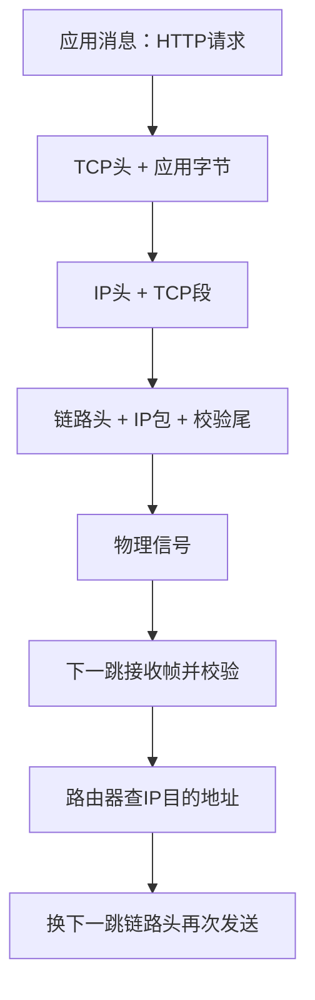
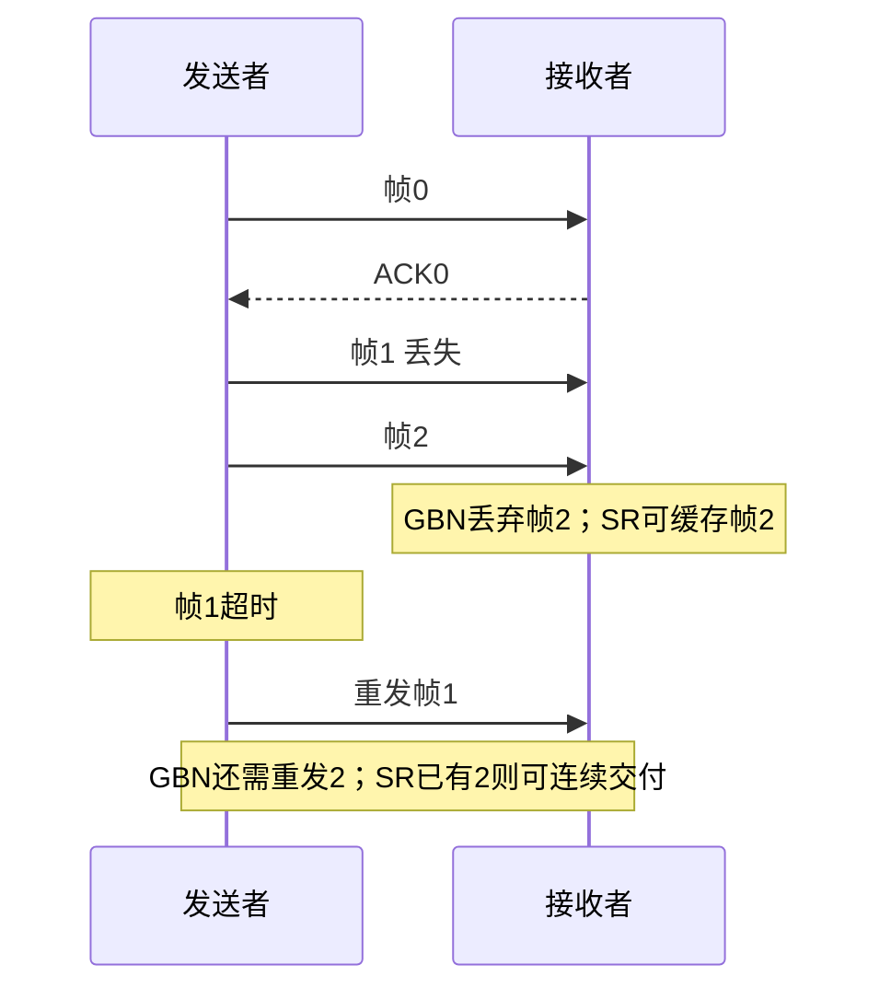
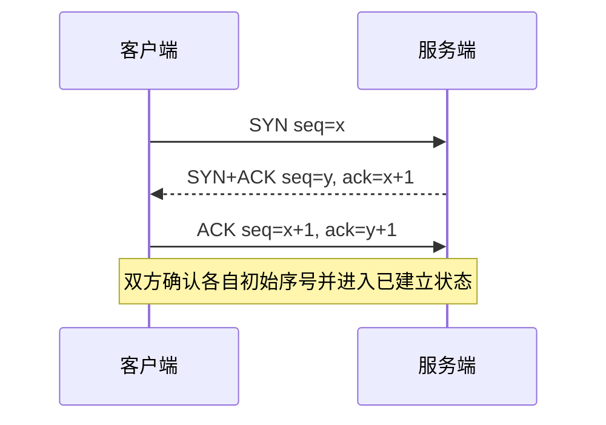
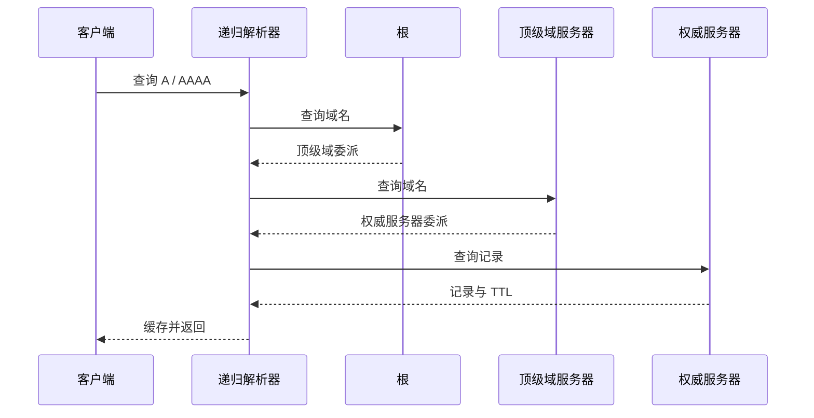

## 从点击链接到比特传输

网络课件按基础概念、物理层、数据链路层、网络层、传输层、应用层展开。学习时沿一条消息走：应用生成 HTTP 内容，传输层负责进程通信，网络层选路，链路层在一跳内传帧，物理层传信号。每层解决不同范围的问题，不能用“TCP可靠”代替应用事务，也不能用“有校验和”代替数据加密。

OSI 七层从下往上是物理、链路、网络、传输、会话、表示、应用。TCP/IP 常用链路、网际、传输、应用四层；教学五层模型把物理与链路分开。会话与表示相关职责通常由具体应用协议/库承担，而非现实网络里固定多出两层进程。



课件封装图中的 H4/H3/H2 是不同层添加的头，T2 是链路尾；大消息还可能被分段/分片，不能假设一条 HTTP 请求永远对应一个 TCP 段或一个以太网帧。路由器通常不会把流量交到 HTTP 应用再转发，而是处理到网络层并重新封装下一跳链路。

LAN 是局域网络，WAN 连接更广地域，MAN 常描述城域，接入网连接用户/组织到更大的网络。区别不只在物理距离，也涉及管理域、技术与拓扑。

### 服务模型与共同设计问题

面向连接服务先建立通信状态，之后沿该状态交换数据；无连接服务让每个数据报独立携带足够目的信息。是否面向连接，与是否可靠、有序不是完全同一维度；具体保证由协议定义。TCP 提供可靠有序字节流，IP/UDP 本身不保证最终交付。

每层会遇到寻址、错误检测/纠正、流量控制、多路复用/分用与路由。地址必须结合层次理解：MAC用于本地链路，IP用于网络接口/转发，端口帮助定位主机上的传输端点，URL定位应用资源。流量控制保护接收者，拥塞控制保护网络，后面还会专门区分。

## 物理层：速率为什么有上限

香农容量公式为 `C=B log₂(1+S/N)`，B 是带宽（Hz），S/N 是**线性功率比**，C 的单位是 bit/s。信噪比若为30 dB，应先换成 `10^(30/10)=1000`。B=3000 Hz 时容量约 `3000×log₂1001≈29.9 kbit/s`。这是理想编码可逼近的噪声信道上界，不等于某设备实测吞吐，还没扣协议开销。

带宽（频率范围）和日常说的网络“带宽”（bit/s）需按上下文区分。容量增加既可扩大 B，也可提高 S/N，但对 S/N 是对数收益；无限加大发射功率不能无代价换来任意速率。

### 有线与无线介质

双绞线利用成对扭绞降低外部干扰与串扰，成本低、布线方便，距离与频率受限；同轴线有中心导体、绝缘与屏蔽层，抗干扰较强；光纤用纤芯/包层约束光传播，支持大容量与长距离、不受电磁干扰，但连接与收发设备成本不同。

无线微波常具有方向性，路径遮挡与视距影响连接；红外适合短距、难穿墙，能减少跨房间干扰；卫星覆盖广，但轨道高度与路径长度会影响传播时延，不应把所有卫星都当成同一种固定延迟。

波长 λ 与频率 f 满足 `λf=v`，在真空/近似空气中 v≈c。较高频通常支持更宽频谱分配，但穿透、衍射与吸收还取决于材料、介质和天线，不能只背“频率高一定更远”。

### 复用：多人怎样共享一条介质

FDM 把频谱分成频带，各用户同时用不同带，需保护带避免干扰；TDM 把时间分片，用户轮流使用，固定时隙可能空闲浪费；WDM 在光纤中同时发送不同波长的光，概念上与光频率复用相关。统计复用则按当前需求分配，更适合突发流量，但需要排队和拥塞管理。

## 数据链路层：找边界、检测错误、控制在途数量

### 成帧的四种办法

字节计数在开头写长度，接收者据此读帧；若长度字段出错，可能失去后续帧边界。字节标志用特殊字节表示起止，正文若出现标志或转义符，发送者加转义，接收者去除。位填充用特殊位模式作为边界，例如常见的连续5个1后插0，避免正文伪装成边界。物理层编码违例则使用正常数据编码不会出现的信号模式表示边界。

错误检测如 CRC 可以发现常见传输错误，但不能保证修复，也不能防止主动篡改。检测到错帧后可丢弃，再由重传协议恢复；前向纠错则加入冗余让接收端修复一部分错误。这是不同机制。

### 停等与滑动窗口

停等一次只发一帧，等 ACK 再发下一帧。如果帧发送时间为 T，往返为 RTT，忽略 ACK 时间的利用率约 `T/(T+RTT)`；远距离高带宽链路上可能极低。滑动窗口允许最多 W 个未确认帧同时在途，把等待与发送重叠，ACK 到来后窗口前移。

课件第17页依次展示初始状态、发送第一帧、收到第一帧、收到确认；发送窗口和接收窗口由序号管理，而不是简单一个“已发数量”计数。序号循环使用，需要窗口大小限制避免旧帧与新帧混淆。

### Go-Back-N 与选择重传

Go-Back-N 的接收窗口为1，若帧2丢失，即使收到3、4也不按有序流提交，发送者超时后从2开始重发后续未确认帧。选择重传（Selective Repeat）允许缓存3、4并单独确认，之后只重发缺失2，重组后再按序交付。

课件18与19页是重复对比图，标题都写 Go-Back-N，但下半幅“缓存乱序帧”的行为是在解释选择性接收/重传的区别，不应把两者混为同一种严格 GBN 协议。k位序号空间2^k，经典 GBN 发送窗口至多2^k−1，经典 SR 发送/接收窗口通常各不超过2^(k−1)。



这个图中的 ACK0 表示“确认帧0”，TCP 后文的 ACK 则表示“下一个期望字节号”，不要混用记号约定。

## 网络层：路径、IP与跨网络转发

### 距离向量：邻居告诉我它到各处有多远

节点 J 保存到各目的的估计距离，周期性接收邻居的距离向量，按 Bellman-Ford 公式更新：`D_J(dest)=min_v(cost(J,v)+D_v(dest))`。只知道邻居提供的距离与下一跳，不要求存整个拓扑。

课件第21页 J 的邻居为 A/I/H/K，链路代价分别8/10/12/6。到 C 的候选为8+25=33、10+18=28、12+19=31、6+36=42，所以选 I，距离28。到 G 为26、41、18、37，选 H，距离18。到 L 为37、43、21、15，选 K，距离15。

| 目的 | A | B | C | D | E | F | G | H | I | J | K | L |
|---|---|---|---|---|---|---|---|---|---|---|---|---|
| J新距离 | 8 | 20 | 28 | 20 | 17 | 30 | 18 | 12 | 10 | 0 | 6 | 15 |
| 下一跳 | A | A | I | H | I | I | H | H | I | 本地 | K | K |

距离向量会遇到路由环和计数到无穷：链路断开后两个邻居可能误以为对方仍有路。分割地平线、毒性逆转与触发更新可缓解，但不是任何拓扑下一招完全解决。

### 链路状态：先交换局部拓扑，再本地计算最短路

每个路由器发现邻居并测量链路代价，发布带序列号和寿命的链路状态消息，经洪泛传播，形成相对一致的拓扑数据库，然后本地运行 Dijkstra。序列号区分新旧消息，寿命防止陈旧状态永久保留。

课件第22页 A连接B代价4、E代价5；B连C代价2、F代价6；C连D代价3、E代价1；D连F代价7；E连F代价8。由A出发：先确定A=0，再B=4、E=5；C可经B为6也可经E为6；D=9，F经B为10，优于经E的13。最短路不要求每条局部最短边都被选中，必须比较完整路径代价。

OSPF 是自治系统内的链路状态路由协议，区域结构用骨干区连接其他区域，区内路由器与区域边界路由器责任不同。BGP 在自治系统之间传播可达性与路径属性，以政策为核心，不只是“全球最短路径 Dijkstra”；AS_PATH 能帮助避免 AS级环路。

### 隧道

课件 IPv6 两端跨过 IPv4 网络：入口将完整 IPv6 包放进 IPv4 包的载荷，IPv4 中间路由只按外层头转发，出口去除外层后继续 IPv6 转发。封装增加头部开销，影响有效 MTU；隧道不自动等于加密，是否保密取决于额外协议。

## IPv4 报头、地址、子网与 NAT

### IPv4 头的字段逐项读

| 字段 | 含义与使用 |
|---|---|
| Version | 4表示IPv4 |
| IHL | 头长度，以32位字为单位；最小5即20字节 |
| DS 字段 | 服务区分/拥塞通知相关位，不能凭它保证网络一定优先转发 |
| Total Length | 包含头与载荷的总字节数 |
| Identification、Flags、Fragment Offset | 支持分片与重组；DF禁止分片，MF表示后面还有分片，偏移以8字节为单位 |
| TTL | 每经过路由转发减小，耗尽丢弃，防止无限环路 |
| Protocol | 指定上层，如TCP6、UDP17 |
| Header Checksum | 仅校验IPv4头，TTL变化后需更新 |
| Source/Destination | 32位源/目的IPv4地址 |
| Options/填充 | 可选信息并使头按32位对齐 |

课件图中 IHL 与 Total Length 不能互换，TTL 也不是精确倒计时秒表。IPv4允许某些路径分片，但现代设计常依赖路径MTU发现避免分片；IPv6路由器不执行IPv4式中途分片。[IPv4 原始报头规范](https://www.rfc-editor.org/rfc/rfc791.html)

### 有类地址是历史，CIDR 是现代前缀表示

课件A/B/C类按前导位划分网络与主机部分，D类对应组播，E类传统上保留；这是理解历史地址分配的图，不宜据此计算现在的路由。0/8、127/8等还有特殊用途，不能把图上范围全部当作普通主机可分配空间。

CIDR 用 `地址/前缀长度`，如192.168.8.0/24前24位是网络前缀，余8位为主机部分。掩码255.255.255.0。课件把192.168.8.0/24到192.168.15.0/24八个连续网段汇总为192.168.8.0/21，掩码255.255.248.0，覆盖第三字节8到15；汇总要前缀对齐，不能任意八个/24都这样合并。

普通/24有256个地址，传统广播子网常有254个可用主机地址（去网络与广播）；/31点对点和/32主机路由等例外不能照搬减2公式。按位 AND 可算网络号：192.168.10.37 AND 255.255.248.0 =192.168.8.0。

### SNAT 与 DNAT

SNAT 修改源地址，常把内网主机地址映射为公网出口；DNAT 修改目的地址，常用于端口转发到内部服务。课件10.0.0.1:5544→198.60.42.12:3344同时改源IP与端口，是常见的 NAPT/PAT。网关保存映射，回包据此送回原端点。NAT增加状态与端到端连接复杂度，它本身不等于防火墙规则或身份验证。

### ARP、RARP、DHCP

ARP 在本地链路询问“谁拥有这个 IPv4 地址”，得到下一跳的MAC。目标在别的子网时，要解析默认网关MAC，而不是跨互联网广播找最终服务器MAC。路由器每跳换链路头，端到端IP通常保留（NAT等例外）。IPv6使用邻居发现而不是IPv4 ARP。

RARP 是早期从硬件地址寻找协议地址的机制，如今配置获取一般用 BOOTP/DHCP 等替代。DHCP客户端通常 Discover→Offer→Request→ACK，获得有期限租约、地址、掩码、网关和DNS等；不需要用户先“登录DHCP服务器”。续租和冲突处理也是协议职责。

## 传输层：端口、UDP与TCP

传输实体在主机内把应用数据交给网络层，目标是端点/进程之间的通信。IP负责把包送到主机网络接口，端口帮助分用到服务。TCP连接通常由源IP、源端口、目的IP、目的端口区分，还要结合协议与网络命名空间等实际环境。

UDP头固定8字节：源端口、目的端口、长度、校验和各16位。UDP保留报文边界，没有TCP式握手、重传和按序字节流保证；应用可在其上自己增加可靠性。UDP校验覆盖伪首部与报文，IPv4/IPv6对校验和的要求存在差异，不能一概说UDP“没有校验”。

| 常用端口 | 服务 | 注意 |
|---|---|---|
| 20/21 | FTP数据/控制 | 主动/被动模式影响数据连接端口 |
| 22 | SSH | 安全远程登录 |
| 25 | SMTP | 主要用于邮件服务器传递，提交还有其他端口 |
| 80 / 443 | HTTP / HTTPS | 端口号只是约定，HTTPS还需要TLS等机制 |
| 110 / 143 | POP3 / IMAP | 明文协议端口与TLS封装端口不同 |
| 554 | RTSP | 原课件写543，是笔误 |
| 631 | IPP | 打印服务 |
| 53 | DNS | UDP与TCP都可用 |

RTSP的554注册可核对 [IANA 服务端口表](https://www.iana.org/assignments/service-names-port-numbers?search=rtsp)。

### TCP头：可靠字节流需要哪些状态

源/目的端口定位连接；Sequence Number 标识本段第一个数据字节序号；Acknowledgment Number 表示下一个期望收到的序号；Data Offset 给头长度；窗口字段通告接收缓冲空间；校验和检查头与数据及伪首部；URG配合紧急指针属于特殊历史机制；SYN、ACK、FIN、RST、PSH及拥塞相关标志控制连接与数据处理，Options可携带MSS、窗口扩大、SACK、时间戳等。

控制标志可逐个读：SYN用于同步初始序号，ACK表示确认字段有效，FIN表示本方向发送结束，RST请求重置/中止连接，PSH表达尽快将已接收数据推进应用的提示而不是应用消息边界，URG表示紧急指针有效；ECE用于显式拥塞通知回显，CWR表示发送方已作拥塞窗口响应。MSS协商对端愿意接收的最大TCP载荷段大小，不等于整个IP包MTU；窗口扩大选项放大接收窗口的表示范围，SACK能说明累计ACK之后还收到了哪些不连续字节块。

序号按字节推进，不按“第几个包”推进。若发送序号1000、载荷100字节，对方完整收到后可ACK1100。重传可能切分成不同大小的段，但同一字节仍占相同序号位置；SYN与FIN也各占一个序号。

### 三次握手为何是三个方向确认



第一次表达客户端初始序号，第二次既确认客户端又表达服务端初始序号，第三次确认服务端序号。过程帮助避免旧重复请求造成不恰当连接，并让双方确认双向通信状态；不应简化成“只验证双方能发能收”后就忽略序号同步。[TCP规范](https://www.rfc-editor.org/rfc/rfc9293.html#name-establishing-a-connection)

### 关闭、半关闭与状态机

TCP两个方向独立关闭：A发送FIN表示A不再发，B确认后仍可能继续发剩余数据，之后B也FIN，A再ACK，因此常画四次挥手；ACK与FIN可合并，也可能同时关闭，并非抓包必须恰好四个包。

主动关闭方常经 ESTABLISHED→FIN_WAIT_1→FIN_WAIT_2→TIME_WAIT→CLOSED；被动方经 ESTABLISHED→CLOSE_WAIT→LAST_ACK→CLOSED。CLOSE_WAIT长时间存在通常说明应用未完成关闭；TIME_WAIT使旧连接重复包有时间消失，并允许最终ACK丢失时对重发FIN再次确认，不能仅为减少数量随意取消。两方同时FIN可经过CLOSING。RST是中止连接，不等价于正常FIN握手。

### 流量控制与拥塞控制

接收窗口 rwnd 反映接收端缓冲容量；拥塞窗口 cwnd 反映发送端对网络可承受在途数据的估计，可发送在途量受两者共同限制。发送快过接收者属于流量控制问题，所有发送者把链路挤满属于拥塞问题。

课件曲线说明经典 Reno 风格：慢启动按每轮RTT大致倍增，达到ssthresh后转为加性增长；超时被视为较强拥塞信号，降低阈值并重新开始；重复ACK触发快速重传，快速恢复避免每次都回到最小窗口。所谓“慢启动”只是相对一开始猛发完整窗口，它的增长是指数型。现代TCP可用其他拥塞算法，不能把课件曲线当作所有连接唯一实现。

## 应用层：DNS、HTTP与浏览器请求链

### DNS 是分层名字数据库

域名从右到左由根、顶级域、下级域组成，区域（zone）是委派与管理边界，不一定等于一个完整子树。浏览器/系统缓存可直接回答；递归解析器若没有缓存，依次询问根、顶级域、权威服务器，拿到结果后按TTL缓存。课件以 robot.cs.washington.edu 展示多级委派，这不是要求每次查询都重复走完整链。



| 记录 | 用途 |
|---|---|
| SOA | 区域起始权威信息、序列号等参数 |
| A / AAAA | IPv4 / IPv6地址 |
| NS | 该区域的权威服务器 |
| CNAME | 一个名字别名指向另一名字，不直接携带IP |
| MX | 邮件交换服务器与优先级 |
| PTR | 反向名字映射，通常用于反向DNS域 |
| SRV | 服务的目标主机、端口、优先级和权重 |
| TXT | 文本数据，常承载验证及邮件策略 |

基础记录机制可核对 [DNS实现规范](https://www.rfc-editor.org/rfc/rfc1035.html)。课件单列 SPF 记录属于历史内容；现代 SPF 策略发布在 TXT 记录中，专用SPF RR类型已废弃。[SPF标准](https://www.rfc-editor.org/rfc/rfc7208.html#section-3.1)

### 点击一个 HTTPS 链接的完整过程

浏览器解析URL，检查缓存、策略与可能的重定向；需要时解析DNS；选择可用地址并建立传输。HTTP/1.1或HTTP/2常运行在TCP上，HTTPS还需TLS握手、证书验证与密钥协商；HTTP/3运行在QUIC上，QUIC以UDP承载并整合TLS1.3相关安全握手，不能说HTTP/3也必先走TCP三次握手。[HTTP/3标准](https://www.rfc-editor.org/rfc/rfc9114.html)

随后发送请求，服务端路由/读取数据/构造响应，浏览器解析HTML与CSS、执行允许的脚本、请求图片字体等子资源、构建布局并绘制。连接可能复用，资源来自不同域名时可能需要不同连接；浏览器显示内容可能逐步发生，而非全部资源下载后才开始。

课件的端口80与纯HTTP流程用于教学；真实HTTPS默认常见端口443，不能省略TLS就声称完整解释HTTPS。

### 短连接、持久连接、流水线与多路复用

课件43页(a)每次请求重建连接，增加握手成本；(b)复用连接但顺序等待响应；(c)HTTP/1.1流水线先连续发请求，响应仍按顺序返回，容易受前面慢请求阻塞。HTTP/2通过帧和流进行应用层多路复用，但一个TCP连接的丢包仍会影响其字节流交付；HTTP/3的QUIC不同流独立交付，避免这种跨流传输层队头阻塞，并不意味着没有共享拥塞、网络时延或应用阻塞。

### 方法与状态码

GET获取资源表示；HEAD返回相应头信息而无响应正文；POST请求资源按自身语义处理数据，不只是“追加网页”；PUT一般以请求表示创建/替换目标资源；DELETE请求删除目标关联；OPTIONS询问通信选项；CONNECT建立隧道；TRACE回显请求用于诊断，实际常禁用。幂等指重复相同请求的预期服务端效果相同，不保证响应码字节完全一致。[HTTP语义](https://www.rfc-editor.org/rfc/rfc9110.html)

1xx是临时信息，2xx成功，3xx重定向/缓存相关，4xx客户端侧请求问题，5xx服务端处理失败。200成功、201创建、204无正文、301永久移动、302临时重定向、304无需重传表示、400坏请求、401需要认证、403拒绝、404不存在、429限流、500内部失败、503暂不可用。304不是普通错误，也不携带一份新的完整正文。

### 消息头逐组解释

| 头 | 用途与注意 |
|---|---|
| Host | HTTP/1.1目标主机与可选端口，让同一IP承载多个站点 |
| User-Agent / Server | 声明客户端/服务器软件信息，不是可靠身份认证 |
| Accept / Accept-Language | 可接受媒体类型与语言 |
| Accept-Encoding / Content-Encoding | 可接受压缩算法 / 本响应实际编码，如gzip |
| Accept-Charset | 历史字符集协商头，现代浏览器通常不再发送 |
| Content-Type | 表示媒体类型及可选charset，区别于压缩编码 |
| Content-Length | 表示字节长度，不能用字符数代替 |
| Authorization | 携带认证凭据，必须配合安全传输与服务端校验 |
| Referer | 来源信息，拼写是协议历史名称，受隐私策略控制 |
| Cookie / Set-Cookie | 客户端发送cookie / 服务端设置cookie；属性影响作用域与发送条件 |
| ETag / If-None-Match | 表示版本标识 / 条件请求；匹配时可返回304 |
| Last-Modified / If-Modified-Since | 修改时间 / 基于时间的再验证 |
| Cache-Control / Expires | 缓存策略 / 绝对过期时间；no-cache要求再验证，no-store要求不存储 |
| Range / Content-Range / Accept-Ranges | 请求部分字节 / 描述返回范围 / 声明范围支持 |
| Location | 重定向目标或创建资源位置 |
| Date | 消息生成时间 |
| Upgrade | 某些HTTP/1.1连接协议升级协商，不能等同HTTP/2/3所有协商方式 |

HTTP/1.1文本消息用起始行、头、空行、可选正文组织；HTTP/2/3用二进制帧承载，不应把文本报文布局原封不动当成线上的HTTP/3格式。

## 可运行网络代码：TCP为什么需要应用层成帧

TCP只提供字节流：一次write可能对应多次read，多次write也可能被一次read得到。下面通过“4字节长度+UTF-8载荷”定义应用协议，在回环地址起一个临时端口服务器，客户端发送中文消息并读回。无需访问外网。

```java
import java.io.DataInputStream;
import java.io.DataOutputStream;
import java.io.IOException;
import java.net.InetAddress;
import java.net.InetSocketAddress;
import java.net.ServerSocket;
import java.net.Socket;
import java.nio.charset.StandardCharsets;
import java.util.concurrent.CompletableFuture;

public class TcpFrameDemo {
    static void send(DataOutputStream out, String text) throws IOException {
        byte[] bytes = text.getBytes(StandardCharsets.UTF_8);
        out.writeInt(bytes.length);
        out.write(bytes);
        out.flush();
    }
    static String receive(DataInputStream in) throws IOException {
        int size = in.readInt();
        if (size < 0 || size > 4096) throw new IOException("非法帧长度");
        byte[] bytes = new byte[size];
        in.readFully(bytes);
        return new String(bytes, StandardCharsets.UTF_8);
    }
    public static void main(String[] args) throws Exception {
        try (ServerSocket server = new ServerSocket()) {
            server.bind(new InetSocketAddress(InetAddress.getLoopbackAddress(), 0));
            CompletableFuture<Void> worker = CompletableFuture.runAsync(() -> {
                try (Socket peer = server.accept()) {
                    peer.setSoTimeout(3000);
                    DataInputStream in = new DataInputStream(peer.getInputStream());
                    DataOutputStream out = new DataOutputStream(peer.getOutputStream());
                    send(out, "收到：" + receive(in));
                } catch (IOException e) {
                    throw new java.io.UncheckedIOException(e);
                }
            });
            try (Socket client = new Socket()) {
                client.connect(new InetSocketAddress(
                    InetAddress.getLoopbackAddress(), server.getLocalPort()), 3000);
                client.setSoTimeout(3000);
                send(new DataOutputStream(client.getOutputStream()), "你好，TCP");
                System.out.println(receive(new DataInputStream(client.getInputStream())));
            }
            worker.get();
        }
    }
}
```

try-with-resources 在退出作用域时关闭 Socket/ServerSocket，包括异常路径；关闭socket也关闭关联流。端口0让OS选择空闲端口，getLocalPort取得实际值。connect超时针对连接建立，setSoTimeout针对阻塞读取，两者不是一个设置。

DataOutputStream.writeInt使用大端4字节整数，与readInt对应。UTF-8下中文常占多个字节，因此必须发送 bytes.length 而不是text.length。readFully循环读满指定长度或抛异常，普通read不保证一次读完。长度上限避免恶意声明巨大缓冲区。flush把包装流待发送字节推进底层，不等于远端应用已处理完成。

CompletableFuture.runAsync在异步任务里执行阻塞accept，返回的Future用于等待并观察异常；这里只是一个教学连接，生产服务器不会无限往公共线程池提交阻塞任务。UncheckedIOException把受检异常转换为Lambda允许抛出的运行时异常，worker.get会把任务失败呈现给主线程。

## 把故障定位到正确一层

DNS失败先检查名字、记录、缓存与委派；连接超时考虑路由、防火墙、服务监听和拥塞；TLS错误看证书、时间与协议；HTTP403看应用权限；页面部分空白看资源请求与脚本。端口能连通不代表HTTP业务正常，ping不通也不能单独证明HTTPS不可达。用每一层的证据逐层缩小范围。
