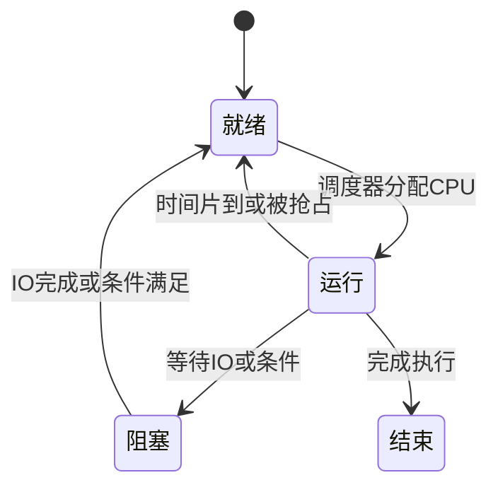
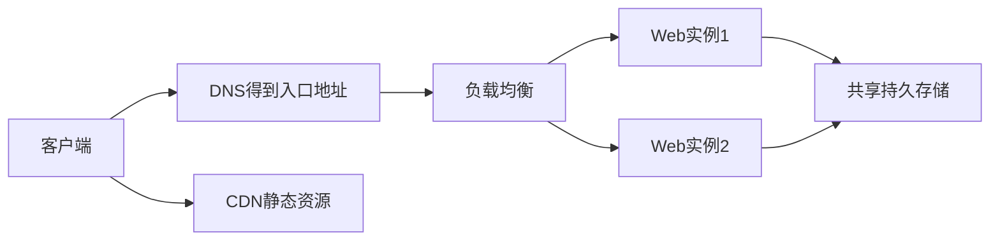
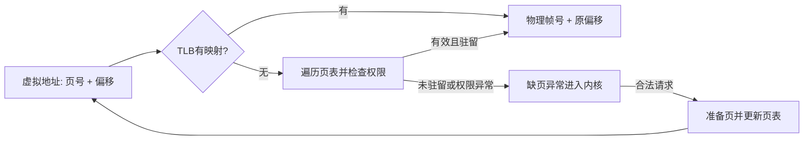

## 操作系统：资源管理与硬件抽象

操作系统管理CPU、内存、文件、设备与网络，把底层硬件包装成进程、虚拟地址空间、文件描述符、套接字等抽象。应用无需自行控制磁盘电机或分配物理内存帧，但仍要遵守系统调用与权限约束。

课件架构图分为用户模式与内核模式：Shell、GUI、应用及库运行在用户侧，系统调用进入内核，内核通过驱动访问设备。一次库函数不一定对应一次系统调用，例如用户态缓冲可能合并多个小写入；malloc/calloc也可能先从进程已有堆空间分配，不必每次向内核申请。

历史路线从真空管与穿孔卡片，发展到晶体管与批处理，再到集成电路、多道程序与分时。批处理追求减少人工间隔，分时追求多个用户的交互响应；现代Unix/Linux/macOS/Windows等通用系统与嵌入式、实时系统有不同目标。实时系统关心在截止时间前完成，不能简单等同于“平均很快”。分布式系统也不要求一定使用一种“分布式操作系统”，多个普通OS进程通过网络协作更常见。

## 进程、线程与上下文切换

程序是代码与静态数据，进程是程序运行中的资源与状态。一个文件可从未运行，也可同时启动多个进程，所以课件“一个程序至少一个进程”应理解为正在运行的实例，而非磁盘上的任意程序。

进程通常有独立虚拟地址空间、文件描述符等资源；线程是进程内的执行流，拥有自己的寄存器、程序计数器与栈，常共享进程的堆和全局数据。共享让通信方便，也使一个线程的错误可能影响整个进程。线程本身并不保证“实时性”，截止时间需要调度、负载和资源设计共同保证。

并发是在一段时间内推进多个任务；并行是在某一时刻多个执行单元同时运行。单核可用切换实现并发，不能同一时刻执行两个普通线程的指令。切换保存/恢复上下文，可能损失缓存/TLB局部性；进程切换还可能涉及地址空间切换，成本依系统与硬件而变。



就绪代表有资格运行但在等CPU；阻塞代表即使给CPU也无法推进。IO完成通常先回就绪，再等调度，不会保证立即运行。这里的三态模型是OS教学模型，与Java的六个Thread.State并非一一对应。

## 进程间通信与线程同步

### 通信工具如何选择

| 机制 | 通信内容与范围 | 关键约束 |
|---|---|---|
| 匿名管道 | 本机字节流，常经父子进程继承文件描述符 | 没有应用消息边界；需定义协议、处理关闭与背压 |
| 命名管道 FIFO | 通过文件系统名字让无亲缘进程访问 | 名字不意味着数据永久保存 |
| 信号 signal | 通知事件，如终止请求或子进程状态 | 不适合大块数据；信号处理上下文有严格限制 |
| 消息队列 | 以消息为单位排队传递 | 队列容量、权限、阻塞/非阻塞语义需定义 |
| 共享内存 | 多进程映射同一存储 | 少复制但必须额外同步，普通读写不能自动保证协议 |
| 信号量 semaphore | 计数许可，主要用于协调 | 不是传业务内容的消息通道 |
| Socket | 本地或跨机器的端点通信 | 网络会延迟、断开、重复重试，需应用协议 |

课件“消息队列就是链表”是实现示意，不是接口必然形式；“共享内存最有用”也依场景而定。共享内存避免重复拷贝不代表不用锁，多个进程更新同一队列索引仍可能竞态。匿名管道常用于亲缘进程，但在支持描述符传递的系统也可由其他方式共享，不能把亲缘关系当作绝对定理。

### 互斥、信号量、条件变量

互斥量保护一个不变量，任意时刻只有持有锁的线程进入相应临界区；所有访问者必须遵守同一协议。信号量保存许可数量，P/acquire申请许可，无许可时等待；V/release归还许可。初值1可表达某些互斥场景，初值N控制最多N个并发使用者，但信号量通常没有互斥锁那种严格线程所有权语义。

条件变量表达“等待共享状态满足条件”。wait/notify或Condition.await/signal必须配合锁和谓词；通知不会累积成永久事件计数，也不保证公平或高优先级者先运行。课件把wait/notify说成比较线程优先级的工具不准确。

自旋锁在忙循环中重复尝试获取资源，适合非常短的临界区与持锁者有机会运行的情况；长等待会浪费CPU。管程（monitor）把共享状态、受保护操作和条件等待集中在一个模块里，减少分散P/V调用导致的错误。会合（rendezvous）要求发送者和接收者在交接时同步到达，可类比Java的SynchronousQueue；不是所有直接RPC都等于这种严格会合语义。

### 可运行：有界缓冲区的管程

生产者最多领先消费者capacity项。队满时生产者等待notFull，队空时消费者等待notEmpty。所有修改都在同一把锁里；await会原子释放锁并等待，返回之前重新获取锁。

```java
import java.util.ArrayDeque;
import java.util.Deque;
import java.util.concurrent.locks.Condition;
import java.util.concurrent.locks.ReentrantLock;

public class BufferDemo {
    static final class Buffer<T> {
        private final Deque<T> queue = new ArrayDeque<>();
        private final int capacity;
        private final ReentrantLock lock = new ReentrantLock();
        private final Condition notEmpty = lock.newCondition();
        private final Condition notFull = lock.newCondition();
        Buffer(int capacity) {
            if (capacity <= 0) throw new IllegalArgumentException("capacity");
            this.capacity = capacity;
        }
        void put(T value) throws InterruptedException {
            lock.lockInterruptibly();
            try {
                while (queue.size() == capacity) notFull.await();
                queue.addLast(value);
                notEmpty.signal();
            } finally {
                lock.unlock();
            }
        }
        T take() throws InterruptedException {
            lock.lockInterruptibly();
            try {
                while (queue.isEmpty()) notEmpty.await();
                T value = queue.removeFirst();
                notFull.signal();
                return value;
            } finally {
                lock.unlock();
            }
        }
    }
    public static void main(String[] args) throws InterruptedException {
        Buffer<Integer> buffer = new Buffer<>(2);
        Thread producer = new Thread(() -> {
            try {
                for (int i = 1; i <= 5; i++) buffer.put(i);
            } catch (InterruptedException e) {
                Thread.currentThread().interrupt();
            }
        });
        producer.start();
        for (int i = 0; i < 5; i++) System.out.println(buffer.take());
        producer.join();
    }
}
```

`<T>` 让同一个缓冲区实现支持多种元素类型，不能在T位置直接写基本类型int，使用Integer。Deque提供头尾操作，此处addLast/removeFirst形成FIFO。lockInterruptibly在等锁时可被中断；只有成功取得锁后才进入try，因此finally不会错误释放未持有的锁。

while不能改if：可能虚假唤醒，也可能唤醒后被别人先拿走元素。signal唤醒一个等待相应条件的线程，释放锁后它才有机会继续。一个Condition的signal不唤醒另一个Condition的等待者。catch中恢复中断标志，让更高层知道任务曾被请求取消；生产代码还需定义关闭协议以免生产者异常后消费者永远等待。本演示main精确消费5项，并join验证生产者结束。[Condition契约](https://docs.oracle.com/en/java/javase/21/docs/api/java.base/java/util/concurrent/locks/Condition.html)

## CPU调度：优化目标不同，算法就不同

FCFS按到达顺序非抢占执行，简单但长任务挡住短任务形成护航效应。SJF按已知CPU burst最短优先，在特定同时到达且非抢占等假设下最小化平均等待，但实际很难精确预知下一段运行时间；抢占版本常称最短剩余时间优先。

优先级调度可抢占或不抢占，低优先级任务可能饥饿；老化让等待越久的任务逐渐提高优先级。时间片轮转把未完成任务放回队尾，时间片太大近似FCFS，太小则切换开销大。多级队列按任务类别分固定队列；多级反馈队列允许任务移动，耗CPU多的下调，长时间等待可提升，交互任务因经常短时运行更易获得快速响应。

### 用数字比较等待与响应

三个任务同时在t=0到达，运行时间A=8、B=4、C=2。

| 策略 | 执行顺序/片段 | 等待时间(A,B,C) | 平均等待 |
|---|---|---|---|
| FCFS | A:0–8，B:8–12，C:12–14 | 0,8,12 | 6.67 |
| SJF | C:0–2，B:2–6，A:6–14 | 6,2,0 | 2.67 |
| RR，片长2 | A,B,C,A,B,A,A | 6,6,4 | 5.33 |

RR完成时刻A=14、B=10、C=6，等待=完成−到达−运行时长。首次响应则A=0、B=2、C=4，比FCFS中C等12才开始更好。一个算法平均等待较低，不表示公平、响应、截止时间和吞吐都同时最优。

## 从单机同步到分布式协作

不同机器通常不能直接对同一CPU内存位置执行原子指令，因此需要数据库条件写、协调服务或消息协议建立跨节点顺序。说“信号量不能用于分布式系统”过于绝对：本地内存信号量不能原样跨机器，但可以用协议实现分布式许可服务，代价是网络与故障处理。

同步RPC让调用者等待结果，gRPC也支持异步/流式API，不能按产品名称断言所有调用都同步。异步消息队列/日志让生产者先写入可交付的事件，再由消费者处理；要考虑确认、重试、重复、顺序、积压和幂等。网络超时意味着“不知道对方是否完成”，不是“对方肯定没执行”。

分布式锁通常需要所有权令牌、租约超时与续约；旧持有者暂停后恢复可能已经失去锁，单靠它自认有锁仍会写坏数据。fencing token让被保护的存储拒绝旧代次写入。Redis或数据库是实现工具，不自动把一行SET命令变成所有故障下正确的互斥。

### 分布式Web服务请求路径

课件图中DNS给出负载分配器地址，客户端建立连接，分配器选择后端，后端返回文档；图里改目的IP/源IP展示NAT式负载均衡的一种实现。反向代理、直返等也有不同数据路径，不能假定所有LB都改相同字段。



高可用需要入口、实例与存储各层故障策略，CDN降低静态内容回源，流式传输允许数据逐步交付但也占用连接与缓冲。它们是可选工具，不是每个小站都必须拥有的清单。

### MapReduce：Map、Shuffle、Reduce缺一不可

课件引用Google于2004年的模型，Hadoop是常见开源实现。Map处理输入并生成中间键值对；Shuffle按键分区、传输和分组；Reduce合并同键的值。运行框架负责分配任务、重试故障和通信。[Google原始论文](https://research.google/pubs/mapreduce-simplified-data-processing-on-large-clusters/)

词频例：输入两行“red blue”“red green”。Map输出(red,1),(blue,1),(red,1),(green,1)；Shuffle聚为red→[1,1]、blue→[1]、green→[1]；Reduce求和得到red2、blue1、green1。相同key必须路由到同一逻辑归约组。可选combiner在本地先聚合，只有适合重复/分组组合的运算才能安全使用，不能把平均值直接逐组平均而忽略组大小。

框架任务重试意味着外部副作用可能重复，不能在map里不加幂等地发送付款请求；热点key会让一个reducer成为瓶颈。MapReduce是批处理模型，不能因为有map/reduce两个函数就忽略分布式shuffle与容错。

## 死锁：一个线程没动不一定就是死锁

死锁是一组任务相互等待，且在不改变资源分配或中止任务的情况下谁都无法前进。饥饿是一直拿不到资源，但其他任务仍在推进；活锁是持续改变状态/重试却没有有用进展；普通长IO等待也不必然有环。

四个必要条件是：互斥资源、占有并等待、不可强制抢占资源、循环等待。这里“非抢占”指相关资源不能安全强行收回，不是说OS不能切走CPU线程。对多实例资源，图中有环是必要但未必充分条件；每种资源一个实例时等待环更直接指向死锁。[操作系统教材：并发错误](https://pages.cs.wisc.edu/~remzi/OSTEP/threads-deadlock.pdf)


### 预防：破坏必要条件

允许共享可共享资源可以破坏互斥，但打印机操作、余额更新不能总是共享。一次申请全部资源破坏占有并等待，却需要预知需求并降低利用率。获取新资源失败先释放旧资源是另一策略，但必须能回滚到一致状态；反复互让可能造成活锁。对所有锁定义全局顺序并始终按序申请可破坏循环等待，是常用方案。

例如账户转账A→B与B→A都先锁ID较小账户，再锁ID较大账户。这样等待边始终从较小编号指向较大编号，不可能绕回起点。若存在同ID不同对象，仍需额外稳定次序/唯一性约束。超时tryLock可以避免无限等待，但超时后的回滚与重试协议仍要正确。

### 避免：银行家算法检查“分配后是否仍安全”

预防从规则上排除某条件；避免根据当前状态与最大需求决定是否批准本次请求。安全状态是存在一个顺序，使每个进程都能在其他进程完成释放资源后获得剩余所需。**不安全不等于已经死锁**，只是无法保证所有声明最大需求都能完成。

定义Available[j]是当前空闲数，Allocation[i][j]是已给进程i的数量，Max[i][j]是其声明上限，Need=Max−Allocation。检查时复制Work=Available，找一个未完成且Need≤Work的进程，假定它完成并归还Allocation，继续直到全部完成或无法前进。

例：单类资源共10个，P0已分2最多4，P1已分3最多6，P2已分2最多4，空闲3。剩余Need为2、3、2。可让P0先完成，Work从3增到5；再P1，增到8；再P2，增到10，所以安全。若初始时P1额外请求2，分配后Available=1，各剩余Need为2、1、2，仍可先让P1完成，所以这次请求可以安全通过。若某状态所有Need都大于Work，就不能批准导致该状态的试探分配。

### 可运行的多资源安全序列检测

```java
import java.util.ArrayList;
import java.util.Arrays;
import java.util.List;

public class BankerDemo {
    static List<Integer> safeSequence(int[] available, int[][] allocation, int[][] max) {
        int n = allocation.length;
        int m = available.length;
        int[] work = available.clone();
        boolean[] finished = new boolean[n];
        List<Integer> order = new ArrayList<>();
        while (order.size() < n) {
            boolean progress = false;
            for (int i = 0; i < n; i++) {
                if (finished[i]) continue;
                boolean enough = true;
                for (int j = 0; j < m; j++) {
                    if (max[i][j] - allocation[i][j] > work[j]) {
                        enough = false;
                        break;
                    }
                }
                if (enough) {
                    for (int j = 0; j < m; j++) work[j] += allocation[i][j];
                    finished[i] = true;
                    order.add(i);
                    progress = true;
                }
            }
            if (!progress) return List.of();
        }
        return order;
    }
    public static void main(String[] args) {
        int[] available = {3, 3, 2};
        int[][] allocation = {{0,1,0},{2,0,0},{3,0,2},{2,1,1},{0,0,2}};
        int[][] max = {{7,5,3},{3,2,2},{9,0,2},{2,2,2},{4,3,3}};
        System.out.println(safeSequence(available, allocation, max)); // [1,3,4,0,2]
        System.out.println(Arrays.toString(available)); // 原数组仍为 [3,3,2]
    }
}
```

available.clone复制一维基本类型数组，避免安全性模拟改掉真实空闲数量；二维数组clone只复制外层，但本程序只读allocation/max。逐资源比较是分量≤，不能把总资源数相加比较：空闲CPU不能替代缺少的打印机。完成假设只归还当前Allocation，因为Work先“借出Need又收回Max”的净变化正好为Allocation。

progress避免无法前进时无限循环；空列表在非空进程集合下表示不安全。本示例假设矩阵维度合法、Max≥Allocation、数据非负；真实接口应校验。最坏扫描O(n²m)，额外O(n+m)。处理新请求还要先检查Request≤Need、Request≤Available，再试分配并调用此检测，失败回滚。

## 内存管理：分段、分页与虚拟地址

### 分段：按逻辑模块形成可变长区域

程序可分代码、数据、栈等段，逻辑地址可表示为(段号,段内偏移)，段表保存基址、界限与权限；检查offset<limit后物理地址=base+offset。每段可以独立保护/共享，符合程序的逻辑结构。

段长可变，释放与重新分配后容易出现外部碎片：总空闲8KB，可能被分成3KB与5KB，装不下需要连续6KB的段。课件23—26页把游戏、文字处理、表格、演示等彩色块放入物理内存，随后换出部分块到swap，留下不连续空洞，再为游戏寻找空间，正是在说明这一问题。

抽象模型中段按所需大小分配可减少内部碎片，但实际对齐与分配器粒度仍可能产生浪费，不能绝对说“现实分段完全没有内碎片”。压缩可把散落段移动合并空闲区，代价是复制与地址重定位。

### 分页：固定大小的页映射到不连续帧

虚拟地址空间分固定大小page，物理内存分同大小frame，页表记录对应关系。一个程序的连续虚拟页可以落到不连续物理帧。课件27—28页的Page Table就承担这张映射表，彩色小格交错也不会破坏程序看到的连续地址。

若页大小4KB=2^12，虚拟地址0x12345的页号为0x12、偏移为0x345；若页表把页0x12映到帧0xA，物理地址为0xA000+0x345=0xA345。页号变化时重新查映射，页内偏移保持不变。



固定页大小消除该分配粒度下的外部碎片，最后一页可能用不满形成内部碎片。现实系统申请多个连续帧、巨大页等仍可遇到物理碎片，因此不要扩大成“有分页就不存在任何碎片”。分页也支持页级权限、共享只读代码与共享内存，课件“页的保护和共享受限”应相对段的逻辑语义理解，而非说分页无法共享。

TLB缓存虚拟到物理的映射，TLB miss只是需要进一步查页表，不一定发生缺页或磁盘IO。页表项包含驻留/有效性、读写执行权限、访问/脏位等；多级页表节省稀疏地址空间的表空间，硬件和内核共同管理。[Linux页表与MMU文档](https://docs.kernel.org/mm/page_tables.html)

### 虚拟内存不只是把硬盘当内存

虚拟内存首先提供地址隔离、保护、灵活映射与按需分配。只把当前工作集放在物理内存，其他内容可从文件、swap或按需零填充恢复，使进程虚拟空间可以大于物理内存；没有swap也仍能使用虚拟内存。

访问未驻留但合法的页触发缺页，内核分配/选出帧，必要时写回脏页并读入目标，更新映射后重新执行指令。访问非法地址或违反权限则可能终止进程。写时复制也会合法触发缺页，不能把所有page fault都当错误。

多进程共享内存时可把不同虚拟地址映射到同一物理帧；因此“进程独立地址空间”不意味着永远不共享物理内存。工作集总和超过物理能力时频繁换入换出产生抖动（thrashing），CPU忙着等IO而有效吞吐下降，加更多进程可能更慢。

## 页面置换：满了以后换出谁

FIFO淘汰最早进入的页，容易实现但不考虑最近使用；LRU淘汰最长时间没访问的页；LFU淘汰累计访问次数最少者，需要老化或时间窗口防止旧热点永远占据；OPT淘汰未来最晚才再访问的页，现实不知道未来，适合作为理论下界。

完整精确LRU每次访问都更新次序，对OS而言成本高，实际常使用访问位、Clock等近似。应用缓存的LinkedHashMap实现LRU与内核的页面置换机制不是同一份实现。

### 三个帧手算FIFO与LRU

访问序列1,2,3,1,4,2,5，表内顺序表示FIFO从最早到最新，或LRU从最久未用到最近用：

| 访问 | FIFO内容 | FIFO结果 | LRU内容 | LRU结果 |
|---|---|---|---|---|
| 1 | 1 | 缺页 | 1 | 缺页 |
| 2 | 1,2 | 缺页 | 1,2 | 缺页 |
| 3 | 1,2,3 | 缺页 | 1,2,3 | 缺页 |
| 1 | 1,2,3 | 命中，不改入队时间 | 2,3,1 | 命中，1移到最近 |
| 4 | 2,3,4 | 换出1 | 3,1,4 | 换出2 |
| 2 | 2,3,4 | 命中 | 1,4,2 | 换出3 |
| 5 | 3,4,5 | 换出2 | 4,2,5 | 换出1 |

这组访问FIFO缺页5次、LRU6次，说明LRU并非对每一个序列都优于FIFO。FIFO还可能出现Belady异常：增加帧反而更多缺页；LRU作为栈算法不出现这种异常。OPT在这组序列中第5次访问4时可淘汰今后不再用的1或3，保留2，故总缺页为5。

### 可运行的LRU页缓存模拟

```java
import java.util.LinkedHashMap;
import java.util.Map;

public class PageReplacementDemo {
    static final class LruPages extends LinkedHashMap<Integer, Boolean> {
        private final int capacity;
        LruPages(int capacity) {
            super(16, 0.75f, true);
            this.capacity = capacity;
        }
        @Override protected boolean removeEldestEntry(Map.Entry<Integer, Boolean> eldest) {
            return size() > capacity;
        }
    }
    public static void main(String[] args) {
        LruPages pages = new LruPages(3);
        int misses = 0;
        for (int page : new int[]{1,2,3,1,4,2,5}) {
            boolean hit = pages.get(page) != null;
            if (!hit) { misses++; pages.put(page, Boolean.TRUE); }
            System.out.println(page + " " + (hit ? "hit " : "miss ") + pages.keySet());
        }
        System.out.println("misses=" + misses); // 6
    }
}
```

LinkedHashMap构造器第三参数true启用访问顺序；get成功会把该项移到最近访问端，containsKey不会起到同样的顺序更新作用。removeEldestEntry在插入后被框架调用，size超过容量才淘汰最旧项。`0.75f` 的f明确float字面量，匹配构造器负载因子参数。Boolean.TRUE用作存在标记，所以null表示未命中；若允许存null值就不能这样区分。这里继承标准容器是利用明确的受保护扩展点，生产中也可封装容器以收窄暴露接口。

## 用一条业务请求串起整门课

Web请求进来时，内核处理网络包，服务线程被唤醒进入就绪队列，调度后解析请求；线程访问共享缓存需要同步，访问内存需要页表映射，缺页时可能阻塞；发RPC遇到超时不能断定对方没执行；拿多把锁要防死锁；分配大量对象会给GC和虚拟内存共同施压。操作系统、Java与网络不是各自独立的背诵清单，而是同一次执行的不同观察层。
